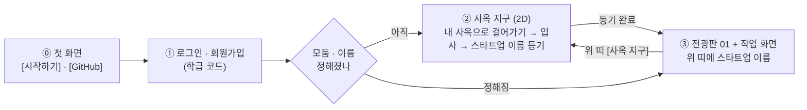
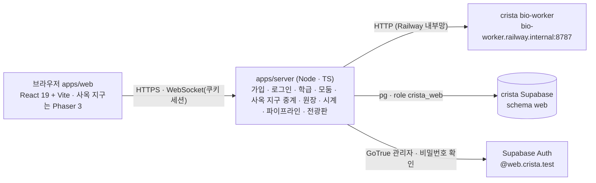

# crista-web 설계 — 신약 개발 파이프라인 플랫폼 (2026-10-23)

> **상태**: 설계안(구현 전) · 2판(같은 날 사용자 지시 반영).
> **사용자 결정(2026-10-23)**
> 1. 새 저장소 `~/Desktop/repo/crista-web`, GitHub 비공개(`mulkib0/crista-web`).
> 2. 연결 방식 **(가)** — 이 저장소는 화면 + 작은 서버만 갖고, 계산은 crista 의 bio-worker 를 HTTP 로 부르며 판정 규칙은 crista 에서 가져온다.
> 3. DB 는 **지금 crista Supabase 프로젝트를 같이 쓰되 게임과 겹치지 않게**.
> 4. **화면 흐름**(2판): ① 학생 **로그인 · 회원가입** → ② 교사가 정한 **N개 모둠의 서로 다른 사옥이 2D 로 보이는 사옥 지구**(지금 crista 처럼) — 자기 사옥에 걸어가 **스타트업 이름을 정한다**
>    → ③ 이름이 정해지면 **전광판 시안 01** 화면. 그 화면 어딘가에 **스타트업 이름이 늘 보인다**.
> 5. **UI/UX = 전광판 시안 01 'LED 흐르는 띠'** — 바탕은 05 '4단계 로드맵'(박막 톤 · 4묶음 사이드바 1.~4. · 분할 본문) 위에 검은 LED 띠 전광판.
>    시안: [`design/pipeline-board-30-variants.html`](../design/pipeline-board-30-variants.html)(01 = 첫 항목) · [게시본](https://claude.ai/artifact/GETqFjoHDn8sYqkoqaWA7a) · 바탕 05 [`design/pipeline-lab-30-variants.html`](../design/pipeline-lab-30-variants.html).
>
> **앞선 초안**: crista 안에 '랩 화면'을 붙이는 설계([`history/2026-10-23-pipeline-lab-in-crista-draft.md`](history/2026-10-23-pipeline-lab-in-crista-draft.md)) — 단계 상태 · 넘기기 · 리드 최적화 · 연구 노트 · 결함 4건을 이 문서로 옮겼다.
> Gemini 4 Argon (High) · GPT-6-Astra (xhigh) 교차 의견 원문은 [`.review/2026-10-23-pipeline-lab/`](../.review/2026-10-23-pipeline-lab/).

---

## 0. 한눈에

| 항목 | 결정 |
| --- | --- |
| 무엇 | 브라우저에서 모둠(스타트업 제약회사)이 **실제 계산으로 신약 개발 파이프라인을 처음부터 허가까지** 밟는 수업 플랫폼 |
| 화면 ① | **로그인 · 회원가입** — 학생은 교사가 준 **학급 코드**로 스스로 가입한다(서버가 대신 계정을 만든다 — §6.3) |
| 화면 ② | **사옥 지구** — crista 의 06 픽셀 타이쿤 그림으로 N개 사옥이 있는 작은 2D 거리. 아바타로 걸어가 문 앞에서 **입사 · 스타트업 이름 등기** |
| 화면 ③ | **전광판 01 + 05 작업 화면** — 위 띠(스타트업 이름 · 티커 · 순위 · 연구비 · 날짜) → **LED 흐르는 띠**(다른 모둠 소식) → 왼쪽 사이드바 1.~4.(하위 1.1~4.2) · 오른쪽 작업 영역 |
| 경쟁 | LED 띠가 다른 모둠의 기업가치 등락 · 특허 · 단계 통과 · 실패 · 허가를 흘려보낸다. 항목을 누르면 그 모둠의 공개 정보 서랍. 사옥 지구의 건물도 성과에 따라 자란다 |
| 계산 | crista **bio-worker 그대로** — Open Targets · ChEMBL 데이터셋, RDKit → Meeko → Vina 1.2.7 → PLIP, ADMET-AI v2, RDKit 물성, 애널리스트 문구 |
| 규칙 · 그림 | crista `shared-types` · `game-rules` 사본(e911572) + crista 에셋 사본(아틀라스 · 목록 · Galmuri) |
| 서버 | 이 저장소의 Node 서버 하나(HTTP + WebSocket + 정적 파일) — Railway 의 crista 프로젝트에 새 서비스(워커가 내부망 전용이라) |
| DB · 계정 | crista Supabase 의 **`web` 스키마 + 전용 역할 `crista_web`** · 웹 계정 이메일 도메인 **`web.crista.test`**(게임 `students.crista.test`) |

---

## 1. 무엇을 살리고 무엇을 버리나

### 1.1 그대로 쓰는 것(crista 에서)

| 자산 | 어떻게 | 근거 |
| --- | --- | --- |
| bio-worker `POST /jobs` · `GET /jobs/{id}` | 이 서버가 작업을 내고 진행을 받아 온다. 요청 모양은 `WorkerJobRequest`(shared-types) 그대로 | crista `apps/bio-worker/app/main.py` |
| bio-worker `POST /molecule/properties` | 무료 물성 미리보기 · 특허 출원 물성 | 같은 RDKit 판이라 숫자가 판정과 같다 |
| bio-worker `/datasets/summary · targets · compounds` | 1.1 표적 · 1.2 스크리닝의 원자료 | Open Targets v4(480 유전자) · ChEMBL 220종 |
| bio-worker `/llm/analyst` | 전광판 헤드라인('AI 생성' 표시, 실패면 규칙 문구) | crista M4 |
| `packages/shared-types` | `DOCKING_TARGETS`(표적 4종 · `referenceKcal`) · `TRIAL_OPTIONS` · `DISEASE_TO_TARGET` · `MoleculeProperties` · `ExperimentResult` · 워커 규격 | 사본 — [`packages/SOURCE.md`](../packages/SOURCE.md) |
| `packages/game-rules` | `pipeline/score.ts`(효능 E · 안전 S · 물성 신호) · `pipeline/rules.ts` · `flow.ts` · `market/analyst.ts`(`ANALYST_BANDS`) · `market/board.ts`(`rankMarketCap` · `changePct24h`) · `clock.ts` | 사본 |
| crista 06 픽셀 에셋 | 사옥 `hq-t1`(설립 직후) · `hq-t2`(Series A 이후) · `hq-t3`(블록버스터) 96×96, 캐릭터 CEO · CSO · CTO · CMO 걷기 32×48 × 4방향, 바닥 타일, Galmuri 글꼴(OFL) | 사본 — `assets/crista/`(자체 생성기 산출물 · `CREDITS.md`) |
| 균형안 수치 | 초기 연구비 $6.000M · HTVS · 도킹 · ADMET $0.050M · 특허 $0.050M · IND · 허가 $0.100M · 임상 $0.300M / $0.600M / $1.200M · 기간 30 / 90 / 180 / 360 / 60게임 일 · Series A $3.000M · B $5.000M | crista `docs/2026-10-19-game-balance-v0.md` §3 · §10 |

### 1.2 버리는 것

crista 의 큰 도시 · 기관 건물 · NPC · 객장 현장 매매 · 서버 권위 이동 · Colyseus 룸. 사옥 지구(§3)는 **이름을 정하고 서로의 사옥을 보는 작은 거리**일 뿐, 실험 · 신청을 하러 걸어가는 곳이 아니다.

### 1.3 다시 만드는 것(이 저장소)

학급 · 모둠 · 계정(가입 · 로그인), 사옥 지구(2D · 접속 표시), 연구비 원장, 학급 게임 시계, 작업 오케스트레이션(워커 호출 · 진행 · 과금 · 환급), 파이프라인 상태 기계, 전광판 · 기업가치, 교사 화면.
crista 게임 서버 코드는 **읽고 옮겨 쓰되**(예: `jobs/service.ts` 의 과금 · 환급 · 멱등, `pipeline/service.ts` 의 단계 판정) 의존하지 않는다.

---

## 2. 화면 흐름



- ⓪ 첫 화면(`/crista/`)은 히어로 변주판 20.02 '박막 무지개' 장면 위에 CRISTA 워드마크와 [시작하기] · [GitHub] 만 둔다. [시작하기] 는 ① 로그인(`/crista/login`, 학생 · 교사 같은 화면)으로, 세션이 있으면 다음 화면으로 바로 간다. [GitHub] 는 저장소를 새 탭으로 연다.
- 처음 들어온 학생: ① → ② → ③. 다음부터는 ① → ③ 으로 바로 간다(모둠 · 이름이 정해졌으므로). ③ 위 띠의 **[사옥 지구]** 로 언제든 ② 에 가서 다른 모둠 사옥을 본다.
- 같은 모둠의 다른 학생이 먼저 이름을 정했으면, 나중에 온 학생은 ② 에서 이미 간판이 걸린 자기 사옥에 들어가 바로 ③ 으로 간다.
- 서버가 판정하는 것은 **입사 · 이름 등기 · 파이프라인 행동**뿐이다. 사옥 지구의 걷기는 화면 경험이다(사옥 앞에 있어야 한다는 서버 규칙은 두지 않는다 — 경쟁 요소가 아니다).

---

## 3. 화면 ① 로그인 · 회원가입

| 칸 | 내용 |
| --- | --- |
| 로그인 | 아이디 · 비밀번호 → [들어가기]. 실패 · 잠금(5회 실패 → 1분) 안내 |
| 회원가입(학생) | **학급 코드**(교사가 알려 줌, 6자) · 아이디(영문 소문자 · 숫자 3~20자) · 이름(화면 표시용, 실명 대신 별명 가능) · 비밀번호(8자 이상) · 비밀번호 확인 → [가입하고 들어가기] |
| 교사 | 공개 가입 없음. 첫 교사 계정은 관리 스크립트(`npm run teacher:create`)로 만들고, 교사 화면에서 학급을 만든다(§9) |
| 모양 | 05/01 박막 톤의 표제(CRISTA · 파이프라인 랩) + 아래에 crista 픽셀 사옥이 늘어선 한 줄(② 로 이어지는 예고). 시각은 UI 프리뷰가 정한다 |

- 가입은 **서버가 대신 만든다**: 서버가 학급 코드를 확인한 뒤 GoTrue 관리자 API 로 `<아이디>@web.crista.test` 계정을 만들고(`email_confirm: true`) `web.members` 에 학생으로 넣는다.
  Supabase 프로젝트의 공개 가입 설정(`enable_signup`)은 **건드리지 않는다** — 게임과 같은 프로젝트라 프로젝트 설정을 바꾸면 게임에도 걸린다(§7.1).
- 로그인도 서버가 GoTrue 로 확인하고 **HttpOnly 쿠키 세션**을 준다(토큰을 브라우저 스크립트에 두지 않는다). WebSocket 도 같은 쿠키로 인증.
- 남용 방지: 가입은 IP · 학급 코드마다 분당 상한, 학급 코드는 교사가 다시 만들거나 닫을 수 있다(학급 정원 초과 · 닫힌 코드는 거절).

---

## 4. 화면 ② 사옥 지구 — N개의 서로 다른 사옥

### 4.1 무엇이 보이나

- 교사가 학급을 만들 때 정한 **모둠 수 N(2~8)** 만큼 사옥 부지가 광장을 둘러싼 작은 거리(약 40×26 타일, 32px). 지금 crista 처럼 3/4 탑다운 · 06 픽셀 타이쿤 그림.
- 부지마다 사옥이 하나: **이름 전**에는 가림막과 '○모둠 사옥 · 입주 n/정원' 팻말, **등기 뒤**에는 스타트업 간판(이름 · 티커) · 모둠 잉크 깃발 · 입구 매트.
- **서로 다른 모습**: 부지마다 외관 변주(지붕 · 차양 · 창 · 간판 모양)를 다르게 그리고 모둠 잉크 색을 입힌다. crista 아틀라스의 사옥은 `hq-t1 · t2 · t3` 세 단계뿐이라,
  같은 06 팔레트 · 그리기 규칙으로 **외관 8종 × 3단계**를 이 저장소의 생성기(`tools/gen-campus-assets.mjs`, crista `tools/crista-asset-lib.js` 의 사옥 그리기에서 옮김)로 만든다.
- **사옥이 자란다**(경쟁 연출): crista 와 같은 뜻 — Tier 1 설립 직후 → Tier 2 Series A 이후 → Tier 3 신약 허가. 다른 모둠이 자라는 모습이 거리에서 보인다.
- 광장 가운데 기둥에 작은 **LED 띠**(③ 의 전광판과 같은 소식)를 둔다.
- 같은 학급 학생들의 아바타가 함께 보인다(머리 위 이름 · 모둠 잉크). 위치는 서버가 학급 채널로 중계만 한다(초당 5회 이하, 판정 없음).

### 4.2 걷기와 입사

- 아바타: crista 캐릭터 4종(CEO · CSO · CTO · CMO) 중 하나를 처음 들어올 때 고른다(표시만, 역할 보너스 없음).
- 이동: WASD · 화살표 + 바닥 클릭 이동(작은 격자 A*). 내 사옥 방향을 화면 가장자리 화살표로 안내.
- **모둠 배정 두 방식**(교사가 학급마다 고른다)
  - `assigned` — 교사가 명단에서 모둠을 배정. 학생에게는 자기 사옥만 열리고(문 위 '우리 모둠'), 다른 사옥은 구경만.
  - `walk-in`(기본 제안) — 아직 모둠이 없는 학생이 **처음 문을 연 사옥이 내 모둠**이 된다(정원 = ⌈학급 인원 ÷ N⌉ 또는 교사가 정함). 들어가기 전에 '이 사옥에 입사할까요? 바꾸려면 교사에게' 확인.
- 문 앞(입구 매트)에 서면 `E 들어가기`. 들어가면 사옥 패널이 열린다.

### 4.3 스타트업 이름 등기

| 칸 | 규칙 |
| --- | --- |
| 스타트업 이름 | 2~14자(한글 · 영문 · 숫자 · 공백 1칸), 학급 안 유일, 욕설 목록 거절 |
| 티커 | 영문 대문자 3~4자, 학급 안 유일. 이름에서 자동 제안(예: 세움제약 → SEUM) |
| 슬로건 | 선택, 40자 |
| 등기 | [설립 등기] → 도장 연출 → 모둠 전원(접속 중)에게 '○○ 님이 「세움제약」으로 등기했어요' → **③ 으로 이동** |

- 한 모둠에 한 번 — 같은 모둠 둘이 동시에 내면 먼저 닿은 것이 이긴다(서버 트랜잭션, 늦은 쪽은 '이미 등기됨'과 함께 ③ 으로).
- **고치기**: 모둠의 첫 유료 행동 전까지는 사옥 패널이나 ③ 위 띠에서 고칠 수 있다. 그 뒤로는 교사만(전광판에 이름이 이미 퍼졌기 때문).
- 등기는 전광판 첫 소식이 된다: `◆ SEUM 「세움제약」 설립 등기 — 상장가 $10.00`.

---

## 5. 화면 ③ 전광판 01 + 작업 화면

### 5.1 배치(시안 그대로)

```text
┌ 위 띠 ───────────────────────────────────────────────────────────────────────────────────────────┐
│ ◇ CRISTA 파이프라인 랩 │ ● 세움제약 SEUM │      [시가총액 순위 2위 · $10.42M] 연구비 $5.850M  게임 D+42  [연구비 신청] [사옥 지구] │
├ 전광판 01 — LED 흐르는 띠(검은 바탕 · 호박색 점 글자) ─────────────────────────────────────────────────────┤
│ ◆ DAON 임상 2상 통과 ▲ 8.0%   ◆ MIRP 2상 보류 — 효능 부족 ▼ 12.0%   ◆ SEUM 물질특허 등록 ▲ 2.0%  …       ● LIVE [멈추기] │
├ 사이드바(05 4묶음) ──────────┬ 작업 영역(분할) ─────────────────────────────────────────────────────────────┤
│ 1. 발견               2/2 │  2.1  분자 도킹                                                          │
│   1.1 질환 · 표적 선정   ✓  │  …                                                                    │
│   1.2 화합물 스크리닝   ✓  │                                                                        │
│ 2. 최적화             0/2 │                                                                        │
│   2.1 분자 도킹    ◀ 지금  │                                                                        │
│   2.2 ADMET 예측 · 리드    │                                                                        │
│ 3. 개발 · 규제        0/2 │                                                                        │
│ 4. 임상 · 허가        0/2 │                                                                        │
└──────────────────────────┴────────────────────────────────────────────────────────────────────────┘
```

### 5.2 스타트업 이름이 보이는 곳

| 자리 | 표시 |
| --- | --- |
| **위 띠 `.co` (늘 보임)** | 모둠 잉크 점 · **스타트업 이름** · 티커 상자. 첫 유료 행동 전에는 눌러서 고치기(§4.3), 그 뒤엔 읽기 전용 |
| 위 띠 순위 단추 | `시가총액 순위 N위 · $x.xxM` — 누르면 **우리 모둠** 서랍(다른 모둠이 보는 것과 같은 공개 정보) |
| 전광판 | 우리 소식도 다른 모둠과 똑같이 `◆ 티커 …` 로 흐른다(다른 모둠 화면에서 우리 이름이 보인다) |
| 사이드바 머리 | `세움제약 · 신약 파이프라인` |
| 서류 | 특허 출원서 · IND · 허가증의 출원인 · 회사 칸(시안에 이미 있음) |
| 브라우저 탭 | `세움제약 — Crista 파이프라인 랩` |
| 사옥 지구 | 사옥 간판 · 광장 LED |

### 5.3 전광판 01 — LED 흐르는 띠

| 요소 | 규격(시안 01 `led`) |
| --- | --- |
| 자리 | 위 띠 아래 전체 폭(그리드 영역 `board`). 검은 바탕, 위아래 14px 여백 |
| 글자 | 3px 격자 점 가면(dot-matrix)의 Mono 22px. 기본 **호박색**(#ffb21a, 은은한 번짐), **악재 빨강**(#ff5a3c), **순위 변동 초록**(#8dff5a) |
| 항목 | 최근 소식 10건 — `◆ {티커} {헤드라인} {▲/▼ x.x%}` |
| 움직임 | 40초에 한 바퀴 흐름(두 벌을 이어 끊김 없이, 두 번째 벌은 `inert`). 마우스를 올리거나 초점이 가면 멈춤. 오른쪽 `● LIVE` 깜빡임 + [멈추기 / 다시 흐르기] |
| 모션 줄이기 | `prefers-reduced-motion` 이면 흐르지 않고 가로 스크롤 목록 |
| 누르기 | 그 모둠 **공개 서랍**: 주가 · 등락 · 투자의견(STRONG BUY · BUY · HOLD · SHORT WARNING) · 추세선 · 시가총액 순위 · 프로그램 코드 · 표적 · 질환 · 단계 진행 칸 · 기록(특허 · 통과 · 실패 · 허가 수) · 최근 공개 소식 8건 · 공개 범위 안내 |
| 새 소식 | 화면 낭독기용 `aria-live="polite"` 한 줄(흐르는 띠와 별도) |

**올리는 소식** — 변동 폭은 crista `game-rules/market/analyst.ts` 의 `PIPELINE_ANALYST_BANDS`(균형안 §10.7) · `ANALYST_BANDS`(§9.3) 그대로(시안의 `DELTA` 표와 같은 값)

| 종류 | 예 | 기업가치 변동(%) |
| --- | --- | --- |
| 설립 등기 | `◆ SEUM 「세움제약」 설립 등기 — 상장가 $10.00` | 0(`listing`) |
| 도킹 신기록 | `◆ SEUM AChE 결합력 학급 신기록 −12.4 kcal/mol` | 0~12(`docking`) |
| 물질특허 | `◆ SEUM 물질특허 등록 — 알츠하이머 후보` | 0~5, 기본 2 |
| IND 승인 · 보류 | `◆ DAON IND 승인` / `◆ DAON IND 보류` | 0~5 / −8~0 |
| 임상 1 · 2 · 3상 통과 | `◆ MIRP 임상 2상 통과 — 3상 진입` | 1상 0~8 · 2상 3~15 · 3상 5~18 |
| 임상 보류(실패) | `◆ MIRP 2상 보류 — 효능 부족, 재설계 중` (빨강) | 1상 −12~−2 · 2상 −18~−5 · 3상 −20~−8 |
| 신약 허가 | `◆ DAON 「다온콕스」 FDA 허가` | 기본 12 × 제형 배율(`approvalDefaultChangePct`) |
| 투자 유치 | `◆ SEUM Series A $3.000M 유치` | 5~15(`investment`) |
| 순위 변동 | `◆ SEUM 시가총액 1위 탈환` (초록) | — |
| 교사 공지 · 정정 | `◆ 정정: MIRP 2상 판정 재계산` | 교사가 정함(`correction`) |

- 변동률은 규칙(범위 안에서 결정적 흔들림)이 정하고, 헤드라인 한 줄만 워커 `/llm/analyst` 로 다듬는다(학급 · 하루 상한, 실패면 규칙 문구).
- **공개 범위**(crista 와 같은 원칙): 사실과 결과만 — 이름 · 티커 · 단계 · 통과/보류와 실패 종류 · 표적 질환 · 프로그램 코드 · 기업가치 · 허가 뒤 브랜드.
  **후보 SMILES · 물성 · 점수 · 연구 노트는 그 모둠과 교사만.** 학급 밖으로는 보내지 않는다.
- 기업가치: 상장가 $10.00 × 1,000,000주에서 시작, 매매가 없으니 **소식(펀더멘털)만으로** 움직인다. 순위 · 24시간 변동은 `rankMarketCap` · `changePct24h`.
- 모둠 잉크: crista `TEAM_INK` 는 4색뿐 → N = 8 까지 **잉크 8색**(밝은 바탕용 · 검은 LED 띠용 짝)을 06 팔레트에서 더 정한다(W2).

### 5.4 사이드바 · 작업 영역(05)

- 사이드바는 05 의 **4묶음 + 하위 단계 8개**를 그대로 쓴다: 묶음 머리 `1. 발견 2/2`(완료/전체), 하위 `1.1` · `1.2` …. 목록(`<ol>`)이 번호를 매기고 지금 하위 단계에 `aria-current="step"`.
- 상태 표시는 색 + 기호 · 글자(✓ 완료 · ▸ 진행 · 🔒 잠김 · ✕ 보류 · ⏸ 막힘). 잠긴 단계도 눌러 '무엇을 배우나 · 무엇이 필요한가'를 본다.
- 작업 영역(분할): 왼쪽 열 = 입력 · 조건, 오른쪽 열 = 결과 · 기록. 순서는 머리(번호 · 제목 · 완료 조건 · 비용) → 실제 산업에서는 → **결과의 성격**(자료 조회 · 실제 계산 · AI 예측 · 교육용 모의 판정) → 준비물 → 입력 · 실행 → 결과 → 연구 노트 → **다음 단계로**(초안만, 자동 실행 · 과금 없음).
- 시안의 '메시지 기록' 단추는 교사 · 개발용으로만 보인다(학생 기본 숨김).

---

## 6. 단계 — 05 의 4묶음 · 하위 8단계

### 6.1 단계 표

05 시안의 하위 단계 8개를 그대로 쓴다. 앞 판(11단계)에서 따로 세웠던 **리드 최적화는 2.1 안의 '구조 바꿔 다시 도킹' 칸**으로, **임상 1 · 2 · 3상은 4.1 안의 세 줄**(상마다 비용 · 기간 · 판정 · 재도전)로 들어간다 — 시안 화면이 이미 그렇게 그린다.

| 묶음 | 하위 | 하는 일 | 계산 · 출처 | 완료 조건(서버 상태) | 비용 · 기간 |
| --- | --- | --- | --- | --- | --- |
| **1. 발견** | **1.1 질환 · 표적 선정** | 질환을 고르고 Open Targets 근거(유전 · 문헌 · 약물 · 발현, 구조 준비 여부)로 표적을 정한다. 도킹까지 가는 표적은 질환마다 1개(결정구조 준비)라는 점을 '약이 될 만한 표적' 설명으로 | `dataset` | 모둠 프로그램에 `targetId` 확정 | 무료 |
| | **1.2 화합물 스크리닝** | 220종 깔때기 컷오프(MW · TPSA · Ro5 · 구조 경고 · QED)를 정해 돌리고 후보를 고른다 | `dataset`(사전 Vina 값 포함) | 그 표적의 스크리닝 1회 이상 | $0.050M |
| **2. 최적화** | **2.1 분자 도킹** | 후보 + 대조군(결정 리간드) 도킹 → ΔG · 기준 대비 결합력 · PLIP 상호작용. **'구조 바꿔 다시 도킹'**: 작용기 칩 · SMILES 편집 → 무료 물성 미리보기 → 재도킹 → 원본 · 변형체 비교표 | `vina` + RDKit | 그 표적의 실제 도킹 근거 1건 이상 | 도킹마다 $0.050M |
| | **2.2 ADMET 예측 · 리드** | 도킹한 분자의 ADMET-AI 레이더(흡수 · 뇌 노출 · hERG · 간독성 …) + RDKit 위험 신호 → 리드 1개 고르기 | `admet-ai` | 리드 지정 | $0.050M |
| **3. 개발 · 규제** | **3.1 선언 · 물질특허** | 리드에 코드명(`CRX-101`) · 기전 → 물질특허 출원(같은 물질은 학급 선착순) | RDKit 물성 | 유효 특허 1건 | $0.050M |
| | **3.2 제형 · IND 신청** | 경구 · 정맥 · 경피 + 용량 10/50/100 mg · 환자군 · 1차 평가지표 → FDA 심사 | 교육용 모의 판정 | IND 통과 | $0.100M · 30게임 일 |
| **4. 임상 · 허가** | **4.1 임상 1 · 2 · 3상** | 1상(안전) → 2상(효능) → 3상(둘 다), 상마다 시작 · 진행 · 판정 · 재도전(같은 프로토콜 · 용량 변경 · 제형 · 후보 교체) | 교육용 모의 판정 | 3상 통과 | $0.300M · 90 / $0.600M · 180 / $1.200M · 360게임 일 |
| | **4.2 최종 허가** | 브랜드 이름 · 포장 → 최종 심사 → 허가 도장 · 전광판 | 교육용 모의 판정 | 허가 | $0.100M · 60게임 일 |

- 4.1 은 사이드바 보조 줄에 지금 상과 진행률을 보인다(예: `2상 · 42%` · `1상 보류 · 재도전 가능`). 전광판에는 상마다 소식이 따로 나간다.
- crista 게임과 **순서가 다른 곳**(이 저장소는 자기 서버라 시안 · 산업 순서를 따른다): **ADMET 이 특허보다 앞**(crista 는 유효 특허 분자만 ADMET), **코드명 선언은 리드를 고른 뒤**(crista 는 표적 선언 때).
  판정(효능 E · 안전 S)은 crista 와 **같은 함수**(`game-rules/pipeline/score.ts`) — 입력은 특허 분자의 도킹값 · RDKit 물성 · 용량 · 제형. ADMET-AI 값은 판정에 넣지 않는다.
- 시안의 3.2 는 '고를 때마다 효능 E 와 안전 S 가 다시 계산'된다고 보여 준다. crista 는 **점수를 판정 뒤에만** 보이는 원칙이다(학생이 물성을 해석하지 않고 숫자만 맞추는 것을 막으려고 — 교차 리뷰 P1). 이 저장소의 기본은 crista 원칙(신청 전에는 물성 · 위험 신호만)으로 두고, 사용자 결정으로 남긴다(§12).

### 6.2 단계 상태

서버가 계산해 내려보낸다(화면은 그리기만).

```ts
type StepState = 'locked' | 'ready' | 'running' | 'done' | 'held' | 'blocked' | 'review';
//  locked  : 앞 단계 근거 없음(reason · unlockBy)      ready  : 할 수 있음
//  running : 작업 · 심사 · 임상 진행(progressPct · byName)  done   : 완료 조건 충족
//  held    : 보류(CRL) · 기준 미달 — 재도전 경로           blocked: 학급 일시정지 · 연구비 부족 등
//  review  : 앞 단계를 바꿔 이 단계 근거를 다시 봐야 함(예: 표적 변경 뒤의 도킹 결과)
interface StepView { id: StepId; group: 1 | 2 | 3 | 4; index: 1 | 2; state: StepState; reason?: string; unlockBy?: StepId;
  progressPct?: number; byName?: string; phase?: 'phase1' | 'phase2' | 'phase3'; attempt?: number;
  evidence: Array<'dataset' | 'compute' | 'prediction' | 'simulation'>; costCents?: number; durationGameDays?: number }
```

- 묶음 머리의 `d/n` 은 하위 단계 상태에서 나온다. 표적을 바꾸면(IND 전) 2.x 근거는 `review` 로 내려가고 옛 표적 결과는 흐리게 따로 남는다.

### 6.3 넘기기

| 보내는 곳 | 넘기는 값 | 받는 곳 |
| --- | --- | --- |
| 1.1 표적 | `targetId` | 1.2 · 2.1 의 표적(고정, 바꾸려면 1.1) |
| 1.2 결과 후보 | 후보 구조체 + 원본 작업 id(표 문자열 복사가 아니다) | 2.1 도킹 대기열 + 대조군 자동 추가 |
| 2.1 결과 | 분자 · ΔG · PLIP 잔기 · 도킹 작업 id | 2.1 '구조 바꿔 다시 도킹'의 시작점 · 2.2 ADMET 입력 |
| 2.2 리드 | 리드 분자 · ADMET · 위험 신호 | 3.1 선언 · 특허 서식 |
| 3.1 특허 | 특허 id | 3.2 IND(후보 = 특허 분자) |
| 4.1 보류 | 실패 종류 · 재도전 3경로 | 4.1 다시 · 3.2 용량 변경 · 3.2 제형 · 후보 교체(→ 새 IND) |

---

## 7. Supabase 공유 — 게임과 겹치지 않게

### 7.1 경계

| 겹칠 수 있는 곳 | 막는 방법 |
| --- | --- |
| **표** | 모든 표를 **`web` 스키마**에. `public` 의 게임 표를 읽지도 쓰지도 않는다. 외래 키는 `auth.users(id)` 만 |
| **권한** | 서버는 전용 역할 **`crista_web`** 로 접속(`web` 스키마 권한만, `public` 은 없음). 실수로 게임 표를 건드리면 DB 가 거절한다. 역할 · 스키마를 만드는 첫 마이그레이션만 관리자 연결(`CRISTA_DATABASE_URL`)로 한 번 |
| **마이그레이션 이력** | crista 는 `supabase db push` 로 `supabase_migrations.schema_migrations` 에 m2~v11 을 쌓았다 → **이 저장소는 Supabase CLI 마이그레이션을 쓰지 않는다.** `db/migrations/*.sql` 을 자체 실행기가 적용하고 `web.schema_migrations` 에 기록 |
| **crista 쪽 `db pull` · `db diff`** | `web` 스키마가 차이로 보일 수 있다 → crista 쪽은 `--schema public` 으로 한정(crista 메모리에 기록함) |
| **계정 · 가입** | 같은 Auth 를 쓰되 합성 이메일 도메인을 **`web.crista.test`**(게임 `students.crista.test`). 같은 아이디 `kim01` 도 다른 계정. 가입은 서버가 관리자 API 로 만든다 — 프로젝트의 공개 가입 설정을 켜지 않는다(켜면 게임 쪽에도 누구나 Auth 계정을 만들 수 있게 된다). crista 에는 `auth.users` 삽입 트리거가 없어(마이그레이션 확인) 웹 계정이 게임 표에 행을 만들지 않는다 |
| **워커 작업 · 캐시** | 워커에 보내는 id 에 접두 — `jobId = web-<uuid>`, `classId = web:<uuid>`, `teamId = web:<uuid>`. 워커의 도킹 캐시는 `public.simulation_cache` 에 **팀 범위 키**로 쌓이므로(외래 키 없음) 게임 팀과 섞이지 않는다. 이 행들만 지우려면 `where class_id like 'web:%'` |
| **워커 용량** | 워커 동시 도킹 기본 2개(`CRISTA_DOCK_MAX_CONCURRENT`)를 게임 수업과 나눠 쓴다. 이 서버가 학급당 동시 도킹 상한을 두고, 겹치는 수업이 생기면 워커 복제본을 따로 띄울지 결정(비용) |
| **LLM 비용** | 워커의 OpenRouter 키를 같이 쓴다 — 학급 · 하루 호출 상한 |
| **Realtime · Storage** | 쓰지 않는다(전광판 · 사옥 지구 접속 표시는 이 서버의 WebSocket) — 프로젝트 설정을 바꾸지 않는다 |

### 7.2 마이그레이션 실행기

- `db/migrate.mjs` — `db/migrations/NNNN_name.sql` 을 이름순으로 한 트랜잭션씩 적용, `web.schema_migrations(version, applied_at, checksum)` 에 기록, 적용한 파일의 체크섬이 바뀌면 멈춘다.
- 대상: 로컬(crista 로컬 Supabase 55322) · 호스팅(풀러 + `certs/supabase-prod-ca-2021.crt` `verify-full`). 호스팅 적용은 `--dry-run` 으로 SQL 을 먼저 보이고 확인 뒤.
- `0000_bootstrap.sql`(관리자 연결 1회): `create schema web` · `create role crista_web login` · 권한. 비밀번호는 `.env.local` 에만.
- 모두 걷어내는 길: `drop schema web cascade` · `drop role crista_web` · 웹 계정(`@web.crista.test`) 삭제 · 워커 캐시 `class_id like 'web:%'` 삭제.

### 7.3 표 초안(`web` 스키마)

| 표 | 칸 |
| --- | --- |
| `classes` | 이름 · **학급 코드**(6자 · 열림/닫힘) · **모둠 수 N** · **배정 방식**(`assigned` · `walk-in`) · 모둠 정원 · 시계 앵커 · 배율 · 일시정지 |
| `members` | user_id · class_id · 역할(teacher · student) · team_id(null = 아직 입사 전) · 표시 이름 · 아바타(CEO · CSO · CTO · CMO) |
| `teams` | class_id · **부지 번호 1..N** · 외관 변주 · 잉크 · **스타트업 이름 · 티커 · 슬로건(null = 등기 전)** · 등기 시각 · 등기한 사람 · 사옥 Tier · 이름 잠금(첫 유료 행동 뒤) |
| `ledger` | 정수 센트 · 종류 · 멱등 키 |
| `jobs` | 워커 작업 · 상태 · 결과 · 출처 · 비용 · 환급 |
| `programs` · `patents` · `steps` | 표적 · 리드 · 코드명 · 제형 · 프로토콜 / 정규 · 평면 SMILES(학급 유일) / IND · 임상 · 허가 진행 · 판정 |
| `board_events` · `valuations` | 학급 공개 소식 / 주가 · 기업가치 이력 |
| `notes` | 연구 노트 |
| `schema_migrations` | 실행기 기록 |

사옥 지구의 아바타 위치는 **저장하지 않는다**(서버 메모리에서 중계만).

---

## 8. 아키텍처



```text
crista-web/
  apps/web/        React 19 + Vite — ① 로그인 · 가입  ② 사옥 지구(Phaser 3 캔버스)  ③ 05 + 전광판 01  · 교사 화면
  apps/server/     Node — REST(행동) + WebSocket(학급 채널: 전광판 · 사옥 지구 접속 / 모둠 채널: 작업 · 단계) + 정적 파일
  packages/shared-types  packages/game-rules   crista 사본(SOURCE.md)
  packages/web-contract  이 저장소의 통신 규격
  assets/crista/   crista 06 픽셀 에셋 사본(아틀라스 · 목록 · Galmuri)    tools/gen-campus-assets.mjs  사옥 외관 8종 × 3단계
  db/migrations/   web 스키마 SQL + 자체 실행기
  design/          화면 시안(05 · 전광판 30종 — 01 선택)
```

- **서버 하나로 정적 파일 · API · WebSocket.** 워커가 Railway 내부망에만 있어 서버가 Railway 에 있어야 하고, 화면까지 같은 서비스에 두면 배포가 하나로 끝난다(Vercel 팀 권한 문제도 피한다).
- **사옥 지구만 Phaser 3**(crista 와 같은 3.90 — 아틀라스 · 픽셀 렌더 설정 · 걷기 코드를 옮겨 쓴다). ③ 작업 화면은 React 만. 지구를 떠나면 Phaser 를 내린다.
- **게임 시계**: crista `clock.ts` 의 앵커 방식. 임상 · 심사는 '끝나는 게임 일'을 저장하고 읽을 때 · 주기 틱에서 판정. 교사가 일시정지 · 배속.
- **작업 오케스트레이션**: crista `jobs/service.ts` 규칙을 옮긴다 — 요청과 과금을 한 트랜잭션(멱등 `(모둠, requestId)`), 워커 실패는 같은 작업 id 로 한 번 환급, 연구상 실패는 환급 없음, 재시작 뒤 진행 중 작업을 같은 id 로 다시 조회.

### 8.1 로컬 개발 — crista 와 포트가 겹치지 않게

| 무엇 | crista | crista-web |
| --- | --- | --- |
| 화면(Vite) | 5173 · 5174 | **5190** |
| 서버 | 2567 · 2568 · 2572 | **3390** |
| bio-worker | 8787 · 8788 · 8796 | crista 워커를 **8790** 으로 띄워 쓴다(`CRISTA_WORKER_MODE=fixture` 또는 `compute`) |
| DB | 로컬 Supabase 553xx | 같은 로컬 Supabase 의 `web` 스키마 |

---

## 9. 교사

- 학급 만들기: 이름 · **모둠 수 N(2~8)** · 배정 방식(`assigned` · `walk-in`) · 정원 · 시계 배율 → **학급 코드** 발급(다시 만들기 · 닫기).
- 명단: 가입한 학생 목록 · 모둠 배정 · 옮기기 · 비밀번호 재설정.
- 진행: 시계 시작 · 일시정지 · 배속, 모둠별 현재 단계 · 막힌 이유 · 연구 노트, Series A/B 승인(모둠이 낸 근거를 보고), 판정 정정(원본 보존 · 전광판 정정 소식), 스타트업 이름 고치기.
- 교사 화면은 ③ 과 같은 전광판을 위에 둔다(수업 화면을 띄워 두기 좋게 — 프로젝터용 큰 글자 보기).

---

## 10. 게이미피케이션 · 리드 최적화 · 결함 피하기

- **연구비**: 초기 $6.000M, 유료 단계마다 비용 칩과 지출 확인, 부족하면 `blocked`. 위 띠 [연구비 신청] = 투자 라운드 요청 — 1. 발견을 마친 뒤 **Series A $3.000M**, 3.1 특허 뒤 **Series B $5.000M**. 모둠이 연구 노트로 '가설 · 근거 · 실패 시 대안'을 내고 **교사가 승인** → 원장 · 전광판 · 사옥 Tier 2.
- **실패 바운티**: 보류 · 기준 미달 뒤 원인 분석을 내면 실제 낸 비용의 일부 환급(crista v8 요율: IND · 1상 50% · 2상 40% · 3상 30% · 실험 40%). 후속 단계.
- **리드 최적화(2.1 안)**: 작용기 바꾸기 칩 6종(방향족 아민 → 아세트아마이드 · 니트로 → 시아노 · 염기성 아민 → 아마이드 · 하이드록시 · 플루오린 도입 · 메톡시 제거) — 워커에 `POST /molecule/transform`(RDKit 반응 SMARTS)을 **crista 쪽에 더해야** 한다(그 저장소 변경이라 사용자 확인 뒤, 그 전에는 SMILES 편집 + 미리보기만).
  무료 미리보기는 서버가 워커 `/molecule/properties` 를 대신 부르고 `propertySignals` 로 위험 신호를 붙인다(모둠당 분당 20회 · 캐시 · 길이 상한). 비교표 = 그 표적에 도킹한 모든 분자의 ΔG · 기준 대비 결합력 · 물성 · 신호 · 부모 분자.
- **연구 노트**: 단계마다 '왜 골랐나 · 무엇을 모르나 · 실패하면 무엇을 바꾸나'. 막지는 않고 투자 신청 · 바운티 · 교사 화면이 미리 채워 쓴다.
- **crista 의 결함 4건을 처음부터 피한다**: ADMET 입력은 서버가 그 모둠의 도킹 근거와 대조 · 모든 응답에 `requestId` 를 실어 그 요청만 완료 표시 · 표적은 1.1 에서만 바뀜 · PDB 입력 없이 질환이 구조를 정함.

---

## 11. 구현 순서

| 단계 | 범위 | 완료 기준 |
| --- | --- | --- |
| **W0 저장소** — 완료 | 저장소 · `.gitignore` · `.env.local` 복사 · CA · crista 패키지 · 에셋 사본 · 시안 · 이 설계 · 비공개 GitHub | 스테이징 파일 전부 비밀값 대조 0건 · `mulkib0/crista-web`(PRIVATE) push |
| **W1 서버 · 계정** | npm workspace · `apps/server`(HTTP · WS · 정적) · `web-contract` · `db/migrate.mjs` + `0000_bootstrap` · `0001_core` · **로컬** Supabase 적용 · 교사 생성 스크립트 · 학급(코드 · N · 배정 방식) · **학생 가입 · 로그인 · 쿠키 세션** · 입사 · 등기 API | 로컬에서 교사 1 · 학생 4 가입(코드) · 두 모둠 입사 · 등기(동시 요청 한 번만) · 게임 표 무변경(`public` 행 수 그대로) |
| **W2 화면 ① ②** | 로그인 · 가입 화면 · 사옥 지구(Phaser 3 · 외관 8종 × 3단계 생성기 · 잉크 8색 · 걷기 · 학급 아바타 중계 · 문 → 입사 · 등기 · 도장) · 흐름 분기(§2) | 두 브라우저 프로필로 가입 → 서로 보이는 지구에서 각자 사옥 등기 → ③ 진입, 다시 로그인하면 ③ 으로 바로 |
| **W3 화면 ③ 뼈대 + 발견 · 최적화** | 05 레이아웃 · 위 띠(스타트업 이름) · LED 띠 자리 · 사이드바 상태 · 1.1 → 1.2 → 2.1 → 2.2 실제 연결(fixture 워커 8790) · 넘기기 · 연구 노트 | 1.1 표적 → 1.2 후보 → 2.1 도킹 입력 자동 채움 · 실행 · 결과 → 2.2 리드 |
| **W4 개발 · 임상 · 허가** | 3.1 · 3.2 · 4.1 · 4.2 · 게임 시계 · 판정(game-rules) · 재도전 3경로 · 교사 일시정지 · 정정 | 시간 건너뛰기로 1.1 → 4.2 완주 · 재전송 무과금 · 보류 뒤 재도전 |
| **W5 전광판 01 · 경쟁** | LED 띠 · 공개 서랍 · 기업가치 · 순위 · 애널리스트 헤드라인 · Series A/B · 사옥 Tier · 광장 LED · 교사 프로젝터 보기 | 두 모둠의 등기 · 특허 · 통과 · 보류가 서로의 LED 띠에 뜨고, 비공개 값은 안 뜸 |
| **W6 배포**(확인 뒤) | 호스팅 DB 적용(dry-run → 확인) · Railway crista 프로젝트에 새 서비스 · compute 워커 연결 | 호스팅에서 가입 → 등기 → 2.1 실제 Vina |

---

## 12. 사용자 결정으로 남긴 것

1. **모둠 배정 기본값** — 조정자 제안: `walk-in`(처음 문을 연 사옥이 내 모둠, 정원 제한). 교사가 명단으로 미리 나누는 `assigned` 도 학급마다 고를 수 있게 했다.
2. **신청 전 효능 E · 안전 S 미리 보이기** — 시안은 보이고, crista 원칙은 숨긴다. 기본은 숨김(물성 · 위험 신호만).
3. 교사 계정을 스크립트로 만들지, 교사 초대 코드로 가입하게 할지(기본: 스크립트).
4. 유지비(시간 = 돈)를 둘지, 연구비만 쓰는 단순한 경제로 갈지.
5. 학생 개인 투자(매수 · 공매도)를 나중에 넣을지.
6. crista bio-worker 에 `POST /molecule/transform` 을 더하는 crista 저장소 변경.
7. W6 배포(Railway 새 서비스 비용 · 호스팅 DB 스키마 생성).
8. 항체 트랙 — `docs/Welcome_to_AI_based_Drug_Prediction_v26_09_15.ipynb`(ChEMBL 항체 → ProteinMPNN → ColabFold → AlphaFold-Multimer)를 나중에 두 번째 파이프라인으로 넣을지.

## 참고

- crista 원본: `PRD.md` · `ARCHITECTURE.md` · `docs/2026-10-19-game-balance-v0.md` · `docs/2026-10-21-m5-implementation-brief.md` · `docs/2026-10-23-real-db-multi-target-upgrade-design.md` · `docs/2026-10-22-gamification-motivation-design.md` · `docs/2026-10-22-art-direction-pixel-tycoon.md`
- NIH NCATS *Early Drug Discovery and Development Guidelines*: https://www.ncbi.nlm.nih.gov/books/NBK92015 · FDA *The Drug Development Process*: https://www.fda.gov/patients/drug-development-process/step-1-discovery-and-development
- TeachOpenCADD: https://projects.volkamerlab.org/teachopencadd/all_talktorials.html · *MedChem Game*, J. Chem. Educ. 2024: https://pubs.acs.org/doi/10.1021/acs.jchemed.4c00253
- 단계 표시 접근성 — 번호는 목록이, 지금 단계는 `aria-current="step"`, 상태는 색 외 표시: Tabler *Step* · Red Hat *Progress stepper* · USWDS *Step indicator*
