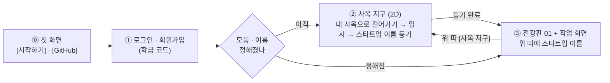
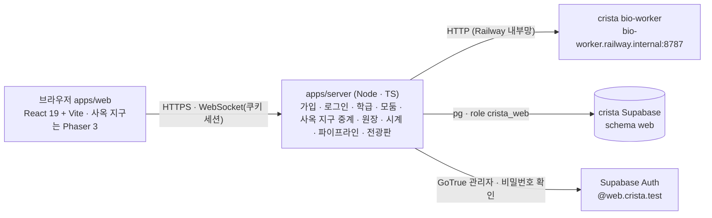

# crista-web 설계 — 신약 개발 파이프라인 플랫폼 (2026-10-23)

> **상태**: 설계안(구현 전) · 2판(같은 날 사용자 지시 반영) · **3판(2026-10-24 — 2.1 → 3.3 학생 선택 · 전임상 · 서류 심사, 결정 8)**.
> **사용자 결정(2026-10-23)**
> 1. 새 저장소 `~/Desktop/repo/crista-web`, GitHub 비공개(`mulkib0/crista-web`).
> 2. 연결 방식 **(가)** — 이 저장소는 화면 + 작은 서버만 갖고, 계산은 crista 의 bio-worker 를 HTTP 로 부르며 판정 규칙은 crista 에서 가져온다.
> 3. DB 는 **지금 crista Supabase 프로젝트를 같이 쓰되 게임과 겹치지 않게**.
> 4. **화면 흐름**(2판): ① 학생 **로그인 · 회원가입** → ② 교사가 정한 **N개 모둠의 서로 다른 사옥이 2D 로 보이는 사옥 지구**(지금 crista 처럼) — 자기 사옥에 걸어가 **스타트업 이름을 정한다**
>    → ③ 이름이 정해지면 **전광판 시안 01** 화면. 그 화면 어딘가에 **스타트업 이름이 늘 보인다**.
> 5. **UI/UX = 전광판 시안 01 'LED 흐르는 띠'** — 바탕은 05 '4단계 로드맵'(박막 톤 · 4묶음 사이드바 1.~4. · 분할 본문) 위에 검은 LED 띠 전광판.
>    시안: [`design/pipeline-board-30-variants.html`](../design/pipeline-board-30-variants.html)(01 = 첫 항목) · [게시본](https://claude.ai/artifact/GETqFjoHDn8sYqkoqaWA7a) · 바탕 05 [`design/pipeline-lab-30-variants.html`](../design/pipeline-lab-30-variants.html).
> 6. **모둠 내 역할 분담 = 1인 1후보 병렬 실험 + 모둠 비교표 합치기**(§6.4) — 단계별로 사람을 나누는 직렬 분담(나머지 3명이 구경하는 문제) 대신, 모든 단계에서 모둠원이 **왼쪽 개인 작업대**로 각자 다른 질환 · 컷오프 · 후보 분자 · 변형체를 동시에 실험하고 **오른쪽 모둠 공유 비교표**(`byName` · 직책 배지)에 올려 함께 주력 리드 · 백업 후보를 고른다.
> 7. **1.2 화합물 스크리닝 화면 = 미리보기 3판으로 확정**(§5.5) — ① 미션 브리핑 → ② **모둠 기준 회의**(안건 6개를 근거와 함께 제안 · 투표 → 정족수 합의) → ③ 합의한 기준으로만 스크리닝 실행 → ④ 통과 분자만 진열된 **분자 쇼핑**(근거 골라 찜) → ⑤ 연구 노트 · 2.1 로 넘기기. 기준을 느슨하게 정하면 후보가 많이 남고(위양성), 엄격하면 적게 남는(위음성) 결과를 모둠이 직접 겪는다.
>    미리보기: [`design/screening-pipeline.html`](../design/screening-pipeline.html) · [게시본](https://claude.ai/artifact/RvRQiUELeMJYWDyaFB8hA9). 앞선 시안(그림 30종 · 학습 활동 30종)은 같은 게시본의 1 · 2판.
>    **보강(§5.5.1)**: 단계 시각화 시안 1.2-**01 기준 설계실 · 02 분포 보고 문턱 정하기 · 03 화학 공간 울타리 · 04 내가 심사관 · 05 도킹할 분자 고르기**를 다섯 걸음의 '내 작업대' 도구로 넣고, 공통 점수판(남은 분자 · 아는 약 계열 k/K · 농축도 · 상위 10 중 아는 약 계열)으로 학생이 기준의 좋고 나쁨을 스스로 판단하게 한다. 시안: [`design/step-viz/`](../design/step-viz/) · [게시본](https://claude.ai/artifact/EikGTLeJwC4kLLUshahZeJ#s2v01).
> 8. **2.1 → 3.3 학생 선택 · 전임상 · 서류 심사**(3판 · §5.6~§5.12) — 단계 시각화 시안을 보고 학생이 직접 고른다.
>    - **2.1** 시안 **3.05 수심계 눈금 · 3.09 점수 카드 · 3.07 10배 계단**으로 2.2 에 보낼 분자를 고른다(§5.6).
>    - **2.2** 시안 **4.02 물성 레이더 · 4.03 신호등 표 · 4.04 몸속 여행 지도 · 4.10 점수 분해 사슬**로 특허 후보를 고른다(§5.7).
>    - **3.1** 특허 후보 중 **모둠당 최대 3건**(조정자 의견 — §5.8.1)을 골라 출원서를 완성하고 **코드명 해부도(5.02)**를 직접 적는다. 규칙이 형식 · 이미 알려진 물질 · 다른 모둠과 겹침을 보고 LLM 심사관이 누락 · 이상한 곳을 본 뒤 받아 주면 **5.04 학급 특허 원장**을 띄운다(§5.8).
>    - **3.2 전임상 · 동물실험(새 단계)** — 동물실험 윤리(3R · 고통등급 · 인도적 종료시점)를 배우고, 동물실험계획서를 윤리위원회 심의(규칙 + LLM)에 낸 뒤, 동물실험 결과로 **한 번 더 골라** 주력 · 백업을 정한다(§5.9).
>    - **3.3 제형 · IND 신청**(앞 판의 3.2 — 번호만 한 칸 밀림) — 학생이 무엇을 하는지 쉽게 풀어 주고, 시안 **6.02~6.07** 로 **'임상시험 계획 승인 신청서'**를 직접 내면 LLM 이 심사한다(§5.10). 서류 심사 공통 규약은 §5.11.
>    - **학생에게 보이는 글(언어)은 구현 때 Gemini 4 Argon (High)** 가 쓴다(§5.12).
>    - **4.1 · 4.2 임상 · 허가 상세 설계는 미룬다**(§6.1 의 표는 앞 판 그대로 둔다).

> **앞선 초안**: crista 안에 '랩 화면'을 붙이는 설계([`history/2026-10-23-pipeline-lab-in-crista-draft.md`](history/2026-10-23-pipeline-lab-in-crista-draft.md)) — 단계 상태 · 넘기기 · 리드 최적화 · 연구 노트 · 결함 4건을 이 문서로 옮겼다.
> Gemini 4 Argon (High) · GPT-6-Astra (xhigh) 교차 의견 원문은 [`.review/2026-10-23-pipeline-lab/`](../.review/2026-10-23-pipeline-lab/).

---

## 0. 한눈에

| 항목 | 결정 |
| --- | --- |
| 무엇 | 브라우저에서 모둠(스타트업 제약회사)이 **실제 계산으로 신약 개발 파이프라인을 처음부터 허가까지** 밟는 수업 플랫폼 |
| 화면 ① | **로그인 · 회원가입** — 학생은 교사가 준 **학급 코드**로 스스로 가입한다(서버가 대신 계정을 만든다 — §6.3) |
| 화면 ② | **사옥 지구** — crista 의 06 픽셀 타이쿤 그림으로 N개 사옥이 있는 작은 2D 거리. 아바타로 걸어가 문 앞에서 **입사 · 스타트업 이름 등기** |
| 화면 ③ | **전광판 01 + 05 작업 화면** — 위 띠(스타트업 이름 · 티커 · 순위 · 연구비 · 날짜) → **LED 흐르는 띠**(다른 모둠 소식) → 왼쪽 사이드바 1.~4.(하위 1.1~4.2) · 오른쪽 작업 영역 |
| 모둠 협업 | **1인 1후보 병렬 실험 + 모둠 비교표 합치기**(§6.4) — 왼쪽 입력 칸은 개인별(로컬), 오른쪽 실행 결과 · 비교표(`byName` · 직책 배지) · 연구 노트 3칸은 모둠 실시간 공유 |
| 경쟁 | LED 띠가 다른 모둠의 기업가치 등락 · 특허 · 단계 통과 · 실패 · 허가를 흘려보낸다. 항목을 누르면 그 모둠의 공개 정보 서랍. 사옥 지구의 건물도 성과에 따라 자란다 |
| 계산 | crista **bio-worker 그대로** — Open Targets · ChEMBL 데이터셋, RDKit → Meeko → Vina 1.2.7 → PLIP, ADMET-AI v2, RDKit 물성, 애널리스트 문구 |
| 규칙 · 그림 | crista `shared-types` · `game-rules` 사본(e911572) + crista 에셋 사본(아틀라스 · 목록 · Galmuri) |
| 서버 | 이 저장소의 Node 서버 하나(HTTP + WebSocket + 정적 파일) — Railway 의 crista 프로젝트에 새 서비스(워커가 내부망 전용이라) |
| DB · 계정 | crista Supabase 의 **`web` 스키마 + 전용 역할 `crista_web`** · 웹 계정 이메일 도메인 **`web.crista.test`**(게임 `students.crista.test`) |

---

## 1. 무엇을 살리고 무엇을 버리나

### 1.1 그대로 쓰는 것(crista 에서)

| 자산 | 어떻게 | 근거 |
| --- | --- | --- |
| bio-worker `POST /jobs` · `GET /jobs/{id}` | 이 서버가 작업을 내고 진행을 받아 온다. 요청 모양은 `WorkerJobRequest`(shared-types) 그대로 | crista `apps/bio-worker/app/main.py` |
| bio-worker `POST /molecule/properties` | 무료 물성 미리보기 · 특허 출원 물성 | 같은 RDKit 판이라 숫자가 판정과 같다 |
| bio-worker `/datasets/summary · targets · compounds` | 1.1 표적 · 1.2 스크리닝의 원자료 | Open Targets v4 · ChEMBL 데이터셋(기존 4대 질환 → **12대 질환 · 표적 12종**으로 확장 — §6.1.1) |
| bio-worker `/llm/analyst` | 전광판 헤드라인('AI 생성' 표시, 실패면 규칙 문구) | crista M4 |
| `packages/shared-types` | `DOCKING_TARGETS`(기존 4종 → **12종** · `referenceKcal`) · `TRIAL_OPTIONS` · `DISEASE_TO_TARGET` · `MoleculeProperties` · `ExperimentResult` · 워커 규격 | 사본 — [`packages/SOURCE.md`](../packages/SOURCE.md)(§6.1.1 확장 후 재복사) |
| `packages/game-rules` | `pipeline/score.ts`(효능 E · 안전 S · 물성 신호) · `pipeline/rules.ts` · `flow.ts` · `market/analyst.ts`(`ANALYST_BANDS`) · `market/board.ts`(`rankMarketCap` · `changePct24h`) · `clock.ts` | 사본 |
| crista 06 픽셀 에셋 | 사옥 `hq-t1`(설립 직후) · `hq-t2`(Series A 이후) · `hq-t3`(블록버스터) 96×96, 캐릭터 CEO · CSO · CTO · CMO 걷기 32×48 × 4방향, 바닥 타일, Galmuri 글꼴(OFL) | 사본 — `assets/crista/`(자체 생성기 산출물 · `CREDITS.md`) |
| 균형안 수치 | 초기 연구비 $6.000M · HTVS · 도킹 · ADMET $0.050M · 특허 $0.050M · IND · 허가 $0.100M · 임상 $0.300M / $0.600M / $1.200M · 기간 30 / 90 / 180 / 360 / 60게임 일 · Series A $3.000M · B $5.000M | crista `docs/2026-10-19-game-balance-v0.md` §3 · §10 |

### 1.2 버리는 것

crista 의 큰 도시 · 기관 건물 · NPC · 객장 현장 매매 · 서버 권위 이동 · Colyseus 룸. 사옥 지구(§3)는 **이름을 정하고 서로의 사옥을 보는 작은 거리**일 뿐, 실험 · 신청을 하러 걸어가는 곳이 아니다.

### 1.3 다시 만드는 것(이 저장소)

학급 · 모둠 · 계정(가입 · 로그인), 사옥 지구(2D · 접속 표시), 연구비 원장, 학급 게임 시계, 작업 오케스트레이션(워커 호출 · 진행 · 과금 · 환급), 파이프라인 상태 기계, 전광판 · 기업가치, 교사 화면.
crista 게임 서버 코드는 **읽고 옮겨 쓰되**(예: `jobs/service.ts` 의 과금 · 환급 · 멱등, `pipeline/service.ts` 의 단계 판정) 의존하지 않는다.

---

## 2. 화면 흐름



- ⓪ 첫 화면(`/crista/`)은 히어로 변주판 20.02 '박막 무지개' 장면 위에 CRISTA 워드마크와 [시작하기] · [GitHub] 만 둔다. [시작하기] 는 ① 로그인(`/crista/login`, 학생 · 교사 같은 화면)으로, 세션이 있으면 다음 화면으로 바로 간다. [GitHub] 는 저장소를 새 탭으로 연다.
- 처음 들어온 학생: ① → ② → ③. 다음부터는 ① → ③ 으로 바로 간다(모둠 · 이름이 정해졌으므로). ③ 위 띠의 **[사옥 지구]** 로 언제든 ② 에 가서 다른 모둠 사옥을 본다.
- 같은 모둠의 다른 학생이 먼저 이름을 정했으면, 나중에 온 학생은 ② 에서 이미 간판이 걸린 자기 사옥에 들어가 바로 ③ 으로 간다.
- 서버가 판정하는 것은 **입사 · 이름 등기 · 파이프라인 행동**뿐이다. 사옥 지구의 걷기는 화면 경험이다(사옥 앞에 있어야 한다는 서버 규칙은 두지 않는다 — 경쟁 요소가 아니다).

---

## 3. 화면 ① 로그인 · 회원가입

| 칸 | 내용 |
| --- | --- |
| 로그인 | 아이디 · 비밀번호 → [들어가기]. 실패 · 잠금(5회 실패 → 1분) 안내 |
| 회원가입(학생) | **학급 코드**(교사가 알려 줌, 6자) · 아이디(영문 소문자 · 숫자 3~20자) · 이름(화면 표시용, 실명 대신 별명 가능) · 비밀번호(8자 이상) · 비밀번호 확인 → [가입하고 들어가기] |
| 교사 | 공개 가입 없음. 첫 교사 계정은 관리 스크립트(`npm run teacher:create`)로 만들고, 교사 화면에서 학급을 만든다(§9) |
| 모양 | 05/01 박막 톤의 표제(CRISTA · 파이프라인 랩) + 아래에 crista 픽셀 사옥이 늘어선 한 줄(② 로 이어지는 예고). 시각은 UI 프리뷰가 정한다 |

- 가입은 **서버가 대신 만든다**: 서버가 학급 코드를 확인한 뒤 GoTrue 관리자 API 로 `<아이디>@web.crista.test` 계정을 만들고(`email_confirm: true`) `web.members` 에 학생으로 넣는다.
  Supabase 프로젝트의 공개 가입 설정(`enable_signup`)은 **건드리지 않는다** — 게임과 같은 프로젝트라 프로젝트 설정을 바꾸면 게임에도 걸린다(§7.1).
- 로그인도 서버가 GoTrue 로 확인하고 **HttpOnly 쿠키 세션**을 준다(토큰을 브라우저 스크립트에 두지 않는다). WebSocket 도 같은 쿠키로 인증.
- 남용 방지: 가입은 IP · 학급 코드마다 분당 상한, 학급 코드는 교사가 다시 만들거나 닫을 수 있다(학급 정원 초과 · 닫힌 코드는 거절).

---

## 4. 화면 ② 사옥 지구 — N개의 서로 다른 사옥

### 4.1 무엇이 보이나

- 교사가 학급을 만들 때 정한 **모둠 수 N(2~8)** 만큼 사옥 부지가 광장을 둘러싼 작은 거리(약 40×26 타일, 32px). 지금 crista 처럼 3/4 탑다운 · 06 픽셀 타이쿤 그림.
- 부지마다 사옥이 하나: **이름 전**에는 가림막과 '○모둠 사옥 · 입주 n/정원' 팻말, **등기 뒤**에는 스타트업 간판(이름 · 티커) · 모둠 잉크 깃발 · 입구 매트.
- **서로 다른 모습**: 부지마다 외관 변주(지붕 · 차양 · 창 · 간판 모양)를 다르게 그리고 모둠 잉크 색을 입힌다. crista 아틀라스의 사옥은 `hq-t1 · t2 · t3` 세 단계뿐이라,
  같은 06 팔레트 · 그리기 규칙으로 **외관 8종 × 3단계**를 이 저장소의 생성기(`tools/gen-campus-assets.mjs`, crista `tools/crista-asset-lib.js` 의 사옥 그리기에서 옮김)로 만든다.
- **사옥이 자란다**(경쟁 연출): crista 와 같은 뜻 — Tier 1 설립 직후 → Tier 2 Series A 이후 → Tier 3 신약 허가. 다른 모둠이 자라는 모습이 거리에서 보인다.
- 광장 가운데 기둥에 작은 **LED 띠**(③ 의 전광판과 같은 소식)를 둔다.
- 같은 학급 학생들의 아바타가 함께 보인다(머리 위 이름 · 모둠 잉크). 위치는 서버가 학급 채널로 중계만 한다(초당 5회 이하, 판정 없음).

### 4.2 걷기와 입사

- 아바타 · 직책: crista 캐릭터 4종(CEO · CSO · CTO · CMO) 중 하나를 처음 들어올 때 고른다(능력치 보너스나 단계 잠금은 없으며, ③ 작업 화면의 비교표 · 연구 노트 · 접속 표시에 직책 배지로 표시 — §6.4).
- 이동: WASD · 화살표 + 바닥 클릭 이동(작은 격자 A*). 내 사옥 방향을 화면 가장자리 화살표로 안내.
- **모둠 배정 두 방식**(교사가 학급마다 고른다)
  - `assigned` — 교사가 명단에서 모둠을 배정. 학생에게는 자기 사옥만 열리고(문 위 '우리 모둠'), 다른 사옥은 구경만.
  - `walk-in`(기본 제안) — 아직 모둠이 없는 학생이 **처음 문을 연 사옥이 내 모둠**이 된다(정원 = ⌈학급 인원 ÷ N⌉ 또는 교사가 정함). 들어가기 전에 '이 사옥에 입사할까요? 바꾸려면 교사에게' 확인.
- 문 앞(입구 매트)에 서면 `E 들어가기`. 들어가면 사옥 패널이 열린다.

### 4.3 스타트업 이름 등기

| 칸 | 규칙 |
| --- | --- |
| 스타트업 이름 | 2~14자(한글 · 영문 · 숫자 · 공백 1칸), 학급 안 유일, 욕설 목록 거절 |
| 티커 | 영문 대문자 3~4자, 학급 안 유일. 이름에서 자동 제안(예: 세움제약 → SEUM) |
| 슬로건 | 선택, 40자 |
| 등기 | [설립 등기] → 도장 연출 → 모둠 전원(접속 중)에게 '○○ 님이 「세움제약」으로 등기했어요' → **③ 으로 이동** |

- 한 모둠에 한 번 — 같은 모둠 둘이 동시에 내면 먼저 닿은 것이 이긴다(서버 트랜잭션, 늦은 쪽은 '이미 등기됨'과 함께 ③ 으로).
- **고치기**: 모둠의 첫 유료 행동 전까지는 사옥 패널이나 ③ 위 띠에서 고칠 수 있다. 그 뒤로는 교사만(전광판에 이름이 이미 퍼졌기 때문).
- 등기는 전광판 첫 소식이 된다: `◆ SEUM 「세움제약」 설립 등기 — 상장가 $10.00`.

---

## 5. 화면 ③ 전광판 01 + 작업 화면

### 5.1 배치(시안 그대로)

```text
┌ 위 띠 ───────────────────────────────────────────────────────────────────────────────────────────┐
│ ◇ CRISTA 파이프라인 랩 │ ● 세움제약 SEUM │      [시가총액 순위 2위 · $10.42M] 연구비 $5.850M  게임 D+42  [연구비 신청] [사옥 지구] │
├ 전광판 01 — LED 흐르는 띠(검은 바탕 · 호박색 점 글자) ─────────────────────────────────────────────────────┤
│ ◆ DAON 임상 2상 통과 ▲ 8.0%   ◆ MIRP 2상 보류 — 효능 부족 ▼ 12.0%   ◆ SEUM 물질특허 등록 ▲ 2.0%  …       ● LIVE [멈추기] │
├ 사이드바(05 4묶음) ──────────┬ 작업 영역(분할) ─────────────────────────────────────────────────────────────┤
│ 1. 발견               2/2 │  2.1  분자 도킹                                                          │
│   1.1 질환 · 표적 선정   ✓  │  …                                                                    │
│   1.2 화합물 스크리닝   ✓  │                                                                        │
│ 2. 최적화             0/2 │                                                                        │
│   2.1 분자 도킹    ◀ 지금  │                                                                        │
│   2.2 ADMET 예측 · 리드    │                                                                        │
│ 3. 개발 · 규제        0/2 │                                                                        │
│ 4. 임상 · 허가        0/2 │                                                                        │
└──────────────────────────┴────────────────────────────────────────────────────────────────────────┘
```

### 5.2 스타트업 이름이 보이는 곳

| 자리 | 표시 |
| --- | --- |
| **위 띠 `.co` (늘 보임)** | 모둠 잉크 점 · **스타트업 이름** · 티커 상자. 첫 유료 행동 전에는 눌러서 고치기(§4.3), 그 뒤엔 읽기 전용 |
| 위 띠 순위 단추 | `시가총액 순위 N위 · $x.xxM` — 누르면 **우리 모둠** 서랍(다른 모둠이 보는 것과 같은 공개 정보) |
| 전광판 | 우리 소식도 다른 모둠과 똑같이 `◆ 티커 …` 로 흐른다(다른 모둠 화면에서 우리 이름이 보인다) |
| 사이드바 머리 | `세움제약 · 신약 파이프라인` |
| 서류 | 특허 출원서 · IND · 허가증의 출원인 · 회사 칸(시안에 이미 있음) |
| 브라우저 탭 | `세움제약 — Crista 파이프라인 랩` |
| 사옥 지구 | 사옥 간판 · 광장 LED |

### 5.3 전광판 01 — LED 흐르는 띠

| 요소 | 규격(시안 01 `led`) |
| --- | --- |
| 자리 | 위 띠 아래 전체 폭(그리드 영역 `board`). 검은 바탕, 위아래 14px 여백 |
| 글자 | 3px 격자 점 가면(dot-matrix)의 Mono 22px. 기본 **호박색**(#ffb21a, 은은한 번짐), **악재 빨강**(#ff5a3c), **순위 변동 초록**(#8dff5a) |
| 항목 | 최근 소식 10건 — `◆ {티커} {헤드라인} {▲/▼ x.x%}` |
| 움직임 | 40초에 한 바퀴 흐름(두 벌을 이어 끊김 없이, 두 번째 벌은 `inert`). 마우스를 올리거나 초점이 가면 멈춤. 오른쪽 `● LIVE` 깜빡임 + [멈추기 / 다시 흐르기] |
| 모션 줄이기 | `prefers-reduced-motion` 이면 흐르지 않고 가로 스크롤 목록 |
| 누르기 | 그 모둠 **공개 서랍**: 주가 · 등락 · 투자의견(STRONG BUY · BUY · HOLD · SHORT WARNING) · 추세선 · 시가총액 순위 · 프로그램 코드 · 표적 · 질환 · 단계 진행 칸 · 기록(특허 · 통과 · 실패 · 허가 수) · 최근 공개 소식 8건 · 공개 범위 안내 |
| 새 소식 | 화면 낭독기용 `aria-live="polite"` 한 줄(흐르는 띠와 별도) |

**올리는 소식** — 변동 폭은 crista `game-rules/market/analyst.ts` 의 `PIPELINE_ANALYST_BANDS`(균형안 §10.7) · `ANALYST_BANDS`(§9.3) 그대로(시안의 `DELTA` 표와 같은 값)

| 종류 | 예 | 기업가치 변동(%) |
| --- | --- | --- |
| 설립 등기 | `◆ SEUM 「세움제약」 설립 등기 — 상장가 $10.00` | 0(`listing`) |
| 도킹 신기록 | `◆ SEUM AChE 결합력 학급 신기록 −12.4 kcal/mol` | 0~12(`docking`) |
| 물질특허 | `◆ SEUM 물질특허 등록 — 알츠하이머 후보` | 0~5, 기본 2 |
| IND 승인 · 보류 | `◆ DAON IND 승인` / `◆ DAON IND 보류` | 0~5 / −8~0 |
| 임상 1 · 2 · 3상 통과 | `◆ MIRP 임상 2상 통과 — 3상 진입` | 1상 0~8 · 2상 3~15 · 3상 5~18 |
| 임상 보류(실패) | `◆ MIRP 2상 보류 — 효능 부족, 재설계 중` (빨강) | 1상 −12~−2 · 2상 −18~−5 · 3상 −20~−8 |
| 신약 허가 | `◆ DAON 「다온콕스」 FDA 허가` | 기본 12 × 제형 배율(`approvalDefaultChangePct`) |
| 투자 유치 | `◆ SEUM Series A $3.000M 유치` | 5~15(`investment`) |
| 순위 변동 | `◆ SEUM 시가총액 1위 탈환` (초록) | — |
| 교사 공지 · 정정 | `◆ 정정: MIRP 2상 판정 재계산` | 교사가 정함(`correction`) |

- 변동률은 규칙(범위 안에서 결정적 흔들림)이 정하고, 헤드라인 한 줄만 워커 `/llm/analyst` 로 다듬는다(학급 · 하루 상한, 실패면 규칙 문구).
- **공개 범위**(crista 와 같은 원칙): 사실과 결과만 — 이름 · 티커 · 단계 · 통과/보류와 실패 종류 · 표적 질환 · 프로그램 코드 · 기업가치 · 허가 뒤 브랜드.
  **후보 SMILES · 물성 · 점수 · 연구 노트는 그 모둠과 교사만.** 학급 밖으로는 보내지 않는다.
- 기업가치: 상장가 $10.00 × 1,000,000주에서 시작, 매매가 없으니 **소식(펀더멘털)만으로** 움직인다. 순위 · 24시간 변동은 `rankMarketCap` · `changePct24h`.
- 모둠 잉크: crista `TEAM_INK` 는 4색뿐 → N = 8 까지 **잉크 8색**(밝은 바탕용 · 검은 LED 띠용 짝)을 06 팔레트에서 더 정한다(W2).

### 5.4 사이드바 · 작업 영역(05)

- 사이드바는 05 의 **4묶음 + 하위 단계 8개**를 그대로 쓴다: 묶음 머리 `1. 발견 2/2`(완료/전체), 하위 `1.1` · `1.2` …. 목록(`<ol>`)이 번호를 매기고 지금 하위 단계에 `aria-current="step"`.
- 상태 표시는 색 + 기호 · 글자(✓ 완료 · ▸ 진행 · 🔒 잠김 · ✕ 보류 · ⏸ 막힘). 잠긴 단계도 눌러 '무엇을 배우나 · 무엇이 필요한가'를 보고 **초안 작성 · 연구 노트 작성**을 미리 할 수 있다(유료 실행 · 단계 확정만 선행 조건 충족 후 열림 — §6.4).
- 작업 영역(분할): **왼쪽 열 = 개인 작업대(입력 · 조건 · 무료 미리보기)** — 한 명이 조작해도 다른 모둠원의 입력 칸이 덮어써지지 않는다. **오른쪽 열 = 모둠 공유 비교표 · 결과 · 연구 노트** — 모둠원 각자가 실행하거나 올린 결과가 `byName` · 직책 배지와 함께 실시간으로 한 비교표에 합쳐진다(§6.4). 순서는 머리(번호 · 제목 · 완료 조건 · 비용) → 실제 산업에서는 → **결과의 성격**(자료 조회 · 실제 계산 · AI 예측 · 교육용 모의 판정) → 준비물 → 입력 · 실행 → 결과 · 모둠 비교표 → 연구 노트 → **다음 단계로**(초안만, 자동 실행 · 과금 없음).
- 시안의 '메시지 기록' 단추는 교사 · 개발용으로만 보인다(학생 기본 숨김).

### 5.5 1.2 화합물 스크리닝 — 확정 화면(미리보기 3판)

기준(컷오프)을 정하는 과정이 이 단계의 학습이다. 그래서 기준은 한 사람이 슬라이더로 정하지 않고 **모둠이 근거를 대며 합의**한다. 실행은 합의한 기준으로만 돌아가고, 결과(남은 수)가 그 기준의 대가를 그대로 보여 준다.
미리보기: [`design/screening-pipeline.html`](../design/screening-pipeline.html)(+ `screening-pipeline.js` · `data.js`) · [게시본](https://claude.ai/artifact/RvRQiUELeMJYWDyaFB8hA9).

1.2 작업 영역 머리 아래에 **다섯 걸음**(①~⑤)을 둔다. 걸음마다 §5.4 의 분할을 따른다 — 왼쪽 '내 작업대'(나만 보임 · 무료), 오른쪽 '모둠 공유'.

| 걸음 | 왼쪽 · 내 작업대 | 오른쪽 · 모둠 공유 | 다음으로 |
| --- | --- | --- | --- |
| **① 미션 브리핑** | 표적 미션 이야기(누가 · 어디로 가야 하는 약인가 · 얼마나 오래 먹나) · 이 표적의 **실제 약 카드**(구조식 · MW · TPSA · logP · Ro5 · 경고 · QED — 기준을 정할 때 '이 약도 통과할까?'의 비교 기준) | 회의 전 질문 3개(뇌까지 가야 하나 · 얼마나 오래 먹나 · 어떻게 먹나)에 모둠원이 각자 답하고 서로의 답이 보인다. 답하면 '맞아요 + 어느 안건과 이어지는지' 또는 '미션 글을 다시 읽어 보세요'. 모둠원별 '읽음' 표시 | 막지 않는다(읽음은 안내만) |
| **② 모둠 기준 회의** | 안건마다 생각 질문 · 생각할 거리 2~3줄 · 지표 설명(접기) · **220종 분포 그래프**(내 값 선 · 실제 약 표시 · 모둠원 제안 깃발) · 내 값 조절 → **이 안건에서 걸러지는 수 · 합의된 기준과 합친 남는 수 · 실제 약 통과 여부**를 바로 보인다. 근거 하나를 골라 '모둠에 제안' | 제안 카드(제안자 · 값 · 근거 · 이 값의 결과 칩 · 찬성 아바타) · 찬성하려면 **근거를 하나 골라야** 한다 · 회의 대화(제안 · 찬성 · 합의 · 동점 안내) · 정족수에 닿으면 **합의 도장**, '다시 논의'로 풀 수 있다. 위에는 늘 **깔때기 띠**(안건별 남는 수, 미정 안건은 '거르지 않음') | 6개 안건 모두 합의 |
| **③ 스크리닝 실행** | 합의한 기준 칩 · 무료 미리보기 수 · 실행 확인(연구비 · 남는 연구비 · '다시 실행해도 같은 비용') · 실행 기록(회차 · 기준 · 실행한 사람 · 통과 수) | 작업 진행(워커 단계 줄) → 관문별 막대(남은 수 + 빠진 양) · **판정**(아래) · 도킹 비용 계산(통과 수 × 도킹 1회 비용, 연구비 대비 %) · '걸러진 분자 중 표적 점수가 높았던 3개 — 놓친 걸까요?'(어느 안건에서 걸렸는지) · [기준 다시 회의] · [통과한 n개 쇼핑하러] | 실행 1회(= 1.2 완료 조건) |
| **④ 분자 쇼핑** | **진열대 = 마지막 실행에서 통과한 분자만** · 카드(통과 순위 · 구조식 · 이름 · 라이브러리 · 표적 점수 막대 · MW · TPSA · logP · QED 칩 · 찜한 사람) · 검색 · 정렬(점수 · QED · TPSA · MW) · 필터(아직 찜 안 됨 · TPSA ≤ 90 · QED ≥ 0.67 · 승인약 · 사내/ZINC) · 12개씩 · 상세 서랍(지표마다 미션 조언과 맞음/벗어남) | **모둠 장바구니** — 모둠원별 칸 · 1인 2개 · 찜마다 근거 · 참여 인원(n/4) · 2.1 도킹 예상 비용((찜 + 대조군 1) × 도킹 비용) | 찜 1개 이상 |
| **⑤ 넘기기** | 연구 노트 3칸(① 컷오프 근거 · ② 걸러진 분자 중 놓쳤을 가능성 · ③ 다시 스크리닝한다면 바꿀 기준, 칸마다 마지막 작성자) · 학습 연구비 중급 문항(실제 컷오프 · 220 → n · 표적의 뇌 여부를 넣은 문장) | **1.2 스크리닝 확정서**(표적 · 안건별 합의값 · 제안자 · 찬성 수 · 실행 횟수 · 연구비 · 2.1 도킹 대기열 = 찜 후보 + 대조군 자동 · 예상 비용) · 아직 찜하지 않은 모둠원 안내 | [2.1 분자 도킹으로 보내기] |

**회의 안건 6개**(깔때기 순서 = 이 순서. 미정 안건은 거르지 않는다)

| 안건 | 기준 | 값 범위 | 생각 질문(학생에게) | 근거 보기(골라야 제안 · 찬성 가능) |
| --- | --- | --- | --- | --- |
| 분자 크기 | MW ≤ | 250~650 Da · 10 | 우리 약 분자는 얼마나 작아야 할까요? | 작은 분자가 장 벽을 잘 지나서 · 뇌혈관 장벽(BBB)을 넘어야 해서 · 후보를 너무 많이 잃지 않으려고 · 실제 약 값을 참고해서 |
| 극성 | TPSA ≤ | 40~180 Ų · 5 | 물과 친한 겉면(TPSA)은 어디까지 봐줄까요? | 장에서 흡수만 되면 돼서 · BBB 를 넘어야 해서 · 후보를 … · 실제 약 … |
| 먹는 약 규칙 | Ro5 위반 ≤ | 0 · 1 · 2개 | 리핀스키 5규칙은 몇 개까지 어겨도 될까요? | 먹는 약이라 규칙을 지켜야 해서 · 규칙을 1개쯤 어긴 좋은 약도 있어서 · 후보를 … · 실제 약 … |
| 독성 부품 | 구조 경고 | 빼기 · 허용 | 독성이 될 수 있는 부품이 있는 분자는 뺄까요? | 오래 먹는 약이라 독성이 쌓이면 안 돼서 · 나중에 구조를 바꿔 고칠 수 있어서(2.1) · 후보를 … |
| 약다움 | QED ≥ | 0~0.90 · 0.05 | 약다움은 몇 점 이상이어야 할까요? | 실제 약과 닮은 분자를 고르려고 · 약다움보다 결합력이 더 중요해서 · 후보를 … · 실제 약 … |
| 결합 예측 | 표적 점수 ≥ | 0~0.90 · 0.05 | 표적에 잘 붙을 분자만 남기려면 몇 점 이상으로 할까요? | 강하게 붙을 분자만 도킹하려고 · 도킹 비용을 아끼려고 · 점수가 낮아도 2.1 에서 구조를 바꿔 좋아질 수 있어서 · 후보를 … · 실제 약 … |

- **결합 예측 안건이 필요한 이유**: 라이브러리 대부분이 약다운 분자라 물성 5개만으로는 잘 걸러지지 않는다(ACHE 미션 조언대로 합의해도 132개). 표적 점수(`screenScoreByTarget`) 분포는 표적마다 달라(중앙값 ACHE 0.38 · EGFR 0.62) 다른 모둠의 숫자를 따라 할 수 없고 그래프를 보고 정해야 한다. 조언값으로 정하면 ACHE 26개가 남는다.
- **정족수**: 지금 모둠 인원 n 의 과반 = `floor(n / 2) + 1`(4명 3표 · 3명 2표 · 2명 2표). 한 사람이 안건마다 제안 1개 · 표 1개(제안하면 자기 제안에 찬성으로 센다). 모두 투표했는데 정족수에 닿은 안이 없으면 '근거를 더 나누거나 절충안을 내 보세요'. 합의 뒤 '다시 논의'는 그 안건의 표를 모두 지우고 새로 투표한다(제안은 남는다).
- **코치(근거 ↔ 값 점검)**: 고른 근거와 값이 어긋나면 바로 짚는다 — 예: 'BBB 를 넘어야 해서' + TPSA 120 → "BBB 를 넘으려면 보통 TPSA 90 이하", '후보를 잃지 않으려고' + 남는 수 < 8 → "그래도 n개밖에 안 남아요", '실제 약 값을 참고해서' + 실제 약이 걸림 → "실제 약도 이 기준에 걸려요". **회의에서는 경고만 하고 막지 않는다**(모둠이 틀린 기준으로 실행해 보고 결과로 배우게). 규칙은 미리보기 `AG[].reasons[].check` 그대로.
- **판정 구간**(③): 0개 '후보 0개 — 너무 엄격'(가장 많이 걸러 낸 안건부터 다시 회의) · 1~7개 '너무 적어요'(4명이 1~2개씩 찜하기 모자람 · 위음성) · 8~40개 '알맞아요' · 41개 이상 '너무 많아요'(덜 걸러져 약이 되기 어려운 분자가 섞임 · 위양성 · 쇼핑을 꼼꼼히). 다시 회의 → 다시 실행은 언제든, 실행마다 비용.
- **찜 근거**(④ · 골라야 찜): 표적 점수가 높아요(통과 10위 밖이면 주의) · 뇌로 잘 갈 것 같아요(TPSA > 90 이면 **막음**) · QED 가 높아요(< 0.6 주의) · 작고 가벼워요(MW > 400 주의) · 다른 모둠원과 다른 종류라서(다른 사람 찜이 모두 같은 라이브러리면 주의) · 이미 승인된 약이라 안전해 보여요(승인약이 아니면 **막음**). 근거가 데이터와 **틀리면(막음) 찜할 수 없고**, '주의'는 찜할 수 있다. 이 표적의 기존 약(대조군)을 찜하려 하면 "2.1 에 대조군으로 자동으로 붙고, 새 약으로 물질특허(3.1)를 받기 어려울 수 있어요"를 띄운다.
- **미션 문구 · 조언값**은 학습 문구라 crista 규칙 값이 아니다 → 이 저장소 `packages/web-contract` 에 표적별 `SCREEN_MISSIONS`(제목 · 이야기 · 브리핑 정답 `cns`(must · nice · no) · `dur`(days · years · life) · `route` · 실제 약 ChEMBL id · 조언값 `{ mwMax, tpsaMax, ro5Max, noAlerts, qedMin, scoreMin }`)로 둔다. 미리보기에 4종(ACHE · EGFR · DPP4 · PTGS2)이 있고, §6.1.1 의 나머지 8종은 구현 때 같은 틀로 쓴다. 조언값은 코치 · 상세 서랍의 '미션 조언' 칩에만 쓰고 **합의를 강제하지 않는다**.
- **미리보기에만 있는 것**(제품에서는 뺀다): 맨 아래 미리보기 도구(지금 화면의 모둠원 바꾸기 · 표적 바꾸기 · 처음부터) · 다른 모둠원 흉내(직책 성향대로 늦게 투표 · 찜하는 규칙) · 브라우저 저장소 진행 저장. 제품에서는 모둠원 4명이 각자 기기로 같은 회의를 보고, 공유 칸은 §7.3 의 표와 모둠 WebSocket 으로 실시간 맞춘다.

#### 5.5.1 내 작업대 도구 5종 — 단계 시각화 1.2-01~05 반영(2026-10-23)

사용자 지시: "학생이 딸깍 보기만 하지 말고 **직접 기준을 고르고, 여러 지표를 보며 선택**하게." 단계 시각화 시안의 1.2 **01 기준 설계실 · 02 분포 보고 문턱 정하기 · 03 화학 공간 울타리 · 04 내가 심사관 · 05 도킹할 5개 고르기**를 위 다섯 걸음의 **왼쪽 '내 작업대'** 도구로 넣는다.
흐름(①~⑤) · 안건 6개 · 정족수 합의 · 1인 2찜은 그대로다. 도구는 모두 **개인 · 무료 · 브라우저 계산**(`dataset` 지표만 씀)이고, 모둠 공유로 넘어가는 길은 지금처럼 '모둠에 제안' · '찜하기' 둘뿐이다.
미리보기: [`design/step-viz/viz-2.js`](../design/step-viz/viz-2.js) · [게시본 #s2v01~05](https://claude.ai/artifact/EikGTLeJwC4kLLUshahZeJ#s2v01).

**공통 점수판**(도구 5종이 같은 엔진 · 같은 칸을 쓴다) — 학생이 '좋은 기준'을 스스로 판단할 잣대.

| 칸 | 값 | 뜻(학생 문구) |
| --- | --- | --- |
| 남은 분자 | `n / 220` · 걸러 낸 % | 도킹 비용과 이어진다(③ 의 도킹 비용 계산과 같은 수) |
| **아는 약 계열** | `k / K` 남음 + 칸 K개(남은 만큼 칠함) | 이 표적에 듣는다고 알려진 분자(실제 약 + 사내 유도체)가 내 기준을 몇 개 통과했나. 실제 연구에서도 이미 아는 약으로 거르기 기준을 검증한다 |
| 농축도 | `(k / n) ÷ (K / 220)` → `×1.0` 부터 | 남은 분자 속 아는 약 계열 비율이 처음보다 몇 배 진해졌나 |
| 상위 10 중 아는 약 계열 | `t / 10` | 결합 예측(표적 점수) 순으로 줄 세웠을 때 도킹 대기열 앞쪽에 몇 개가 오나 |

- '아는 약 계열'(`knownActiveIds`) = 화합물 데이터의 `t === targetId` 인 분자(ACHE 12개 = 시판 6 + 사내 유도체 6). §6.1.1 의 표적별 시드 50종 중 '결정 리간드 · 승인 비교약 · 활성 화합물 · 의약화학 변형체'가 같은 역할을 한다. 이 수는 **판정 · 연구비에 쓰지 않는다**(학습용 잣대). ① 의 실제 약 카드 1개는 이 집합의 대표다.
- 점수판은 ② · ③ · ④ 의 왼쪽 머리에 늘 붙고, 오른쪽 깔때기 띠(합의값)와 **같은 함수**로 센다(내 값 ↔ 합의값 차이를 바로 비교).

| 도구(시안) | 들어가는 걸음 | 학생이 하는 일 | 모둠 공유로 넘기는 것 |
| --- | --- | --- | --- |
| **기준 설계실**(01) | ② 회의 · 내 작업대 첫 탭 | 안건 6개(MW · TPSA · Ro5 · 독성 부품 · QED · 결합 예측)를 한 판에서 켜고 끄며 값을 옮긴다. 안건마다 작은 분포 그래프(빨간 문턱선 · 버리는 쪽 음영 · 아는 약 계열 눈금), 오른쪽에 점수판 · 내 기준 깔때기(안건별 −n · 버린 아는 약 계열 수) · 상위 10 미리보기. 빠른 시작: 미션 조언값 · Lipinski 5의 규칙 · 뇌로 가는 약 · 기준 없음 | [이 조합으로 제안하기] → 아직 내 제안이 없는 안건마다 제안 카드 초안(값만 채움, **근거는 안건마다 직접 골라야** 올라간다 — §5.5 코치 그대로) |
| **분포 보고 문턱 정하기**(02) | ② 회의 · 안건 화면의 분포 그래프 | 지금 §5.5 의 220종 분포 그래프에 ① 아는 약 계열을 막대 위 라임 칸으로 쌓고 ② 문턱 밖으로 버려지는 아는 약 계열의 **이름 · 값 목록**("버려지는 약 계열: 메만틴(179)")을 그래프 바로 아래에 띄운다. 안건 설명(접기)은 '무엇인가 · 왜 거르나' 두 줄 | 그대로 '모둠에 제안'(바뀜 없음) |
| **화학 공간 울타리**(03) | ② 회의 · 내 작업대 '지도' 탭 | 가로 · 세로 지표를 골라(MW · TPSA · QED · 결합 예측 + 참고 지표 cLogP · HBD · RotB) 산점도를 보고, **끌어서 사각형 울타리**를 친다(점 = 분자, 별 = 아는 약 계열). 울타리 안 수 · 아는 약 계열 · 농축도 · 울타리 밖 아는 약 이름. [교과서 기준선 겹쳐 보기] | [울타리 값 가져오기] → 울타리의 ≤ 쪽 변을 MW · TPSA 안건 내 값으로, ≥ 쪽 변을 QED · 결합 예측 내 값으로 옮긴다(참고 지표 축은 옮기지 않음). 키보드 · 터치 대체: 네 변 숫자 칸 |
| **내가 심사관**(04) | ① 브리핑 뒤 '회의 전 몸풀기'(막지 않음) | 분자 카드 8장(구조식 · MW · TPSA · cLogP · HBD · RotB · QED 막대 + 시판 약 대부분이 있는 범위 띠(참고) · 구조 경고)을 보고 **직접 통과 · 탈락**. 다 정하면 [판정 열기] → 미션 조언값 기준 판정 · 걸린 기준 · 실제 이야기 · '조언과 같은 판정 x/8' | 없음(개인). 결과 수는 ⑤ 연구 노트 ② 칸 힌트로만 쓴다 |
| **도킹할 분자 고르기**(05) | ④ 분자 쇼핑 · 진열대 '표로 보기' 토글 | 통과 분자를 카드 대신 **정렬 · 검색되는 지표 표**(MW · TPSA · cLogP · HBD · QED · 경고 · 결합 예측, 교과서 기준을 넘은 값은 빨강)로 보고 행에서 바로 찜한다 | 기존 찜(1인 2개 · 찜마다 근거 · `claims`) 그대로 |

- **04 카드 8장**은 표적마다 고른 교육용 묶음이라 `SCREEN_MISSIONS[].judgeCards: Array<{ compoundId; story }>`(`packages/web-contract`)에 둔다. ACHE 예: 사내 유도체 CRX-ACHE-03(통과 · 나중의 리드) · 타크린(구조 경고 → 실제로 간 독성) · Irinotecan(도킹 220개 중 1위지만 MW 587 — 큰 분자는 도킹 점수가 부풂) · Troglitazone(규칙은 모두 통과, 실제로는 간 독성으로 철수 — 규칙이 놓치는 위험) · CRX-ACHE-05(cLogP 5.01 — Ro5 '1개까지'면 삶) · Melagatran(TPSA 149) · Cimetidine(QED 0.23) · 메만틴(아주 작음). 나머지 표적은 같은 틀(통과 2 · 규칙이 잡은 위험 2 · 규칙이 놓친 위험 1 · 경계 3)로 고른다.
- **05 의 '도킹 결과 열어 보기'는 1.2 에 두지 않는다.** 데이터셋의 사전 Vina 값(`vinaKcalByTarget`)을 1.2 에서 보이면 2.1 도킹이 '이미 아는 답'이 된다. 1.2 화면용 화합물 응답에서는 이 값을 **서버가 빼고 보낸다**(브라우저 개발자 도구로도 볼 수 없게). 대신 **2.1 결과 비교표 위에 '찜 회고' 줄**을 둔다: 찜한 분자마다 ΔG · 이 표적 220개 중 순위 · 찜할 때 고른 근거, 그리고 '결합 예측 상위 n개를 그대로 찜했다면 평균 ΔG' 비교(사전 Vina 값은 이때 서버가 계산해 한 줄로만 내려 준다).
- **참고 지표**(cLogP · HBD · HBA · RotB)는 안건이 아니다. 03 의 지도 축 · 04 카드 · 05 표에서 **보기만** 하고 거르지 않는다(안건 6개 · 깔때기 순서 · 정족수 규칙을 그대로 두려고). 안건으로 올릴지는 §12 에 남긴다.
- 시안의 **06~10**(두 사람 기준 겨루기 · 문턱-성과 곡선 · 미션 도전 · 탈락 분자 구제하기 · 예측하고 확인하기)은 이번에 반영하지 않는다. 06 은 ② 의 제안 카드 비교가, 09 는 ③ 의 '걸러진 분자 중 표적 점수가 높았던 3개 — 놓친 걸까요?'가 이미 같은 역할을 한다.

---

## 6. 단계 — 05 의 4묶음 · 하위 8단계

### 6.1 단계 표

05 시안의 하위 단계 8개를 그대로 쓴다. 앞 판(11단계)에서 따로 세웠던 **리드 최적화는 2.1 안의 '구조 바꿔 다시 도킹' 칸**으로, **임상 1 · 2 · 3상은 4.1 안의 세 줄**(상마다 비용 · 기간 · 판정 · 재도전)로 들어간다 — 시안 화면이 이미 그렇게 그린다.

| 묶음 | 하위 | 하는 일 | 계산 · 출처 | 완료 조건(서버 상태) | 비용 · 기간 |
| --- | --- | --- | --- | --- | --- |
| **1. 발견** | **1.1 질환 · 표적 선정** | 질환을 고르고 Open Targets 근거(유전 · 문헌 · 약물 · 발현, 구조 준비 여부)로 표적을 정한다. 도킹까지 가는 표적은 질환마다 1개(결정구조 준비)라는 점을 '약이 될 만한 표적' 설명으로 | `dataset` | 모둠 프로그램에 `targetId` 확정 | 무료 |
| | **1.2 화합물 스크리닝** | 미션 브리핑 → 모둠이 깔때기 기준 6개(MW · TPSA · Ro5 · 구조 경고 · QED · 표적 점수)를 근거와 투표로 합의 → 합의 기준으로 220종 스크리닝 → 통과 분자 쇼핑 · 찜(§5.5) | `dataset`(사전 표적 점수 · Vina 값 포함) | 그 표적의 스크리닝 1회 이상 | $0.050M(250,000 크리스타) · 기준 미리보기 무료 |
| **2. 최적화** | **2.1 분자 도킹** | 후보 + 대조군(결정 리간드) 도킹 → ΔG · 기준 대비 결합력 · PLIP 상호작용. **'구조 바꿔 다시 도킹'**: 작용기 칩 · SMILES 편집 → 무료 물성 미리보기 → 재도킹 → 원본 · 변형체 비교표 | `vina` + RDKit | 그 표적의 실제 도킹 근거 1건 이상 | 도킹마다 $0.050M |
| | **2.2 ADMET 예측 · 리드** | 도킹한 분자의 ADMET-AI 레이더(흡수 · 뇌 노출 · hERG · 간독성 …) + RDKit 위험 신호 → 리드 1개 고르기 | `admet-ai` | 리드 지정 | $0.050M |
| **3. 개발 · 규제** | **3.1 선언 · 물질특허** | 리드에 코드명(`CRX-101`) · 기전 → 물질특허 출원(같은 물질은 학급 선착순) | RDKit 물성 | 유효 특허 1건 | $0.050M |
| | **3.2 제형 · IND 신청** | 경구 · 정맥 · 경피 + 용량 10/50/100 mg · 환자군 · 1차 평가지표 → FDA 심사 | 교육용 모의 판정 | IND 통과 | $0.100M · 30게임 일 |
| **4. 임상 · 허가** | **4.1 임상 1 · 2 · 3상** | 1상(안전) → 2상(효능) → 3상(둘 다), 상마다 시작 · 진행 · 판정 · 재도전(같은 프로토콜 · 용량 변경 · 제형 · 후보 교체) | 교육용 모의 판정 | 3상 통과 | $0.300M · 90 / $0.600M · 180 / $1.200M · 360게임 일 |
| | **4.2 최종 허가** | 브랜드 이름 · 포장 → 최종 심사 → 허가 도장 · 전광판 | 교육용 모의 판정 | 허가 | $0.100M · 60게임 일 |

- 4.1 은 사이드바 보조 줄에 지금 상과 진행률을 보인다(예: `2상 · 42%` · `1상 보류 · 재도전 가능`). 전광판에는 상마다 소식이 따로 나간다.
- crista 게임과 **순서가 다른 곳**(이 저장소는 자기 서버라 시안 · 산업 순서를 따른다): **ADMET 이 특허보다 앞**(crista 는 유효 특허 분자만 ADMET), **코드명 선언은 리드를 고른 뒤**(crista 는 표적 선언 때).
  판정(효능 E · 안전 S)은 crista 와 **같은 함수**(`game-rules/pipeline/score.ts`) — 입력은 특허 분자의 도킹값 · RDKit 물성 · 용량 · 제형. ADMET-AI 값은 판정에 넣지 않는다.
- 시안의 3.2 는 '고를 때마다 효능 E 와 안전 S 가 다시 계산'된다고 보여 준다. crista 는 **점수를 판정 뒤에만** 보이는 원칙이다(학생이 물성을 해석하지 않고 숫자만 맞추는 것을 막으려고 — 교차 리뷰 P1). 이 저장소의 기본은 crista 원칙(신청 전에는 물성 · 위험 신호만)으로 두고, 사용자 결정으로 남긴다(§12).

### 6.1.1 12대 표적 질환 카탈로그 및 바이오 데이터셋 DB 확장 (4대 질환군 × 3종)

> **공동 고안 (`Gemini 4 Argon (High)` × `GPT-6-Astra (xhigh)`)**: 원문 [`.review/2026-10-23-db-12targets/`](../.review/2026-10-23-db-12targets/).
> 초안의 PDB-리간드 불일치 4건(`5I6X`→`5I71` · `1HW9`→`1HWK` · `6BVR`→`6BBU` · `3G45`→`1XMU`)과 MONDO 질환 온톨로지 ID 3건(`MONDO_0005359`→`MONDO_0021187` · `MONDO_0005265`→`MONDO_0005399` · 천식 `MONDO_0004979` + COPD `MONDO_0005002` 분리)을 바로잡고, 다량체 계면 · 보조인자 · 금속 배위 포켓의 수용체 준비 규격을 확정했다.

모둠 수 N 이 최대 8개이고 한 모둠에서 3~4명이 병렬 탐색(§6.4)하므로, **4대 질환군(신경계 · 종양/항암 · 대사/심혈관 · 면역/호흡기) × 각 3종 = 총 12개 질환 트랙 · 12개 결정구조 표적**으로 확장한다.
4인 모둠에서 **1인당 1개 질환군(3개 질환)씩** 맡아 탐색하면 정확히 나누어떨어지고, 8개 모둠이 모두 서로 다른 질환 · 표적으로 독자 파이프라인을 굴릴 수 있다.

| 질환군 | # | 질환 트랙 (`MONDO`) | 도킹 표적 ID | 유전자 · 단백질 | PDB (`CCD`) | 기준 리간드(승인약) | 수용체 준비 · CNS · 제형 특성 | 대표 임상 1차 평가지표 | 구분 |
| --- | :-: | --- | --- | --- | :---: | --- | --- | --- | :---: |
| **Ⅰ. 신경계**<br/>(중추신경 · BBB 필수) | 1 | **알츠하이머병**<br/>(`MONDO_0004975`) | `ache-4ey7` | `ACHE`<br/>아세틸콜린에스테라아제 | `4EY7`<br/>(`E20`) | 도네페질<br/>(Donepezil) | 사슬 `A` 단일 · `cns: true`<br/>(BBB · 경구/경피 패치) | 인지 기능 점수(ADAS-Cog) · 일상생활 기능(ADCS-ADL) | 기존 |
| | 2 | **파킨슨병**<br/>(`MONDO_0005180`) | `maob-2v5z` | `MAOB`<br/>모노아민 산화효소 B | `2V5Z`<br/>(`SAG`) | 사피나미드<br/>(Safinamide) | 사슬 `A` + **보조인자 `FAD` 보존** · `cns: true` (BBB · 경구) | 통합 파킨슨병 척도 운동 점수(UPDRS Part III) · ON 시간 변화 | **신규** |
| | 3 | **주요우울장애**<br/>(`MONDO_0002009`) | `sert-5i71` | `SLC6A4`<br/>세로토닌 수송체(SERT) | `5I71`<br/>(`68P`) | 에스시탈로프람<br/>(Escitalopram) | 사슬 `A` 중앙(S1) 포켓 지정 + **`Na+` 보존** · `cns: true` (BBB · 경구) | 몽고메리-아스버그 우울 척도(MADRS) · 해밀턴 우울 척도(HAM-D) | **신규** |
| **Ⅱ. 종양 · 항암**<br/>(표적항암제) | 4 | **비소세포폐암**<br/>(`MONDO_0005233`) | `egfr-1m17` | `EGFR`<br/>상피세포 성장인자 수용체 | `1M17`<br/>(`AQ4`) | 엘로티닙<br/>(Erlotinib) | 사슬 `A` 단일 · `cns: false`<br/>(`brainPopulations` 뇌전이 포함) | 무진행 생존기간(PFS) · 객관적 반응률(ORR · RECIST 1.1) | 기존 |
| | 5 | **만성 골수성 백혈병**<br/>(`MONDO_0011996`) | `abl1-2hyy` | `ABL1`<br/>BCR-ABL1 타이로신 키나아제 | `2HYY`<br/>(`STI`) | 이마티닙<br/>(Imatinib) | 사슬 `A` 단일(DFG-out) · `cns: false` (경구 정제 표준) | 12개월 주요 분자유전학적 반응률(MMR) · 완전 혈액학적 반응률 | **신규** |
| | 6 | **전이성 흑색종**<br/>(`MONDO_0005105`) | `braf-3og7` | `BRAF`<br/>BRAF V600E 키나아제 | `3OG7`<br/>(`032`) | 베무라페닙<br/>(Vemurafenib) | 사슬 `A` 단일(변이 명시) · `cns: false` (`brainPopulations` 뇌전이 포함) | 무진행 생존기간(PFS) · 객관적 반응률(ORR) · 전체 생존기간(OS) | **신규** |
| **Ⅲ. 대사 · 심혈관**<br/>(만성 질환 · 안전성 중심) | 7 | **2형 당뇨병**<br/>(`MONDO_0005148`) | `dpp4-1x70` | `DPP4`<br/>디펩티딜 펩티다아제-4 | `1X70`<br/>(`715`) | 시타글립틴<br/>(Sitagliptin) | 사슬 `A` 단일 · `cns: false`<br/>(경구) | 24주 당화혈색소(HbA1c) 변화량 · 공복 혈장 포도당(FPG) | 기존 |
| | 8 | **고지혈증 · 이상지질혈증**<br/>(`MONDO_0021187`) | `hmgcr-1hwk` | `HMGCR`<br/>HMG-CoA 환원효소 | `1HWK`<br/>(`117`) | 아토르바스타틴<br/>(Atorvastatin) | **이량체 계면 사슬 쌍(`A`+`B`) 보존** · `cns: false` (경구 · 간독성 주의) | 12주 저밀도 지단백 콜레스테롤(LDL-C) 감소율(%) | **신규** |
| | 9 | **정맥혈전색전증 · 뇌졸중 예방**<br/>(`MONDO_0005399`) | `fxa-2p16` | `F10`<br/>혈액응고인자 Xa | `2P16`<br/>(`GG2`) | 아픽사반<br/>(Apixaban) | 촉매 사슬 `A`(필요 시 경쇄 · `Ca2+` 보존) · `cns: false` (경구 · 정맥) | 정맥혈전색전증 재발 · 뇌졸중 발생률 · ISTH 주요 출혈 사건 발생률 | **신규** |
| **Ⅳ. 면역 · 염증 · 호흡기**<br/>(다중 제형 · 국소/전신) | 10 | **류마티스 관절염**<br/>(`MONDO_0008383`) | `cox2-3ln1` | `PTGS2`<br/>사이클로옥시게나아제-2 | `3LN1`<br/>(`CEL`) | 세레콕시브<br/>(Celecoxib) | 사슬 `A` 단일(생쥐 상동 구조 명시) · `cns: false` (경구) | 24주 ACR20 반응 달성률 · 관절 통증 척도(VAS) 변화 | 기존 |
| | 11 | **아토피 피부염**<br/>(`MONDO_0004980`) | `jak1-6bbu` | `JAK1`<br/>야누스 키나아제 1 | `6BBU`<br/>(`D7D`) | 아브로시티닙 (`D7D`)<br/>· 비교약 우파다시티닙 | 사슬 `A` 단일(인산화 `PTR` 검증) · `cns: false` (경구 · 국소 외용) | 16주 습진 면적 · 중증도 지수(EASI-75) 달성률 · 가려움증 NRS | **신규** |
| | 12 | **천식 · 만성폐쇄성폐질환**<br/>(`MONDO_0004979` · `0005002`) | `pde4b-1xmu` | `PDE4B`<br/>포스포디에스테라아제 4B | `1XMU`<br/>(`ROF`) | 로플루밀라스트<br/>(Roflumilast) | 사슬 `A` + **`Zn2+ · Mg2+` · 배위 물 보존** · `cns: false` (경구 · 흡입) | 1초간 강제호기량(FEV1) 변화량 · 중등도~중증 악화 연간 발생률 | **신규** |

- **수용체 준비 · 재도킹 검증 규격(`prepare_target.py` · `redock_check.py` 확장)**
  - 기존 4종의 파일 해시(`sha256`)는 그대로 유지하면서, 표적 명세(`TARGETS[id]`)에 ① **다중 사슬 보존(`receptorChains`)**(`hmgcr-1hwk`의 이량체 계면 포켓 절단 방지), ② **선택적 보조인자 · 이온 · 배위 물 보존(`keepCofactors` · `keepIons` · `keepWaters`)**(`maob-2v5z`의 `FAD`, `pde4b-1xmu`의 `Zn2+`/`Mg2+`, `sert-5i71`의 `Na+`), ③ **리간드 잔기 번호 명시(`ligandSeq`)**(SERT 중앙 S1 포켓 지정) 및 **입체화학 포함 템플릿 일치 검사**(`isomericSmiles=True`)를 추가한다.
  - `redock_check.py`는 결정 리간드 재도킹 시 **반올림 전 1위 포즈 중원자 RMSD ≤ 2.0 Å**를 통과하지 못하면 비정상 종료(exit 1)하도록 고치고, 검증 통과 전 표적은 `validation_status = 'draft'`로 두어 수업 선택 목록에 노출하지 않는다.
- **Stage 1 · Stage 2 바이오 데이터셋 확장 및 부분 사전 도킹**
  - **질환-표적 연결(`disease_targets.json`)**: 화면의 12개 질환 트랙 카드와 실제 MONDO 온톨로지 ID(천식 `MONDO_0004979` · COPD `MONDO_0005002` 등)를 매핑하고, Open Targets 결과에 도킹 유전자가 없을 때 가짜 점수/잘못된 Ensembl ID를 채우던 보강 경로 대신 `curatedForLesson: true`로 명시 분리한다. `TARGET_TO_DISEASES`는 복수 질환 배열을 허용한다.
  - **화합물 라이브러리 · 사전 도킹(`compound_library.json` · `prescreen_library.py`)**: 분자 동일성은 **입체정보 포함 `canonicalSmiles`**로, 특허 선점 동일성은 **평면 `flatSmiles`**로 분리한다. 전체 `600 × 12 = 7,200`건을 한 번에 돌리는 대신 **표적별 교육용 시드 50종(결정 리간드 · 승인 비교약 · 활성 화합물 · 의약화학 변형체 · 대조군) + 공통 다양성 분자 30종(총 ~960쌍)**부터 우선 사전 도킹한다.
  - **미계산(`not_scheduled`) 분리**: 사전 도킹을 돌리지 않은 `(표적, 분자)` 쌍을 `potency(None) → 0`(약한 결합)으로 깎아내리지 않고 `dockingStatus: 'completed' | 'not_scheduled' | 'failed'`로 구분한다. 캐시 키는 `SHA256(canonicalSmiles + 리간드준비버전 + 수용체해시 + 상자설정 + Vina버전/seed/exhaustiveness)` 전체를 포함한다.

### 6.2 단계 상태

서버가 계산해 내려보낸다(화면은 그리기만).

```ts
type StepState = 'locked' | 'ready' | 'running' | 'done' | 'held' | 'blocked' | 'review';
//  locked  : 앞 단계 근거 없음(reason · unlockBy)      ready  : 할 수 있음
//  running : 작업 · 심사 · 임상 진행(progressPct · byName)  done   : 완료 조건 충족
//  held    : 보류(CRL) · 기준 미달 — 재도전 경로           blocked: 학급 일시정지 · 연구비 부족 등
//  review  : 앞 단계를 바꿔 이 단계 근거를 다시 봐야 함(예: 표적 변경 뒤의 도킹 결과)
interface StepView { id: StepId; group: 1 | 2 | 3 | 4; index: 1 | 2; state: StepState; reason?: string; unlockBy?: StepId;
  progressPct?: number; byName?: string; phase?: 'phase1' | 'phase2' | 'phase3'; attempt?: number;
  evidence: Array<'dataset' | 'compute' | 'prediction' | 'simulation'>; costCents?: number; durationGameDays?: number }
```

- 묶음 머리의 `d/n` 은 하위 단계 상태에서 나온다. 표적을 바꾸면(IND 전) 2.x 근거는 `review` 로 내려가고 옛 표적 결과는 흐리게 따로 남는다.

### 6.3 넘기기

| 보내는 곳 | 넘기는 값 | 받는 곳 |
| --- | --- | --- |
| 1.1 표적 | `targetId` | 1.2 · 2.1 의 표적(고정, 바꾸려면 1.1) |
| 1.2 결과 후보 | 찜한 후보 구조체 + 원본 작업 id(표 문자열 복사가 아니다) + 담당자 · 찜 근거 · 그 실행의 합의 기준 | 2.1 도킹 대기열 + 대조군 자동 추가 · 비교표의 담당자 칸 |
| 2.1 결과 | 분자 · ΔG · PLIP 잔기 · 도킹 작업 id | 2.1 '구조 바꿔 다시 도킹'의 시작점 · 2.2 ADMET 입력 |
| 2.2 리드 | 주력 리드 분자(+ 백업 후보) · ADMET · 위험 신호 | 3.1 선언 · 특허 서식 |
| 3.1 특허 | 특허 id | 3.2 IND(후보 = 특허 분자) |
| 4.1 보류 | 실패 종류 · 재도전 3경로 | 4.1 다시 · 3.2 용량 변경 · 3.2 제형 · 후보 교체(→ 새 IND) |

### 6.4 모둠 협업 — 1인 1후보 병렬 실험 + 비교표 합치기

파이프라인(`1.1` → `4.2`)을 단계별 담당자(예: 1단계는 CSO, 2단계는 CTO)로 쪼개면 한 명이 조작할 때 나머지 모둠원 3명이 놀게 된다. 이를 막기 위해 **모든 단계에서 모둠원이 왼쪽 개인 작업대로 각자 다른 가설 · 후보를 동시에 굴리고, 오른쪽 모둠 공유 비교표에 올려 합치는 병렬 구조**로 설계한다.

| 단계 | 모둠원 3~4명이 **동시에** 하는 일(왼쪽 개인 작업대) | 오른쪽 **모둠 공유 비교표** · 합치기 |
| --- | --- | --- |
| **1.1 질환 · 표적 선정** | **12대 질환(4대 질환군: Ⅰ 신경계 · Ⅱ 종양/항암 · Ⅲ 대사/심혈관 · Ⅳ 면역/호흡기 × 각 3종, §6.1.1)**을 모둠원이 **1인 1질환군(3개 질환)씩** 맡아 Open Targets 근거(유전 · 문헌 · 약물 · 발현 점수, 결정구조 준비 여부)를 조회하고 '내 추천 표적'으로 올린다 | 각자 올린 표적 후보 카드(`byName` · 직책 배지)를 나란히 비교(전광판에서 다른 모둠이 선점한 질환 여부까지 참고)해 모둠의 `targetId` 1개를 확정 |
| **1.2 화합물 스크리닝** | 안건(기준)마다 **각자 분포 그래프에서 값을 바꿔 보며**(무료) 걸러지는 수 · 남는 수 · 실제 약 통과를 확인하고, 근거를 골라 제안한다. 쇼핑 때는 각자 진열대를 따로 넘겨 본다 | 안건 6개를 **제안 · 근거 · 투표로 합의**(정족수 = 과반) → 합의 기준으로 스크리닝($0.050M) → 통과 분자만 진열 → **모둠원이 1인 1~2개씩 근거를 골라 '내 담당 후보(`claimedBy`)'로 찜**해 2.1 로 넘긴다(§5.5) |
| **2.1 분자 도킹 · 리드 최적화** | 각자 찜한 후보 분자(또는 작용기 변형 칩 6종 · SMILES 편집 변형체)로 **무료 물성 미리보기 + 도킹($0.050M)을 동시에 실행**한다 | 그 표적에 모둠원이 도킹한 모든 분자가 **한 비교표**(`담당자 byName · 직책` · 분자 · ΔG · 기준 대비 결합력 · PLIP 상호작용 잔기 · 물성 위험 신호 · 부모 분자)에 실시간으로 쌓인다 |
| **2.2 ADMET 예측 · 리드** | 비교표 상위 분자들을 각자 맡아 ADMET-AI 6축 레이더(흡수 · 뇌 노출 · hERG · 간독성 …)와 RDKit 위험 신호를 대조한다 | 효능(ΔG)과 안전성(ADMET) 균형을 비교해 **주력 리드(Lead) 1개 + 백업 후보(Backup) 1개**를 지정한다 |
| **3.1~4.2 특허 · IND · 임상 · 허가** | • **주력 진행**: 주력 리드로 `3.1 특허 출원` → `3.2 제형 · 용량 · IND` → `4.1 임상 1 · 2 · 3상` → `4.2 허가` 진행<br/>• **동시 병렬 작업**(잠긴 단계 초안 · 전광판 · 투자): ① 전광판 01 공개 서랍으로 경쟁 모둠의 표적 · 특허 선점 감시, ② **Series A($3.000M) · B($5.000M) 투자 유치용 연구 노트** 작성, ③ 임상 보류(CRL) 대비 **용량 · 제형 변경안 및 백업 후보 교체 초안**을 미리 준비 | 투자금 확보로 임상 비용 충당, 임상 보류 시 미리 준비한 대안 · 백업 후보로 즉시 재도전 |

- **개인 입력 vs 모둠 공유의 경계**
  - **개인(브라우저 로컬 상태)**: 지금 보고 있는 단계 탭, 왼쪽 열의 입력 폼(질환 선택 · 컷오프 슬라이더 · 편집 중인 SMILES · 무료 물성 미리보기 결과), 아직 제출하지 않은 다음 단계 초안. 한 명이 슬라이더나 SMILES 를 만져도 다른 모둠원의 화면 입력 칸이 흔들리지 않는다.
  - **모둠 공유(서버 저장 + 모둠 WebSocket 채널 실시간 중계)**: 표적 후보 카드 올리기, **1.2 브리핑 답 · 기준 제안 · 투표 · 합의**, 히트 후보 찜(`claimedBy` · 근거), 유료 작업(`jobs`) 시작 · 진행률 · 완료 결과, 도킹 · ADMET **모둠 비교표**, 주력 리드 · 백업 후보 지정, **연구 노트 3칸**, 단계 완료 · 보류 상태.
- **연구 노트 3칸 동시 분담(덮어쓰기 방지)**: 단계마다 있는 연구 노트의 세 항목(`① 왜 골랐나(가설·근거)` · `② 무엇을 모르나(물성·독성 한계)` · `③ 실패하면 무엇을 바꾸나(대안·백업)`)을 DB 와 WebSocket 에서 **칸(`section`) 단위로 따로 저장 · 중계**한다. 세 명이 같은 단계의 ① · ② · ③ 칸을 동시에 써도 서로의 글을 덮어쓰지 않으며, 각 칸 옆에 마지막 작성자(`byName` · 직책 배지)가 찍힌다.
- **직책(CEO · CSO · CTO · CMO) 권장 가이드**: 모둠 인원수(2~4명)와 상관없이 모든 버튼은 누구나 누를 수 있되(강제 잠금 없음), 화면에 직책별 동시 미션 가이드를 띄운다 — **CSO**(표적 근거 · ΔG 비교 · 노트 ① 가설), **CTO**(작용기 변형 · 물성 미리보기 · 노트 ② 한계), **CMO**(ADMET 독성 · 제형/용량 초안 · 노트 ③ 실패 대안), **CEO**(설립 등기 · 예산 관리 · 전광판 경쟁사 정찰 · Series A/B 연구비 신청).

---

## 7. Supabase 공유 — 게임과 겹치지 않게

### 7.1 경계

| 겹칠 수 있는 곳 | 막는 방법 |
| --- | --- |
| **표** | 모든 표를 **`web` 스키마**에. `public` 의 게임 표를 읽지도 쓰지도 않는다. 외래 키는 `auth.users(id)` 만 |
| **권한** | 서버는 전용 역할 **`crista_web`** 로 접속(`web` 스키마 권한만, `public` 은 없음). 실수로 게임 표를 건드리면 DB 가 거절한다. 역할 · 스키마를 만드는 첫 마이그레이션만 관리자 연결(`CRISTA_DATABASE_URL`)로 한 번 |
| **마이그레이션 이력** | crista 는 `supabase db push` 로 `supabase_migrations.schema_migrations` 에 m2~v11 을 쌓았다 → **이 저장소는 Supabase CLI 마이그레이션을 쓰지 않는다.** `db/migrations/*.sql` 을 자체 실행기가 적용하고 `web.schema_migrations` 에 기록 |
| **crista 쪽 `db pull` · `db diff`** | `web` 스키마가 차이로 보일 수 있다 → crista 쪽은 `--schema public` 으로 한정(crista 메모리에 기록함) |
| **계정 · 가입** | 같은 Auth 를 쓰되 합성 이메일 도메인을 **`web.crista.test`**(게임 `students.crista.test`). 같은 아이디 `kim01` 도 다른 계정. 가입은 서버가 관리자 API 로 만든다 — 프로젝트의 공개 가입 설정을 켜지 않는다(켜면 게임 쪽에도 누구나 Auth 계정을 만들 수 있게 된다). crista 에는 `auth.users` 삽입 트리거가 없어(마이그레이션 확인) 웹 계정이 게임 표에 행을 만들지 않는다 |
| **워커 작업 · 캐시** | 워커에 보내는 id 에 접두 — `jobId = web-<uuid>`, `classId = web:<uuid>`, `teamId = web:<uuid>`. 엄격한 `web` 스키마 격리를 지키기 위해 웹 요청(`classId` 가 `web:` 로 시작)은 `public.simulation_cache` 를 읽거나 쓰지 않고 **`web.simulation_cache`**(또는 워커 메모리 캐시)만 쓰도록 분기한다. **현재(2026-10-23) 알려진 예외**: crista 워커(`apps/bio-worker/app/docking/cache.py`)는 `CRISTA_WORKER_DATABASE_URL` 이 있으면 웹 요청도 `public.simulation_cache` 에 읽고 쓴다(팀 · 작업 식별자는 빼고 저장). 이 분기는 crista 변경(§12-6)과 `web.simulation_cache` 마이그레이션(0004 이후)이 함께 들어가야 풀린다 |
| **워커 용량** | 워커 동시 도킹 기본 2개(`CRISTA_DOCK_MAX_CONCURRENT`)를 게임 수업과 나눠 쓴다. 이 서버가 학급당 동시 도킹 상한을 두고, 겹치는 수업이 생기면 워커 복제본을 따로 띄울지 결정(비용) |
| **LLM 비용** | 워커의 OpenRouter 키를 같이 쓴다 — 학급 · 하루 호출 상한 |
| **Realtime · Storage** | 쓰지 않는다(전광판 · 사옥 지구 접속 표시는 이 서버의 WebSocket) — 프로젝트 설정을 바꾸지 않는다 |

### 7.2 마이그레이션 실행기

- `db/migrate.mjs` — `db/migrations/NNNN_이름.sql` 을 이름순으로 파일마다 한 트랜잭션 적용, `web.schema_migrations(version, name, checksum, applied_at, applied_by)` 에 기록, 적용한 파일의 SHA-256 이 바뀌면 아무것도 적용하지 않고 멈춘다(`--status` · `--dry-run` · `--reset-role-password`).
- **적용 현황(2026-10-23 `--status` 확인)**: `0000_bootstrap` · `0001_core` · `0002_pipeline` 이 **로컬과 호스팅 모두에 적용됨**. 세 파일은 고치지 않는다. 12대 표적 · 1인 1후보 병렬 실험 확장은 **`0003_parallel_lab.sql`** 로 더하고, 파이프라인 경제(특허 · IND · 임상 · 전광판)와 `web.simulation_cache` 는 `0004` 이후 파일로 더한다(이름은 쓸 때 정한다).
- **expand → contract**: 호스팅에 이미 0002 표가 있고 그 표를 쓰는 서버가 있을 수 있으므로, 0003 은 **칸 · 표 · 키를 더하고 기존 행을 채우기만** 한다(열 삭제 없음). 새 서버가 새 칸만 쓰게 된 뒤 옛 칸(`programs.disease_id` · `target_id` · `lead_*`)을 지우는 파일을 따로 낸다.
- 대상: 로컬(crista 로컬 Supabase 55322) · 호스팅(풀러 + `certs/supabase-prod-ca-2021.crt` `verify-full`). 호스팅 적용은 `--dry-run` 으로 SQL 을 먼저 보이고 확인 뒤 `--yes-hosted`.
- `0000_bootstrap.sql`(관리자 연결 1회): `create schema web` · `create role crista_web login` · 권한 · `web.schema_migrations` · `web.accounts`. 비밀번호는 `.env.local` 에만.
- 모두 걷어내는 길: `drop schema web cascade` · `drop role crista_web` · 웹 계정(`@web.crista.test`) 삭제.

### 7.3 표 설계(`web` 스키마)

`Gemini 4 Argon` × `GPT-6-Astra` 공동 고안(`.review/2026-10-23-db-12targets/`)을 **이미 적용된 0001 · 0002 에 맞춰 줄였다.** 원칙은 둘이다.

- 모둠원 4명의 동시 행동은 **한 사람 · 한 작업 · 한 칸이 한 행**이 되게 해서 JSON 배열 하나를 서로 덮어쓰지 않게 한다.
- 표적을 바꿔도 이전 실험 · 노트가 덮어써지지 않고, 늦게 끝난 옛 작업이 새 표적의 근거로 섞이지 않게 **표적 버전(`program_revisions`)** 을 둔다. 지금은 `jobs.target_id = programs.target_id` 로 거르기 때문에 A → B → A 로 되돌리면 첫 A 의 결과가 다시 근거로 잡히고, 노트 · 찜은 표적과 상관없이 모둠에 하나뿐이다.

**적용된 표(0001 · 0002) — 고치지 않는다**

| 파일 | 표 | 실제 칸 · 제약 |
| --- | --- | --- |
| `0000_bootstrap` | `schema_migrations` · `accounts` | 실행 기록 / 웹 계정(`auth.users` 를 가리키는 유일한 표 · 표시 이름) |
| `0001_core` | `classes` | 교사 · 이름 · **학급 코드**(6자 · 열림/닫힘) · **모둠 수 N**(2~8) · **배정 방식**(`assigned` · `walk-in`) · 최대 인원 · 모둠 정원(null = 자동). 시계 앵커 · 배율 · 일시정지는 **아직 없음**(W4 이후 파일) |
| | `teams` | `class_id` · **부지 1..N** · 외관 · 잉크 · 사옥 Tier · **스타트업 이름 · 티커 · 슬로건(null = 등기 전)** · 등기 시각 · 등기한 사람 · 이름 잠금(첫 유료 행동 뒤) |
| | `members` | `(class_id, user_id)` · 역할(teacher · student) · 현재 `team_id` · 입사 시각 · **직책 아바타**(`ceo` · `cso` · `cto` · `cmo`). 학생은 학급 하나만. 모둠 이동 이력 표는 두지 않는다 — 작성자는 `jobs.created_by` · `claims.claimed_by` · `notes.updated_by` 가 계정 id 로 남긴다 |
| | `sessions` | 로그인 세션(토큰 SHA-256) |
| `0002_pipeline` | `programs` | 모둠당 한 행(PK `team_id`) · 확정 `disease_id` · `target_id` · 주력 `lead_job_id` · 백업 `backup_job_id` |
| | `target_picks` | **[1.1 추천 카드]** `UQ(team_id, user_id, disease_id)` — 한 사람이 질환마다 한 장, 다시 올리면 메모만 바뀜 |
| | `ledger` | 정수 센트 원장 · `UQ(team_id, idem_key)` · 잔액 = 합계(`initial` · `paid_work` · `paid_work_refund` · `adjustment`) |
| | `jobs` | **[1.2 · 2.1 · 2.2 워커 작업 = 결과 저장소]** 한 작업 한 행 · `UQ(team_id, request_id)` 멱등 · `created_by` · `parent_job_id` · 상태 · `result jsonb` · `canonical_smiles` · `affinity_kcal` · 비용 · 환급 |
| | `claims` | **[1.2 히트 후보 찜]** PK `(team_id, compound_id)` — 후보 하나에 담당자 한 명, 놓으면 행 삭제 |
| | `notes` | **[연구 노트 3칸]** PK `(team_id, step_id, section)` · `section in ('why', 'unknown', 'fallback')` · `updated_by` |

**`0003_parallel_lab` — 더하는 것(설계안 이름 → 실제 처리)**

| 설계안 | 실제 처리 | 이유 |
| --- | --- | --- |
| `programs` + `program_revisions` | **새 표 `program_revisions`**(`id` · `team_id` · `revision_no` · `disease_id` · `target_id` · 열린 시각 · 연 사람 · `lead_job_id` · `backup_job_id` · **`lead_version`** · `lead_set_at` · `lead_set_by`, `UQ(team_id, revision_no)` · `UQ(id, team_id)`) + **`programs.current_revision_id`**. 프로그램을 만들 때 표적 없는 1번 버전을 함께 연다. 표적이 비어 있으면 그 버전에 채우고, 이미 정한 표적을 바꾸면 새 버전을 연다. 기존 행은 현재 표적 · 리드로 1번 버전을 채운다 | 표적별 근거 격리. `code_name` · 카탈로그 버전 칸은 쓰는 화면이 생길 때 더한다 |
| `target_proposals` | **`target_picks` 를 그대로 쓴다**(새 표 없음) | `UQ(team_id, user_id, disease_id)` 로 이미 사람마다 별도 행 — 동시 제출 4장이 모두 남는다. 근거 점수는 Open Targets 응답에서 화면이 다시 그린다 |
| `candidate_claims`(slot 1·2, 부분 UNIQUE) | **`claims` 를 넓힌다**: `program_revision_id`(채움 뒤 not null) · `slot smallint check (slot in (1, 2))` 추가, PK 를 `(program_revision_id, compound_id)` 로 바꾸고 `UQ(program_revision_id, claimed_by, slot)` 추가. 놓으면 지금처럼 행 삭제(그래서 부분 인덱스가 필요 없다) | 1인 상한을 서버의 advisory lock + count 대신 **DB 키**로 보장. 상한은 §6.4 의 "1인 1~2개" → 서버 상수 `CLAIMS_PER_PERSON` 을 3 에서 2 로 맞춘다. 기존 행은 사람별 찜 순서로 slot 1 · 2 를 채운다(2026-10-23 확인: 로컬 · 호스팅 모두 3개 이상 찜한 사람 0명) |
| `docking_results` · `admet_results` | **새 표 없음 — `jobs` 의 `step = '2.1'` · `'2.2'` 행이 결과**. `jobs.program_revision_id` 추가(현재 표적과 같은 작업만 1번 버전으로 채우고, 나머지 옛 작업은 null = 근거로 세지 않음) · `UQ(id, program_revision_id)` | 작업마다 한 행이라 4명의 도킹 결과가 이미 각각 남는다. 결과를 두 곳에 두면 어긋난다 |
| `lead_selections` · `selection_decisions` | **새 표 없음 — `program_revisions` 의 `lead_job_id` · `backup_job_id` · `lead_version`**. 외래 키 `(lead_job_id, id)` · `(backup_job_id, id)` → `jobs(id, program_revision_id)` 로 **같은 표적 버전의 작업만** 고를 수 있게 하고, `check (lead_job_id <> backup_job_id)` | 쌍을 한 행 한 문장으로 바꾸므로 한꺼번에 저장된다. 근거 ID = 작업 id(작업 결과는 끝난 뒤 바뀌지 않음). 선택 이력 표는 교사 화면이 필요할 때 더한다 |
| `notes` · `note_revisions` | **`notes` 를 넓힌다**: `program_revision_id`(채움 뒤 not null) · `version integer not null default 1` 추가, PK 를 `(program_revision_id, step_id, section)` 로 바꾼다. 새 표적 버전을 열 때 `1.1` 칸은 새 버전으로 복사한다(표적을 고른 이유는 이어지게) | 칸별 낙관적 잠금. 수정 이력 표는 두지 않는다 |
| `molecules` · `candidates` · `candidate_origins` · `screening_runs` · `screening_hits` | **이번엔 만들지 않는다** — 후보 · 계보는 `jobs.result` · `jobs.parent_job_id` · `claims.screen_job_id` 로 이미 이어진다 | 같은 SMILES 를 여러 모둠원이 따로 도킹하는 것은 병렬 실험의 일부다. 분자 원장은 3.1 특허(학급 유일 `flat_smiles`)를 만들 때 함께 정한다 |
| `catalog_releases` · `catalog_targets` · `catalog_indications` | **DB 표 없음** — 12대 표적 · 질환 매핑은 `packages/shared-types`(crista 사본, `packages/SOURCE.md` 에 원본 커밋)에 둔다 | 규칙 값은 crista 에서만 고친다(AGENTS.md). DB 에 같은 값을 또 두면 어긋난다 |

**1.2 기준 회의 · 분자 쇼핑(§5.5) — 더하는 것(`screen_meeting`, 번호는 쓸 때 정함)**

모둠 공유 칸은 지금처럼 **한 사람 · 한 안건이 한 행**이다. 모두 `program_revision_id` 에 묶여 표적을 바꾸면 새 회의가 열린다(옛 회의는 남는다).

| 표 · 칸 | 내용 · 제약 | 이유 |
| --- | --- | --- |
| `screen_briefing` | PK `(program_revision_id, user_id, question)` · `question in ('cns', 'dur', 'route', 'read')` · `answer text` · `answered_at` | ① 미션 브리핑의 각자 답 · 읽음. 사람마다 한 행이라 동시에 답해도 덮어쓰지 않는다 |
| `screen_agendas` | PK `(program_revision_id, agenda)` · `agenda in ('mw', 'tpsa', 'ro5', 'alert', 'qed', 'score')` · `round int not null default 1` · `status in ('open', 'agreed')` · 합의값 `value numeric` · 합의한 제안 `proposed_by` · `votes smallint` · `agreed_at`. 표적 버전을 열 때 6행을 함께 만든다 | 안건마다 **잠금 대상이 되는 한 행**(투표 · 합의를 이 행 잠금으로 직렬화). '다시 논의' = `round + 1` · `status = 'open'` |
| `screen_proposals` | PK `(program_revision_id, agenda, proposed_by)` · `value numeric not null`(구조 경고는 빼기 1 · 허용 0) · `reason text not null` · `updated_at`. 값 범위는 안건별 CHECK(§5.5 표) | 한 사람이 안건마다 제안 1개 — 다시 내면 값 · 근거만 바뀐다 |
| `screen_votes` | PK `(program_revision_id, agenda, voter)` · `round int` · 찬성한 제안 `proposed_by` → `screen_proposals` 복합 외래 키 · `reason text not null` · `voted_at` | 한 사람 한 표. 지금 `round` 의 표만 센다 |
| `claims` 넓히기 | `reason text not null`(찜 근거 키) 추가 | 확정서 · 2.1 비교표의 담당자 칸 · 투자 심사 '4인 병렬 발굴' 근거 |
| `jobs`(1.2) | 새 칸 없음 — `result jsonb` 에 **실행 때의 합의 기준 스냅숏**(`{ mw, tpsa, ro5, alert, qed, score }` + 안건별 `round`)과 관문별 남은 수 · 통과 id 를 넣는다 | 다시 회의해도 옛 실행의 기준이 남는다(실행 기록 표) |

**`0004` 이후(W4~W5, 이름은 쓸 때 정함)**: 학급 시계(앵커 · 배율 · 일시정지) · 물질특허(활성 특허 `UQ(class_id, flat_smiles)` 학급 선착순) · 제형 · 용량 · 환자군 · 평가지표 프로토콜 버전 · IND · 임상 1·2·3상 · 허가 판정 · 교사 정정(원본 보존) · 전광판 공개 소식(`UQ(class_id, class_seq)`) · 기업가치 이력 · `web.simulation_cache`. 잔액 표(`team_balances`)는 따로 두지 않는다 — 지금처럼 `teams` 행 잠금 + `ledger` 합계로 직렬화한다.

사옥 지구의 아바타 위치는 **저장하지 않는다**(서버 메모리에서 중계만).

### 7.4 모둠 4인 동시 조작 불변식(레이스 컨디션 방지)

READ COMMITTED 에서 `UPDATE … WHERE version = $expected` 는 앞선 트랜잭션이 커밋할 때까지 기다린 뒤 **새 행으로 WHERE 를 다시 평가**한다(PostgreSQL 문서 13.2.1). 그래서 늦은 쪽은 0행을 받고, 서버는 이것을 `409` 로 바꾼다.

| 동시 조작 상황 | DB 처리(0002 → 0003) | 결과 |
| --- | --- | --- |
| **① 1.1 표적 추천 카드 4장 동시 제출** | `target_picks` 에 사람마다 별도 행. `on conflict (team_id, user_id, disease_id) do update` 로 같은 사람의 재제출만 메모를 바꾼다(0002 그대로) | 4명의 카드가 모두 남는다 |
| **② 1.2 같은 히트 후보 동시 찜** | `claims` PK `(program_revision_id, compound_id)` + `on conflict do nothing` → 0행이면 담당자 이름을 읽어 `409`. 1인 상한은 `UQ(program_revision_id, claimed_by, slot)` · `slot in (1, 2)` — 서버는 비어 있는 슬롯 번호를 골라 넣고, 같은 사람이 동시에 눌러 같은 슬롯이 겹치면 고유 키 위반을 `409` 로 바꾼다 | 먼저 누른 1명만 성공하고 늦은 요청은 기존 담당자 이름을 받는다. 한 사람은 2개까지 |
| **③ 2.1 병렬 도킹 · 변형체 동시 실행** | 접수는 `teams` 행을 `FOR UPDATE` 로 짧게 잠그고 `UQ(team_id, request_id)` 멱등 · 동시 작업 상한 · 잔액(`ledger` 합계) 확인 → `jobs(queued, program_revision_id)` · `ledger` 를 커밋한 **뒤** 워커 HTTP 호출(도킹 중 잠금 없음). 결과는 그 작업 행에만 쓴다(0002 그대로 + 표적 버전 칸) | 4명의 결과가 순서와 상관없이 각각 비교표에 쌓인다 |
| **④ 2.2 주력 리드 + 백업 후보 지정** | `update web.program_revisions set lead_job_id, backup_job_id, lead_version = lead_version + 1 … where id = $rev and lead_version = $expectedVersion` 한 문장. 같은 버전 작업인지는 복합 외래 키가, 주력 ≠ 백업은 CHECK 가 막는다. 표적 버전이 바뀐 뒤 온 요청은 `$rev` 가 현재 버전이 아니라서 `409` | 쌍이 한꺼번에 저장되고, 오래된 화면의 요청은 `409 Conflict` |
| **⑤ 연구 노트 3칸 동시 작성** | 칸마다 한 행. 새 칸은 `insert … on conflict do nothing`(expectedVersion 0), 기존 칸은 `update … set version = version + 1 where (program_revision_id, step_id, section) = … and version = $expectedVersion`. 0행이면 `409` 와 함께 현재 본문 · 버전을 돌려준다 | 서로 다른 칸은 동시에 저장된다. 같은 칸을 동시에 고치면 늦은 쪽이 `409` 와 상대 본문을 받아 합친다 |
| **⑥ 1.2 기준 회의 — 동시 투표 · 합의** | 투표 · 제안 · '다시 논의'는 모두 한 트랜잭션에서 먼저 `screen_agendas` 의 그 안건 행을 `FOR UPDATE` 로 잠근다. `status = 'agreed'` 면 `409`(이미 합의 — 합의값을 돌려줌). 아니면 표를 `on conflict (program_revision_id, agenda, voter) do update` 로 넣고 같은 트랜잭션에서 지금 `round` 의 표를 제안별로 센다 → 정족수(그 시각 모둠 인원의 과반)에 닿으면 안건 행을 `agreed` 로 바꾼다. 제안 값을 고치면 그 제안에 찍힌 **다른 사람의 표는 지운다**(값이 바뀐 안에 찬성한 셈이 되지 않게) | 동시에 3 · 4번째 표가 와도 합의는 한 번만, 합의값은 하나. 늦은 표는 합의 결과를 받는다 |
| **⑦ 1.2 스크리닝 동시 실행** | 요청에 기준을 싣지 않는다 — 서버가 `screen_agendas` 를 읽어 6개 모두 `agreed` 가 아니면 `409`. ③ 의 `teams` 잠금 안에서 그 표적 버전에 `queued` · `running` 인 1.2 작업이 있으면 `409`(실행한 사람 이름) | 두 사람이 같이 눌러도 한 번만 실행 · 한 번만 과금. 늦은 쪽은 진행 중 작업을 본다 |
| **⑧ 1.2 찜 근거 검사** | 찜 요청의 `reason` 을 서버가 그 분자 값으로 다시 판정(§5.5 '막음' 규칙)해 틀리면 `400`. 찜할 수 있는 분자는 그 표적 버전의 **마지막 성공 1.2 작업의 통과 id** 뿐 | 화면을 거치지 않은 요청도 같은 규칙 |
| **⑨ 경계** | 모든 문장은 `crista_web` 연결 · `web` 스키마만 | `public` 행 수가 변하지 않는다(로컬 4인 동시성 검증 때만 관리자 연결로 앞뒤 `count(*)` 비교) |

---

## 8. 아키텍처



```text
crista-web/
  apps/web/        React 19 + Vite — ① 로그인 · 가입  ② 사옥 지구(Phaser 3 캔버스)  ③ 05 + 전광판 01  · 교사 화면
  apps/server/     Node — REST(행동) + WebSocket(학급 채널: 전광판 · 사옥 지구 접속 / 모둠 채널: 작업 · 단계) + 정적 파일
  packages/shared-types  packages/game-rules   crista 사본(SOURCE.md)
  packages/web-contract  이 저장소의 통신 규격
  assets/crista/   crista 06 픽셀 에셋 사본(아틀라스 · 목록 · Galmuri)    tools/gen-campus-assets.mjs  사옥 외관 8종 × 3단계
  db/migrations/   web 스키마 SQL + 자체 실행기
  design/          화면 시안(05 · 전광판 30종 — 01 선택 · 1.2 스크리닝 미리보기 screening-pipeline.html)
```

- **서버 하나로 정적 파일 · API · WebSocket.** 워커가 Railway 내부망에만 있어 서버가 Railway 에 있어야 하고, 화면까지 같은 서비스에 두면 배포가 하나로 끝난다(Vercel 팀 권한 문제도 피한다).
- **사옥 지구만 Phaser 3**(crista 와 같은 3.90 — 아틀라스 · 픽셀 렌더 설정 · 걷기 코드를 옮겨 쓴다). ③ 작업 화면은 React 만. 지구를 떠나면 Phaser 를 내린다.
- **게임 시계**: crista `clock.ts` 의 앵커 방식. 임상 · 심사는 '끝나는 게임 일'을 저장하고 읽을 때 · 주기 틱에서 판정. 교사가 일시정지 · 배속.
- **작업 오케스트레이션**: crista `jobs/service.ts` 규칙을 옮긴다 — 요청과 과금을 한 트랜잭션(멱등 `(모둠, requestId)`), 워커 실패는 같은 작업 id 로 한 번 환급, 연구상 실패는 환급 없음, 재시작 뒤 진행 중 작업을 같은 id 로 다시 조회.

### 8.1 로컬 개발 — crista 와 포트가 겹치지 않게

| 무엇 | crista | crista-web |
| --- | --- | --- |
| 화면(Vite) | 5173 · 5174 | **5190** |
| 서버 | 2567 · 2568 · 2572 | **3390** |
| bio-worker | 8787 · 8788 · 8796 | crista 워커를 **8790** 으로 띄워 쓴다(`CRISTA_WORKER_MODE=fixture` 또는 `compute`) |
| DB | 로컬 Supabase 553xx | 같은 로컬 Supabase 의 `web` 스키마 |

---

## 9. 교사

- 학급 만들기: 이름 · **모둠 수 N(2~8)** · 배정 방식(`assigned` · `walk-in`) · 정원 · 시계 배율 → **학급 코드** 발급(다시 만들기 · 닫기).
- 명단: 가입한 학생 목록 · 모둠 배정 · 옮기기 · 비밀번호 재설정.
- 진행: 시계 시작 · 일시정지 · 배속, 모둠별 현재 단계 · 막힌 이유 · 연구 노트, Series A/B 승인(모둠이 낸 근거를 보고), 판정 정정(원본 보존 · 전광판 정정 소식), 스타트업 이름 고치기.
- 교사 화면은 ③ 과 같은 전광판을 위에 둔다(수업 화면을 띄워 두기 좋게 — 프로젝터용 큰 글자 보기).

---

## 10. 게이미피케이션 · 리드 최적화 · 결함 피하기

- **연구비 · 화폐 단위(`크리스타`)**: 가상 화폐 **`크리스타(CRISTA)`** 사용, 모둠 초기 연구비 **`10,000,000 크리스타`(1,000만 크리스타)**에서 시작(상세 수지표는 [`2026-10-23-learning-grant-balance.md`](2026-10-23-learning-grant-balance.md) 참조 — `$0.001M = 5,000 크리스타` 비율 환산). 유료 단계마다 비용 칩과 지출 확인, 부족하면 `blocked`.
- **Series A / B 자동 심사(교사 승인 폐지)**: 위 띠 [투자 유치] = 투자 라운드 요청 — `2.2` 리드 지정 후 **Series A(최대 `15,000,000 크리스타`)**, `3.1` 특허 및 `3.2` IND 승인 후 **Series B(최대 `25,000,000 크리스타`)**. 교사 승인 없이 **모둠원 4명이 각자 발굴한 신약 후보 데이터(정량 70점: 4인 병렬 발굴 다양성 · 도킹 ΔG/PLIP · ADMET 안전성 및 백업 후보 · 특허/IND 설계) + 연구 노트 및 피치(정성 LLM 30점)**를 서버가 즉시 종합 평가해 점수 비례(바닥 30% 보장)로 원장 입금 · 전광판 공시 · 사옥 Tier 2 승격.
- **실패 바운티**: 보류 · 기준 미달 뒤 원인 분석을 내면 실제 낸 비용의 일부 환급(crista v8 요율: IND · 1상 50% · 2상 40% · 3상 30% · 실험 40%). 후속 단계.
- **리드 최적화(2.1 안)**: 작용기 바꾸기 칩 6종(방향족 아민 → 아세트아마이드 · 니트로 → 시아노 · 염기성 아민 → 아마이드 · 하이드록시 · 플루오린 도입 · 메톡시 제거) — 워커에 `POST /molecule/transform`(RDKit 반응 SMARTS)을 **crista 쪽에 더해야** 한다(그 저장소 변경이라 사용자 확인 뒤, 그 전에는 SMILES 편집 + 미리보기만).
  무료 미리보기는 서버가 워커 `/molecule/properties` 를 대신 부르고 `propertySignals` 로 위험 신호를 붙인다(모둠당 분당 20회 · 캐시 · 길이 상한). 비교표 = 그 표적에 모둠원이 도킹한 모든 분자의 `byName` · 직책 · ΔG · 기준 대비 결합력 · 물성 · 신호 · 부모 분자(§6.4).
- **연구 노트**: 단계마다 '왜 골랐나 · 무엇을 모르나 · 실패하면 무엇을 바꾸나' 3칸 분리(모둠원 동시 작성 시 덮어쓰기 방지 · 칸별 `byName` 표시). **채점을 받지 않아도 다음 단계 진행은 절대 막지 않으며**, 작성 후 평가를 요청하면 단계당 최대 `200,000 크리스타`(3칸 분담 작성 시 `×1.2` = `240,000 크리스타`)를 지급하고 Series A/B 투자 심사에 반영한다.
- **crista 의 결함 4건을 처음부터 피한다**: ADMET 입력은 서버가 그 모둠의 도킹 근거와 대조 · 모든 응답에 `requestId` 를 실어 그 요청만 완료 표시 · 표적은 1.1 에서만 바뀜 · PDB 입력 없이 질환이 구조를 정함.
- **학습 연구비**(확정 — [`2026-10-23-learning-grant-design.md`](2026-10-23-learning-grant-design.md) · [`2026-10-23-learning-grant-balance.md`](2026-10-23-learning-grant-balance.md)): ① 단계별 **개념 · 중급 · 심화(심층 서술형)** 3단 문항 보상, ② **연구 노트 3칸** 꾸준 작성 보상(분담 `×1.2`), ③ **단계(`step_id`) 가동률(`ρ` · 연속 단계 `s` → 배율 `×1.0~2.5`) + 현실 10분 주기 기초 연구비 실시간 충전**(단계당 2틱 상한 · 전원 가동 시 잔여분 즉시 정산 — 100분 단기 · 50분×3회 분산 · 상시 오픈 수업 모두 호환), ④ **Series A/B 4인 후보 종합 평가 투자금**. LLM 채점은 `crista-web` 서버가 직접 OpenRouter 를 호출한다.

---

## 11. 구현 순서

| 단계 | 범위 | 완료 기준 |
| --- | --- | --- |
| **W0 저장소** — 완료 | 저장소 · `.gitignore` · `.env.local` 복사 · CA · crista 패키지 · 에셋 사본 · 시안 · 이 설계 · 비공개 GitHub | 스테이징 파일 전부 비밀값 대조 0건 · `mulkib0/crista-web`(PRIVATE) push |
| **W1 서버 · 계정** | npm workspace · `apps/server`(HTTP · WS · 정적) · `web-contract` · `db/migrate.mjs` + `0000_bootstrap` · `0001_core` · **로컬** Supabase 적용 · 교사 생성 스크립트 · 학급(코드 · N · 배정 방식) · **학생 가입 · 로그인 · 쿠키 세션** · 입사 · 등기 API | 로컬에서 교사 1 · 학생 4 가입(코드) · 두 모둠 입사 · 등기(동시 요청 한 번만) · 게임 표 무변경(`public` 행 수 그대로) |
| **W2 화면 ① ②** | 로그인 · 가입 화면 · 사옥 지구(Phaser 3 · 외관 8종 × 3단계 생성기 · 잉크 8색 · 걷기 · 학급 아바타 중계 · 문 → 입사 · 등기 · 도장) · 흐름 분기(§2) | 두 브라우저 프로필로 가입 → 서로 보이는 지구에서 각자 사옥 등기 → ③ 진입, 다시 로그인하면 ③ 으로 바로 |
| **W3 화면 ③ 뼈대 + 발견 · 최적화(1인 1후보 병렬)** | 05 레이아웃 · 위 띠(스타트업 이름) · LED 띠 자리 · 사이드바 상태 · 1.1 → 1.2(후보 찜) → 2.1(병렬 도킹 · 모둠 비교표) → 2.2(주력 리드 · 백업) 실제 연결(fixture 워커 8790) · 넘기기 · 연구 노트 3칸 동시 저장 | 같은 모둠 두 프로필이 서로 다른 질환 · 후보 분자를 동시에 실행해도 입력 칸 간섭 없이 오른쪽 비교표 · 노트 3칸에 실시간 합산 → 리드 확정 |
| **W4 개발 · 임상 · 허가** | 3.1 · 3.2 · 4.1 · 4.2 · 게임 시계 · 판정(game-rules) · 재도전 3경로 · 교사 일시정지 · 정정 | 시간 건너뛰기로 1.1 → 4.2 완주 · 재전송 무과금 · 보류 뒤 재도전 |
| **W5 전광판 01 · 경쟁** | LED 띠 · 공개 서랍 · 기업가치 · 순위 · 애널리스트 헤드라인 · Series A/B · 사옥 Tier · 광장 LED · 교사 프로젝터 보기 | 두 모둠의 등기 · 특허 · 통과 · 보류가 서로의 LED 띠에 뜨고, 비공개 값은 안 뜸 |
| **W6 배포**(확인 뒤) | 호스팅 DB 적용(dry-run → 확인) · Railway crista 프로젝트에 새 서비스 · compute 워커 연결 | 호스팅에서 가입 → 등기 → 2.1 실제 Vina |
| **W7 1.2 기준 회의 · 분자 쇼핑**(§5.5) | `screen_meeting` 마이그레이션(§7.3) · `web-contract` 의 `SCREEN_MISSIONS`(12 표적) · 안건 · 근거 · 코치 규칙(미리보기 `screening-pipeline.js` 의 `AG` · `CLAIM_R` 를 옮김) · 회의 API(브리핑 답 · 제안 · 투표 · 다시 논의) + 모둠 WebSocket 중계 · 1.2 실행 요청에서 기준 빼기(서버가 합의값으로 만든다) · 진열대 · 찜 근거 · 확정서. 미리보기의 모둠원 흉내 · 미리보기 도구는 옮기지 않는다 | 두 브라우저 프로필이 같은 안건에 동시에 제안 · 투표해도 합의가 한 번만 나고 양쪽 화면에 같은 도장이 뜬다 · 합의 전 실행 `409` · 두 사람 동시 실행에 과금 1회 · 근거가 데이터와 틀린 찜 `400` |

---

## 12. 사용자 결정으로 남긴 것

1. **모둠 배정 기본값** — 조정자 제안: `walk-in`(처음 문을 연 사옥이 내 모둠, 정원 제한). 교사가 명단으로 미리 나누는 `assigned` 도 학급마다 고를 수 있게 했다.
2. **신청 전 효능 E · 안전 S 미리 보이기** — 시안은 보이고, crista 원칙은 숨긴다. 기본은 숨김(물성 · 위험 신호만).
3. 교사 계정을 스크립트로 만들지, 교사 초대 코드로 가입하게 할지(기본: 스크립트).
4. ~~유지비(시간 = 돈)~~ → **확정**: 유지비(음수 차감)를 두지 않고 **기초 연구비(양수 충전)**로 완전히 대체.
5. 학생 개인 투자(매수 · 공매도)를 나중에 넣을지.
6. crista 저장소 연동 변경 — ① `bio-worker` 에 신규 8종 표적 데이터(`data/targets/<id>/`, Open Targets 12대 질환 · ChEMBL 스크리닝 데이터셋) 추가 및 `shared-types`(`DOCKING_TARGETS` · `DISEASE_TO_TARGET` · `TRIAL_OPTIONS` 12종) 재복사(§6.1.1), ② `POST /molecule/transform`(작용기 변형 RDKit SMARTS) 추가, ③ **1.2 기준 회의용**(§5.5): `/datasets/compounds` 에 `ro5Max`(0~4) 를 받게 한다 — 지금은 `ro5Only` 참/거짓이라 'Ro5 위반 2개까지'와 220종 전체 분포(회의 그래프 · 안건별 걸러지는 수)를 줄 수 없다. 받으면 서버는 표적마다 전체 라이브러리를 한 번 읽어 캐시하고, 안건 6개 깔때기(QED · 표적 점수 관문 포함)를 미리보기와 같은 함수로 직접 센다. 그 전까지는 Ro5 안건을 0 · 1개 두 값만 둔다.
7. W6 배포(Railway 새 서비스 비용 · 호스팅 DB 스키마 생성).
8. 항체 트랙 — `docs/Welcome_to_AI_based_Drug_Prediction_v26_09_15.ipynb`(ChEMBL 항체 → ProteinMPNN → ColabFold → AlphaFold-Multimer)를 나중에 두 번째 파이프라인으로 넣을지.
9. ~~**학습 연구비** 제안의 결정 7건~~ → **전부 확정 완료**: ① 초기 연구비 `10,000,000 크리스타`(가상 화폐 `CRISTA`), ② 단계(`step_id`) 가동률 + 현실 10분 주기 기초 연구비(단계당 2틱 상한 · 전원 가동 즉시 정산), ③ 연구 노트 보상 별도 분리 + 심화 = 심층 서술형 문제 + 채점 미실시 시에도 단계 진행 제한 없음, ④ Series A/B 교사 승인 폐지 및 4인 발굴 후보 데이터 종합 평가 자동 지급, ⑤ `crista-web` 서버에서 직접 OpenRouter 호출, ⑥ 유지비를 기초 연구비로 완전 대체, ⑦ 밸런스 문서 분리([`2026-10-23-learning-grant-design.md`](2026-10-23-learning-grant-design.md) · [`2026-10-23-learning-grant-balance.md`](2026-10-23-learning-grant-balance.md)).
10. **1.2 참고 지표를 안건으로 올릴지**(§5.5.1) — 시안 1.2-01 은 cLogP · HBD · HBA · RotB 도 기준으로 켤 수 있지만, 설계는 안건 6개 · 정족수 규칙을 지키려고 이 넷을 '보기만 하는 참고 지표'로 두었다. 올리면 회의가 10안건으로 길어지고 `/datasets/compounds` 필터 · 깔때기 순서가 늘어난다.

## 참고

- crista 원본: `PRD.md` · `ARCHITECTURE.md` · `docs/2026-10-19-game-balance-v0.md` · `docs/2026-10-21-m5-implementation-brief.md` · `docs/2026-10-23-real-db-multi-target-upgrade-design.md` · `docs/2026-10-22-gamification-motivation-design.md` · `docs/2026-10-22-art-direction-pixel-tycoon.md`
- NIH NCATS *Early Drug Discovery and Development Guidelines*: https://www.ncbi.nlm.nih.gov/books/NBK92015 · FDA *The Drug Development Process*: https://www.fda.gov/patients/drug-development-process/step-1-discovery-and-development
- TeachOpenCADD: https://projects.volkamerlab.org/teachopencadd/all_talktorials.html · *MedChem Game*, J. Chem. Educ. 2024: https://pubs.acs.org/doi/10.1021/acs.jchemed.4c00253
- 단계 표시 접근성 — 번호는 목록이, 지금 단계는 `aria-current="step"`, 상태는 색 외 표시: Tabler *Step* · Red Hat *Progress stepper* · USWDS *Step indicator*
