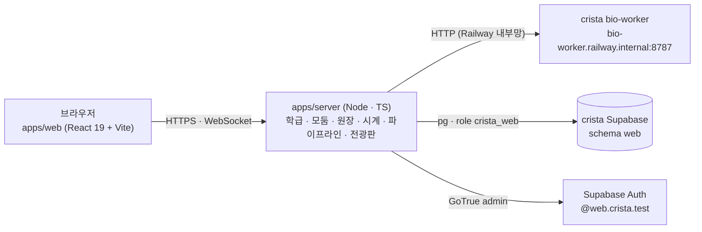

# crista-web 설계 — 신약 개발 파이프라인 플랫폼 (2026-10-23)

> **상태**: 설계안(구현 전). 저장소를 세우고 필요한 파일을 옮긴 첫날의 기준 문서다.
> **사용자 결정(2026-10-23)**: ① 새 저장소 `~/Desktop/repo/crista-web`, GitHub 비공개 ② 연결 방식 **(가)** — 이 저장소는 화면 + 작은 서버만 갖고, 계산은 crista 의 bio-worker 를 HTTP 로 부르며 판정 규칙은 crista 에서 가져온다
> ③ DB 는 **지금 crista Supabase 프로젝트를 같이 쓰되 게임과 겹치지 않게**.
> **화면 출발점**: crista 옆 세션의 시안 30종 중 **05 '4단계 로드맵'** + 상단 **전광판**(다른 모둠 소식 — 팀 간 경쟁). 전광판 시안 30종은 그 세션에서 만드는 중이다.
> **앞선 초안**: crista 안에 '랩 화면'을 붙이는 설계([`history/2026-10-23-pipeline-lab-in-crista-draft.md`](history/2026-10-23-pipeline-lab-in-crista-draft.md)) — 그중 단계 상태 · 완료 조건 · 넘기기 · 리드 최적화 · 연구 노트 · 결함 4건은 이 문서로 옮겼고,
> 월드와의 공존(학급 모드 · 가상 지점 · `LabRoom`)은 월드가 없으므로 버렸다. Gemini 4 Argon (High) · GPT-6-Astra (xhigh) 교차 의견 원문은 [`.review/2026-10-23-pipeline-lab/`](../.review/2026-10-23-pipeline-lab/).

---

## 0. 한눈에

| 항목 | 결정 |
| --- | --- |
| 무엇 | 브라우저에서 모둠(가상 제약회사)이 **실제 계산으로 신약 개발 파이프라인을 처음부터 허가까지** 밟는 수업 플랫폼. 걷는 월드는 없다 |
| 화면 | 05 '4단계 로드맵' — 왼쪽 사이드바 **큰 번호 1.~4.**(발견 · 최적화 · 개발 · 규제 · 임상 · 허가) + 하위 단계 1.1 · 1.2 …, 오른쪽 작업 영역, **위쪽 전광판** |
| 경쟁 | 전광판이 다른 모둠의 기업가치 · 주가 변동 · 단계 통과 · 실패 · 특허 · 허가를 실시간으로 띄운다. 기업가치 순위가 수업의 축 |
| 계산 | crista **bio-worker 그대로** — Open Targets · ChEMBL 데이터셋, RDKit → Meeko → Vina 1.2.7 → PLIP, ADMET-AI v2, RDKit 물성, OpenRouter 애널리스트 문구 |
| 규칙 | crista `packages/shared-types` · `packages/game-rules` **사본**(crista `e911572`) — 비용 · 기간 · 효능 E · 안전 S 판정 · 애널리스트 변동 폭 · 순위 |
| 서버 | 이 저장소의 Node 서버 하나(HTTP + WebSocket + 정적 파일). Railway 의 crista 프로젝트에 **새 서비스**로 올려 내부망으로 워커를 부른다 |
| DB | crista Supabase 에 **`web` 스키마 하나** + 전용 역할 `crista_web`(그 스키마 밖은 못 만진다). 마이그레이션 이력도 따로 둔다 |
| 계정 | 같은 Supabase Auth 를 쓰되 이메일 도메인을 `web.crista.test` 로(게임은 `students.crista.test`) — 같은 아이디라도 다른 계정 |

---

## 1. 무엇을 살리고 무엇을 버리나

### 1.1 그대로 쓰는 것(crista 에서)

| 자산 | 어떻게 | 근거 |
| --- | --- | --- |
| bio-worker `POST /jobs` · `GET /jobs/{id}` | 이 서버가 작업을 내고 진행을 받아 온다. 요청 모양은 `WorkerJobRequest`(shared-types) 그대로 | crista `apps/bio-worker/app/main.py` |
| bio-worker `POST /molecule/properties` | 리드 최적화의 **무료 물성 미리보기** · 특허 출원 물성 | 같은 RDKit 판이라 숫자가 판정과 같다 |
| bio-worker `/datasets/summary · targets · compounds` | 1.1 표적 · 1.2 스크리닝의 원자료 | Open Targets v4(480 유전자) · ChEMBL 220종 |
| bio-worker `/llm/analyst` | 전광판 헤드라인 · 애널리스트 한 줄('AI 생성' 표시, 실패면 규칙 문구) | crista M4 |
| `packages/shared-types` | `DOCKING_TARGETS`(표적 4종 · `referenceKcal`) · `TRIAL_OPTIONS` · `DISEASE_TO_TARGET` · `MoleculeProperties` · `ExperimentResult` · 워커 규격 | 이 저장소 `packages/shared-types`(사본) |
| `packages/game-rules` | `pipeline/score.ts`(효능 E · 안전 S · 물성 신호) · `pipeline/rules.ts` · `flow.ts` · `market/analyst.ts`(`ANALYST_BANDS`) · `market/price.ts` · `market/board.ts`(`rankMarketCap` · `changePct24h`) · `clock.ts` | 이 저장소 `packages/game-rules`(사본) |
| 균형안 수치 | 초기 연구비 $6.000M · 도킹 · ADMET $0.050M · 특허 $0.050M · IND · 허가 $0.100M · 임상 $0.300M / $0.600M / $1.200M · 기간 30 / 90 / 180 / 360 / 60게임 일 | crista `docs/2026-10-19-game-balance-v0.md` §3 · §10 |

### 1.2 버리는 것

Phaser 월드 · 도시 · 사옥 · NPC · 걷기 · 사거리 판정 · 설비 배치 · 객장 현장 매매 · Colyseus 룸. 월드에 묶인 `game-rules/world` · `npc` 는 사본에 남아 있어도 쓰지 않는다(정리는 W1 에서).

### 1.3 다시 만드는 것(이 저장소)

학급 · 모둠 · 계정 발급, 연구비 원장, 학급 게임 시계(임상 기간), 작업 오케스트레이션(워커 호출 · 진행 · 과금 · 환급), 파이프라인 상태 기계, 전광판 이벤트 · 기업가치, 교사 화면.
crista 게임 서버 코드는 **읽고 옮겨 쓰되**(예: `jobs/service.ts` 의 과금 · 환급 · 멱등, `pipeline/service.ts` 의 단계 판정) 의존하지 않는다.

---

## 2. 단계 — 05 '4단계 로드맵'

### 2.1 번호

05 시안의 4묶음을 큰 번호로, 하위 단계를 `N.M` 으로 쓴다. 하위 단계는 시안의 8개에서 **임상을 1 · 2 · 3상으로 나누고 리드 최적화를 따로 세워** 11개다(앞선 교차 설계에서 두 모델이 같은 권고 — 임상은 비용 · 기간 · 판정 · 재도전이 상마다 다르다).

| 큰 번호 | 하위 단계 | 하는 일 | 계산 · 출처 | 완료 조건(서버 상태) | 비용 · 기간 |
| --- | --- | --- | --- | --- | --- |
| **1. 발견** | **1.1 질환 · 표적 확정** | 질환을 고르고 Open Targets 근거(유전 · 문헌 · 약물 · 발현, 구조 준비 여부)를 비교해 표적을 정한다 | `dataset` | 모둠 프로그램에 `targetId` 확정 | 무료 |
| | **1.2 히트 스크리닝** | 220종 깔때기 컷오프(MW · TPSA · Ro5 · 구조 경고)를 직접 정해 돌리고 후보를 고른다 | `dataset`(사전 Vina 값 포함) | 그 표적의 스크리닝 1회 이상 | 무료 |
| **2. 최적화** | **2.1 도킹 · 리드 선정** | 후보 + 대조군(결정 리간드)을 도킹 → ΔG · 기준 대비 결합력 · PLIP 상호작용 비교 → 리드 고르기 | `vina` | 그 표적의 실제 도킹 근거 1건 이상 | 도킹마다 $0.050M |
| | **2.2 리드 최적화** | 작용기 바꾸기 칩 · SMILES 편집 → **무료 물성 미리보기** → 재도킹 → 원본 · 변형체 비교표 | `vina` + RDKit | 변형체 1개 이상 도킹 **또는** '원본 유지' 이유를 연구 노트에 적음 | 도킹마다 $0.050M |
| | **2.3 ADMET 예측** | 리드의 ADMET-AI 레이더 6축 + RDKit 위험 신호 | `admet-ai` | 리드 1개 이상 예측 | $0.050M |
| **3. 개발 · 규제** | **3.1 후보 지명 · 물질특허** | 후보 1개에 코드명(`CRX-101`) · 기전을 붙이고 물질특허 출원(같은 물질은 학급 선착순) | RDKit 물성 | 유효 특허 1건 | $0.050M |
| | **3.2 제형 · IND 신청** | 경구 · 정맥 · 경피 + 용량 10/50/100 mg · 환자군 · 1차 평가지표 → FDA 심사 | 교육용 모의 판정 | IND 통과 | $0.100M · 30게임 일 |
| **4. 임상 · 허가** | **4.1 임상 1상** | 안전성 · 용량(통과 용량 기록) | 교육용 모의 판정 | 1상 통과 | $0.300M · 90게임 일 |
| | **4.2 임상 2상** | 효능 · 안전성 | 〃 | 2상 통과 | $0.600M · 180게임 일 |
| | **4.3 임상 3상** | 대규모 확증 | 〃 | 3상 통과 | $1.200M · 360게임 일 |
| | **4.4 신약 허가** | 브랜드 이름 · 포장 · 최종 심사 | 〃 | 허가 | $0.100M · 60게임 일 |

crista 게임과 **순서가 달라지는 곳**(이 저장소는 자기 서버라 산업 순서에 맞춘다):
- **ADMET 이 특허보다 앞** — crista 는 '유효 특허 분자'만 ADMET 을 돌린다. 산업에서는 리드 최적화 중에 ADMET 을 보고 후보를 고른 뒤 특허 · 지명을 한다(05 시안도 이 순서).
- **코드명은 후보 지명 때** — crista 는 표적 선언 때 코드명을 붙인다. 산업의 화합물 코드명은 후보 지명 때 붙는다. 표적은 1.1 에서 따로 확정한다.
- 판정(효능 E · 안전 S)은 crista 와 **같은 함수**(`game-rules/pipeline/score.ts`) — 입력은 특허 분자의 도킹값 · RDKit 물성 · 용량 · 제형. ADMET-AI 값은 판정에 넣지 않는다(crista 와 같음 — 넣으려면 규칙 판을 올린다).

### 2.2 단계 상태

서버가 계산해 내려보낸다(화면은 그리기만). crista 초안의 7상태를 그대로 쓴다.

```ts
type StepState = 'locked' | 'ready' | 'running' | 'done' | 'held' | 'blocked' | 'review';
//  locked  : 앞 단계 근거 없음(reason · unlockBy)       ready  : 할 수 있음
//  running : 작업 · 심사 · 임상 진행(progressPct · byName)  done   : 완료 조건 충족
//  held    : 보류(CRL) · 기준 미달 — 재도전 경로              blocked: 학급 일시정지 · 연구비 부족 등 학급 · 회사 상태
//  review  : 앞 단계를 바꿔 이 단계 근거를 다시 봐야 함(예: 표적 변경 뒤의 도킹 결과)
interface StepView { id: StepId; major: 1 | 2 | 3 | 4; minor: number; state: StepState; reason?: string; unlockBy?: StepId;
  progressPct?: number; byName?: string; attempt?: number; evidence: Array<'dataset' | 'compute' | 'prediction' | 'simulation'>;
  costCents?: number; durationGameDays?: number }
```

- 큰 번호(1.~4.)의 상태는 하위 단계에서 나온다(모두 `done` → 완료, 하나라도 `running` → 진행, …).
- **점수(E · S)는 판정 뒤에만** 보인다. 미리보기 · ADMET · IND 서식은 물성과 위험 신호만.
- 표적을 바꾸면(IND 전) 2.x 근거는 `review` 로 내려가고 옛 표적 결과는 흐리게 따로 남는다.

### 2.3 화면 계약(05 위에서)

- 사이드바: 큰 번호는 목록(`<ol>`)이 매기고, 지금 하위 단계 하나에 `aria-current="step"`. 상태는 색 + 기호 · 글자(✓ ▸ 🔒 ✕ ⏸ ↺). 잠긴 단계도 눌러 '무엇을 배우나 · 무엇이 필요한가'를 본다.
- 작업 영역 순서: 머리(번호 · 제목 · 완료 조건 · 비용) → 실제 산업에서는 → **결과의 성격**(자료 조회 · 실제 계산 · AI 예측 · 교육용 모의 판정) → 준비물(앞 단계에서 넘어온 값) → 입력 · 실행 → 결과 기록 → 연구 노트 → **다음 단계로**(초안만 채움, 자동 실행 · 과금 없음).
- 05 시안의 '서버 메시지 기록' 칸은 개발 · 교사용 토글로 남긴다(학생 기본은 숨김).

---

## 3. 전광판 — 모둠 간 경쟁

### 3.1 올리는 소식

| 종류 | 예 | 계기 |
| --- | --- | --- |
| 기업가치 · 주가 | `NRG 기업가치 +8.2% — 리드 결합력 신기록` | 애널리스트 계기마다(아래 §3.2) |
| 단계 통과 | `BNX 임상 1상 통과 — 2상 진입` | IND · 1 · 2 · 3상 · 허가 판정 |
| 실패 · 보류 | `HLX 임상 2상 보류 — 효능 부족, 재설계 중` | 판정 보류(CRL) |
| 특허 | `NRG 물질특허 등록 — 알츠하이머 후보` | 3.1 출원 |
| 기록 | `학급 최고 결합력 경신 −12.4 kcal/mol (AChE)` | 표적별 최고 ΔG 경신 |
| 허가 | `◉ BNX '뉴로클리어정' FDA 허가` | 4.4 |
| 교사 공지 · 정정 | `정정: HLX 2상 판정 재계산` | 교사 |

**공개 범위**(crista 와 같은 원칙): 전광판 · 순위에는 **사실과 결과만** — 회사 · 단계 · 통과/보류와 실패 종류 · 표적 질환 · 기업가치. **후보 SMILES · 물성 · 점수 · 연구 노트는 그 모둠과 교사만.** 학급 밖으로는 아무것도 보내지 않는다.

### 3.2 기업가치

- 매매가 없으므로 가격은 **펀더멘털만**이다: 상장가 $10.00 · 1,000,000주에서 시작해 계기마다 `ANALYST_BANDS`(crista `game-rules/market/analyst.ts`)의 변동 폭 안에서 움직인다. 기업가치 = 주가 × 주식 수.
- 변동률은 규칙이 정하고, 헤드라인 한 줄만 워커 `/llm/analyst` 로 쓴다(키가 없거나 실패하면 규칙 문구, 'AI 생성' 표시). 학급 · 하루 호출 상한을 둔다.
- 순위 · 24시간 변동은 `rankMarketCap` · `changePct24h` 를 쓴다. 5분 봉은 전광판 그래프용.
- 학생 개인 투자(매수 · 공매도)는 **이번 범위가 아니다** — 넣으면 crista `market/*` 의 계좌 · 증거금 규칙을 옮겨 오는 별도 단계(사용자 결정).

### 3.3 전송

서버 WebSocket 으로 학급 채널에 민다(모둠 전용 채널과 분리). 새로 들어온 학생은 최근 50건 + 순위를 받는다. 전광판 시안이 정해지면 그 모양(띠 · 시세판 · 피드)에 맞춘다.

---

## 4. 아키텍처



```text
crista-web/
  apps/web/        React 19 + Vite — 05 화면 · 전광판 · 교사 화면(W2)
  apps/server/     Node 서버 — REST(행동) + WebSocket(밀기) + apps/web 정적 파일(W1)
  packages/shared-types  packages/game-rules   crista 사본(SOURCE.md)
  packages/web-contract  이 저장소의 통신 규격(W1)
  db/migrations/   web 스키마 SQL + 자체 실행기(§5.2)
  design/          화면 시안(05 원본 · 전광판 시안)
  docs/            설계 · 기록
```

- **서버 하나로 정적 파일 · API · WebSocket** 을 함께 낸다. 워커가 Railway 내부망에만 있어 서버는 Railway 에 있어야 하고, 화면까지 같은 서비스에 두면 배포가 하나로 끝난다(Vercel 팀 권한 문제도 피한다).
- 프런트엔드 스택은 crista 와 같은 React 19 + Vite(학습 곡선 · 컴포넌트 이식). Next.js 는 쓰지 않는다 — 워커 진행을 오래 기다리고 WebSocket 을 들고 있어야 해서 서버리스와 맞지 않는다.
- **게임 시계**: crista `clock.ts` 의 앵커 방식(현실 시각 → 게임 일). 임상 · 심사 진행은 '끝나는 게임 일'을 저장하고 읽을 때 · 주기 틱에서 판정한다. 교사가 일시정지 · 배속.
- **작업 오케스트레이션**: crista `jobs/service.ts` 의 규칙을 옮긴다 — 요청과 과금을 한 트랜잭션(멱등 `(모둠, requestId)`), 워커 실패는 같은 작업 id 로 한 번 환급, 연구상 실패는 환급 없음, 서버 재시작 뒤 진행 중 작업을 같은 id 로 다시 조회.

### 4.1 로컬 개발 — crista 와 포트가 겹치지 않게

| 무엇 | crista | crista-web |
| --- | --- | --- |
| 화면(Vite) | 5173 · 5174 | **5190** |
| 서버 | 2567 · 2568 · 2572 | **3390** |
| bio-worker | 8787 · 8788 · 8796 | crista 워커를 **8790** 으로 띄워 쓴다(`CRISTA_WORKER_MODE=fixture` 또는 `compute`) |
| DB | 로컬 Supabase 553xx | 같은 로컬 Supabase 의 `web` 스키마(호스팅과 같은 실행기) |

---

## 5. Supabase 공유 — 게임과 겹치지 않게

### 5.1 경계

| 겹칠 수 있는 곳 | 막는 방법 |
| --- | --- |
| **표** | 모든 표를 **`web` 스키마**에. `public` 의 게임 표를 읽지도 쓰지도 않는다. 외래 키는 `auth.users(id)` 만 |
| **권한** | 서버는 전용 역할 **`crista_web`** 로 접속(`web` 스키마의 USAGE · CREATE · 표 권한만, `public` 은 권한 없음). 실수로 게임 표를 건드리면 DB 가 거절한다. 역할 · 스키마를 만드는 첫 마이그레이션만 관리자 연결(`CRISTA_DATABASE_URL`)로 한 번 |
| **마이그레이션 이력** | crista 는 `supabase db push` 로 `supabase_migrations.schema_migrations` 에 m2~v11 을 쌓았다. 이 저장소에서 같은 명령을 쓰면 '원격에 로컬에 없는 판이 있다'로 충돌하거나 이력이 섞인다 → **이 저장소는 Supabase CLI 마이그레이션을 쓰지 않는다.** `db/migrations/*.sql` 을 자체 실행기가 적용하고 `web.schema_migrations` 에 기록한다 |
| **crista 쪽 `db pull` · `db diff`** | crista 에서 이 명령을 쓰면 `web` 스키마가 차이로 보일 수 있다 → crista 쪽은 `--schema public` 으로 한정(crista 문서에 한 줄 남길 것 — 그 저장소 작업은 사용자 확인 뒤) |
| **계정** | 같은 Auth 를 쓰되 합성 이메일 도메인을 **`web.crista.test`**(게임 `students.crista.test`, crista `apps/game-server/src/auth/identity.ts`). 같은 아이디 `kim01` 도 다른 계정이다. 역할 · 학급 소속은 `web.members` 에만. crista 에는 `auth.users` 삽입 트리거가 없어(마이그레이션 확인) 웹 계정이 게임 표에 행을 만들지 않는다 |
| **워커 작업 · 캐시** | 워커에 보내는 id 에 접두를 붙인다 — `jobId = web-<uuid>`, `classId = web:<uuid>`, `teamId = web:<uuid>`. 워커의 도킹 캐시는 `public.simulation_cache` 에 **팀 범위 키**로 쌓이므로(외래 키 없음) 게임 팀과 섞이지 않는다. 이 행들만 지우려면 `where class_id like 'web:%'` |
| **워커 용량** | 워커 동시 도킹은 기본 2개(`CRISTA_DOCK_MAX_CONCURRENT`) — 게임 수업과 **대기열을 나눠 쓴다**. 이 서버가 학급당 동시 도킹 상한을 두고, 겹치는 수업이 생기면 워커 복제본을 따로 띄울지 결정(비용) |
| **LLM 비용** | 워커의 OpenRouter 키를 같이 쓴다 — 이 서버가 학급 · 하루 호출 상한을 둔다 |
| **Realtime · Storage** | 쓰지 않는다(전광판은 이 서버의 WebSocket) — 프로젝트 설정을 바꾸지 않는다 |

### 5.2 마이그레이션 실행기

- `db/migrate.mjs` — `db/migrations/NNNN_name.sql` 을 이름순으로 한 트랜잭션씩 적용, `web.schema_migrations(version, applied_at, checksum)` 에 기록, 이미 적용한 파일의 체크섬이 바뀌면 멈춘다.
- 대상: 로컬(crista 로컬 Supabase 55322) · 호스팅(풀러 + `certs/supabase-prod-ca-2021.crt` `verify-full`). 호스팅 적용은 `--dry-run` 으로 SQL 을 먼저 보이고 확인 뒤.
- `0000_bootstrap.sql`(관리자 연결 1회): `create schema web` · `create role crista_web login` · 권한. 비밀번호는 `.env.local` 에만.
- 모두 걷어내는 길: `drop schema web cascade` · `drop role crista_web` · 웹 계정(`@web.crista.test`) 삭제 · 워커 캐시 `class_id like 'web:%'` 삭제.

### 5.3 표 초안(`web` 스키마)

`classes`(이름 · 시계 앵커 · 배율 · 일시정지 · 초대 코드) · `members`(user_id · class_id · 역할 · 모둠) · `teams`(사명 · 티커 · 색 · 슬로건) · `ledger`(정수 센트 · 종류 · 멱등 키) ·
`jobs`(워커 작업 · 상태 · 결과 · 출처 · 비용 · 환급) · `programs`(표적 · 코드명 · 기전 · 후보 · 제형 · 프로토콜) · `patents`(정규 · 평면 SMILES · 학급 유일) · `steps`(IND · 임상 · 허가 진행 · 판정) ·
`board_events`(학급 공개 소식) · `valuations`(주가 · 기업가치 이력) · `notes`(연구 노트) · `schema_migrations`.

---

## 6. 게이미피케이션

- **회사 설립은 모둠이 한다** — 첫 입장 때 사명 · 티커(학급 유일 3~4자) · 색 · 슬로건. crista 와 달리 매매가 없어 티커를 상장 키로 묶어 둘 까닭이 약하다 — 첫 유료 행동 전까지 고칠 수 있게.
- **연구비** — 초기 $6.000M, 유료 단계마다 비용 칩과 지출 확인, 잔액 부족은 `blocked`. 원장은 정수 센트.
- **투자 라운드** — 1. 발견 끝에 Series A($3.000M), 3.1 후보 지명 뒤 Series B($5.000M)(균형안 §3.1). 모둠이 연구 노트로 '가설 · 근거 · 실패 시 대안'을 내고 **교사가 승인** — 승인되면 원장 · 전광판(`NRG Series A 유치`).
- **실패 바운티** — 보류 · 기준 미달 뒤 원인 분석을 내면 실제 낸 비용의 일부를 환급(crista v8 요율: IND · 1상 50% · 2상 40% · 3상 30% · 실험 40%). W4.
- **유지비 · 게임 시계** — 월 유지비(기본 $0.050M)로 '시간도 돈'을 남길지는 첫 수업 길이를 보고 정한다(사용자 결정).

---

## 7. 리드 최적화 · 연구 노트 (crista 초안에서 옮김)

- **작용기 바꾸기 칩 6종**(고등학생이 SMILES 를 손으로 고치기 어렵다 — Gemini): 방향족 아민 → 아세트아마이드 · 니트로 → 시아노 · 염기성 아민 → 아마이드 · 하이드록시 도입 · 플루오린 도입 · 메톡시 제거. 워커에 `POST /molecule/transform`(RDKit 반응 SMARTS)을 **crista 쪽에 더해야** 한다 — crista 저장소 변경이라 사용자 확인 뒤(그 전에는 SMILES 편집 + 미리보기만).
- **무료 미리보기**는 서버가 워커 `/molecule/properties` 를 대신 부르고 `propertySignals` 로 위험 신호를 붙인다. 모둠당 분당 20회 · 캐시 · 길이 상한. 단추 · 칩을 누를 때만.
- **비교표**: 그 표적에 도킹한 모든 분자 — ΔG · 기준 대비 결합력 · MW · cLogP · TPSA · 신호 · 부모 분자.
- **연구 노트**: 단계마다 '왜 골랐나 · 무엇을 모르나 · 실패하면 무엇을 바꾸나'. 막지는 않고, 투자 심사 · 바운티 · 교사 화면이 미리 채워 쓴다.
- **3D 포즈 뷰어 · 2D 스케처**: 새 패키지라 사용자 승인 뒤. 워커는 이미 `artifacts.poseSdf` 를 만든다.

## 8. crista 의 기존 결함 — 이 저장소에서는 처음부터 피한다

| crista 결함(코드 대조 확인) | 이 저장소 |
| --- | --- |
| Stage 4 가 특허 분자인지 서버가 안 봄(`jobs/service.ts` `prepareInput` — 길이만) | ADMET 입력은 서버가 '그 모둠의 도킹 근거가 있는 분자'인지 대조 |
| `PIPELINE_STATE` 를 받으면 대기 중 서식을 모두 완료로(`store/pipeline.ts` `applyState`) | 모든 응답에 `requestId` 를 실어 그 요청만 완료 |
| 제형 결정이 프로그램 표적을 특허 표적으로 조용히 바꿈(`pipeline/service.ts` L821~) | 표적은 1.1 에서만 바뀐다. 다른 표적 특허로는 지명 불가 |
| Stage 1 PDB 기본값 `1M17` 고정 | PDB 입력 없음 — 질환이 표적 · 구조를 정한다 |

이 넷은 crista 에서도 고쳐야 한다(그 저장소 작업 — 따로).

---

## 9. 구현 순서

| 단계 | 범위 | 완료 기준 |
| --- | --- | --- |
| **W0 저장소**(오늘) | 저장소 · `.gitignore` · `.env.local` 복사 · CA · crista 패키지 사본 · 05 시안 · 이 설계 · 비공개 GitHub | 비밀값 미커밋 확인 · 원격 push |
| **W1 서버 뼈대** | npm workspace · `apps/server`(HTTP · WS · 정적) · `web-contract` · `db/migrate.mjs` + `0000_bootstrap` · `0001_core` · 로컬 Supabase 적용 · 로그인(`@web.crista.test`) · 학급 · 모둠 · 원장 | 로컬에서 교사 1 · 모둠 2 로그인, 원장 한 줄, 게임 표 무변경(`public` 행 수 그대로) |
| **W2 화면 뼈대** | 05 레이아웃(사이드바 1.~4. + 하위 단계) · 단계 상태 · 1.1 → 1.2 → 2.1 실제 연결(fixture 워커 8790) · 전광판 자리 | 1.1 표적 확정 → 1.2 후보 → 2.1 도킹 입력 자동 채움 · 실행 · 결과 |
| **W3 파이프라인 끝까지** | 2.2 · 2.3 · 3.1 · 3.2 · 4.1~4.4 · 게임 시계 · 판정(game-rules) · 재도전 3경로 · 교사 일시정지 · 정정 | 시간 건너뛰기로 1.1 → 4.4 완주 · 재전송 무과금 · 보류 뒤 재도전 |
| **W4 전광판 · 경쟁** | 전광판 시안 반영 · 기업가치 · 순위 · 애널리스트 헤드라인 · Series A/B · 바운티 | 두 모둠의 통과 · 보류가 서로의 전광판에 뜨고, 비공개 값은 안 뜸 |
| **W5 배포**(확인 뒤) | 호스팅 DB 적용(dry-run → 확인) · Railway crista 프로젝트에 새 서비스 · compute 워커 연결 | 호스팅에서 한 모둠 1.1 → 2.1 실제 Vina |

---

## 10. 사용자 결정으로 남긴 것

1. 전광판 시안(옆 세션 30종 중 하나).
2. 유지비(시간 = 돈)를 둘지, 연구비만 쓰는 단순한 경제로 갈지.
3. 학생 개인 투자(매수 · 공매도)를 나중에 넣을지.
4. crista bio-worker 에 `POST /molecule/transform` 을 더하는 crista 저장소 변경.
5. W5 배포(Railway 새 서비스 비용 · 호스팅 DB 스키마 생성).
6. 항체 트랙 — `docs/Welcome_to_AI_based_Drug_Prediction_v26_09_15.ipynb`(ChEMBL 항체 → ProteinMPNN → ColabFold → AlphaFold-Multimer)는 지금의 저분자 파이프라인과 다른 트랙이다. 나중에 두 번째 파이프라인으로 넣을지.

## 참고

- crista 원본: `PRD.md` · `ARCHITECTURE.md` · `docs/2026-10-19-game-balance-v0.md` · `docs/2026-10-21-m5-implementation-brief.md` · `docs/2026-10-23-real-db-multi-target-upgrade-design.md` · `docs/2026-10-22-gamification-motivation-design.md` · `docs/2026-10-23-railway-deploy.md`(deploy worktree)
- NIH NCATS *Early Drug Discovery and Development Guidelines*: https://www.ncbi.nlm.nih.gov/books/NBK92015 · FDA *The Drug Development Process*: https://www.fda.gov/patients/drug-development-process/step-1-discovery-and-development
- TeachOpenCADD: https://projects.volkamerlab.org/teachopencadd/all_talktorials.html · *MedChem Game*, J. Chem. Educ. 2024: https://pubs.acs.org/doi/10.1021/acs.jchemed.4c00253
