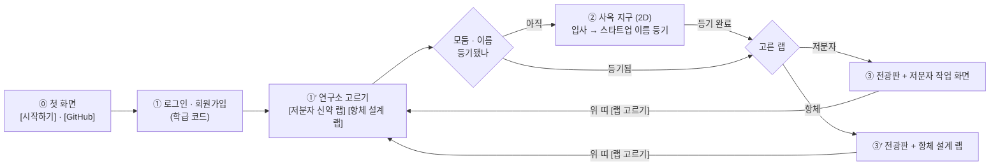

# crista-web 항체 설계 랩 설계 — 두 번째 파이프라인 (2026-10-24)

> **상태**: 설계안(구현 전) · **2판**(1판에 대한 feasibility · science-honesty · ux-game 3렌즈 검토 의견을 반영). 본 설계서는 [`2026-10-23-crista-web-design.md`](2026-10-23-crista-web-design.md)(이하 **본 설계**)의 §12-8 '항체 트랙 미결'을 **한다**로 확정하는 문서다. 반영·보류 내역은 **§10 검토 의견 처리**에 전부 적었다.
> **작업 저장소**: `/Users/mulkib/Desktop/repo/crista-web-antibody` (git worktree · 브랜치 `feat/antibody-lab`). 원본 `/Users/mulkib/Desktop/repo/crista-web` 은 다른 세션이 작업 중이라 **읽기만** 한다.
> **사용자 결정(2026-10-24)**
> 1. 로그인 · 회원가입 뒤 **버튼 2개**('저분자 신약 랩' / '항체 설계 랩')로 두 파이프라인 중 하나를 골라 들어간다.
> 2. 항체 랩은 [`Welcome_to_AI_based_Drug_Prediction_v26_09_15.ipynb`](Welcome_to_AI_based_Drug_Prediction_v26_09_15.ipynb)(31셀 · 보평고 김태영 · v2026.09.15)의 파이프라인을 구현한다 — Part0 ChEMBL 항체 검색 + RCSB 구조 → Part1·2 보존도 + 변이체 설계 → Part3 구조 예측 → Part4 복합체 평가 → 보고서.
> 3. **제약회사 설립(모둠 · 스타트업 이름 등기)은 저분자 랩과 똑같다**. 다른 것은 '무엇으로 점수를 받는가'다 — 항체 랩에서는 **항체를 얼마나 잘 설계했느냐**가 점수 · 기업가치를 정한다.
> 4. 화면은 본문 레이아웃 시안 **21 '둥근 섬'**([`design/body-layout-30.html`](../design/body-layout-30.html) `#L21` · 규격은 본 설계 §5.4.1)을 적용한다.
> **제약**
> - **GPU 가 없다.** ProteinMPNN · ColabFold 구조예측 · AlphaFold-Multimer 는 이 서버에서 돌리지 않는다.
> - 유료 자원(GPU 임대 · 유료 API 키 발급 · 배포)은 **사용자 확인 전에 만들지 않는다**.
> - **정직성**: 실제 계산이 아닌 값에는 '교육용 근사' 배지를 반드시 붙인다. 실측 API 로 받은 값과 서버에서 결정적으로 계산한 값, 근사값을 화면에서 구분한다. **원전 지표 이름을 근사값에 쓰지 않는다** — 금지 이름은 `ipTM` · `ΔΔG` · `TAP` · `SFvCSP` · `FvCSP` · `PSH` · `PPC` · `PNC` · `ConSurf` 이며, 묶음 6 의 정직성 감사가 grep 으로 고정한다(§3.5).
> - **용어**: 학생 화면에는 우리말 이름만 쓴다(§6.6 학생 문구 대응표). 원어는 배지를 눌러 펼치는 상세와 '점수 계산 방법' 페이지에만 둔다.
> **조사 근거**: 2026-10-24 에 외부 API 를 직접 호출해 확인한 응답 · 지연 · 실패 코드를 §3 에 적었다. 과학 지표의 상수 · 임계값 출처는 §4 · §9 에 링크로 남긴다.

---

## 0. 한눈에

| 항목 | 결정 |
| --- | --- |
| 무엇 | 저분자 랩과 **같은 회사 · 같은 연구비 · 같은 전광판**을 쓰는 **두 번째 파이프라인**. 모둠은 표적 항원을 고르고, 기존 치료항체를 본떠 **Fv(VH+VL) 변이체를 설계**하고, 설계 품질 점수로 기업가치를 키운다 |
| 화면 흐름 | ⓪ 첫 화면 → ① 로그인 · 가입 → **①′ 연구소 고르기(버튼 2개)** → (모둠 · 이름 없으면 ② 사옥 지구 등기) → ③ 저분자 작업 화면 `/board` 또는 ③′ **항체 랩** `/antibody` |
| 단계 | 4묶음 · 하위 6단계 — **A1 표적 · 원본 항체 → A2 구조 · 보존도 → A3 변이 설계 → A4 접힘 예측 → A5 복합체 평가 → A6 보고서 · 상장 평가** |
| 실제 계산 | ChEMBL(항체 · 서열) · RCSB(구조 · 서열 유사도) · ColabFold MSA(실제 MSA) · SAbDab2(IMGT 번호 · 최근접 실측 항체) · ESMFold(실제 구조 예측 · ≤400잔기) — 모두 무키 공개 API, 실측 확인 |
| 서버 계산(센 값) | 번호 매김 기반 CDR 구간 · 전하 · pI · 두 사슬 전하곱 · CDR 길이 · 약점 모티프 개수 · 사람 유전자 동일성 — 결정적 TypeScript |
| 모형 추정값 | 레퍼토리 다양성(MSA 엔트로피 백분위) · 기름진 겉면 정도(창 근사) · **붙는 힘 점수**(MJ 접촉 통계 · 무단위) · 설계 적합도 — 전부 `교육용 근사` 배지 |
| 교육용 근사 | 변이체 자동 제안(ProteinMPNN 대체) · 복합체 설계 적합도(AlphaFold-Multimer 대체). **금지 이름 목록(§3.5)을 코드·화면에서 쓰지 않는다** |
| 점수 | **항체 설계 점수 0~100** = 붙는 힘 0.30 · 안정성 0.20 · 개발가능성 0.30 · 인간화 개선 0.10 · 유효 신규성 0.10 (가중치는 학급 설정으로 교사가 바꾼다) |
| 기업가치 | 저분자 랩과 **한 회사 · 하나의 펀더멘털**. 계기는 **모둠 자기 최고점 경신**(0~10%) + A3 미리보기 최고 경신(0~3%) + A4 첫 성공(0~2%). 상장가 $10.00 × 1,000,000주. 1차 저장은 `web.antibody_valuations`, 0007 병합 시 `web.valuations` 로 이관(§4.6) |
| 수입 | 학습 연구비 4통로를 **트랙 축으로 확장**한다 — 단계 키를 `track:stepId`(`antibody:A3`)로, `GET /api/learn/step/:track/:stepId`(기존 경로는 `small` 기본값). 항체 랩만 쓰는 모둠도 문항 · 노트 · 가동률로 연구비를 번다(§4.7) |
| DB | 새 마이그레이션 **`0020_antibody_lab.sql`** — `web.antibody_*` 새 표만(프로그램 · 버전 · 제안 · 투표 · 설계 · 작업 · 점수 · 노트 · 소식 · 가치 · 캐시 · 계면 · CDR 통계 · 학급 설정). 공유 표(`ledger` · `jobs` · `teams`)는 `ALTER` 하지 않는다 |
| 화면 | 시안 21 '둥근 섬' — 사이드바 섬 264px · 머리 섬 · 작업 섬 둘(내 작업대 / 모둠 공유) · 반경 26px · 틈 12px · 섬 사이 선 없음. 폰 경계 **960px**(기존 `.shell` 과 같게). 3D 뷰어는 **3Dmol.js 2.5.5** + **같은 내용의 표 대안 필수** |
| 수업 시간 | A1·A2 1차시 / A3·A4 2차시 / A5·A6 3차시. 학급 24명 · 8모둠 큐 시뮬레이션을 §8 위험 1 에 숫자로 적었다 |
| 수정 금지 | `packages/shared-types` · `packages/game-rules`(crista 사본 `e911572` — [`packages/SOURCE.md`](../packages/SOURCE.md)). 항체 전용 상수 · 타입은 `packages/web-contract` 와 `apps/server/src/features/antibody/` 에 둔다 |

---

## 1. 화면 흐름 — 연구소 고르기

### 1.1 흐름



- **제약회사 설립은 하나다.** 모둠 · 스타트업 이름 · 티커 · 연구비 원장은 두 랩이 함께 쓴다. 두 버튼은 '회사를 두 개 만드는 것'이 아니라 **어느 파이프라인의 작업 화면을 열지** 고르는 것이다. 한 회사가 두 랩을 동시에 굴릴 수 있다.
- **고른 랩은 주소에 둔다 — 저장소에 의존하지 않는다.** 등기 전에 항체 랩을 고른 학생은 `/crista/district?lab=antibody` 로 보내고, 등기가 끝나면 그 쿼리 값으로 **고른 랩**으로 돌려보낸다. `sessionStorage['crista.lab']` 은 **보조 캐시**로만 `try/catch` 로 적고, 주소 · 저장소 **둘 다 비어 있으면 저분자 랩으로 조용히 넘기지 않고 `/crista/lab`(연구소 고르기)로 되돌린다**. 시크릿 창 · 저장소 차단 · 새 탭에서 학생이 모르는 사이 다른 랩에 들어가는 일을 막는 것이 이 규칙의 목적이다.
- 라우트 자체도 주소에 있다(`/crista/lab` · `/crista/board` · `/crista/antibody`) — 새로고침 · 뒤로가기 · 링크 공유에 견딘다.
- 위 띠에 **[랩 고르기]** 단추를 둬서 두 랩을 언제든 왕복한다.
- **소식(전광판) 출처는 하나로 간다 — 다만 1차에서는 두 랩이 같은 띠를 공유하지 않는다.** 지금 워크트리의 `Board.tsx` LED 띠는 서버 소식 피드가 아니라 `board.teams` 로 화면이 직접 만든 '설립 등기' 문구뿐이다. 그래서 1차 구현에서는 **항체 소식은 항체 랩 화면의 LED 띠에서만** 보이고(출처 `web.antibody_events`), 저분자 화면은 지금 동작을 그대로 둔다. 다른 세션의 `0007_market_learn`(`web.board_events`)이 병합되면 **§4.6 의 이관 SQL 한 번으로 소식 출처를 `board_events` 하나로 합치고** 두 랩이 같은 띠를 쓰게 한다. 그때 `Board.tsx` 의 LED 띠를 서버 피드로 바꾸는 작업은 **2차 범위**이며 그 세션 쪽 작업과 겹치므로 여기서 하지 않는다(§7.1).

### 1.2 라우트 · 주소

| 라우트 | 주소(`BASE = /crista`) | 화면 | 비고 |
| --- | --- | --- | --- |
| `landing` | `/crista/` | 첫 화면 | 그대로 |
| `login` | `/crista/login` | 로그인 · 가입 | 그대로 |
| **`lab`** | **`/crista/lab`** | **연구소 고르기(버튼 2개)** | 새로 만든다 |
| `district` | `/crista/district` | 사옥 지구 | 그대로 |
| `board` | `/crista/board` | 저분자 작업 화면 | 그대로 |
| **`antibody`** | **`/crista/antibody`** | **항체 설계 랩** | 새로 만든다 · `lazy`(3D 뷰어가 무겁다) |
| `teacher` | `/crista/teacher` | 교사 화면 | **1차에서는 선생님 화면을 건드리지 않는다**(2026-10-24 수정 · §12). `Teacher.tsx` 가 §11.4 '손대도 되는 줄' 목록에 없어서다. 서버 경로(`/api/antibody/teacher/{settings,correct,queue}`)는 올라와 있고 화면 탭만 2차로 미룬다 — 목록에 `Teacher.tsx` 를 더할지는 **사용자 결정**(§9-20) |

- SPA 재작성(`vercel.json`)은 `api/` · `ws` · `assets/` · `campus/` 만 빼고 전부 `index.html` 로 보내고, 서버 정적 처리도 확장자 없는 경로를 `index.html` 로 보낸다 → 새 주소 둘은 **설정 변경 없이** 동작한다.

### 1.3 서버 `next` 처리 — **서버는 고치지 않는다**

서버의 `MeResponse.next`(`'district' | 'board' | 'teacher'`)는 **그대로 둔다**. `NextScreen` 값을 늘리면 그 타입을 쓰는 주소표 · 교사 분기 · 다른 세션의 코드가 함께 깨진다.

대신 화면에서만 한 겹 감싼다.

```ts
// apps/web/src/App.tsx
export type Route = 'landing' | 'login' | NextScreen | 'lab' | 'antibody';

/** 서버가 준 next 를 '처음 보낼 라우트'로 바꾼다. 등기까지 끝난 학생은 연구소 고르기로. */
const entry = (m: MeResponse): Route => (m.next === 'board' ? 'lab' : m.next);
```

| 자리 | 지금 | 바꿀 것 |
| --- | --- | --- |
| 첫 `/api/me` 뒤 리다이렉트 | `go(found.next)` | `go(entry(found))` + `(['lab','antibody','board'].includes(current) && found.next === 'district')` 이면 `go('district')`(등기 전 학생이 주소로 바로 들어온 경우) |
| 첫 화면 [시작하기] | `go(me ? me.next : 'login')` | `go(me ? entry(me) : 'login')` |
| 로그인 완료 | `go(found.next, true)` | `go(entry(found), true)` |
| 렌더 분기 | `teacher` · `board` · 그 밖 `District` | `lab` → `<Labs>` · `antibody` → `<Suspense><Antibody></Suspense>` 를 `board` 앞에 |
| 사옥 지구 등기 완료 3곳(WS 로 남이 등기 · 위 띠 '작업 화면으로' · 사옥 패널 `onBoard`) | `go('board')` | `go(pickedLab() === 'antibody' ? 'antibody' : 'lab')` — `pickedLab()` 은 **주소 쿼리 `?lab=` 우선 · `sessionStorage` 보조 · 둘 다 없으면 `'lab'`**(§1.1) · 위 띠 글자는 '랩으로' |
| 저분자 작업 화면 위 띠 | '사옥 지구' | 옆에 **[랩 고르기]** → `go('lab')` |

- 항체 랩 화면도 저분자 화면과 같은 되돌리기를 쓴다 — API 가 `not_registered_team`(409) 을 주면 `go('district')`.
- **두 트랙 진행을 함께 담는 선택 칸을 더한다**(진행 칩을 두려면 필요하다. 저분자 `StepId` 는 9개가 아니라 **8개**(1.1~4.2)다):

```ts
// packages/web-contract/src/api.ts — MeResponse 에 선택 칸 하나(추가는 하위 호환)
export interface LabProgress { opened: boolean; doneCount: number; total: number; stepId?: string }
export interface MeResponse {
  /* …기존 칸 그대로… */
  labs?: { small: LabProgress; antibody: LabProgress };   // small.total = 8 · antibody.total = 6
  openTracks?: LabTrack[];                                 // 교사가 닫은 랩을 고르기 화면에서 비활성으로 그린다
}
```

  - 채우는 자리: `apps/server/src/accounts.ts` 의 `me()` 가 `web.pipeline_steps`(저분자) · `web.antibody_jobs`·`antibody_designs`(항체) 완료 수를 세어 넣는다. **이 두 파일(`accounts.ts` · `web-contract/src/api.ts`)을 묶음 1 · 4 의 수정 목록에 넣었다**(§7).
  - 칸이 없거나 `undefined` 면 **고르기 화면은 진행 칩을 그리지 않는다**(§1.4) — 없는 값을 추측해 그리지 않는다.

### 1.4 '연구소 고르기' 화면(21 둥근 섬 톤)

| 요소 | 규격 |
| --- | --- |
| 바탕 | `--raise`. 가운데 한 줄로 **섬 두 개**(반경 26px · 틈 12px · 선 없음 · `--surface`) |
| 머리 | 큰 글자 `연구소 고르기` 28px + 질문(명조 17px) `우리 회사는 어떤 약을 만들까요?`. 위에 눈썹 줄(Mono 대문자) `CRISTA 파이프라인 랩` |
| 섬 ① 저분자 신약 랩 | 큰 번호 자리에 `01`(52px · 박막 그라데이션 글자 + 1px 잉크 외곽선) · 제목 `저분자 신약 랩` · 한 줄 설명 `작은 분자를 깎아 표적 주머니에 끼워 넣습니다` · 단계 칩 `1.1 표적 → 1.2 스크리닝 → 2.1 도킹 → 2.2 ADMET → …`(8단계) · **진행 칩**(`labs.small` 이 있을 때만 `3/8 단계`) · 단추 `들어가기` · 섬 안 페이퍼 판에 **결과의 성격 한 줄**: `실제 계산(도킹 · 물성)과 교육용 모의 판정(심사 · 전임상 · 임상)이 섞여 있습니다` |
| 섬 ② 항체 설계 랩 | `02` · 제목 `항체 설계 랩` · 설명 `우리 몸의 단백질 무기를 직접 설계해 표적 항원에 붙입니다` · 단계 칩 `A1 표적 · 항체 → A2 보존도 → A3 변이 설계 → A4 접힘 → A5 복합체 → A6 보고서`(6단계) · 진행 칩(`labs.antibody` 가 있을 때만) · 단추 `들어가기` · **같은 형식의 결과의 성격 한 줄**: `실제 자료 · AI 예측과 교육용 근사가 섞여 있습니다 — GPU 가 없는 교실 환경이라 어디가 실제이고 어디가 근사인지 단계마다 적어 둡니다` |
| 성격 배지 대칭 | 두 섬의 **단계 칩마다 작은 성격 배지**(`자료` · `계산` · `AI` · `근사` · `모의`)를 붙여 비교가 한쪽으로 기울지 않게 한다. 한 섬에만 경고를 달면 학생이 다른 섬을 '전부 실제'로 오해한다 |
| 진행 칩 | **선택 요소** — `MeResponse.labs` 가 없으면 **칩을 숨긴다**(§1.3). 숨겨도 레이아웃이 흔들리지 않게 자리를 비워 둔다 |
| 교사가 닫은 랩 | `openTracks` 에 없는 트랙의 섬은 **흐림(opacity .55) + 이유 문구**(`이번 차시에는 선생님이 이 랩을 닫아 두었습니다`) + 단추 `disabled` · `aria-disabled="true"` · 포커스는 받되 누르면 아무 일도 일어나지 않고 같은 문구를 읽어 준다 |
| 아래 줄 | [사옥 지구] · [로그아웃] · 등기 전이면 섬 두 개 위에 띠 하나 — `먼저 사옥 지구에서 회사를 등기해야 합니다` + [사옥 지구로](누르면 `?lab=` 을 붙여 보낸다) |
| 폰(≤960px) | 섬 두 개를 한 줄로 쌓는다. 섬 반경 20px · 안 여백 16px · 큰 번호 40px |
| 접근성 | 카드 전체를 누르게 하려면 **표준 패턴**을 쓴다 — 제목을 `<a>`(또는 `<button>`)로 두고 **카드에 `::after` 겹침 레이어**(`position:absolute; inset:0`)를 깔아 그 링크의 클릭 영역을 카드 전체로 늘린다. 카드 안에 다른 조작 요소를 중첩하지 않는다. `aria-current="page"` 는 **쓰지 않는다** — 두 섬은 현재 페이지가 아니라 '갈 곳'이다. 진행 중인 랩은 **보이는 칩 `진행 중`** + `aria-describedby` 로 알린다 |
| 포커스 | 순서 = 머리 → 섬① 제목 링크 → 섬② 제목 링크 → 아래 줄. 포커스 표시는 **2px 잉크 윤곽**(`outline: 2px solid var(--fg); outline-offset: 2px`) |

---

## 2. 항체 랩 단계 — 노트북 Part0~4 + 보고서

사이드바는 저분자 랩과 같은 **4묶음 · 하위 단계** 꼴을 쓴다. 노트북 31셀을 6단계로 묶었다.

| 묶음 | 하위 | 노트북 셀 | 하는 일 |
| --- | --- | --- | --- |
| **A. 표적 찾기** | **A1 표적 항원 · 원본 항체** | 3 · 5 · 7 | 질환 표적을 고르고 ChEMBL 치료항체 목록에서 본뜰 원본 항체를 1개 고르고 RCSB 구조를 정한다 |
| | **A2 구조 읽기 · 레퍼토리 다양성** | 12 · 13 · 14 | 체인 역할(H · L · 항원)을 확인하고 CDR 과 보존도를 읽어 '건드려도 되는 자리'를 찾는다 |
| **B. 설계** | **A3 변이 설계** | 10 · 15 · 16 · 17 · 18 | CDR 안의 잔기를 직접 바꿔 변이체를 만든다(규칙 기반 제안 + 직접 편집) |
| **C. 검증** | **A4 접힘 예측** | 21 · 23 · 24 | 설계한 Fv/scFv 를 실제로 접어 pLDDT 로 구조 신뢰도를 본다 |
| | **A5 복합체 평가** | 26 · 27 · 28 · 29 | 항원과의 계면 적합도를 보고 변이체 순위를 매긴다 |
| **D. 상장** | **A6 보고서 · 상장 평가** | 30 | 대표 후보 1개를 제출하고 설계 점수 · 기업가치를 확정한다 |

### 2.1 단계 표

| 하위 | 학생 활동 · **1인 1몫** | 입력(학생이 정하는 것 · 기본값) | 출력 | 결과의 성격 | 예상 소요(개인 / 모둠 4인) | 비용 |
| --- | --- | --- | --- | --- | --- | --- |
| **A1 표적 항원 · 원본 항체** | **분담 조회 → 제안 → 과반 투표.** 모둠원이 **표적 3종(또는 원본 항체 24종을 1인 6종씩)을 나눠** ChEMBL 임상 단계 · 승인연도 · 구조 보유를 조회하고 `내 추천 원본 항체` 카드를 근거와 함께 올린다. 오른쪽 공유 섬에서 카드를 견준 뒤 **저분자 1.2 와 같은 제안 · 근거 · 정족수 과반 투표**로 표적 · 원본 항체 · 참조 PDB 를 확정한다 | 표적(`EGFR` CHEMBL203 · `HER2` CHEMBL1824 · `VEGFR2` CHEMBL279 · 기본 EGFR) · 원본 항체(표에서 선택 · 기본 CETUXIMAB · **VEGFR2 트랙은 RAMUCIRUMAB**) · 참조 PDB(EGFR `1YY9` · HER2 `1N8Z` · VEGFR2 `3S37`) | 항체 표(ChEMBL ID · 이름 · 분자종류 · 최초승인 · 최대임상단계 · 서열 보유) · 구조 후보 표(PDB · 제목 · 해상도 · 체인 조 · 체인 역할) · 원본 VH · VL 서열 · **제안 카드 · 투표 현황** | **실제 자료 조회**(ChEMBL REST · RCSB search v2 + GraphQL + files) | 조회 1~2분 / 카드 비교 · 투표 5~8분 | 무료 |
| **A2 구조 읽기 · 레퍼토리 다양성** | **사슬 · CDR 분담.** 모둠원이 `H1·H2·H3` / `L1·L2·L3` 를 나눠 맡아 자기 구간의 다양성 막대를 읽고 `내가 고정할 자리 후보`를 근거와 함께 올린다. 공유 섬에서 합쳐 **고정 위치 목록을 합의로 확정**한다. 3D(또는 표)로 CDR 6개 위치와 항원 접촉을 확인한다 | CDR 정의(`IMGT` 기본 · Kabat · Chothia · AbM · Contact) · 다양성 문턱(백분위 `상위 25%` 기본 · 10~50%) · 체인 역할 · 체인 조(복합체가 여러 벌인 PDB) | 잔기별 다양성 등급(1~9 **백분위**) · CDR/FR 구간 · IMGT 번호 · **고정 위치 목록(합의본)** · 색칠한 3D + **같은 내용의 표** · 항원 계면 잔기쌍 | **실제 자료 조회**(SAbDab2 IMGT 번호 · 계면 잔기는 미리 파싱한 DB 상수) + **교육용 근사**(ColabFold MSA 열 엔트로피 → 백분위 등급) | 표적 캐시 적중 시 즉시 / 분담 · 합의 8~12분 | 무료(MSA 는 표적별 선캐시 · 큐) |
| **A3 변이 설계** | CDR 안의 잔기를 바꿔 변이체 Fv 를 만든다. **FR 복귀변이(back-mutation)도 허용**해 사람 유전자에 가깝게 되돌릴 수 있다. 서버 규칙 제안도 쓸 수 있다. 바꿀 때마다 **무료 미리보기**가 바로 뜬다 | 설계 체인(H · L · 둘) · 바꿀 위치 · 바꿀 아미노산 · 제안 받기 · 과감함(`보수적` / `보통` / `과감`) | 변이체 서열 목록(H · L · 변이 목록 · 유효 변이 수) · 모둠 공유 비교표 · 미리보기 지표 · **점수 분해 미리보기** | 학생 설계 = **학생 입력** · 제안 = **교육용 근사**(규칙 기반) · 미리보기 = **센 값 + 모형 추정값 혼합**(항목별 배지) | 1인 1~2개 설계 10~15분 / 비교 · 토론 10분 | 미리보기 무료(**모둠당 분당 20회**) · 제안 무료 |
| **A4 접힘 예측** | 변이체를 접어 보고(≤400잔기 제한을 설계 규칙으로 배운다) CDR-H3 구간 확신도를 읽는다. **단일서열 모델이라 변이체 사이 평균 확신도 차이는 거의 없다 — 화면이 이 사실을 먼저 말한다** | 접을 변이체(**1인 1개** · 표적 버전당) · 사슬 모양(`Fv 따로` / `scFv 링커 GGGGS×3`) | 예측 구조(PDB) · 평균 확신도 · **CDR-H3 구간 확신도** · 구간별 표 · 길이 초과 안내 | **실제 AI 예측**(ESM Atlas ESMFold v1 — 실제 추론. 확신도는 모델 자기 확신값) | 12~27초 × 1건 / 큐 포함 3~6분 | **무료(공시 단계)** — 판별력이 낮은 단계에 과금하지 않는다(§10 S15) |
| **A5 복합체 평가** | 확신도 문턱을 넘긴 변이체를 항원과 붙여 **설계 적합도**를 본다. 원본 항체가 비교군으로 늘 함께 들어간다. 계면 접촉을 3D **또는 접촉 잔기 표**로 확인한다 | 확신도 문턱(`70` · 50~90) · 평가할 변이체 수(`3` · 1~5 · **1인 1건**) · (키가 있으면) `실제 복합체 예측` 켜기 | 변이체 순위표(설계 적합도 · **붙는 힘 점수** · 확신도 · 등급) · **전하쌍으로 번 점수 분해** · 원본 대비 개선폭 · 복합체 3D + 접촉 잔기 표 | 기본 = **교육용 근사**(MJ 접촉 통계 기반 붙는 힘 점수 + 계면 유지율. **AlphaFold 지표 아님**) · `BOLTZ_API_KEY` 가 있으면 **실제 AI 예측** | 평가 1건 20~40초 / 큐 포함 5~8분 | 평가당 `500,000 크리스타` · 같은 서열 재평가 무과금 |
| **A6 보고서 · 상장 평가** | 대표 후보 1개를 고르고 '왜 이 설계인가'를 연구 노트 3칸(`why` · `unknown` · `fallback`)으로 적어 제출한다. 설계 점수 · 기업가치 변동 · 학급 상대 순위를 받는다 | 대표 변이체 1개 · 연구 노트 3칸 | 보고서 4섹션 · **항체 설계 점수 0~100** · 소식 · 기업가치 변동 | 점수 = **센 값 + 모형 추정값**, 하위 점수마다 성격 배지 | 노트 10~15분 / 제출 즉시 | 제출 `1,000,000 크리스타` |

- **금액 단위**는 학습 연구비 설계의 `크리스타`로 맞춘다(저분자 랩과 같은 원장 · 같은 단위). 원장 칸 이름(`*_cents`)은 바꾸지 않고 정수 크리스타를 담는다. 구체 금액은 §9-13 사용자 결정.
- **1인 1몫 원칙**(본 설계 §6.4 결정 6)을 여섯 단계 모두에 둔다 — A1 분담 조회 · A2 사슬/CDR 분담 · A3 1인 1~2설계 · A4 1인 1접기 · A5 1인 1평가 · A6 노트 3칸 분담(`×1.2` 보상).

### 2.2 단계 상태 · 완료 조건

저분자 랩의 상태 기계(`locked` · `ready` · `running` · `done` · `held` · `blocked` · `review`)를 그대로 쓴다.

| 하위 | 완료 조건 | 잠금 해제 |
| --- | --- | --- |
| A1 | **모둠 유효 인원의 과반이 추천 카드 + 근거를 올림** + 제안이 **과반 찬성**으로 통과 → 프로그램에 `antigen_target` · `parent_antibody` · `reference_pdb` 확정 | 등기 완료 |
| A2 | **과반이 '고정할 자리 후보' 카드를 올림** + 고정 위치 목록 합의 1회 + 그 PDB 의 다양성 분석 1회 이상 | A1 |
| A3 | 모둠에 변이체 1개 이상(**서로 다른 모둠원이 올린 변이체 2개 이상이면 `분담` 배지**) | A2 |
| A4 | 접힘 예측 1건 이상 성공 | A3 |
| A5 | 복합체 평가 1건 이상(원본 비교군 포함) | A4 |
| A6 | 대표 후보 제출 1건 | A5 |

- 잠긴 단계도 눌러 '무엇을 배우나 · 무엇이 필요한가'를 볼 수 있고 연구 노트는 미리 쓸 수 있다(저분자 랩과 같은 규칙).
- A1 의 표적 · 원본 항체를 바꾸면 A2~A5 근거는 `review` 로 내려가고 옛 결과는 흐리게 따로 남는다.

### 2.3 노트북에서 바로잡아 쓰는 것

노트북을 그대로 옮기면 안 되는 곳이 있다. 설계에서 미리 막는다.

| 노트북 | 문제 | 이 랩에서 |
| --- | --- | --- |
| 셀13 클래스 이름이 `ConSurf` | 실제로는 MSA · 진화 정보를 쓰지 않는 아미노산 종류별 고정 점수표(`use_blast=False`) | **이름도 범례도 가져오지 않는다.** ColabFold MSA 열 엔트로피를 **그 서열 집합 안의 백분위**로 9등급화하고, 화면 이름은 `보존도`가 아니라 **`레퍼토리 다양성`**으로 쓴다 — 항체 V 도메인의 MSA 히트는 대부분 다른 Ig V 도메인이라 이 값은 '진화적 보존'이 아니라 **같은 계열 항체들 사이의 다양성**이다(§3.2 · §10 S18) |
| 셀12 기본 PDB `6ARP` | Fab 단독 구조라 항원이 없다. 셀26 의 '타깃 체인 자동 탐색'이 중쇄를 항원으로 잘못 고를 수 있다 | 기본값을 **항원 복합체**로 — EGFR `1YY9`(A=EGFR 624aa · C=경쇄 213 · D=중쇄 221 · 2.605Å), HER2 `1N8Z`(A=경쇄 214 · B=중쇄 220 · C=HER2 607 · 2.52Å), **VEGFR2 `3S37`**(X=VEGFR2 122aa · H·L=라무시루맙 Fab). 체인 역할 · **체인 조**는 DB 에 데이터로 저장 |
| 표적–구조 짝 어긋남 | 1판은 표적을 `VEGFR2 CHEMBL279` 로 두고 fixture 를 `VEGF–베바시주맙 1BJ1` 로 두었다. **1BJ1 의 항원은 VEGF-A(리간드)**이고 베바시주맙은 수용체가 아니라 리간드를 중화하므로 `CHEMBL279` 기전 조회로 나오지 않는다 → A1 의 '표적 → 항체 표' 흐름이 이 트랙에서만 빈다 | **표적 `VEGFR2 CHEMBL279` 를 유지하고 원본 항체를 라무시루맙 · 참조 PDB 를 `3S37`(X=VEGFR2 122aa) 로 바꾼다.** `1BJ1`(VEGF-A) 은 fixture 에서 빼고 '리간드 중화 항체' 예시로 교육 문구에만 남긴다 |
| 복합체가 여러 벌인 PDB | `1BJ1`(V/W · H/K · J/L) · `5SX4`(M/N · H/J · I/L) 처럼 비대칭 단위에 복합체가 2벌 들어 있다. `ChainRoles {H,L,AG}` 단일 문자열로는 어느 벌인지 못 적고 계면 표의 PK 가 벌에 따라 다른 계면을 준다 | `ChainRoles` 에 `set` 을 더하고(`{set:'1', H:'D', L:'C', AG:'A'}`) `web.antibody_interfaces` PK 에 **`ab_set`** 을 넣는다. fixture 마다 **어느 조(assembly · 체인 조)를 쓰는지 명시**하고 계면 파싱은 그 조로만 한다 |
| 셀13 기본 체인 매핑 `A:H;B:H;C:L;D:L` | `6ARP` 실제 배치(A·C=경쇄, B·D=중쇄)와 어긋난다 | RCSB GraphQL 의 `pdbx_description` 으로 자동 판별한 뒤 학생이 확인 · 수정 |
| 셀15 설명 `temp 낮으면 다양성↑ 정확도↓` | 뒤집혀 있다 | `과감함이 높을수록 다양성↑ · 원본 회복률↓` 로 바로잡아 쓴다 |
| 셀26 `include_original` | 폼만 있고 분기에 쓰이지 않으며 `is_original` 판정이 셀18 의 id 형식과 맞지 않아 '원본 대비 개선도'가 늘 빈다 | **원본 Fv 를 항상 비교군 한 행으로 명시 삽입**한다. 점수가 개선폭에 걸리므로 이 비교군이 평가의 전제다 |
| 셀29 체인 색 `A,B=중쇄 / C,D=경쇄 / E=항원` 하드코딩 | 예측 출력 체인 라벨은 입력 순서대로 매겨진다 | 체인 역할을 응답 데이터로 내려보내 뷰어가 그대로 쓴다 |
| 셀21 `glob('sequences*.csv')` 최신 파일 | 남의 파일 · 이전 차시 파일이 섞인다 | 모둠 · 표적 버전 단위로 DB 행을 명시 참조 |
| 셀3 `biotherapeutic` 응답 키 | 노트북은 `bio_component_sequences` 를 기대하지만 실제 키는 **`biocomponents`** | 어댑터에서 `biocomponents` 를 읽는다. `max_phase` 는 숫자가 아니라 문자열(`'4.0'`) |
| 셀3 `.endswith('mab')` 휴리스틱 | 불필요 | 서버 쪽 필터 `molecule_type=Antibody` + `only=` 로 응답을 줄인다 |

### 2.4 살려 쓰는 교육 문구(노트북 원문)

학생 안내문은 노트북의 원문을 그대로 인용한다(출처 표시). **다만 지표 이름 · 범례처럼 뜻이 달라지는 문구는 인용하지 않고 새로 쓴다** — 포장만 바꿔 쓰는 것은 §3.5 가 금지한 일이다. 지표를 무엇으로 부를지는 설계 결정이므로 §6.6 대응표에서 정했고, 구현 때 문장 다듬기(어감 · 길이)만 본 설계 §5.12 대로 Gemini 4 Argon (High) 가 맡는다.

- **다시 쓴 다양성 범례**(ConSurf 백분위 등급 설명을 가져오지 않는다): `9: 이 자리는 비슷한 항체 7,304개에서 거의 모두 같은 아미노산입니다 — 바꾸면 구조가 흔들릴 수 있어요` / `7-8: 대부분 같습니다 — 고정 권장` / `5-6: 반반입니다 — 신중히` / `1-4: 항체마다 많이 다릅니다 — 마음껏 바꿔도 됩니다`
- 다양성 색: 브랜드 토큰 9단 램프(§6.5) — 원문의 🔴🟡🔵 설명(`7-9 = Framework`)은 **쓰지 않는다**(CDR 안에도 다양성 낮은 자리가 있어 사실과 어긋난다)
- MSA(그대로 인용): `진화적 보존 패턴이 3D 구조의 단서가 된다.` — 다만 **항체에서는 그 패턴이 레퍼토리 다양성과 섞인다**는 한 줄을 반드시 함께 둔다
- 템플릿: `단백질은 진화적으로 구조가 서열보다 더 잘 보존된다.`
- 3D 보기: `CDR 영역이 타겟과 접촉하는지 확인하세요` — 이 랩의 학습 목표를 가장 잘 요약한 한 줄이라 A5 머리 섬 질문으로 올린다.
- 변이체 수: `variant를 만들 서열의 개수. 많으면 계산 시간/비용이 큼` · `다양성(창의성)과 정확성 간의 trade-off라고 생각하면 좋다.`

---

## 3. 계산 방식 — 무엇이 실제이고 무엇이 근사인가

### 3.1 실제 외부 API(무키 · 2026-10-24 실측 확인)

모두 **서버(Node)에서만** 부른다. 브라우저에서 직접 부르지 않는다(키 노출 · 학술 서버 예절 · 캐시).

| # | API | 호출 | 실측 응답 | 쓰는 곳 |
| --- | --- | --- | --- | --- |
| 1 | **ChEMBL REST** `www.ebi.ac.uk/chembl/api/data` | `GET /mechanism.json?target_chembl_id=…&limit=200` → `GET /molecule.json?molecule_chembl_id__in=…&molecule_type=Antibody&limit=100&only=…` → `GET /molecule/{id}.json`(단건에 `biotherapeutic.biocomponents` 동봉) | 2.42s(90건) · 1.30s(항체 15종) · 1.24s | A1 항체 표 · 원본 사슬 서열 |
| 2 | **RCSB search v2** `search.rcsb.org/rcsbsearch/v2/query` | `POST` full_text(항체명) AND `entity_poly.rcsb_entity_polymer_type exact_match Protein` | 1.64s · 40건 | A1 구조 후보 |
| 3 | **RCSB data GraphQL** `data.rcsb.org/graphql` | `POST` 한 번으로 해상도 + 엔티티별 설명 · auth 체인 · 서열 | **0.64s**(왕복 3회 대신 1회) | A1 체인 역할 자동 판별 |
| 4 | **RCSB files** `files.rcsb.org/download/{ID}.pdb` | `GET` | 0.69s · 752KB(`1YY9`) | A2 구조 · 계면 잔기 파싱 |
| 5 | **RCSB sequence search** `search.rcsb.org` service=`sequence` | `POST`(mmseqs2) | 1.27s | 점수 — 기존 구조와의 동일성 |
| 6 | **ColabFold MSA** `api.colabfold.com` | `POST /ticket/msa`(form `q=>101\n<서열>`, `mode=env`) → `GET /ticket/{id}` 폴링 → `GET /result/download/{id}` | 제출 1.53s · 완료 약 1~2분(119aa) · tar.gz 552KB(uniref **7,304 서열**) | A2 실제 보존도의 재료 |
| 7 | **SAbDab2** `sabdab.opig.stats.ox.ac.uk/api` | `POST /api/sequence-similarity-search` `{heavy_seq, light_seq, n, threshold, region:"CDRs"}` | **5.65s** — `target_numbering`(IMGT 번호 · 간격 포함) + 최근접 실측 항체 · 유사도 점수 | A2 IMGT/CDR · 점수 신규성 |
| 8 | **ESM Atlas ESMFold** `api.esmatlas.com/foldSequence/v1/pdb/` | `POST`(본문 = 원서열 한 줄 · 헤더 · 키 없음) | VH 119aa **11.70s** · scFv 241aa 9.05s · 400aa 27.16s | A4 실제 구조 예측 |

**제약과 실패 코드 — 화면에 한국어로 설명해야 하는 분기**

| 상황 | 응답 | 학생 화면 문구(초안) |
| --- | --- | --- |
| ESMFold 서열 401잔기 이상 | `413 Sequence is longer than 400.` | `설계 범위를 벗어났습니다 — 이 랩은 가변영역(Fv) 또는 링커로 이은 scFv 400 잔기까지 접습니다. 전장 사슬(452 잔기)은 접지 않습니다.` |
| ESMFold 에 `VH:VL` 처럼 `:` · 잘못된 문자 | `422 Sequence is only allowed to have {20 AA} tokens.` | `두 사슬을 한 번에 접을 수 없습니다 — 사슬을 따로 접거나 scFv 링커(GGGGS×3)로 이어 주세요.` |
| ColabFold 결과 대기 | `{"status":"PENDING"}` | `전 세계가 함께 쓰는 공용 서버에서 비슷한 단백질 7천여 개를 찾는 중입니다(1~2분).` |
| SAbDab2 `/api/frontend/pdb/1YY9` | `404`(확장 ID `pdb_00001yy9` 만 받는다) | 어댑터에서 PDB ID 를 확장 형식으로 변환한다(학생에게 보이지 않는다) |
| ChEMBL 429 · 5xx | — | 재시도(backoff 0.6 · 최대 5회 · User-Agent 명시) 뒤 캐시 · 고정 예시로 강등 |

**ESMFold pLDDT 주의**: B-factor 열에 들어오지만 **0~1 스케일**이다(VH 측정 평균 0.911 · 최소 0.65). 화면에 0~100 으로 쓰려면 ×100 한다. 3Dmol 색칠은 `colorscheme:{prop:'b'}` 범위를 0.5~0.9 로 두거나 서버에서 ×100 해 다시 쓴다.

### 3.2 서버 내 결정적 TypeScript 계산

GPU · 외부 키 없이 전부 돌고, 같은 입력이면 늘 같은 값이 나온다. `apps/server/src/features/antibody/metrics.ts` 와 `constants.ts` 에 둔다.

| 계산 | 방법 | 출처 |
| --- | --- | --- |
| **CDR 구간 — 번호 매김 1순위** | **정규식을 1순위로 쓰지 않는다.** ① SAbDab2 `/sequence-similarity-search` 의 `target_numbering`(IMGT 번호 · 간격 포함) → ② 받지 못하면 로컬 ANARCI/ANARCII 이식 구현 → ③ 둘 다 안 되면 **아래 보정 정규식**으로 강등하고 화면에 `번호 매김 실패 — 경계가 틀릴 수 있습니다` 를 띄운다. 어느 스킴 · 어느 번호축인지 상수 주석에 박는다 | [SAbDab2 API](https://sabdab.opig.stats.ox.ac.uk/api/docs) · [ANARCI](https://github.com/oxpig/ANARCI) |
| **CDR 경계 상수표 — 번호축을 분리한다** | **IMGT 번호축**: CDR1-IMGT **27-38** · CDR2-IMGT **56-65** · CDR3-IMGT **105-117**(H · L 공통). **Kabat 번호축**: Kabat H1 31-35B · Chothia H1 26-32 · AbM H1 26-35B · Contact H1 30-35B, Kabat H2 50-65 · Chothia H2 52-56 · AbM H2 50-58 · Contact H2 47-58, Kabat/AbM H3 95-102 · Contact H3 93-101, Kabat L1 24-34 · Kabat L2 50-56 · Kabat L3 89-97. **두 축의 숫자를 한 표에 섞지 않는다** — 1판의 `IMGT: L 27-32 · 50-51 · 89-97 / H 26-35B · 51-56 · 93-102` 는 Kabat·Chothia·AbM·Contact 를 섞은 잘못된 표였다(§10 S1) | [bioinf.org.uk/abs/info.html](http://bioinf.org.uk/abs/info.html)(Kabat 축) · [TAP REGION DICTIONARY 실측](https://opig.stats.ox.ac.uk/webapps/sabdab-sabpred/sabpred/tap_results/TAP_example)(IMGT 축 27-38 / 56-65 / 105-117) |
| **보정 정규식(3순위 강등 경로)** | 1판의 `H3 = /C[A-Z]{2}(?<h3>.*?)WG[A-Z]G/` 는 **FR1 의 Cys(IMGT 23)에서 걸려** 보통 81~87 잔기를 잡는다(고유 VH 6,651개 중 실제 CDR-H3 와 일치 **2건 · 0.03%**). 고쳐서 **`WG[A-Z]G` 모티프에서 거꾸로 걸어 그 앞의 _마지막_ Cys 를 앵커**로 쓴다(`lastIndexOf` 구현 또는 `/C(?!.*C.*WG[A-Z]G)[A-Z]{2}(.{3,25}?)WG[A-Z]G/`). L1 정규식 `/C(.{8,19}?)W[YLF][QL]/` 은 **Kabat L1 을 잡아 IMGT CDR-L1 과 5,003건 전부 불일치**했으므로 **IMGT 축에서는 쓰지 않는다**(Kabat 스킴을 고른 경우에만 사용) | 측정(SAbDab2 all-summary) |
| **레퍼토리 다양성(옛 '보존도')** | ColabFold `uniref.a3m`(소문자 삽입 제거 후 열 정렬) 열별 섀넌 엔트로피 → **그 서열 집합 안의 백분위로 9분위 등급화**(절대 엔트로피 선형 분할이 아니다 — 선형이면 프레임워크 0.51 → 등급 5, CDR-H3 0.29 → 등급 3 이 되어 '등급 ≥7' 집합이 비어 버린다). 문턱도 등급이 아니라 **백분위**(`상위 25%`)로 쓴다. 실측: 7,304×119 에 **0.06초** | 측정 · §10 S8 |
| **약점 모티프** | High(각 −18): CDR 내 `N[GS]` · `DP` · `D[DGHST]`, Fv 전체 `N[^P][ST]`, Cys 개수 홀수, IMGT 23/104 Cys 결손. Medium(−8): CDR 내 `N[AHNT]` · `NP` · `TS` · `W` · `M`. Low(−3): `[STK]N`. 추가(−6): `GG|RR|VG|VV|YY|WW|W.W` · `FHW` | [PLoS Comp Biol 2024](https://doi.org/10.1371/journal.pcbi.1011881) · [platforma-open/antibody-sequence-liabilities](https://github.com/platforma-open/antibody-sequence-liabilities) |
| **순전하 · pI** | `Q(pH) = Σ_basic 1/(1+10^(pH-pKa)) − Σ_acidic 1/(1+10^(pKa-pH))`, Bjellqvist pKa(Nterm 7.50 · Cterm 3.55 · D 4.05 · E 4.45 · H 5.98 · C 9.00 · Y 10.00 · K 10.00 · R 12.00 + 말단 잔기 보정). pI 는 pH 0~14 이분법 | [Biopython IsoelectricPoint](https://github.com/biopython/biopython/blob/master/Bio/SeqUtils/IsoelectricPoint.py) · [Expasy](https://web.expasy.org/compute_pi/) |
| **두 사슬 전하곱**(옛 `FvCSP`) | `charge(VH) × charge(VL)`(D/E −1 · K/R +1 · H +0.1, **pH 5.5** — 원전 Sharma 2014 · TAP 의 제형 pH. 1판의 7.4 는 오기였다). **구조 기반 지표와 다르다** — 원전 이름은 `S`FvCSP 이고 TAP 는 다섯 지표 **전부**를 ABodyBuilder2 모델 표면에서 계산한다. 따라서 ① 배지는 `교육용 근사`, ② 임계값은 TAP 값을 베끼지 않고 **승인 항체 서열 전하곱 분포로 자체 산출**한다 | [PNAS 2019 TAP](https://www.pnas.org/doi/10.1073/pnas.1810576116) · [TAP 결과 페이지 실측](https://opig.stats.ox.ac.uk/webapps/sabdab-sabpred/sabpred/tap_results/TAP_example) · §10 S6 |
| **기름진 겉면 정도**(옛 `PSH` 근사) | `Σ_{|i-j|≤5} H_i·H_j/(|i-j|+1)²`(Kyte-Doolittle 1~2 정규화 `1+(kd+4.5)/9`)를 **CDR 주변부(CDR + 양옆 2잔기)로 범위를 제한**해 계산한다(원식 PSH 는 CDR vicinity 한정인데 1판 식은 Fv 전체에 걸려 스케일이 4배가량 어긋났다). **z 감점을 쓰지 않고 자체 백분위 밴드**로 등급을 매긴다 — 1판의 `평균 123.30 ± 16.60` 은 같은 문서의 임계값 표(정상 구간 중심 약 139.5)와 모순되고, 그 평균으로 z 감점을 매기면 원전이 green 을 주는 항체가 감점된다. 보정은 **승인 항체 50개 이상**으로 하고 결정계수를 문서에 남긴다 | 같음 · §10 S7 |
| **사람 유전자 동일성**(옛 '인간화도') | 최근접 인간 germline V 유전자와의 **FR1·FR2·FR3 동일성(%)** 만 센다. **FR4 는 계산 범위에서 뺀다** — FR4-IMGT(118-128)는 J 유전자가 만들므로 저장한 V allele 과 비교할 수 없다(필요하면 IGHJ/IGKJ/IGLJ 를 따로 저장해 별도 지표로). FR 길이는 **고정 상수(`25/17/38/11`)로 다루지 않고 IMGT 번호 기준 자리 집합**으로 다룬다 — IMGT 는 간격을 두므로 실측에서도 `fwh1 25 · fwh3 38`(10 · 73 비움)과 `26/17/39` 가 함께 나온다. 로컬 저장: VH 324 · VK 97 · VL 86 allele | [BioPhi](https://pmc.ncbi.nlm.nih.gov/articles/PMC8837241/) · [NCBI IgBLAST germline](https://www.ncbi.nlm.nih.gov/igblast/) · [IMGT FR4 정의](https://www.imgt.org/IMGTScientificChart/Numbering/IMGTIGVLsuperfamily.html) · §10 S9 |
| **붙는 힘 점수**(옛 `ΔΔG`) | 복합체 PDB 에서 항체–항원 중원자 거리 ≤4.5Å 잔기쌍 집합 C 를 **표적별 · 체인 조별 1회만** 파싱해 DB 상수로 저장. `raw = Σ_{(i,j)∈C} [e'(mut_i, j) − e'(wt_i, j)]`, e' = Miyazawa-Jernigan 1996 매몰환경 접촉 통계. **단위를 붙이지 않는다**(kT · kcal 표기 금지) — MJ 통계의 접촉 정의(측쇄 중심 약 6.5Å · 쌍당 1회)와 우리의 4.5Å 중원자 정의가 달라 합의 스케일이 보존되지 않기 때문이다. 이름은 화면 · 계약 · 코드에서 **`붙는 힘 점수`(`bindScore`)**, 배지는 `교육용 근사(접촉 통계)`. **전하쌍 상한**: 한 변이체의 `raw` 중 전하쌍(K·R ↔ D·E) 기여분이 **50% 를 넘지 못하게 자른다**(§4.1a) | [AAindex MIYS960102](https://www.genome.jp/dbget-bin/www_bget?aaindex:MIYS960102) · Miyazawa & Jernigan, JMB 256:623-644 (1996) · §10 S4 · S11 |
| **CDR 길이 분포(IMGT 축 하나로 통일)** | SAbDab2 `GET /api/download/all-summary`(**쉼표 구분 CSV · 17.5MB · 약 100초 · 22,692행** — 1판의 `4.44MB · 60초` 는 틀렸다)를 **배포 · 시드 때 1회만** 받아 `web.antibody_cdr_stats` 에 적재한다. 이 파일에 `CDR-H1~CDR-L3` 서열 열이 있어 **IMGT 축 길이 분포**를 그대로 뽑는다. 길이 검사 · 제안 규칙도 **IMGT 축 하나로** 한다(Kabat 범위 `L1 10~17 · L2 7 · H1 10~12` 등은 **Kabat 스킴을 고른 경우에만**). 참고 실측(IMGT): trastuzumab H1 `GFNIKDTY`(8) · H2 `IYPTNGYT`(8) · Total IMGT CDR Length 47, cetuximab 46, pembrolizumab 51. 시드 경로는 `fetchCapped` 의 바이트 · 시간 상한을 **인자로 올려 받는다**(32MB · 180초) 또는 스트리밍 파서를 쓴다 | SAbDab2 실측(2026-10-24) · §10 S14 · S16 |
| **결정적 흔들림** | 필요하면 사본의 `cohortNoise(학급시드, '<track>:<stepId>:<서열해시>', axis, range)` 를 **그대로 호출**한다 — 재실행 · 복원에도 같은 값 | `packages/game-rules/src/pipeline/score.ts` |

상수 원자료는 아래 파일을 **저장소로 복사한 뒤 출처 주석을 남긴다**(지금은 임시 폴더에 있다).

| 받아 둔 파일 | 저장소 자리 |
| --- | --- |
| `aaindex_MIYS960101.txt`(전이 에너지 20×20) · `aaindex_MIYS960102.txt`(매몰환경 접촉 — ΔΔG 에 사용) · `aaindex_MIYS960103.txt`(접촉 횟수 n_ij) | `apps/server/src/features/antibody/data/mj1996.ts` |
| `germline_VH.txt`(324) · `germline_VK.txt`(97) · `germline_VL.txt`(86) | `apps/server/src/features/antibody/data/germline.ts` |

### 3.3 GPU 가 필요한 두 단계 — 대체와 선택적 키

| 노트북 단계 | 왜 못 돌리나 | **기본 경로(키 없음)** | **선택 경로(키 있음)** |
| --- | --- | --- | --- |
| **Part1-2 ProteinMPNN 변이체 생성** | 무키 공개 API 없음. NVIDIA NIM 호스팅은 `Bearer NVIDIA_API_KEY` 필요(무료 40 RPM) | **학생이 직접 변이 설계 + 규칙 기반 제안** — 보존도 ≥7 위치는 잠그고, CDR 안에서 ① 자연 CDR 길이 분포에 맞는 길이 유지 ② 약점 모티프를 만들지 않는 치환 ③ MJ 접촉 에너지로 계면 잔기에 유리한 치환 ④ germline 동일성을 깨지 않는 치환 을 점수순으로 8개 제안. **배지 `교육용 근사 — ProteinMPNN 계산이 아닙니다`** | `NVIDIA_API_KEY` 가 있으면 `POST https://health.api.nvidia.com/v1/biology/ipd/proteinmpnn/predict` `{input_pdb, input_pdb_chains, sampling_temp:[0.1], num_seq_per_target:8, fixed_positions_jsonl, omit_AAs:['C'], random_seed}` → 응답 `mfasta`. 배지 `실제 계산 — ProteinMPNN(NVIDIA NIM)` |
| **Part4 AlphaFold-Multimer 도킹 · ipTM** | 무키 공개 API 없음. ESMFold 는 멀티체인 불가, ColabFold 는 MSA 까지만. **NIM 의 `esmfold` · `alphafold2` · `alphafold2-multimer` 호스팅 엔드포인트는 폐지**(AF2-Multimer 2026-09-17) — 코드에 넣지 않는다 | **결정적 '결합 적합도(교육용 근사)'** = MJ ΔΔG + 계면 접촉 보존율 + CDR 집중도(§4.2). **ipTM 이라는 이름을 쓰지 않는다.** 배지 `교육용 근사 — 실제 AlphaFold ipTM 이 아닙니다` | `BOLTZ_API_KEY` 가 있으면 Boltz API(`api.boltz.bio` · `boltz-2.1` · `predictions:structure-and-binding`, entities 에 H · L · 항원, msa 는 우리가 받은 ColabFold a3m 재사용 가능) → `metrics.json` 의 `iptm` · `complex_plddt`. 이때만 `ipTM` 이라는 이름을 쓴다. 배지 `실제 AI 예측 — Boltz-2.1 ipTM` |

- 두 키는 **선택 기능**이다. 환경변수가 없으면 자동으로 근사 모드로 **강등**되고 화면이 그 사실을 말한다. 키 발급 · 과금은 **사용자 확인 뒤에만**.
- **Boltz 경로의 한계**: `binding_confidence` · `optimization_score` 같은 결합 지표는 **리간드–단백질 전용**이다. 항체–항원 경로에서는 `metrics.iptm` · `complex_plddt` 만 온다 → 결합력 수치로 쓰지 않고 `복합체 신뢰도`로만 표시한다.
- **설정 스위치를 `config.ts` 에 더한다**(묶음 4 수정 파일에 포함):

```ts
// apps/server/src/config.ts — Config 에 한 칸
antibody: {
  offline: boolean;        // WEB_ANTIBODY_OFFLINE=1 → 외부 호출 금지, 캐시 → fixture 로만
  nvidiaKey: string | null;  // NVIDIA_API_KEY (없으면 규칙 제안)
  boltzKey: string | null;   // BOLTZ_API_KEY (없으면 근사 적합도)
  userAgent: string;         // 학술 서버 예절 — 연락처 포함
  seedLimits: { maxBytes: number; timeoutMs: number };  // 시드 전용 상한(32MB · 180초)
}
```

- **`dataMode` 결정 규칙**(화면에 늘 보인다): `offline` 이면 캐시 적중 시 `cached`, 아니면 `fixture`. `offline` 이 아니면 외부 호출 성공 `live` · 캐시 적중 `cached` · 둘 다 실패 `fixture`. 세 경우 모두 테스트로 고정한다.
- **어댑터는 `fetch` 를 인자로 받는다**(`createChemblAdapter({ fetch, userAgent, cache })` 꼴). 단위 테스트는 가짜 `fetch` 를 넣어 413 · 422 · PENDING · 429 를 재현하고, **테스트가 실제 외부 API 를 부르지 않음**을 `fetch` 미주입 시 throw 로 고정한다.
- **RunPod serverless 는 지금 만들지 않는다**(사용자 확인 필요). 추후 옵션으로 비용만 문서에 남긴다 — 24GB 등급 $0.00019/s($0.69/hr), AF2-Multimer 복합체 1건(650~900잔기 · 10~20분) **$0.12~0.23**, A100 $0.45~0.90. 20팀 × 변이체 8개 = 160건 → 24GB 약 **$19~37** · A100 $72~145. flex worker 는 모델 로딩 · idle timeout 까지 과금되므로 콜드스타트(수십 초~수 분)를 비용에 넣어야 한다.
- **ConSurf 는 쓰지 않는다**. 본 서버는 웹 폼만 있고 ConSurf-DB 는 `GET /find_chains/?pdb_ID=1YY9`(→`["A","C","D"]`, 1.47s)만 동작하며 점수 파일 엔드포인트(`Get_Score_File/` · `get_final_data/`)는 매개변수 조합을 바꿔도 전부 **400**, POST 는 CSRF 403, 구 정적 경로는 404 였다.

### 3.4 오프라인 · API 실패 때 대체

**3층 강등**: ① DB 캐시 → ② 고정 예시 데이터(저장소에 넣어 둔 실제 자료) → ③ 한국어 안내 + 재시도.

| 층 | 내용 |
| --- | --- |
| **① 캐시** | 모든 외부 응답을 요청 해시 키로 `web.antibody_cache` 에 **영구** 저장(ChEMBL 표 · RCSB 구조 · GraphQL 메타 · ColabFold a3m · SAbDab2 번호 · ESMFold PDB). 키 = `sha256(엔드포인트 + 정규화 입력)`. 수업 중 20~30명이 같은 표적을 누르므로 첫 한 명만 외부를 부른다 |
| **② 고정 예시(fixture)** | 저장소 `apps/server/src/features/antibody/data/fixtures/` 에는 **원자료만** 넣는다 — `a3m` · PDB · 각 API 의 응답 JSON/CSV. 표적 3종: EGFR–세툭시맙 `1YY9`(A=EGFR 624aa · C=경쇄 213 · D=중쇄 221 · 2.605Å), HER2–트라스투주맙 `1N8Z`(A=경쇄 214 · B=중쇄 220 · C=HER2 607 · 2.52Å), **VEGFR2–라무시루맙 `3S37`**(X=VEGFR2 122aa · H·L=Fab). 보조로 EGFR–파니투무맙 `5SX4`(2벌 — 쓰는 조를 파일에 명시). **다양성 벡터 · 계면 잔기쌍 같은 파생 값은 fixture 에 굽지 않고 묶음 4 의 시드 단계에서 계산해 DB 에 넣는다**(파생 함수가 묶음 3 소속이라 묶음 2 에서는 만들 수 없다 — §7 의존 그래프). 화면 배지: `미리 받아 둔 참고 자료입니다(2026-10-24 수집 · 실시간 조회 아님)` |
| **③ 안내** | 그래도 안 되면 단계를 `blocked` 로 두고 한국어 사유 · 재시도 시각을 보여 준다. **없는 값을 만들어 채우지 않는다** |

- 외부 호출은 **작업 큐로 직렬화**하고 도메인별 동시요청 상한을 둔다 — ESMFold **1**, ColabFold **1~2**, SAbDab2 **2**, RCSB · ChEMBL 4.
- 단일 HTTP 타임아웃으로 묶으면 실패한다(ESMFold 400aa 27초 · ColabFold 1~2분 · SAbDab2 all-summary **약 100초 · 17.5MB**) → **티켓 · 폴링 구조**. 공통 헬퍼 `fetchCapped(url, {timeoutMs, maxBytes})`: `AbortSignal.any([요청신호, AbortSignal.timeout(ms)])` + `Content-Length` 선검사 + reader 로 조각 읽으며 바이트 상한 + `TimeoutError`→504 · 초과→413. 상한은 **호출마다 인자로 받는다** — 요청 경로 기본값 `PDB 8MB · JSON 2MB · 30초`, **시드 스크립트 전용 `config.antibody.seedLimits`(32MB · 180초)**. 1판처럼 요청 경로 상한을 시드에도 쓰면 all-summary 가 자기 헬퍼에서 413 을 맞는다. 서버에 새 의존성은 없다(Node 22 전역).
- `files.rcsb.org/download/{id}.pdb` 가 404 면 `{id}.cif` 로 넘어가고 3Dmol 에는 `'cif'` 형식으로 넣는다.

### 3.5 정직성 배지 — 규칙

모든 단계 카드 · 모든 지표에 **배지 하나를 반드시** 붙인다. 응답에 플래그를 실어 화면이 빠뜨릴 수 없게 한다.

| 배지 | 뜻 | 예 |
| --- | --- | --- |
| `자료 조회` | 공개 DB 에서 실제로 읽은 값 | ChEMBL 항체 표 · RCSB 구조 · SAbDab2 IMGT 번호 |
| `센 값` | 서열에서 **그대로 센** 값(모형이 없다) | 순전하 · pI · 두 사슬 전하곱 · CDR 길이 · 약점 모티프 개수 · 사람 유전자 동일성 |
| `모형으로 추정한 값` | 모형 · 통계표를 거친 값(원전과 다른 근사) | 레퍼토리 다양성 · 기름진 겉면 정도 · **붙는 힘 점수** · 설계 적합도 |
| `실제 AI 예측` | 외부 모델이 실제로 추론한 값(모델의 자기 확신값임을 함께 적는다) | ESMFold 확신도 · (키 있을 때) Boltz 복합체 신뢰도 |
| `교육용 근사` | 실제 계산을 대신하는 규칙 값 | 변이체 제안 · 설계 적합도 |
| `사전 계산` | 미리 받아 둔 참고 자료 | fixture · `YYYY-MM-DD 수집` 날짜를 함께 |

**배지 분류를 1판에서 바꾼 이유**: 1판은 `서버 계산(결정적)` 한 칸에 pI(센 값)와 PSH 근사 · ΔΔG(모형 추정값)를 같이 넣어, §4.1(c) 가 PSH 를 '교육용 근사'로 적은 것과 모순됐다. '결정적'은 **재현성**을 뜻할 뿐 **정확성**을 뜻하지 않으므로, 분류 기준을 `센 값` / `모형으로 추정한 값` 으로 다시 갈랐다.

**금지 이름**(묶음 6 의 grep 감사가 고정한다): `ipTM`(Boltz 경로 밖) · `ΔΔG` · `TAP` · `SFvCSP` · `FvCSP` · `PSH` · `PPC` · `PNC` · `ConSurf`. 코드 식별자 · 화면 문구 · 계약 필드 이름 어디에도 쓰지 않는다. 원전 이름은 **배지 상세와 '점수 계산 방법' 페이지의 출처 표**에서만, `우리 값은 원전과 다릅니다` 문장과 함께 쓴다.

- 배지를 누르면 **무엇을 언제 어떻게** 했는지 한국어로 펼친다 — 실측이면 `엔드포인트 · 호출 시각 · 응답 시간`, 계산이면 `산식 · 상수 출처 링크`.
- 화면 어딘가에 늘 보이는 한 줄: `이 랩의 점수는 교육용 근사입니다. 실제 신약 개발의 판단 근거가 아닙니다.`
- 지표별 한계 문구(결과 상세에 길게):
  - CDR 구간 — `실측 항체 데이터베이스의 번호 매김으로 잘랐습니다(IMGT 기준). 번호를 받지 못하면 서열 규칙으로 대신 자르고 그 사실을 이 자리에 적습니다.`
  - 레퍼토리 다양성 — `비슷한 항체 7,304개를 모아 이 자리에서 아미노산이 얼마나 갈리는지 센 값입니다. 항체는 원래 이 부분을 다양하게 만들도록 진화했으므로, 이 값은 '진화적으로 중요한 자리'가 아니라 **같은 계열 항체들 사이의 다양성**을 뜻합니다.`
  - 약점 모티프 — `모티프가 있다고 실제로 변형이 일어나는 것은 아닙니다. 40°C · pH 6.0 · 2주 스트레스 실험에서 NG 모티프 중 67%, NS 중 21%, DG 중 36%, DS 중 13% 에서만 변형이 검출됐습니다.`
  - 기름진 겉면 정도 — `원전은 3차원 구조 모형에서 표면 노출과 원자 거리를 재어 계산합니다. 이 랩은 서열 창(window)으로 CDR 주변만 대신 계산하므로 원전 값과 다릅니다. 순위를 보는 데만 쓰세요.`
  - 두 사슬 전하 궁합 — `두 사슬의 순전하를 곱한 값입니다. 원전은 구조 표면에 드러난 전하만 세므로 이 값과 다릅니다.`
  - 붙는 힘 점수 — `아미노산 쌍이 단백질 안에서 얼마나 자주 맞닿는지 센 통계표(Miyazawa-Jernigan 1996)로 더한 **무단위 점수**입니다. 자유에너지 계산도, 실험 측정도 아닙니다. 이 통계는 **입체 충돌(공간이 모자라 들어가지 못하는 것)을 보지 못하므로**, 작은 잔기를 큰 잔기로 바꾸는 설계가 실제로는 불가능해도 점수가 오를 수 있습니다.`
  - 확신도(접힘) — `모델이 스스로 매긴 자기 확신 점수이고, 정답과 비교한 정확도가 아닙니다. 또 이 모델은 서열 하나만 보기 때문에 CDR 한두 자리를 바꾼 변이체들 사이에 평균값 차이가 거의 없습니다.`
  - 사람 유전자 동일성 — `가장 가까운 사람 유전자와의 서열 동일성(FR1·FR2·FR3)입니다. 면역원성 예측이 아닙니다.`
  - 설계 적합도 — `항체–항원 복합체 예측은 현재 기술에서도 정확도가 낮고, 이 값은 결합력(affinity)이 아닙니다.`

---

## 4. 점수 · 기업가치

### 4.1 항체 설계 점수 S(0~100)

```
S = round( 0.30·붙는힘 + 0.20·안정성 + 0.30·개발가능성 + 0.10·인간화개선 + 0.10·유효신규성 )
```

각 항은 0~100 으로 정규화한 뒤 가중합하고 **소수점을 버려 정수로** 표시한다. 다섯 항목 모두 **같은 입력이면 같은 값**이다. 1판에서 바꾼 것(근거는 §10 U1 · S3 · S9):

| 1판 | 2판 | 왜 |
| --- | --- | --- |
| 결합력 0.30(원본 대비 상대값) | **붙는 힘 0.30(절대 스케일 · 원본 = 65점 기준점 · 변이당 효과)** | 원본 제출이 50점에 갇혀 '승인 항체 ≥70점'이 공식상 불가능했고, 계면 밖 변이로 신규성만 올리는 꼼수가 가능했다 |
| 인간화도 0.15(절대 동일성) | **인간화 개선 0.10(원본 대비 변화)** | FR 을 안 건드리면 상수항이라 '원본을 잘 고르기'로 4~5점을 먼저 챙기는 꼼수였다. A3 에서 **FR 복귀변이를 허용**해 학생이 실제로 올릴 수 있게 했다 |
| 개발가능성 0.25 | **0.30** | 인간화도에서 뺀 0.05 를 여기로. 서열만으로 가장 정직하게 셀 수 있는 항목이다 |
| 신규성 0.10 | **유효 신규성 0.10** | 아무 자리나 바꿔 점수를 쌓지 못하게 '유효 변이'를 정의했다 |

#### (a) 붙는 힘 0~100 — 가중치 0.30

```
raw      = Σ_{(i,j)∈C} [ e'(mut_i, j) − e'(wt_i, j) ]   // C = 표적 · 체인 조별 계면 잔기쌍(≤4.5Å), e' = MIYS960102, 무단위
raw      = capCharge(raw)        // 전하쌍(K·R ↔ D·E) 기여를 ±0.5·|raw| 안으로 가두고 나머지와 더한다
                                 //   — 상한은 **부호를 바꾸지 않는다**(뒤집히면 0 에서 멈춘다 · 2026-10-24 보강 · §12)
perMut   = raw / max(1, m_eff)   // 유효 변이 1개당 효과 — 변이 수를 늘려 점수를 쌓지 못한다
z        = −perMut / σ_target    // σ_target = 그 표적에서 임의 CDR 단일 변이 1,000회 시뮬레이션의 표준편차
붙는힘    = clamp(65 + 12·z, 65 − 3·m_eff, 65 + 3·m_eff) 그리고 0~100
                                 // 유효 변이 1개가 움직일 수 있는 폭은 ±3 점 — 한 자리만 바꿔
                                 //   가중치 30% 를 만점 받는 길을 막는다(2026-10-24 보강 · §12).
                                 //   m_eff = 0 이면 폭이 0 이라 **원본은 정확히 65** 다.
```

- **기준점이 65 인 절대 스케일이다.** 원본 그대로 제출하면 65 점이고, 계면 밖만 건드린 설계도 65 점에서 움직이지 않는다. 도전해서 부호를 놓치면 65 아래로 내려가지만, 같은 설계가 개발가능성 · 인간화 개선에서 점수를 받을 수 있어 **도전이 구조적으로 벌받지 않는다**.
- **표적별 정규화**(§10 U7): `σ_target` 은 표적마다 다르다 — 항원 크기가 다르면 계면 잔기쌍 수가 달라 같은 1변이의 `|raw|` 가 달라진다. 시드 때 표적별로 아래 표를 계산해 `web.antibody_interfaces` 에 함께 저장하고 **측정값을 이 문서에 적는다**.

| 표적 | 참조 PDB(체인 조) | 계면 잔기쌍 수 | 단일 변이 1개 `|raw|` 평균 | `σ_target` |
| --- | --- | --- | --- | --- |
| EGFR | `1YY9`(C·D / A) | **55** | **0.2296** | **0.4608** |
| HER2 | `1N8Z`(A·B / C) | **42** | **0.1558** | **0.3433** |
| VEGFR2 | `3S37`(H·L / X) | **57** | **0.2767** | **0.4985** |

  (굵은 숫자는 2026-10-24 에 묶음 3 구현으로 실제 PDB 를 파싱해 잰 값이다 — 아래 **보정 산출물** 절에 조건과 재현 방법을 적었다.)

  **빈 칸을 채우기 전에는 묶음 3 을 완료로 보지 않는다**(완료 조건 §7). 정규화를 끝내 못 하면 **학급 신기록 · 순위를 표적별 리그로 나눈다**(대안).
- **한 자리 꼼수 차단**(2026-10-24 보강 · §12): `perMut` 로 나누는 것만으로는 **유효 변이 1개**를 막지 못한다(`m_eff = 1` 이면 아무 일도 하지 않는다). 실측에서 전하쌍이 아닌 소수성 치환 **한 글자**로 붙는 힘 100 이 나오고 총점이 문턱 `T` 를 넘었다(계면 CDR 자리 단일 변이 전수조사 1,062가지 중 **138가지**가 `T` 를 넘었다 — EGFR 19.4% · HER2 11.4% · VEGFR2 8.3%). 그래서 **유효 변이 1개당 ±3 점 폭**을 둔다. 보강 뒤 같은 전수조사에서 최고 붙는 힘은 **68**(= 65+3)이고 붙는 힘 · 신규성만으로 `T` 를 넘는 단일 변이는 **0가지**다. 전체 지표로 `T` 를 넘는 단일 변이는 남아 있지만 **모두 개발가능성 · 안정성이 원본보다 올라간 경우**(약점 모티프 제거 · 백분위 밴드 상승)여서 꼼수가 아니라 실제 개선이고, 회귀 시험이 그 사실을 단정으로 고정한다.
  - 이 폭은 **교육용 보호장치**이고 과학적 근거가 있는 항이 아니다 — 코드 주석 · 설계서 · '점수 계산 방법' 쪽에 그렇게 적는다(§3.5).
  - 알려진 성질: 폭이 걸려 있는 동안(`m_eff² < 4·|raw|/σ`) **유효 변이를 늘리면 천장도 함께 올라간다**. 최악의 경우(EGFR 최고 단일 변이 + 효과 없는 계면 변이 3개)에도 붙는 힘은 76.7 에서 멈추고, 그 구간은 유효 신규성이 정당하게 올라가는 구간이라 그대로 둔다.
- **전하 쌓기 꼼수 차단**(§10 S4): MJ 표에서 `K↔E = −1.04` · `R↔D = −0.89` 이고 접촉 1쌍 최대 이득이 −1.58~−1.63 이라, 1판처럼 `−4` 에서 포화하면 **CDR 한 자리를 Arg 로 바꾸는 단일 변이만으로 가중치 30% 를 만점** 받을 수 있었다. 그래서 ① `perMut` 로 나누고 ② 전하쌍 기여를 절반으로 가두고 ③ **A5 순위표에 '전하쌍으로 번 점수'를 분해해 보여 주고** ④ 양전하 패치는 개발가능성에서 risk 로 되돌아오게 했다(아래 (c)). 교육 문구도 함께 둔다: `이 통계표는 공간이 모자라 들어가지 못하는 경우(입체 충돌)를 보지 못합니다 — Gly 를 Trp 로 바꾸는 설계처럼 실제로는 불가능한 치환도 점수가 오를 수 있습니다.`
- `BOLTZ_API_KEY` 로 실제 복합체 예측을 받으면 **1차에서는 혼합하지 않고 표시만 한다**(2026-10-24 수정 · §11.5 · §12). 1판이 적었던 혼합식(`붙는힘 = 0.6·(위 값) + 0.4·clamp((iptm−0.5)/0.35·100, 0, 100)`)은 **구현하지 않는다** — 키가 있는 모둠만 점수가 달라지면 같은 학급에서 순위를 견줄 수 없다. 받은 값은 복합체 카드에 **별도 지표 · 별도 배지**로 보여 주고, 점수에는 들어가지 않는다는 문장을 그 자리에 함께 적는다. 해석 문턱은 공개 기준 그대로(`>0.8` 신뢰 · `0.6~0.8` 회색지대 · `<0.6` 실패 — [EBI](https://www.ebi.ac.uk/training/online/courses/alphafold/)). **이 경로에서만 원전 이름을 쓴다.**
- 계면 잔기쌍 `C` 는 표적 · 체인 조별로 **한 번만** PDB 를 파싱해 DB 에 넣는다. 런타임에 PDB 를 받지 않는다.

#### (b) 안정성 0~100 — 가중치 0.20 (세 항의 평균)

| 항 | 산식 |
| --- | --- |
| 기름진 겉면 정도 | CDR 주변부로 제한한 창 근사값을 **승인 항체 50개 이상의 자체 분포에서 백분위 밴드**로 환산한다 — `25~75%` 100 · `10~25%` 또는 `75~90%` 70 · `5~10%` 또는 `90~95%` 40 · 그 밖 10. **z 감점(`100−25|z|`)을 쓰지 않는다**(1판의 평균·σ 가 자기 임계값 표와 모순이라 원전이 정상으로 보는 항체를 감점했다 — §10 S7) |
| 두 사슬 전하 궁합 | `charge(VH)·charge(VL)`(pH 5.5)를 **승인 항체 자체 분포 백분위**로 같은 4단 밴드. 원전 임계값(−6.00 / −30.60)을 베껴 쓰지 않는다(구조 기반 지표와 축이 다르다) |
| pI | Bjellqvist pKa 이분법 → `6.0 ≤ pI ≤ 9.0` 100 · `5.0~6.0` 또는 `9.0~10.0` 70 · 그 밖 40 |

#### (c) 개발가능성 0~100 — 가중치 0.30 (감점식)

```
개발가능성 = clamp(100 − Σ penalty, 0, 100)
```

- **감점 스케일을 실데이터로 재보정했다**(§10 S3). 1판 스케일(High −18 · Medium −8 · Low −3)을 승인 항체의 실제 IMGT CDR 에 적용하면 **cetuximab 6점 · trastuzumab 13점 · pembrolizumab 34 · panitumumab 53 · adalimumab 56 · bevacizumab 56** 이 나와, 기본 원본으로 지정한 항체부터 문턱을 못 넘었다. 2판 **잠정값**:

| 등급 | 1판 | 2판 잠정 | 비고 |
| --- | --- | --- | --- |
| High(`N[GS]` · `DP` · `D[DGHST]` · Fv `N[^P][ST]` · Cys 홀수 · IMGT 23/104 Cys 결손) | −18 | **−6** | Fv N-글리코실레이션은 High 유지 |
| Medium(`N[AHNT]` · `NP` · `TS`) | −8 | **−3** | |
| CDR 안 `W` · `M` | −8 각 | **감점 폐지 → risk 라벨** | 노출도 정보 없이 Trp · Met 산화를 감점하는 것은 과하다(§10 S3) |
| Low(`[STK]N`) | −3 | **−1** | |
| 응집 · 다중반응성(`GG|RR|VG|VV|YY|WW|W.W` · `FHW`) | −6 | **−2** | |
| **양전하 패치**(CDR 주변부 창에서 K·R 밀도 상위 5%) | 없음 | **−10** | 전하 쌓기 꼼수의 반대급부(§10 S4) |

  **보정 완료 조건**: 승인 항체 **50개 이상**의 개발가능성 분포 **중앙값이 70~80** 에 오는지 확인하고, 측정한 분포(중앙값 · 사분위)를 이 문서에 적는다. 중앙값이 벗어나면 위 값을 고친다 — 잠정값은 구현 전 추정이다.
- **PPC · PNC 는 점수에서 뺀다**(§10 S5). 원전은 두 지표를 ABodyBuilder2 **모델 표면**의 'CDR 주변부' 전하 패치로 계산하므로 서열만으로 재현할 대상이 아니고, 1판에는 계산식조차 없었는데 감점 최대 −40 이 걸려 있었다. 대신 **risk 라벨**(`양전하 패치가 많습니다` · `음전하 패치가 많습니다`)로만 보여 주고, 점수에 들어가는 전하 항은 위 표의 `양전하 패치 −10`(우리가 정의한 창 밀도) 하나뿐이다.
- **CDR 총길이**는 IMGT 축으로 세고, 감점이 아니라 **자연 분포 이탈 risk 라벨**로 쓴다(`web.antibody_cdr_stats` 백분위 하위·상위 2.5%). 1판이 베껴 온 원전 임계값 표(PPC amber 상한 4.20 / red > 4.24 처럼 **구간이 끊겨 미분류 값이 생기는** 전사 오류 포함)는 점수에서 쓰지 않고, 출처 표에 원값으로만 남긴다.
- 화면에는 감점 항목을 **'왜 깎였는지' 목록**으로 보여 주고, 항목마다 `고치기 쉬움 / 어려움` 라벨을 붙여 다음 라운드 개선 동선을 만든다.

#### (d) 인간화 개선 0~100 — 가중치 0.10

```
Δh = 사람유전자동일성(설계) − 사람유전자동일성(원본)      // FR1·FR2·FR3 만, 백분율 포인트
인간화개선 = clamp(50 + 5·Δh, 0, 100)                   // 원본 그대로 50 · +10%p → 100 · −10%p → 0
```

- **절대 동일성을 점수로 쓰지 않는다** — 원본 선택만으로 결정되는 상수항이 되기 때문이다(cetuximab 키메라 약 50~60% vs trastuzumab 인간화 약 85~90%). 절대값은 **표시만** 한다: `가장 가까운 사람 유전자: IGHV3-23*01 (82%) · 원본 대비 +3%p`.
- 이 항을 학생이 실제로 올릴 수 있게 **A3 에서 FR 복귀변이를 허용**한다(§2.1 A3 · §10 S9). FR 편집 허용 여부는 **이 문서에서 한 곳(여기)에서만 정하고**, §4.2 의 'CDR 집중항'은 그래서 폐지했다.
- 절대값 밴드(표시용 · 55~70% 구간을 채웠다): `≥85%` 사람 수준 · `70~85%` 인간화 · `55~70%` 부분 인간화(키메라) · `<55%` 비인간(마우스 원형 41~51%).

#### (e) 유효 신규성 0~100 — 가중치 0.10

```
m_eff = 유효 변이 수   // ① 계면 잔기쌍 C 에 든 자리, 또는 ② 레퍼토리 다양성 백분위 '상위 25% 밖'(= 바꿔도 되는 자리)
유효신규성 = clamp( 100·(1 − exp(−m_eff/4)) · (1 − 0.5·중복비율) − 복제감점, 0, 100 )
복제감점 = 30  (최근접 실측 항체 유사도 = 100 — 기존 항체 복제)
         | 20  (유사도 threshold 70 미달 — 비현실)
         | 0   (그 밖)
```

- **감점은 항 내부에서 하고 `clamp` 은 맨 끝에 한 번만 둔다**(1판은 감점이 총점인지 항인지 미지정이라 원본 제출 시 음수가 될 수 있었다 — §10 S17).
- **유효 변이 정의가 꼼수를 막는다**: 계면도 아니고 다양성도 낮은(= 손대면 위험한) 자리를 아무리 바꿔도 `m_eff` 가 늘지 않으므로 신규성이 오르지 않는다. 1판은 `m` 이 'CDR 안 변이 수'라서 **의미 없는 보수적 치환 3~5개로 S 가 4~6점 올랐다**.
- `중복비율` = 같은 학급 · 같은 표적에서 다른 모둠이 이미 제출한 동일 CDR 서열 비율(DB 조회).
- **길이를 바꾸는 설계**(삽입 · 결손)는 1차에서 **금지**한다 — 원본 Fv 의 MSA 열을 재사용하므로 길이가 바뀌면 열 정렬이 밀려 다양성 값이 깨진다(§8 위험 8 · §10 S17). 제안 규칙도 치환만 한다.
- 다양성 상위 자리를 건드렸는지는 **점수에 넣지 않고 risk 라벨로** 표시한다 — '왜 위험한가'를 겪게 하는 게 교육적이다.

#### (f) 문턱 · 한계 문구 · 회귀 테스트

**문턱은 고정 60 이 아니라 원본 비교군 점수에서 잡는다**(§10 U1-③). 표적 · 원본 항체마다 서버가 원본 비교군의 `S_원본` 을 계산해 `web.antibody_revisions` 에 저장한다.

```
T = S_원본 + 5            // 기업가치 계기의 문턱. 교사가 학급 설정에서 ±5 조정 가능
```

- **'원본 + 무의미한 변이'가 문턱을 넘지 못함을 공식 수준에서 보일 수 있다**: 계면 밖 · 다양성 낮은 자리만 바꾸면 ① 붙는 힘 = 65(변화 없음) ② 유효 신규성 = 0 ③ 인간화 개선 = 50(변화 없음) ④ 안정성 · 개발가능성은 **새 모티프가 생기면 내려가고 좋아질 일이 없다** → `S ≤ S_원본 < T`. 1판의 고정 문턱 60 에서는 같은 설계가 신규성만으로 통과했다. 세 표적의 `S_원본` · `T` 실측값은 묶음 3 완료 시 이 문서에 표로 적고 테스트로 고정한다.
- 점수 화면 고정 문구: `이 점수는 서열과 통계 지표로 계산한 교육용 지표입니다. 실제 결합력(KD)이나 임상 성공 가능성을 뜻하지 않습니다.`
- 가중치 · 임계값 · 문턱 보정은 **교사가 바꿀 수 있는 학급 설정**(`web.antibody_class_settings` · §5.3)으로 두고, 기본값 출처를 '점수 계산 방법' 페이지에 링크와 함께 밝힌다.
- **회귀 테스트 세트**(1판의 '승인 항체 ≥70 · 문제 사례 <50' 은 폐기 — 공식상 달성 불가능했고 문제 사례 판정도 틀렸다):

| # | 기준 | 입력 |
| --- | --- | --- |
| 1 | 개발가능성 분포 **중앙값 70~80** | 승인 치료항체 50개 이상(서열 공개분) |
| 2 | 승인 항체는 **안정성 · 개발가능성 두 항에서 문제 사례보다 높다**(절대 점수 기준이 아니라 **분포 백분위** 비교) | 승인 항체 50개 vs MEDI-1912 · AB001 · erenumab |
| 3 | 문제 사례는 **해당 지표에서 risk 라벨(amber/red 상당)이 뜬다** — 총점 기준이 아니다. erenumab 은 1판 임계값 표로도 red 가 아니라 **amber 3개**(CDR 길이 60 · 기름진 겉면 173.85 · 양전하 1.53)이므로 '총점 <50' 을 요구할 수 없었다 | 같음 |
| 4 | 유효 신규성 · 중복비율은 **합성 입력**으로 고정(원본 + 유효 변이 n개 · 중복 모둠 m개) — 변이 0 인 승인 항체로는 이 항이 전혀 검증되지 않는다 | 합성 |
| 5 | **원본 비교군 S 와 문턱 T** 가 표적 3종에서 기대값과 같고, '원본 + 무의미한 변이 5개'가 `T` 를 **넘지 못한다** | 표적 3종 |
| 6 | **전하 쌓기 꼼수**: '에피토프의 Asp/Glu 맞은편에 Arg/Lys 5개' 설계가 붙는 힘 **만점을 받지 못하고** 개발가능성에서 양전하 패치 감점을 받는다 | 합성 |
| 7 | CDR 구간이 **고유 VH 6,000개 이상에서 실측 데이터베이스의 CDR 과 일치**한다 | SAbDab2 all-summary |
| 8 | 같은 입력 1,000회 반복에 같은 출력(결정성) | 전체 |

#### (g) 보정 산출물(구현 때 측정) — 2026-10-24

> 묶음 3 구현이 실제 자료로 잰 값이다. 상수는 `apps/server/src/features/antibody/constants.ts`, 고정 테스트는 `apps/server/test/antibody-calibration.test.ts`(§4.1(f) 회귀 8종)에 있고, **두 곳의 숫자가 어긋나면 테스트가 깨진다**. 테스트는 네트워크 · DB · 시각 · 난수를 쓰지 않는다 — 쓰는 자료를 테스트 파일 안에 넣었다.

**쓴 자료**

| 자료 | 받은 곳 | 규모 |
| --- | --- | --- |
| 승인 치료항체 VH · VL | Thera-SAbDab `TheraSAbDab_SeqStruc_OnlineDownload.csv` | `Approved` + `Whole mAb` + 20종 글자 **153종** → 여섯 CDR 을 모두 끊어 낸 **151종** |
| 실측 IMGT CDR · CDR 총길이 분포 | SAbDab `GET /api/download/all-summary`(쉼표 구분 CSV · **17.5MB** · 22,692행 — §3.2 기재와 일치) | 고유 VH **6,609개** · 여섯 CDR 이 모두 있는 **17,944행** |
| 계면 잔기쌍 · σ | `files.rcsb.org/download/{1YY9,1N8Z,3S37}.pdb` | 아래 표 |
| MJ 1996 접촉 통계 | AAindex `MIYS960102`(+ 참고용 `MIYS960101` · `MIYS960103`) | 20×20 |
| 사람 germline V | IMGT/GENE-DB `GENElect 7.3`(`F` · 전장만) | IGHV 267 allele → 서열 191종 · IGKV 88 → 63 · IGLV 96 → 82 |

**① 개발가능성 분포 — 보정 완료 조건 '중앙값 70~80' 충족**

| 항목 | 값 |
| --- | --- |
| 표본 | 승인 치료항체 **151종** |
| 중앙값 | **76** (조건 70~80) |
| 사분위 | 1사분위 **67** · 3사분위 **85** |
| 최소 · 최대 | **33** · **98** |
| 기본 원본 3종 | cetuximab **62** · trastuzumab **67** · ramucirumab **98** (1판 스케일에서는 6 · 13 이었다 — §10 S3) |

**감점표를 2판 잠정값에서 다시 올렸다.** 2판 잠정값(High −6 · Medium −3 · Low −1 · 응집 −2)으로는 중앙값이 **83** 이라 조건(70~80)을 벗어났다. 최종값:

| 등급 | 2판 잠정 | **구현 확정** |
| --- | --- | --- |
| High(`N[GS]` · `DP` · `D[DGHST]` · Fv `N[^P][ST]`) | −6 | **−8** |
| Cys 홀수 · 보존 Cys(IMGT 23 · 104) 결손 | −6 | **−8** |
| Medium(`N[AHNT]` · `NP` · `TS`) | −3 | **−4** |
| Low(`[STK]N`) | −1 | **−2** |
| 응집 · 다중반응성(`GG\|RR\|VG\|VV\|YY\|WW\|W.W` · `FHW`) | −2 | **−3** |
| 양전하 패치 | −10 | **−10**(그대로) |
| CDR 안 `W` · `M` | 감점 폐지 | **감점 폐지**(경고 라벨만) |

**② 백분위 밴드의 참조 분포**(41칸 분위점을 `constants.ts` 에 저장 · 원전 임계값을 베끼지 않았다)

| 지표 | 중앙값 | 1사분위 | 3사분위 | 비고 |
| --- | --- | --- | --- | --- |
| 기름진 겉면 정도(CDR 주변부 창 · VH+VL 합) | **63.28** | **60.60** | **66.80** | 원전과 스케일이 다르다 — 순위 비교용 |
| 두 사슬 전하 궁합(pH 5.5 간단 전하의 곱) | **0.10** | **−0.98** | **3.20** | 원전 임계값(−6.00 / −30.60)을 쓰지 않는다 |
| CDR 총길이(**IMGT 축** · 17,944행) | **51** | 2.5% **42** | 97.5% **63** | 참고: trastuzumab 47 · cetuximab 46 · pembrolizumab 51(§3.2 기재와 일치) |
| 사람 유전자 동일성(VH · FR1·FR2·FR3) | **91.25%** | — | — | 표시용 |

**양전하 패치 문턱은 백분위가 아니라 밀도 값으로 뒀다.** 창이 9칸이라 밀도가 `n/9` 로만 나오고 95% 분위(**0.3333** = 3/9)에 승인 항체 **20종(13%)** 이 몰려 있어서, '상위 5%' 를 백분위로 자르면 13% 가 걸린다. 그래서 그 다음 칸 **0.4444(4/9) 이상**을 감점 문턱으로 두었고, 이 문턱이면 승인 항체 151종 가운데 **2종(1.3%)** 만 걸린다.

**③ 표적별 정규화 — §4.1(a) 표의 빈 칸**

| 표적 | 참조 PDB(체인 조) | 계면 잔기쌍 수 | 단일 변이 `\|raw\|` 평균 | `σ_target` | 씨앗 |
| --- | --- | --- | --- | --- | --- |
| EGFR | `1YY9`(H=D · L=C / AG=A) | **55** | **0.2296** | **0.4608** | `EGFR:1YY9` |
| HER2 | `1N8Z`(H=B · L=A / AG=C) | **42** | **0.1558** | **0.3433** | `HER2:1N8Z` |
| VEGFR2 | `3S37`(H=H · L=L / AG=X) | **57** | **0.2767** | **0.4985** | `VEGFR2:3S37` |

σ 는 '원본 Fv 의 **CDR 안 아무 자리** 하나를 바꾸는 단일 변이' 1,000회의 `raw` 표준편차다(계면 밖 자리는 `raw` 0 으로 함께 센다 — '임의 CDR 단일 변이'를 글자 그대로 따랐다). 난수는 `mulberry32(FNV-1a(씨앗))` 결정적 난수여서 재실행에도 같은 값이 나온다. 세 σ 가 모두 다르므로 **표적별 정규화가 필요하다는 §10 U7 의 판단이 실측으로 확인됐다**.

**④ 원본 비교군 점수 `S_원본` 과 문턱 `T = S_원본 + 5`**

| 표적 | 원본 항체 | 붙는힘 | 안정성 | 개발가능성 | 인간화개선 | 유효신규성 | **`S_원본`** | **`T`** |
| --- | --- | --- | --- | --- | --- | --- | --- | --- |
| EGFR | cetuximab | 65 | 80 | 62 | 50 | 0 | **59** | **64** |
| HER2 | trastuzumab | 65 | 90 | 67 | 50 | 0 | **62** | **67** |
| VEGFR2 | ramucirumab | 65 | 90 | 98 | 50 | 0 | **71** | **76** |

**'원본 + 무의미한 변이 5개'는 세 표적 모두 `T` 를 넘지 못했다**(회귀 5). 계면 밖 CDR 자리를 약점 모티프가 늘지도 줄지도 않는 치환으로 5개 바꾼 설계에서 붙는힘 65 · 유효신규성 0 이 그대로이고, 총점은 `S_원본 + 4` 이하였다.

**⑤ 꼼수 두 가지의 실측 결과**(회귀 6 · HER2 기준 · `T` = 67)

| 꼼수 | 붙는힘 | 개발가능성 | 유효신규성 | `S` | 결과 |
| --- | --- | --- | --- | --- | --- |
| 에피토프 Asp/Glu 맞은편 CDR 자리 5개를 Arg 로 | **65.70**(만점 아님 · 전하쌍 상한이 `raw` 를 **−2.62 → −0.1 로 96% 깎음** — 전하쌍 기여가 −3.83 이고 전하쌍이 아닌 기여가 +1.21 로 반대 부호라 '절반'보다 많이 깎인다 · 2026-10-24 실측 · §12) | **59**(양전하 패치 −10 포함 · 패치 밀도 0.4444) | 71.35 | **57** | `T` 미달 |
| CDR 안 계면 잔기 **전부(17자리)** 를 Trp 로 | **63.75** | **52**(연속 Trp 가 `WW` · `W.W` 응집 모티프로 잡힘) | 98.57 | **65** | `T` 미달 |

Trp 꼼수는 `W` 자체를 감점하지 않아도(§10 S3 대로 경고 라벨만) **응집 모티프 감점으로 상쇄된다**는 것이 확인됐다.

**⑥ CDR 경계 일치율 — 고유 VH 6,609개**

| 경로 | CDR-H1 | CDR-H2 | CDR-H3 |
| --- | --- | --- | --- |
| ① SAbDab2 번호(1순위) | 번호를 그대로 쓰므로 정의상 일치 | — | — |
| ② germline 에 맞춘 국소 번호(2순위) + ③ 강등 포함한 최종 | **95.93%** | **92.90%** | **96.54%** |
| ③ 보정 정규식 단독 | — | — | **88.97%** |
| 1판 정규식 `/C[A-Z]{2}(.*?)WG[A-Z]G/` | — | — | **0.00%**(§3.2 의 '2건 · 0.03%' 기재보다도 낮다) |

6,609개 가운데 **229개(3.5%)** 만 보정 정규식으로 강등됐다. 참고: trastuzumab IMGT CDR 은 H1 `GFNIKDTY`(8) · H2 `IYPTNGYT`(8) · H3 `SRWGGDGFYAMDY`(13) · 총길이 **47** 로 §3.2 의 참고값과 정확히 같았다.

**⑦ 측정하지 못한 것 · 설계와 달라진 것**

| 항목 | 내용 |
| --- | --- |
| `MEDI-1912` · `AB001` 서열 | Thera-SAbDab 에 없다(개발 단계 분자). **서열을 짐작해 넣지 않았다** — 회귀 2 · 3 은 **erenumab(실측)** 과 합성 문제 사례(전하 쌓기 · 전부 Trp)로 확인했다. erenumab 은 기름진 겉면 백분위 **0.992**(경고 `alert`) · 두 사슬 전하 궁합 **0.915**(`watch`) · CDR 총길이 **0.95**(`watch`)로 **경고 라벨 3개**가 떴고 개발가능성 **54** 로 승인 항체 1사분위(67) 아래였다 — §4.1(f) 가 적은 'amber 3개'와 성질이 같다 |
| ANARCI 이식 | 하지 않았다. 2순위는 **IMGT 간격 표기 germline 에 서열을 맞추는 국소 정렬**이고, 계약의 `NumberingSource` 에 `'anarci'` 를 **쓰지 않는다**(실제 ANARCI 를 이식할 때 쓰려고 비워 둔 값). 화면에는 `regex-fallback` 과 같은 '경계가 틀릴 수 있어요' 문구를 쓴다 |
| 다양성 백분위 방향 | §3.3('보존도 ≥7 잠금' — 1판 이름)과 §4.1(e) · §4.2('다양성 상위 25% = 건드리면 위험')가 어긋나 있어서, **지켜야 하는 자리 = 다양성이 가장 낮은 25%** 로 읽었다. `grades` 는 9 가 가장 많이 갈리는 자리이고, 방향을 쓰는 곳은 `diversity.ts` 의 `isLocked` 한 함수뿐이다 |
| 인간화 개선이 완전한 상수항은 아니다 | §4.1(d)는 'FR 을 안 건드리면 상수항'이라고 적었지만, **CDR 치환이 최근접 germline allele 선택을 바꿔** FR 동일성이 1~2%p 움직일 수 있다(실측: EGFR 무의미 변이 5개에서 +1.25%p → 인간화 개선 56.25). 문턱(+5)을 넘길 폭은 아니고, 회귀 5 는 이 폭을 '10점 이내' 로 고정했다 |
| MJ 접촉 1쌍 최대 이득 | §4.1(a)는 '−1.58~−1.63' 이라고 적었지만 `MIYS960102`(매몰환경 접촉)에서 20×20 최솟값은 **−1.04**(K↔E)다. `−1.58` 대는 `MIYS960101`(전이 에너지) 쪽 값이다. 상한 · 기울기 계산은 실제 표 값으로 했다 |

### 4.2 설계 적합도(교육용 근사) — A5 의 표시값

```
적합도 = clamp( 0.70·붙는힘 + 0.30·계면 유지항, 0, 100 )
  붙는힘     = §4.1(a) 와 **똑같은 값**(다시 스케일하지 않는다)
  계면 유지항 = 100 × (다양성 상위 25% 안에 드는 계면 잔기 중 그대로 둔 비율)
              = 분모가 0 이면 **이 항을 빼고 붙는힘 가중치를 1.00 으로 재분배**한다(0/0 금지)
```

- **같은 뜻의 값을 두 이름으로 보여 주지 않는다**(§10 U11). 1판은 점수 (a)항을 `결합력`, A5 표시값을 `결합 적합도` 로 불러 학생이 한 화면에서 `결합력 62 · 결합 적합도 71` 을 동시에 보게 됐다. 2판은 **`붙는 힘 점수` 하나만** 쓰고, A5 의 `설계 적합도` 는 '붙는 힘 + 위험한 자리를 지켰는지'를 합친 **한 단계 위의 묶음 값**임을 화면에 한 줄로 적는다.
- **CDR 집중항(0.15)은 폐지**했다 — A3 가 FR 복귀변이를 허용하므로 'CDR 안에 있는 비율'은 설계 품질이 아니라 편집 위치의 함수이고, 1판처럼 CDR 안만 편집하게 하면 늘 100 인 상수항이었다(§10 S17).
- 등급: `80+ 아주 좋음` · `60~80 좋음` · `40~60 보통` · `40 미만 부족`. **색은 노트북의 Material 4색(#4CAF50 · #FFC107 · #FF9800 · #F44336)을 쓰지 않는다** — §6.1 · 본 설계 §5.4.1 의 '새 색 금지'와 어긋나고, #FFC107 은 페이퍼(#f1f1e9) 위 대비가 1.7:1 수준으로 읽히지 않는다. 브랜드 토큰 4단 램프(§6.5)를 쓰고 **색 + 이름 + 기호**를 함께 둔다.
- A4 의 확신도는 적합도에 넣지 않고 **문턱**으로만 쓴다(평균 확신도 ×100 < 70 이면 A5 후보 탈락 — 노트북 `min_plddt_threshold=70` 과 같은 뜻). **문턱이 세 개(점수 문턱 `T` · 적합도 등급 60/80 · 확신도 70)인 이유를 머리 섬에서 한 번에 설명한다**(§6.6).
- **원본 대비 개선폭** `Δ적합도 = 설계 최고 − 원본`을 늘 함께 보여 준다. 원본이 1위면 `원본이 여전히 최고입니다 — 개선 실패` 로 적고 개선폭 0 으로 둔다.

### 4.3 기업가치 규칙

저분자 랩과 **새 공식을 만들지 않는다**. 사본 `packages/game-rules/src/market` 의 함수를 그대로 부른다(사본은 수정 금지).

| 항목 | 값 · 함수 |
| --- | --- |
| 상장가 · 주식수 | `MARKET_RULES.initialPriceUsd = 10` · `initialShares = 1_000_000` → 시가총액 **$10.000M** |
| 시가총액 | `marketCapCents(priceUsd, shares)` |
| 펀더멘털 하한 | $0.10 |
| 소식 적용 | `applyFundamentalChange(F, Δ%) = max(0.10, F×(1+Δ/100))` |
| 교사 정정 | `correctedFundamental(F, 원래Δ, 새Δ)` |
| 대기 계기 합치기 | `shouldMergeTriggers(pending > 3)` + `mergeAnalystBands`(±20% 상한) |
| 순위 · 24h 등락 | `rankMarketCap(rows)` · `changePct24h(candles, nowMs, price, listingPrice)` |

**점수 → 가치 함수** — 저분자의 '도킹 신기록' 규칙을 그대로 옮긴다. 네 장치(문턱 · 신기록만 · 선형 포화 · 상한)가 핵심이다.

```
T  = S_원본 + 5                                     // §4.1(f) — 표적 · 원본 항체마다 다르다
Δ% = 0                                              if S ≤ T
Δ% = 0                                              if S ≤ 모둠 자기 최고 점수        // ★ 모둠 기준 — 학급 기준이 아니다
Δ% = 2 + 8 × clamp((S − T)/(100 − T), 0, 1)         otherwise   → 2~10%, 범위는 ANALYST_BANDS.docking(0~12%) 로 자른다
```

- **신기록 기준은 '모둠 자기 최고 점수'로 확정한다**(§10 U2). 학급 기준으로 하면 학급 최고점을 처음 넘은 한 모둠만 가치가 오르고 **나머지 7개 모둠은 수업 내내 변동 0%** 가 된다. '학급 최고점 돌파'는 **가치 변동 없는 별도 소식**(소식 #5b · `tone=rank`)으로 분리한다.
- 이 규칙이 **좋은 설계를 처음 해냈을 때만 가치가 오르고, 같은 서열 · 같은 점수를 반복 제출하면 0** 임을 규칙 수준에서 보장한다.

**소식 종류**(항체 랩) — `1차` 칸이 `○` 인 것만 1차에서 구현한다.

| # | 종류 | 예 | 변동(%) | 밴드 | 1차 |
| --- | --- | --- | --- | --- | --- |
| 1 | 설립 등기 | `◆ SEUM 「세움제약」 설립 등기 — 상장가 $10.00` | 0 | `listing` | ○ |
| 2 | 표적 · 원본 항체 확정 | `◆ SEUM EGFR 표적 · 세툭시맙 본뜨기 착수` | 0 | 공시만 | ○ |
| 3 | 다양성 분석 완료 | `◆ SEUM 항체 가변부위 분석 완료` | 0 | 공시만 | ○ |
| 4 | 변이체 설계 제출 | `◆ SEUM CDR-H3 변이체 8종 설계` | 0 | 공시만 | ○ |
| 4b | **설계 미리보기 자기 최고 경신** | `◆ SEUM 설계 미리보기 기록 경신` | **0~3** | `docking` 하위 | ○ |
| 5 | **모둠 설계 기록 경신**(A6 제출) | `◆ SEUM 항체 설계 기록 경신` | **0~10** | 위 공식 · 모둠 신기록만 | ○ |
| 5b | 학급 1위 경신 | `◆ SEUM 학급 설계 1위 경신` | **0** | `tone=rank` | ○ |
| 6 | 접힘 예측 첫 성공 | `◆ SEUM 변이체 구조 예측 성공` | **0~2** | `docking` 하위 · **모둠 · 표적 버전당 1회** | ○ |
| 7 | 복합체 평가 통과 | `◆ SEUM 복합체 평가 통과` | 0~8 | `phase1` 재사용 · **모둠 · 표적 버전당 최초 1회만**, 이후 재평가는 공시만 | ○ |
| 11 | 순위 변동 | `◆ SEUM 시가총액 1위 탈환` | — | — | ○ |
| 12 | 교사 정정 | `◆ 정정: SEUM 설계 점수 재계산` | 교사가 정함 | `correction` | ○ |
| 8 | 물질특허 | `◆ SEUM 항체 물질특허 등록` | 0~5(기본 2) | `patent` | ✕ 2차 |
| 9 | IND · 임상 · 허가 | 저분자와 동일 문구 | 저분자와 동일 밴드 | `PIPELINE_ANALYST_BANDS` | ✕ 2차 |
| 10 | 투자 유치(Series A/B) | `◆ SEUM Series A 유치` | 5~15 | `investment` | **△ §4.7** |

- **1차의 변동 계기를 다시 설계했다**(§10 U6). 1판은 §9-6 에서 '1차는 A6 까지'로 정하면서도 소식 표에 #8·#9·#10 을 올려 게임성이 실제보다 풍부해 보였고, 그것을 빼면 계기가 #5 와 #7 둘뿐이었다. 2판은 **작은 양의 계기(#4b · #6)를 더해 모든 모둠이 한 번은 전광판에 오르게** 했다.
- **음수 변동은 A5 반복에 붙이지 않는다** — A5 는 모둠원이 각자 평가하는 반복 단계여서 평가마다 −12~−2% 를 붙이면 실험을 많이 한 모둠이 벌을 받고 '좋은 설계를 처음 해냈을 때만 오른다'는 규칙도 무너진다. 음수는 **A6 제출 결과가 원본보다 나쁠 때만** 붙이고 폭을 줄인다(`−4~−1%`).
- **#7 통과 · 미달 판정 기준을 수치로 정의한다**: `통과 = 설계 적합도 ≥ 60 AND 원본 대비 개선폭 > 0`. 미달이면 변동 없이 공시만 한다.
- **공개 소식에 점수 숫자를 싣지 않는다**(§10 U20). `78점` 처럼 숫자를 흘리면 §4.5 의 하위권 보호(자기 순위와 위·아래만 보기)가 무력화된다. LED 띠 · 전광판에는 **사건 + 등급 칩**만 두고(`기록 경신` · `아주 좋음`), 점수 숫자는 **모둠 안 화면과 교사 화면에만** 둔다.
- 모든 항체 계기 문구에 **'교육용 근사' 배지**를 붙인다. 비공개 범위(서열 · **설계 점수 숫자** · 점수 내역 · 연구 노트)는 본 설계 §5.3 공개 원칙 + §4.5.
- **임상 단계 통과 확률만 항체 수치로** 둔다(변동 폭은 사본 밴드 그대로). BIO/Informa/QLS 2021(2011–2020 · 12,728 전이) 단일클론항체: 1상→2상 **54.7%** · 2상→3상 **34.1%** · 3상→BLA **68.1%** · BLA→허가 **95.4%** · 1상부터 LOA **12.1%**. 저분자는 52.6 / 28.0 / 56.9 / 89.5 · LOA 7.5%. 즉 **항체가 저분자보다 LOA 약 1.6배**이고 차이는 2 · 3상에서 난다 — 이 숫자를 학생에게 그대로 보여 준다.
- 현실 주가 반응과 밴드가 이미 맞는다(발표 1건 중위 변동 3.8% · 56.5% 가 ±5% 안 · 소형주일수록 크고 **실패의 폭 > 성공의 폭**) → 밴드를 새로 만들 이유가 없다.
- 기업가치 설명은 rNPV 개념을 교실용 한 줄로 축약한다: `승인 확률 × 예상 최대 매출 − 남은 개발비 기대값`. 상위 항체는 연 $10~30B, 블록버스터 기준 $1B 이라는 감각을 함께 준다(Keytruda 2024 $29.5B · Dupixent $13.0~13.6B · Humira 는 바이오시밀러 진입 후 2025년 약 $4.5B 로 급락).

### 4.4 재시도 · 남용 방지

**사중 차단**(1판의 삼중 + **사람별 상한**).

| 층 | 방법 |
| --- | --- |
| ① 멱등 | `web.antibody_jobs (team_id, request_id)` 유일 제약 + 기존 원장 멱등 키(`web.ledger (team_id, idem_key)` 유일). 같은 요청 재전송은 과금 1회 |
| ② 같은 서열 | **정규화 서열 해시**를 `(team_id, revision_id, seq_hash)` 유일 제약으로 두고 같은 서열 재제출은 **과금 없이 기존 결과**를 돌려준다 |
| ③ **사람별 상한** | `unique (team_id, revision_id, designed_by, slot)` **이름 있는 제약**(`antibody_designs_slot_key` → 409 `slot_taken`)으로 1인 2설계를 **DB 가** 막는다. 유료 · 무료 작업도 사람별로 — **표적 버전당 접기 1건 · 평가 1건**(`unique (team_id, revision_id, step, requested_by)` → 409 `my_quota_used`). 화면 실행 확인에 `내 몫 1/1 · 모둠 5/8` 을 함께 보여 준다. 1판은 `slot int check (slot between 1 and 2)` 만 두고 유일 제약을 빼서 **한 학생이 혼자 모둠 예산을 소진**할 수 있었다(§10 U8) |
| ④ 계단식 비용 | 같은 표적 버전에서 n번째 유료 제출: 1 · 2회 기본, 3회부터 ×1.5, 5회부터 ×2 |
| ⑤ 환불 | 사본 `refundCents(jobId, 'infrastructure'|'scientific', …)` 그대로 — **과학적 실패는 환불 없음**, 서버 · 외부 API 장애만 1회 환불. **'실패 원인 분석 제출 → 부분 환급'은 1차 범위에서 뺀다**(§10 F11) — 0002 의 원장 `kind` 제약에 `failure_bounty` 가 없고(0007 에서만 추가) 이 설계는 `kind` ALTER 를 금지하며, `bountyRefundCents` 의 `rateKind` 에도 항체 단계에 대응하는 값이 없다. 2차에서 0007 병합 뒤 `paid_work_refund` + `ab-bounty:` 접두 · `rateKind='experiment'` 대응으로 넣는다 |
| ⑥ 신기록만 계기 | 같은 · 더 나쁜 점수를 반복 제출해도 기업가치가 움직이지 않는다(§4.3) |
| ⑦ 낙관적 잠금 | 프로그램 · 노트 · 제안 `version` 조건부 UPDATE → `409 stale`(저분자와 같은 규칙) |

### 4.5 학급 순위

| 종류 | 내용 |
| --- | --- |
| 거시 1개 | `rankMarketCap` 시가총액 순위(기존 함수 그대로) |
| 미시 2개 | ① **최고 설계 점수**(비공개 숫자 · 상대 순위만 공개) ② **설계 효율** = `개선폭 / max(1, 유효 변이 수)` — 같은 개선을 더 적은 변이로 낸 모둠이 높다 |
| 폐지 | 1판의 `변이 절약` 은 **유효 신규성(많이 바꿀수록 ↑)과 정반대 방향으로 보상**해 학생이 한 화면에서 '많이 바꿔라'와 '적게 바꿔라'를 동시에 들었다 → **설계 효율 하나로 합쳤다**. 1판의 `보존 잔기 보존율` 은 설계서 어디에도 산식이 없었다 → **§4.2 의 계면 유지항과 같은 값**이므로 따로 두지 않는다(§10 U18) |
| 표시 방식 | 전광판 서랍 · 위 띠에는 **자기 순위와 바로 위 · 아래만** 보이는 상대 순위(하위권 동기 보호). 공개 소식 · 순위표에 **점수 숫자를 싣지 않는다**(§4.3). 모둠 안에서는 모둠원별 기여(`byName` · 직책)를 함께 보여 무임승차를 줄인다 |
| 재시도 점수화 | **설계 점수 `S` 에는 넣지 않는다.** 미시 순위 ②(설계 효율)의 보조 가중으로만 쓰고(1회 6 · 2회 4 · 3회 2 · 4회+ 0), **계단식 비용(§4.4④)과 둘 중 하나만** 적용한다 — 둘 다 걸면 같은 행동에 두 번 벌을 준다. 1차는 **계단식 비용만** 쓰고 재시도 가중은 2차 |

근거: 상대 순위 리더보드가 전역 순위보다 하위권 동기를 덜 꺾고, 거시 + 미시를 함께 두면 성공 경험이 늘고, 팀 리더보드는 팀 간 + 팀 내를 함께 보여야 무임승차가 줄며, 재시도 횟수가 변수인 과제는 시도별 감점이 권장된다.

### 4.6 두 랩의 기업가치를 어떻게 합치나

**회사 하나 · 펀더멘털 하나 · 원장 하나.**

| 쟁점 | 결정 |
| --- | --- |
| 펀더멘털 | 트랙별로 `F` 를 따로 두지 **않는다**. 하나의 `F` 에 두 트랙의 계기를 모두 적용하고, 계기에 `track` 을 기록해 **전광판 표기 · 교사 정정만** 구분한다 |
| **`F` · 주가 · 시가총액을 어디에 저장하나** | **1차는 `0020` 이 항체 랩 전용 가치 이력 표를 만든다**(§10 F1). 지금 워크트리(0000~0004)에는 `F` · 주가 · 시가총액을 담는 표가 **없고**, `valuations` · `board_events` 는 다른 세션의 `0007`(커밋 전)에만 있다. `0007` 병합을 선행 조건으로 걸면 항체 랩이 그 세션 일정에 묶이므로, **`web.antibody_valuations`** 를 0020 에 두고 `applyFundamentalChange` 의 결과를 여기에 쌓는다. 0007 이 병합되면 **이관 SQL 한 번**으로 `web.valuations` 로 옮기고 0020 쪽 표는 뷰로 남긴다(아래 이관 절차) |
| **어디에 보이나** | 항체 랩 **위 띠**(시가총액 · 직전 대비 변동 · 학급 순위)와 **전광판 서랍**. 응답 칸은 `AntibodyBoardResponse.valuation`(§5.4). **0007 병합 전에는 저분자 화면에 이 값이 보이지 않는다** — 저분자 위 띠는 그 세션의 `valuations` 를 읽기 때문이다. 병합 후에는 같은 표를 읽으므로 두 화면에 같은 값이 보인다. 이 제약을 §1.1 과 함께 적어 둔다 |
| 연구비 | 기존 `web.ledger` 한 장을 함께 쓴다. 항체 과금은 **기존 `kind` 값** `'paid_work'` · `'paid_work_refund'` 로 넣고 멱등 키 접두로 구분(`ab-job:<id>` · `ab-refund:<id>`). `kind` 제약을 `ALTER` 하지 않는다(§5.1) |
| 티커 · 이름 | 하나. 랩마다 회사를 따로 만들면 `teams.ticker` 유일성 · 원장과 어긋난다 |
| 변동률 쌓기 방지 | 대기 계기가 3건을 넘으면 `shouldMergeTriggers` + `mergeAnalystBands`(±20% 상한)로 묶는다 — 한 모둠이 두 랩을 병행해 변동률을 쌓는 것을 막는다 |
| 프로그램 축 | 모둠당 1행 + 표적 버전(`revision_no`) 구조를 그대로 쓰고 **트랙을 축으로 더한다**(§5.3) |
| C-Level 보상 | `ExecutiveMilestone` 에 modality 구분이 없어 두 랩에서 같은 마일스톤을 두 번 달성해도 보상은 1회다. 트랙별로 따로 주려면 **사본을 고치지 말고** crista-web 쪽에서 `` `${track}:${milestone}` `` 키로 감싼다 |
| 학생 개인 매매 | 본 설계 §12-5 가 아직 미결이므로, 항체 랩 기업가치도 **매매 없이 소식(펀더멘털)만으로** 움직이는 §5.3 전제를 유지한다 |

**0007 병합 이관 절차**(미리 적어 둔다 — 병합 때 새로 설계하지 않는다)

```sql
-- 0021_antibody_merge_0007.sql — 0007 이 병합된 뒤에만 적용한다
-- ① 소식: antibody_events → board_events (tone · 형 변환은 이미 0020 에서 맞춰 두었다)
insert into web.board_events (class_id, class_seq, team_id, kind, headline, change_pct, tone, public, idem_key, created_at)
select e.class_id,
       -- class_seq 는 0007 의 (class_id, class_seq) 유일 제약을 지키려면 다시 채번한다
       (select coalesce(max(b.class_seq), 0) from web.board_events b where b.class_id = e.class_id)
         + row_number() over (partition by e.class_id order by e.created_at, e.id),
       e.team_id, e.kind, e.headline, e.change_pct, e.tone, e.public, e.idem_key, e.created_at
  from web.antibody_events e
 where not exists (select 1 from web.board_events b where b.class_id = e.class_id and b.idem_key = e.idem_key);
-- ② 가치: antibody_valuations → valuations (칸 이름이 같게 0020 을 설계해 두었다)
-- ③ 이관 뒤 web.antibody_events · web.antibody_valuations 를 뷰로 바꿔 읽기 호환을 남긴다
```

- **0007 과 형 · 값을 미리 맞춰 둔다**(§10 F2): `tone` 은 `('normal','good','bad','rank')`(1판의 `'neutral'` 이 아니다) · `class_seq` 는 **integer** · `change_pct` 는 **real** · `kind` 는 0007 의 집합 + `antibody_*` 접두. 1판처럼 형이 다르면 병합 때 전부 캐스팅해야 한다.
- **`class_seq` 채번 방식**: `select 1 from web.classes where id = $1 for update` 로 학급 행을 잠근 뒤 `max(class_seq)+1` 을 쓴다(0007 과 같은 규약). 독립 채번을 쓰면 병합 때 `unique (class_id, class_seq)` 와 충돌한다.

### 4.7 연구비 수입 — 학습 연구비를 트랙 축으로 확장한다

**1판에는 수입이 하나도 설계돼 있지 않았다**(§10 U5). 확정된 학습 연구비 설계([`2026-10-23-learning-grant-design.md`](2026-10-23-learning-grant-design.md))의 수입 4통로가 모두 **저분자 `stepId` 축**에 걸려 있어, 항체 랩을 고른 모둠은 같은 원장에서 **돈만 쓰고 벌 길이 없었다**.

| 통로 | 1판(저분자 전용) | 2판(트랙 축 확장) |
| --- | --- | --- |
| ① 3단 문항 보상 | `GET /api/learn/step/:stepId` | **`GET /api/learn/step/:track/:stepId`** — 기존 경로는 `track='small'` 기본값으로 **하위 호환**. 단계 키를 `` `${track}:${stepId}` ``(`antibody:A3`)로 확장한다 |
| ② 연구 노트 보상(단계당 최대 `200,000 크리스타` · 3칸 분담 `×1.2`) | 저분자 단계별 | 항체 A1~A6 에도 그대로. 노트 3칸은 **기존 `NoteSection`(`why` · `unknown` · `fallback`)을 그대로 쓴다**(§5.3) → 분담 `×1.2` 판정 로직을 고치지 않아도 된다 |
| ③ 기초 연구비 + 단계 가동률 가속(`m = 1 + ρ + 0.1·min(s,5)`) | 저분자 단계 축 | **보고 있는 트랙의 단계**로 센다. `ρ` 는 `antibody:A3` 에 참여한 인원 / 모둠 유효 인원. 단계당 2틱 상한도 그대로. 위 띠 가동률 칩(`⚡ ×2.1 · 단계 가동 3/4`)에 **`track` 을 함께 내려보내** 항체 화면이 저분자 단계 기준 가동률을 보여 주지 않게 한다 |
| ④ Series A/B 자동 심사 | '4인이 발굴한 후보 종합 평가' | 항체 입력으로 대응: **정량 70점 = 설계 점수 `S` 40 + 원본 대비 개선폭 20 + 접힘 확신도 10**, **정성 30점 = 피치 서술 + 연구 노트**(기존 루브릭 그대로). 트랙별로 라운드를 두 번 받지 못하게 `` `${track}:${round}` `` 키로 1회 제한 |

- **A1~A6 문항 · 노트 보상 상한 표**(학습 연구비 설계의 금액 체계 그대로):

| 단계 | 개념(2문항 ×`25,000`) | 중급(1문항 `75,000`) | 심화(1문항 `150,000`) | 노트 3칸 상한 | 단계 합계 상한 |
| --- | --- | --- | --- | --- | --- |
| A1 표적 · 원본 항체 | 왜 항체는 표적을 '주머니'가 아니라 '표면'으로 고르나 | 우리 모둠이 고른 원본 항체의 임상 단계 · 승인연도 해석 | 수용체 차단 vs 리간드 중화 — 어느 전략이 이 표적에 맞나 | `200,000` | `800,000` |
| A2 구조 · 다양성 | CDR 과 FR 의 역할 구분 | 우리 표적의 계면 잔기 수가 뜻하는 것 | 다양성이 높은 자리를 바꿔도 되는 이유와 한계 | `200,000` | `800,000` |
| A3 변이 설계 | 아미노산 성질 분류 | 우리 변이체의 약점 모티프 해석 | 붙는 힘과 개발가능성의 트레이드오프 | `200,000` | `800,000` |
| A4 접힘 예측 | 확신도가 '정확도'가 아닌 이유 | 우리 변이체의 CDR-H3 확신도 읽기 | 단일서열 모델이 변이체를 구별하지 못하는 까닭 | `200,000` | `800,000` |
| A5 복합체 평가 | 계면 · 에피토프 뜻 | 우리 순위표에서 전하쌍으로 번 점수 분해 | 전하 쌓기가 현실에서 실패하는 이유(폴리반응성 · PK) | `200,000` | `800,000` |
| A6 보고서 | 기업가치와 승인 확률 | 우리 설계의 개선폭 해석 | 이 점수가 실제 신약 개발 판단이 될 수 없는 이유 | `200,000`(분담 `×1.2` → `240,000`) | `800,000` |

- 고칠 파일은 다른 세션 소유(`features/learn.ts` · `0007`)이므로 **1차에서는 계약 · 경로 규약만 정의하고 구현은 0007 병합 뒤**에 한다. 병합 전 항체 랩만 쓰는 모둠은 **초기 연구비 + A4 무료화**로 A5 · A6 을 치를 수 있게 금액을 맞춘다(§9-13).

---

## 5. 데이터 모델 · 계약

### 5.1 마이그레이션 번호 — **`0020_antibody_lab.sql`**

| 쟁점 | 결정 |
| --- | --- |
| 왜 0005 가 아닌가 | 원본 저장소에 **다른 세션이 이미 `0005_screen_meeting.sql` · `0006_develop_regulate.sql` · `0007_market_learn.sql`** 을 만들어 두었다(커밋 전). `0007` 은 `web.ledger` 의 `kind` 제약을 지우고 다시 만들며 `board_events` · `valuations` 를 새로 만든다 |
| 번호 | **`0020`** — 다른 세션이 `0008~` 을 더 쓸 여지를 남긴다. 파일 이름 규칙 `^(\d{4})_([a-z0-9_]+)\.sql$` · 이름순 적용 · 파일마다 한 트랜잭션 · 적용 뒤 체크섬 고정 |
| 공유 표 | `web.ledger` · `web.jobs` · `web.teams` 를 **`ALTER` 하지 않는다**. `web.antibody_*` 새 표만 만든다 → 0005~0007 과 적용 순서가 무관하다 |
| 참조 범위 | `0000~0004` 객체(`accounts` · `classes` · `teams` · `members` · `ledger`)만 참조한다. **`web.antibody_valuations` 도 `teams` 만 참조**하므로 0007 과 무관하게 적용된다(§4.6) |
| 실행기 | `apps/server/src/db.ts` 의 `REQUIRED_MIGRATION = '0004'` 검사는 '가장 큰 번호 ≥ 필요 번호'만 본다 → 공유 로컬 DB 에 `0020` 이 들어가면 0005~0007 미적용을 가려 버린다. 1판은 단일 번호를 `'0020'` 으로 바꾸자고 했는데, 그러면 **다른 세션의 같은 줄 변경(`'0007'`)과 반드시 충돌**하고 0001~0004 미적용도 여전히 못 잡는다 → **필요 번호 집합을 모두 확인하는 함수로 바꾼다**(§10 F7) |

```ts
// apps/server/src/db.ts — 단일 번호 → 집합. 병합 때 '0007' 을 배열에 한 줄 더하는 것으로 끝난다.
export const REQUIRED_MIGRATIONS = ['0004', '0020'] as const;   // 0007 병합 시 ['0004','0007','0020']

export async function assertMigrations(pool: Pool): Promise<void> {
  const { rows } = await pool.query<{ version: string }>('select version from web.schema_migrations');
  const have = new Set(rows.map((r) => r.version));
  const missing = REQUIRED_MIGRATIONS.filter((v) => !have.has(v));
  if (missing.length) throw new Error(`web 마이그레이션 ${missing.join(' · ')} 이 필요합니다. \`npm run db:migrate:local\``);
}
```

- 병합 절차: ① 0007 을 받는다 ② `REQUIRED_MIGRATIONS` 배열에 `'0007'` 을 더한다(한 줄) ③ `0021_antibody_merge_0007.sql`(§4.6)을 적용한다 ④ `npm run db:check:local` 로 경계를 다시 확인한다. 이 네 줄을 `docs/2026-10-23-implementation-status.md` 에도 적어 둔다.
| 번호 유지 | 병합 뒤 번호를 바꾸면 이미 적용한 DB 에서 다시 적용하려다 실패한다 → **처음 정한 번호를 유지**한다 |

### 5.2 web 스키마 관례

- **RLS 를 쓰지 않는다.** 격리는 역할로 한다 — `0000_bootstrap` 이 만든 `crista_web` 연결로 적용하므로 새 표의 소유자가 `crista_web` 이고, 스키마 권한은 `public` 에서 회수돼 있어 **`grant` 할 것이 없다**. `anon` · `authenticated` 에 권한을 주지 않는다(PostgREST 노출 없음).
- 모든 SQL 에 `web.` 접두. id 는 `uuid primary key default gen_random_uuid()` 또는 `bigint generated always as identity`. 시각은 `timestamptz not null default now()`.
- 값 범위는 `check` 로 계약(`web-contract`)과 같은 값을 박는다. 멱등 · 1인 상한은 **이름 있는 unique 제약**(서버가 제약 이름으로 409 로 바꿀 수 있게).
- 동시 수정은 `version` 칸 조건부 UPDATE → `409 stale`. 모둠 · 버전 일치는 복합 FK `(x_id, team_id) references … (id, team_id)`.
- 파일 머리 주석: `-- 0020_antibody_lab — 항체 설계 랩(설계 docs/2026-10-24-antibody-lab-design.md) / crista_web 연결로 적용한다. web 스키마 밖은 만들거나 바꾸지 않는다. 0000~0004 는 고치지 않는다. 공유 표(ledger · jobs · teams)는 ALTER 하지 않는다.`
- 적용 뒤 `npm run db:check:local`(경계 12항목)로 확인. 호스팅 적용은 **사용자 확인 뒤**(`--yes-hosted`).

### 5.3 표

| 표 | 주요 열 | 제약 · 비고 |
| --- | --- | --- |
| **`web.antibody_programs`** | `team_id uuid pk references web.teams(id) on delete cascade` · `track text not null default 'antibody' check (track = 'antibody')` · `antigen_target text`(ChEMBL ID) · `parent_antibody_chembl_id text` · `parent_antibody_name text` · `reference_pdb text check (reference_pdb ~ '^[0-9A-Za-z]{4}$')` · `chain_roles jsonb not null default '{}'`(`{"H":"D","L":"C","AG":"A"}`) · `parent_vh text` · `parent_vl text` · `revision_no int not null default 1` · `version int not null default 1` · `created_at` · `updated_at` | 모둠당 1행. `revision_no` 는 표적 · 원본 항체를 바꿀 때 올린다 |
| **`web.antibody_revisions`** | `id uuid pk` · `team_id` · `revision_no int not null` · 위 확정값 사본 · **`parent_score int check (parent_score between 0 and 100)`**(원본 비교군 `S_원본`) · **`threshold int`**(`T = parent_score + 5` · 교사 조정 반영) · **`sigma_target numeric`**(표적별 정규화 척도 · §4.1a) · `created_by references web.accounts(user_id) on delete set null` · `created_at` | `unique (team_id, revision_no)` · 복합 FK 를 위해 `unique (id, team_id)` |
| **`web.antibody_proposals`** | `id uuid pk` · `(team_id, revision_id)` 복합 FK · `topic text check (topic in ('program','fixed_positions'))` · `value jsonb not null`(표적 · 원본 항체 · PDB · 체인 조 / 고정 위치 목록) · `rationale text check (char_length(rationale) between 1 and 600)` · `proposed_by references web.accounts(user_id) on delete set null` · `status text check (status in ('open','passed','rejected','withdrawn')) default 'open'` · `version int not null default 1` · `created_at` | A1 · A2 의 **합의**를 데이터로 만든다(저분자 1.2 와 같은 꼴 · §10 U4). 모둠 · 버전 · 안건당 열린 제안은 하나 — `unique (team_id, revision_id, topic) where status = 'open'`(부분 유일 색인) |
| **`web.antibody_votes`** | `id uuid pk` · `proposal_id references web.antibody_proposals(id) on delete cascade` · `team_id` · `voter references web.accounts(user_id) on delete cascade` · `choice text check (choice in ('yes','no'))` · `created_at` | **`unique (proposal_id, voter)`** — 1인 1표. 정족수 = 모둠 유효 인원의 **과반**. 과반 `yes` 가 되면 서버가 같은 트랜잭션에서 `status='passed'` + 프로그램 확정 |
| **`web.antibody_card_submissions`** | `id uuid pk` · `(team_id, revision_id)` · `step text check (step in ('A1','A2'))` · `slot text`(A1 = 맡은 표적/항체 묶음 · A2 = `H1`~`L3`) · `payload jsonb not null` · `rationale text` · `submitted_by` · `created_at` | **1인 1몫**을 데이터로 — `unique (team_id, revision_id, step, submitted_by, slot)`. 완료 조건 '과반이 카드를 올림'을 이 표로 센다 |
| **`web.antibody_designs`** | `id uuid pk` · `(team_id, revision_id)` 복합 FK · `label text check (char_length(label) between 1 and 40)` · `vh text not null` · `vl text` · `seq_hash text not null`(정규화 `sha256`) · `mutations jsonb not null`(`[{chain,pos,wt,mut,cdr}]`) · `origin text check (origin in ('student','suggested','parent','nim'))` · `designed_by references web.accounts(user_id) on delete set null` · `slot int check (slot between 1 and 2)` · `preview jsonb`(모티프 · 전하 · pI · 사람 유전자 동일성) · `created_at` | **`unique (team_id, revision_id, seq_hash)`** — 같은 서열 재제출 차단(§4.4②) · **`constraint antibody_designs_slot_key unique (team_id, revision_id, designed_by, slot)`** — 1인 2설계 상한을 DB 가 막고 서버가 제약 이름을 409 `slot_taken` 으로 바꾼다(§4.4③) · `origin in ('parent','suggested')` 행은 `designed_by is null` 이므로 이 제약에 걸리지 않는다(비교군 · 제안은 모둠 공용) |
| **`web.antibody_jobs`** | `id uuid pk` · `team_id` · `revision_id` · `design_id` · `request_id text check (request_id ~ '^[A-Za-z0-9_-]{8,64}$')` · `step text check (step in ('A2','A4','A5'))` · **`status text check (status in ('queued','running','succeeded','failed'))`** · **`progress real check (progress between 0 and 1)`** · `phase text` · `provider text check (provider in ('colabfold','esmfold','sabdab','rcsb','chembl','approx','nim','boltz','fixture'))` · `external_ticket text` · **`requested_by references web.accounts(user_id) on delete set null`** · `cost_cents bigint not null default 0` · `refunded_cents bigint not null default 0` · `result jsonb` · `approx boolean not null default true` · `timeout_at timestamptz` · `created_at` · `finished_at` | **`unique (team_id, request_id)`** — 멱등. **상태 · 진행 값 체계를 기존 `web.jobs` 와 같게 맞췄다**(`succeeded`/`failed` · `real 0~1`) — 1판의 `complete`/`error` · `int 0~100` 은 `WebJobView` · `job.progress` 를 재사용하는 화면 코드와 뜻이 어긋났다(§10 F13). **사람별 상한**: `constraint antibody_jobs_my_quota_key unique (team_id, revision_id, step, requested_by) where step in ('A4','A5')`(부분 유일 색인) → 409 `my_quota_used`. `result` 에 `source` · `approx` · `calledAt` · `elapsedMs` 를 늘 싣는다 |
| **`web.antibody_scores`** | `id uuid pk` · `team_id` · `revision_id` · `design_id` · `score int check (score between 0 and 100)` · `parts jsonb not null`(5항 하위 점수 · 감점 목록 · 배지) · `fit int`(결합 적합도) · `plddt_mean numeric` · `plddt_cdr numeric` · `ddg numeric` · `humanness numeric` · `nearest_germline text` · `sabdab_score numeric` · `formula_version text not null` · `created_at` | 이력 보존(가중치를 바꿔도 옛 점수를 남긴다). `(team_id, design_id)` 에 index |
| **`web.antibody_notes`** | `id uuid pk` · `(team_id, revision_id)` · `step text` · **`section text check (section in ('why','unknown','fallback'))`** · `body text check (char_length(body) <= 2000)` · `version int not null default 1` · `updated_by` · `updated_at` | `unique (team_id, revision_id, step, section)` · 칸별 `version` 으로 덮어쓰기 방지. **칸 이름을 기존 계약 `NoteSection`(`why` · `unknown` · `fallback`)과 같게 맞췄다** — 1판의 `'next'` 는 계약과 어긋나 노트 보상의 분담 `×1.2` 판정(§4.7②)과 `NOTE_SECTION_LABEL` 재사용을 깨뜨렸다(§10 F5). 학생 화면 문구는 `fallback` = `실패하면 무엇을 바꾸나` |
| **`web.antibody_events`** | `id bigint generated always as identity pk` · `class_id` · **`class_seq integer not null`** · `team_id` · `kind text check (kind in (…§4.3 표…))` · `headline text check (char_length(headline) <= 140)` · **`change_pct real`** · **`tone text check (tone in ('normal','good','bad','rank'))`** · `public jsonb not null default '{}'` · `idem_key text not null` · `created_at` | **`unique (class_id, idem_key)`** — 중복 소식 차단 · **`unique (class_id, class_seq)`** — 0007 과 같은 제약. **형 · tone 값 · 채번 방식을 0007 `board_events` 와 미리 맞췄다**(§4.6 이관 SQL · §10 F2) |
| **`web.antibody_valuations`** | `id bigint generated always as identity pk` · `team_id` · `class_id` · `fundamental_usd numeric not null`(하한 0.10) · `price_usd numeric not null` · `market_cap_cents bigint not null` · `change_pct real` · `event_id bigint references web.antibody_events(id) on delete set null` · `track text not null default 'antibody'` · `created_at` | **`F` · 주가 · 시가총액 이력**(§4.6). 칸 이름을 0007 `web.valuations` 와 같게 두어 이관이 `insert … select` 하나로 끝나게 한다. 최신 행 조회를 위해 `index (team_id, created_at desc)` |
| **`web.antibody_class_settings`** | `class_id uuid pk references web.classes(id) on delete cascade` · `weights jsonb not null default '{"binding":0.30,"stability":0.20,"developability":0.30,"humanization":0.10,"novelty":0.10}'` · `thresholds jsonb not null default '{}'`(문턱 보정 · 적합도 등급 · 확신도 문턱) · `open_tracks text[] not null default '{small,antibody}'` · `version int not null default 1` · `updated_by` · `updated_at` | **교사 설정**(§10 U9). 가중치 합이 1.00 인지 서버가 검사(409 `invalid_input`). `open_tracks` 가 연구소 고르기 화면의 비활성 상태를 정한다(§1.4) |
| **`web.antibody_cache`** | `cache_key text pk`(`sha256(엔드포인트+정규화입력)`) · `provider text not null` · `payload jsonb` · `blob bytea` · `bytes int` · `fetched_at timestamptz not null default now()` · `elapsed_ms int` | 영구 캐시. ColabFold a3m · ESMFold PDB 는 `blob`, 표 · 메타는 `payload` |
| **`web.antibody_interfaces`** | `reference_pdb text` · **`ab_set text not null default '1'`**(복합체가 여러 벌인 PDB 의 체인 조) · `ab_chain text` · `ag_chain text` · `pairs jsonb not null`(`[{abResi,abAa,agResi,agAa,dist}]`) · **`pair_count int not null`** · **`sigma_single numeric`**(단일 변이 1,000회 시뮬레이션 표준편차 · §4.1a) · **`energy_stats jsonb`**(MJ 접촉 분포 요약) · `parsed_at` | **`primary key (reference_pdb, ab_set, ab_chain, ag_chain)`** — 1판 PK 는 `ab_set` 이 없어 2벌 구조에서 벌에 따라 다른 계면을 줬다(§10 S10). 표적 · 체인 조별 **1회만** 파싱해 넣고 런타임에 PDB 를 받지 않는다 |
| **`web.antibody_cdr_stats`** | `scheme text not null default 'imgt'` · `chain text` · `cdr text` · `len int` · `count int` | `primary key (scheme, chain, cdr, len)` · SAbDab2 all-summary(**쉼표 구분 CSV · 17.5MB · 약 100초 · 22,692행**)를 **시드 때 1회만** 받아 적재. 요청 경로에서 호출 금지. 번호축을 섞지 않게 `scheme` 을 PK 에 넣는다(§10 S16) |

### 5.4 `web-contract` 타입

새 파일 `packages/web-contract/src/antibody.ts` + `index.ts` 에 `export * from './antibody.ts';` 한 줄. **기존 `StepId`(8값) · `JobStep`(3값) · `STEP_META` 를 건드리지 않는다** — 늘리면 저분자 화면 · 서버가 깨진다. 대신 **트랙 축**을 새로 둔다.

**계약에 해시 함수를 두지 않는다**(§10 F6). `web-contract` 는 Vite 화면도 그대로 `import` 하므로(`main = src/index.ts`) `node:crypto` 를 쓰면 화면 빌드가 깨지고, `crypto.subtle` 은 비동기라 서명이 달라진다(`tsconfig` 의 `lib` 도 `ES2022` + `types: node` 뿐이라 DOM 타입이 없다).

| 둘 곳 | 함수 |
| --- | --- |
| `packages/web-contract/src/antibody.ts` | **`normalizeSeq(raw: string): string`** — 대문자 변환 · 공백 · 줄바꿈 제거 · **20종 아미노산 문자만 허용**(아니면 `throw`). 동기 · 순수 · 의존성 없음. 화면도 서버도 같은 함수를 쓴다 |
| `apps/server/src/features/antibody/hash.ts` | **`seqHash(vh: string, vl?: string): string`** = `createHash('sha256').update(normalizeSeq(vh) + '|' + normalizeSeq(vl ?? '')).digest('hex')` — **서버 전용**(`node:crypto`). 화면은 해시를 만들지 않고 서버가 준 값을 쓴다 |

테스트로 고정: 같은 입력에 같은 해시 · 공백 · 소문자 · 줄바꿈이 섞인 입력이 같은 해시 · 20종 밖 문자는 `invalid_input`.

```ts
/** 랩 트랙 — 기존 StepId 를 늘리지 않고 축을 하나 더한다. */
export type LabTrack = 'small' | 'antibody';

export type AntibodyStepId = 'A1' | 'A2' | 'A3' | 'A4' | 'A5' | 'A6';
export const ANTIBODY_STEP_IDS: readonly AntibodyStepId[] = ['A1', 'A2', 'A3', 'A4', 'A5', 'A6'];
export type AntibodyJobStep = 'A2' | 'A4' | 'A5';

/** 결과의 성격 — 화면이 배지를 빠뜨릴 수 없게 모든 응답에 싣는다(§3.5). */
export type AntibodySource = 'lookup' | 'server-calc' | 'ai-predict' | 'edu-approx' | 'precomputed';
export interface Provenance {
  source: AntibodySource;
  label: string;            // 배지에 쓰는 한국어 한 줄
  detail: string;           // 눌렀을 때 펼치는 설명(엔드포인트 · 산식 · 출처)
  endpoint?: string; calledAt?: string; elapsedMs?: number; collectedOn?: string;
  approx: boolean;
}

export interface AntibodyStepMeta {
  id: AntibodyStepId; group: 1 | 2 | 3 | 4; index: 1 | 2;
  title: string; question: string; notebookPart: string;
  evidence: AntibodySource[]; costCents: number;
}
export const ANTIBODY_STEP_META: Record<AntibodyStepId, AntibodyStepMeta>;

export interface AntibodyStepView {
  id: AntibodyStepId; group: 1 | 2 | 3 | 4; index: 1 | 2;
  state: 'locked' | 'ready' | 'running' | 'done' | 'held' | 'blocked' | 'review';
  reason?: string; unlockBy?: AntibodyStepId;
  progressPct?: number; byName?: string;
  evidence: AntibodySource[]; costCents?: number;
}

/** 복합체가 여러 벌인 PDB 가 있으므로 '어느 조'인지 함께 적는다(§2.3). */
export interface ChainRoles { set: string; H: string; L?: string; AG?: string }
/** 번호축을 값으로 들고 다닌다 — Kabat 숫자와 IMGT 숫자를 섞지 않기 위해(§3.2). */
export type CdrScheme = 'imgt' | 'kabat' | 'chothia' | 'abm' | 'contact';
export interface CdrSpan { chain: 'H' | 'L'; cdr: 1 | 2 | 3; scheme: CdrScheme; start: number; end: number; seq: string }

/** 항체 랩 연구 노트 — 기존 NoteView 는 stepId 가 StepId(저분자 8값)라 그대로 쓸 수 없다(§10 F5). */
export interface AntibodyNoteView {
  stepId: AntibodyStepId;
  section: NoteSection;            // 'why' | 'unknown' | 'fallback' — 기존 값 그대로 재사용
  body: string;
  byName: string | null;
  avatar: Avatar | null;
  updatedAt: string;
  version: number;
}

/** 합의 — A1 · A2 (§5.3 · §10 U4). */
export interface AntibodyCardView {
  id: string; step: 'A1' | 'A2'; slot: string;
  payload: unknown; rationale: string; byName?: string; createdAt: string;
}
export interface AntibodyProposalView {
  id: string; topic: 'program' | 'fixed_positions';
  value: unknown; rationale: string; byName?: string;
  status: 'open' | 'passed' | 'rejected' | 'withdrawn';
  votes: { yes: number; no: number; quorum: number; myChoice?: 'yes' | 'no' };
  version: number;
}

export interface AntibodyProgramView {
  revisionId: string; revisionNo: number; version: number;
  antigenTarget?: string; parentAntibodyName?: string; parentAntibodyChemblId?: string;
  referencePdb?: string; chainRoles?: ChainRoles; parentVh?: string; parentVl?: string;
}

export interface DesignView {
  id: string; label: string; vh: string; vl?: string; seqHash: string;
  mutations: Array<{ chain: 'H' | 'L'; pos: number; wt: string; mut: string; cdr?: 1 | 2 | 3 }>;
  origin: 'student' | 'suggested' | 'parent' | 'nim';
  byName?: string; roleBadge?: string; slot?: 1 | 2;
  preview?: PreviewMetrics; provenance: Provenance;
}

/** 지표 이름은 모두 우리말 뜻으로 — 원전 이름(PSH · FvCSP · PPC · PNC)을 계약에 쓰지 않는다(§3.5). */
export interface PreviewMetrics {
  liabilities: Array<{ motif: string; severity: 'high' | 'medium' | 'low'; chain: 'H' | 'L'; pos: number; fixable: 'easy' | 'hard' }>;
  chargeVh: number; chargeVl?: number;
  chainChargeProduct?: number;      // 두 사슬 전하 궁합(pH 5.5)
  pi: number;
  greasySurface: number;            // 기름진 겉면 정도 — CDR 주변부 창 근사
  greasyPercentile: number;         // 승인 항체 자체 분포 백분위(점수에 쓰는 값)
  cdrTotalLength: number;           // IMGT 축
  humanness: { percent: number; nearestGermline: string; deltaVsParent: number };
  riskFlags: Array<{ metric: 'cdrLength' | 'greasySurface' | 'positivePatch' | 'negativePatch' | 'chainChargeProduct'; level: 'ok' | 'watch' | 'alert'; value: number; note: string }>;
  provenance: Provenance[];
}

/** 옛 ConservationView — '보존도'가 아니라 레퍼토리 다양성이다(§3.2 · §10 S18). */
export interface DiversityView {
  chain: 'H' | 'L';
  grades: number[];                          // 1~9 — 그 서열 집합 안의 백분위 9분위
  percentiles: number[];                     // 0~1 원값(문턱 비교에 쓴다)
  imgtNumbers: Array<[number, string]>;      // 실측 번호 매김(간격 포함)
  numberingSource: 'sabdab' | 'anarci' | 'regex-fallback';
  cdrs: CdrSpan[]; suggestedFixed: number[];
  msaDepth: number; provenance: Provenance;
}

export interface FoldView {
  designId: string; pdb: string; format: 'pdb' | 'cif';
  confidenceMean: number; confidenceCdrH3: number;   // 0~100 으로 변환해 내려보낸다(원본은 0~1)
  bySegment: Array<{ label: string; start: number; end: number; mean: number }>;  // 표 대안의 재료(§6.4)
  chainRoles: ChainRoles; provenance: Provenance;
}

export interface ComplexView {
  designId: string;
  fit: number;                                // 설계 적합도 0~100
  grade: 'great' | 'good' | 'fair' | 'poor';
  bindScore: number;                          // 붙는 힘 점수 0~100 — 무단위 · 원전 지표가 아니다
  bindRaw: number;                             // 접촉 통계 합(표시용 · 단위 없음)
  chargePairShare: number;                     // 0~1 — '전하쌍으로 번 점수' 분해(§4.1a)
  interfaceKept: number;
  deltaVsParent: number;
  iptm?: number;                               // Boltz 경로에서만 채운다(이 이름을 쓰는 유일한 자리)
  contacts: Array<{ cdr: string; abResi: number; abAa: string; agResi: number; agAa: string; dist: number; diversity: number }>;
  contactsByCdr: Array<{ cdr: string; count: number }>;
  pdb?: string; provenance: Provenance;
}

export interface ScoreView {
  score: number;                              // 0~100
  parts: { binding: number; stability: number; developability: number; humanization: number; novelty: number };
  weights: { binding: number; stability: number; developability: number; humanization: number; novelty: number };  // 학급 설정으로 바뀐다
  penalties: Array<{ label: string; points: number; fixable: 'easy' | 'hard' }>;
  risks: string[];                             // 다양성 높은 자리를 건드렸다 · 양전하 패치 등 — 점수에 넣지 않는 경고
  parentScore: number; threshold: number;      // S_원본 · T = S_원본 + 5 (§4.1f)
  effectiveMutations: number;
  formulaVersion: string; caveat: string; provenance: Provenance[];
}

/** 기업가치 — 1판에는 이 칸이 없어 사용자 핵심 요구를 보여 줄 자리가 없었다(§10 F1). */
export interface AntibodyValuationView {
  fundamentalUsd: number; priceUsd: number; marketCapCents: number;
  changePct: number;                           // 직전 대비
  rankMarketCap: number; of: number;           // 학급 순위
  lastEvent?: { headline: string; changePct?: number; at: string };
}

export interface AntibodyBoardResponse {
  track: 'antibody';
  team: TeamView; program: AntibodyProgramView;
  steps: AntibodyStepView[]; current: AntibodyStepId;
  designs: DesignView[]; folds: FoldView[]; complexes: ComplexView[];
  cards: AntibodyCardView[]; proposals: AntibodyProposalView[];   // A1 · A2 합의
  notes: AntibodyNoteView[];                   // 잠긴 단계에서도 미리 쓴 노트를 읽어 온다(§2.2)
  best?: ScoreView;
  valuation: AntibodyValuationView;
  classRank?: { rank: number; of: number };    // 이웃 모둠의 '점수 숫자'는 싣지 않는다(§4.5)
  balanceCents: number; costs: Record<AntibodyJobStep, number>;
  myQuota: { designs: { used: number; max: number }; fold: { used: number; max: number }; evaluate: { used: number; max: number } };
  teamQuota: { running: number; max: number };
  /** 외부 API 를 쓸 수 있는지 — 'live' | 'cached' | 'fixture'. 화면에 늘 보인다(저분자의 workerMode 와 같은 뜻). */
  dataMode: 'live' | 'cached' | 'fixture';
  optional: { proteinmpnn: boolean; boltz: boolean };   // 키가 설정됐는지(값은 보내지 않는다)
  settings: { weights: ScoreView['weights']; openTracks: LabTrack[] };   // 교사 학급 설정(읽기)
  news: Array<{ seq: number; ticker: string; headline: string; changePct?: number; tone: string; track: LabTrack }>;
}
```

- `ApiErrorBody` 에 **선택 칸 한 줄**을 더한다 — `abNote?: AntibodyNoteView`. 노트 409 `stale` 이 '지금 칸'을 돌려줘야 하는데 기존 `error.note` 는 `NoteView` 형이라 쓸 수 없다(§10 F5).
- `AntibodyJobStep` 은 `'A2' | 'A4' | 'A5'` 그대로지만 **A4 는 무료**이므로 `costs.A4 = 0`(§2.1 · §10 S15).

### 5.5 API 경로

`ANTIBODY_API` 상수를 `antibody.ts` 에 둔다. 모든 라우트는 **`apps/server/src/features/antibody/index.ts` 의 `register(router, account)`** 한 함수로 모으고 `routes.ts` 의 `buildRouter()` 끝에서 **한 줄** 호출한다 — `routes.ts` 의 `account()` 는 **export 되지 않은 지역 함수**라 가져올 수 없고, 다른 세션이 `registerClockRoutes(router, account)` 처럼 **인자로 넘기는 관례**를 쓰기 때문이다(§10 F4 · F14). 파일 배치도 그 세션 관례(`features/<name>` + `register`)에 맞춘다.

| 메서드 · 경로 | 몸 · 응답 | 비고 |
| --- | --- | --- |
| `GET /api/antibody/board` | → `AntibodyBoardResponse` | 화면 한 번에 그릴 전부 |
| `GET /api/antibody/catalog` | → 표적 3종 + 표적별 항체 표 + 구조 후보 | 캐시 · fixture 강등 |
| `GET /api/antibody/structure/:pdb` | → 체인 역할 · 서열 · 해상도 · 구조 파일 URL | GraphQL 1회 + files |
| `PUT /api/antibody/program` | `{antigenTarget, parentAntibodyChemblId, referencePdb, chainRoles, version}` → `AntibodyProgramView` | A1 확정 · `version` 불일치 409 `stale` |
| `POST /api/antibody/jobs` | `{requestId, step:'A2'|'A4'|'A5', designId?, params}` → `{job, created}` | 멱등 · 과금 · 큐 |
| `GET /api/antibody/jobs/:jobId` | → 상태 · 진행 · 결과 | 폴링 보조(주 경로는 WS) |
| `POST /api/antibody/designs` | `{label, vh, vl, mutations}` → `DesignView` | 서열 해시 중복이면 기존 행 200 |
| `POST /api/antibody/designs/suggest` | `{count, boldness}` → `DesignView[]`(`origin:'suggested'`) | 규칙 제안 또는 NIM |
| `DELETE /api/antibody/designs/:designId` | → 204 | 제출 전만 |
| `POST /api/antibody/preview` | `{vh, vl}` → `PreviewMetrics` | 무료 · **모둠당 분당 20회**(§2.1 과 같은 값 — 1판은 §2.1 20회 / §5.5 60회로 어긋났다) · 캐시 |
| `PUT /api/antibody/notes/:step/:section` | `{body, version}` → **`AntibodyNoteView`** | 칸별 낙관적 잠금 · 409 `stale` 은 `error.abNote` 에 지금 칸을 싣는다 |
| `POST /api/antibody/cards` | `{step:'A1'|'A2', slot, payload, rationale}` → `AntibodyCardView` | **1인 1몫** · `unique` 위반이면 200 으로 기존 카드 갱신 |
| `POST /api/antibody/proposals` | `{topic, value, rationale}` → `AntibodyProposalView` | 열린 제안이 있으면 409 `invalid_input` |
| `POST /api/antibody/proposals/:id/votes` | `{choice:'yes'|'no', version}` → `AntibodyProposalView` | 1인 1표 · **과반이면 같은 트랜잭션에서 프로그램 확정** |
| `POST /api/antibody/submit` | `{designId, requestId}` → `{score: ScoreView, valuation: AntibodyValuationView, event?}` | A6 · 모둠 신기록이면 계기 발생 |
| `GET /api/antibody/scoring` | → 가중치 · 임계값 · 문턱 · 출처 링크 · **학생 문구 대응표** | '점수 계산 방법' 페이지 |
| `GET /api/antibody/teacher/settings` · `PUT …` | `{weights, thresholds, openTracks, version}` → 같은 꼴 | **교사만**(학생 403 `forbidden`) · 가중치 합 1.00 검사 |
| `POST /api/antibody/teacher/correct` | `{teamId, designId, reason, newChangePct?}` → `{score, valuation, event}` | 점수 재계산 + 사본 `correctedFundamental` 호출 + 소식 #12 |
| `GET /api/antibody/teacher/queue` | → 학급 큐 길이 · 도메인별 대기 · 예상 대기 | 수업 운영(§8 위험 1) |

**규약은 기존 것을 그대로 쓴다.**

- 인증: **`register(router, account)` 로 받은 `account`** 를 쓴다(401) → `teamMember(db, account)`(교사 403 `forbidden` · 미등기 409 `not_registered_team`). 교사 경로는 반대로 학생을 403 으로 막는다. 모둠 id 는 경로로 받지 않고 세션에서 정한다.
- Origin · CSRF · 게이트웨이 · `content-type: application/json` 검사는 앱이 이미 모든 `/api` 에 걸어 둔다 — 새 라우트도 자동 적용.
- 본문 상한 16KB → 서열 · 설계 입력은 충분하지만 **PDB 업로드는 불가**(서버가 RCSB 에서 읽거나 fixture 를 쓴다).
- 오류: `ApiError(status, code, message, {retryAfterSec?})` → `{error:{code,message,retryAfterSec?}}`. **기존 `ErrorCode` 를 재사용**한다(`step_locked` · `insufficient_funds` · `invalid_input` · `stale` · `too_many_jobs` · `rate_limited` · `worker_unavailable` · `not_registered_team` · `forbidden`). 새 코드는 꼭 필요할 때만 union 에 더한다 — `sequence_too_long`(ESMFold 413) · `slot_taken`(1인 2설계) · `my_quota_used`(사람별 작업 상한).
- rate-limit: `createLimits()` 에 `antibodyPreviewPerTeam`(**20/분**) · `antibodyLookupPerTeam`(20/분 — **캐시 뒤에서만** 센다) 두 줄 추가.

### 5.6 WS 메시지

`board.changed` 를 재사용하면 저분자 작업 화면도 쓸데없이 다시 읽는다 → `packages/web-contract/src/ws.ts` 의 `ServerMessage` union 에 셋을 더한다.

```ts
| { type: 'antibody.changed'; teamId: string; reason: string; byName?: string }
| { type: 'antibody.progress'; teamId: string; jobId: string; status: 'queued' | 'running'; progress: number; phase?: string }
| { type: 'antibody.news'; classId: string; teamId: string; ticker: string; headline: string; changePct?: number; tone: string; track: LabTrack }
| { type: 'antibody.consensus'; teamId: string; topic: 'program' | 'fixed_positions'; yes: number; no: number; quorum: number; status: string }
```

- 소식 메시지에는 **점수 숫자를 싣지 않는다**(§4.3 · §4.5) — `headline` 은 사건 + 등급 칩까지만.
- `antibody.consensus` 는 A1 · A2 투표 현황을 실시간으로 흘린다(§5.3 제안 · 투표 표).

- 패턴은 저분자와 같다 — 모둠 데이터가 바뀌면 `antibody.changed` 만 보내고 화면이 `GET /api/antibody/board` 로 다시 읽는다. 진행률만 `antibody.progress` 로 흘린다.
- 채널은 서버가 DB 로 정한다(학생 = `class:<classId>` + `team:<teamId>`). 소식은 `classChannel` 로.
- 화면은 모르는 `type` 을 무시하므로 추가는 하위 호환이다.

### 5.7 작업 러너

`web.jobs` 는 저분자 워커 전용 `check` 제약(`step in ('1.2','2.1','2.2')` 등)에 묶여 있고 폴러도 bio-worker 전용이다 → **별도 표 + 별도 러너**를 둔다.

- `apps/server/src/features/antibody/runner.ts` 의 `AntibodyRunner` — 1.5초 tick, 진행 중 상한, `timeout_at`, 외부 티켓 폴링(ColabFold), 도메인별 동시요청 상한, 실패 시 **한 번만** 환급.
- 접수 트랜잭션은 저분자 `startJob` 순서를 그대로 옮긴다: ① `requestId` 형식 검사 ② 같은 `(team, requestId)` 면 그 작업 반환(`created:false` → 200) ③ 입력 확인은 트랜잭션 · 과금 **전** ④ `select … from web.teams where id = $1 for update` → 중복 재확인 → **`ensureAntibodyRows(tx, teamId)`** → 동시 작업 상한(429 `too_many_jobs`) → **사람별 상한(409 `my_quota_used`)** → 잔액(402 `insufficient_funds`) → insert → 원장 `-cost, 'paid_work', 'ab-job:<id>'` → `name_locked_at` 갱신 ⑤ 커밋 뒤 `hub.publish`.
- **`ensureAntibodyRows(db, teamId)` 는 맨 먼저 `ensureTeamRows(db, teamId)` 를 부른다**(§10 F3). 초기 연구비 원장 줄(`'initial'`)은 `pipeline.ts` 의 `ensureTeamRows` 만 넣고 그 호출 지점은 `loadBoard` · `setTarget` · `claim` · `startJob` 뿐이다 → 등기 뒤 곧장 항체 랩만 쓰는 모둠은 그 줄이 없어 **잔액 0** 이 되고 첫 유료 작업에서 402 가 난다. `GET /api/antibody/board` 와 접수 트랜잭션 **양쪽**에서 부른다.
- e2e 사례에 **'저분자 화면을 한 번도 열지 않은 모둠의 첫 유료 작업'** 을 넣는다(§7 묶음 4 완료 조건).
- `context.ts` 의 `Deps` 에 `antibody: AntibodyRunner` 를 더하고 `index.ts` 에서 `start()` · `stop()`.

---

## 6. 화면 — 21 '둥근 섬'

### 6.1 CSS 를 옮기는 규칙

시안의 토큰 이름이 제품과 다르다. 옮길 때 바꾼다.

| 시안 | 제품 |
| --- | --- |
| `--paper` | `--bg`(#f1f1e9) |
| `--ink` | `--fg`(#080b09) |
| `--surface` · `--raise` · `--hi` · `--film` | 그대로(제품 값 유지 — **새 색은 쓰지 않는다**) |

- 지금 제품의 `.shell` · `.side` 는 아직 **05 직각 모양**이고(오른쪽 경계선 · 각진 단추), **다른 세션도 이것을 21 로 바꿀 예정**이다 → 충돌을 피해 항체 화면 CSS 는 **`.ab-` 접두 별도 파일**(`apps/web/src/antibody/antibody.css`)에 둔다.
- **위 띠 · LED 띠는 '재사용'이 아니라 항체 랩용으로 따로 만든다**(§10 F9). CSS 클래스(`grid-area: top/board`)는 `.ab-shell` 에서도 쓸 수 있지만, 두 띠의 내용은 `Board.tsx` 안의 **인라인 JSX**(회사 · 연구비 · 이름 고치기 대화상자 · 흐름 멈춤 상태 포함)이고 따로 뺀 컴포넌트가 아니다. `Board.tsx` 에서 추출하는 것은 '한두 줄 수정' 범위를 넘고 다른 세션과 충돌한다 → **`apps/web/src/antibody/TopBar.tsx` · `LedBoard.tsx` 를 새로 만든다(중복 허용)**.

| 항목 | 결정 |
| --- | --- |
| `TopBar` 에 담는 것 | 회사 이름 · 티커 · **시가총액 + 직전 대비 변동 + 학급 순위**(`valuation` · §5.4) · 연구비 잔액 · **가동률 칩(`⚡ ×2.1 · 단계 가동 3/4` — `track='antibody'` 기준)** · [랩 고르기] · [사옥 지구] |
| `LedBoard` 에 담는 것 | `news[]`(항체 소식) — **점수 숫자 없이** 사건 + 등급 칩. 0007 병합 뒤에는 공용 피드로 바꾼다(§1.1) |
| 이름 고치기 대화상자 | **항체 랩에 두지 않는다.** 스타트업 이름 변경은 저분자 위 띠 · 사옥 지구에서만 하고, 항체 위 띠는 이름을 **읽기 전용**으로 보여 준다(중복 구현 · 잠금 규칙 중복을 피한다) |
| 중복 비용 | 두 띠의 CSS 는 `.ab-top` · `.ab-led` 로 복사하고, **다른 세션이 21 로 통일한 뒤 한 번에 합치는 것**을 2차 과제로 적어 둔다 |

### 6.2 규격

| 요소 | 규격 |
| --- | --- |
| 겉 틀 | `.ab-shell` — `grid-template-rows: auto auto minmax(0,1fr)` · 영역 `"top" "board" "body"` |
| 본문 | `.ab-body` — `grid-template-columns: 264px minmax(0,1fr) minmax(0,1.15fr)` · 영역 **`"side head head" "side mine team"`** · `gap: 12px` · 바탕 `--raise` · `padding-block: 16px 48px` · 좌우 `max(16px, env(safe-area-inset-*))` |
| 섬 | `.ab-isl` — 바탕 `--surface` · **반경 26px** · 안 여백 22px · `min-width: 0` |
| 사이드바 섬 | `grid-area: side` · `position: sticky; top: 0` · 안 여백 18px 12px. 머리(`세움제약 · 항체 설계 랩`) · 묶음 머리(`A 표적 찾기 2/2`) · 단계 줄(번호 · 이름 · 보조 줄) · 아래 모둠 정보 · `dataMode` 표시. 단계 줄 **반경 14px**, 지금 단계 = **`--hi` 라임 채움** + `aria-current="step"`, 마우스 올림 `--bg` |
| 단계 상태 표기 | **기호 + 우리말 글자를 함께** 보인다(본 설계 §5.4 가 요구한 '색 + 기호 + 글자'). `✓ 완료` · `▸ 진행 중` · `🔒 잠김` · `✕ 보류` · `⏸ 막힘`. **기호는 `aria-hidden="true"`**, 상태는 글자로 읽히게 한다(스크린리더가 🔒 를 'lock' · ▸ 를 'black right-pointing small triangle' 로 읽는 일을 막는다). 폰에서 글자를 숨기더라도 `aria-label` 에는 남긴다. **라임 채움 위 잉크 글자 대비(4.5:1) 확인을 묶음 5 완료 조건에 넣었다**(§10 U14) |
| 머리 섬 | `grid-area: head` · 큰 단계 번호 **52px**(박막 그라데이션 글자 + 1px 잉크 외곽선) · 눈썹 줄(묶음 · 출처 · 비용, Mono 대문자) · 제목 28px · 질문(명조 17px) · 아래 **걸음 · 도구 탭**(반경 12px · 페이퍼 바탕, 고른 탭 = 잉크 바탕 · 번호 라임) |
| 작업 섬 둘 | `grid-area: mine` **내 작업대**(입력 · 조건 · 무료 미리보기 — 나만 보임) · `grid-area: team` **모둠 공유**(결과 · 비교표 · 연구 노트 — 실시간 합산) |
| 섬 안 판 | '배우는 것' · 노트 칸 = 페이퍼 둥근 판 **16~20px**. 구조 상자 12px. 칩 · 작은 단추 알약(999px) |
| 선 | **섬과 섬, 섬 안 구역 사이에 테두리 선을 긋지 않는다.** 위 띠 · LED 띠 경계선과 표 안 줄 구분선만 남긴다 |
| 폰(**≤960px**) | 한 줄로 쌓는다: 사이드바 섬 → **가로로 넘기는 단계 칩**(묶음 머리 · 보조 줄 숨김) → 머리 섬 → 내 작업대 → 모둠 공유. 섬 반경 **20px** · 안 여백 16px · 큰 번호 **40px**. 3D 뷰어 높이 240px이고 **기본 탭은 표**(§6.4) · 손가락 조작 안내 한 줄. 경계를 기존 `.shell` 미디어 쿼리와 같은 **960px** 로 맞췄다(1판의 860px 은 재사용하는 위 띠 · LED 띠와 줄바꿈 시점이 어긋났다 — §10 F15) |
| 폰 콘텐츠 폭 계산 | 폰 360px 기준: 좌우 여백 16px×2 → 섬 폭 328px → 섬 안 여백 16px×2 → **콘텐츠 폭 296px**. 1280px 기준 '내 작업대' 섬 콘텐츠 폭은 약 **400px**(`264px 1fr 1.15fr` · 틈 12px · 안 여백 22px). 이 두 숫자가 §6.3 서열 편집기 격자의 셀 크기를 정한다 |
| 색 · 글꼴 | 브랜드 그대로 — 잉크 · 페이퍼 · 라임 · 박막 간섭색, IBM Plex Sans KR · Plex Mono · Noto Serif KR |

### 6.3 단계별 작업 섬 내용

| 단계 | 내 작업대 섬 | 모둠 공유 섬 |
| --- | --- | --- |
| **A1** | **내 분담 몫**(`표적 1종` 또는 `원본 항체 6종`)의 **항체 표**(이름 · 최대 임상단계 · 최초 승인연도 · 서열 보유 칩) · 고른 항체의 사슬 길이 · **구조 후보 표**(PDB · 제목 · 해상도 · **체인 조** · 체인 역할 · `항원 포함` 칩) → `내 추천 원본 항체` 카드 올리기(근거 필수) | 모둠원 **추천 카드 비교판**(`byName` · 근거 · 임상 단계) · **제안 하나 + 찬반 투표 줄**(과반 정족수 · 내 표 표시 · 실시간 `antibody.consensus`) · 통과 시 자동 확정 · 배지 `자료 조회 — ChEMBL · RCSB` |
| **A2** | CDR 정의 고르기(IMGT 기본 · **번호축 표시**) · 다양성 문턱 슬라이더(상위 25%) · 체인 역할 · 체인 조 확인 · **내 담당 CDR**(H1~L3 중 하나)의 다양성 막대 + **잔기별 표** → `내가 고정할 자리 후보` 카드 올리기 | **① 표 탭(기본)** 잔기별 다양성 표(IMGT 번호 · 잔기 · 등급 · 백분위 · CDR/FR 구분 · 고정 추천 여부) + `고정 추천 위치 n개` 목록 · **② 3D 탭** 다양성 색칠 · 고정 추천 `stick` · 항원 `surface`. 범례는 §2.4 의 다시 쓴 문구 · MSA 깊이(`7,304 서열`) · 고정 위치 **합의 투표** · 배지 `교육용 근사 — 레퍼토리 다양성입니다` |
| **A3** | **서열 편집기(§6.3.1)** — 10잔기 묶음 격자 · 셀 28×28px · CDR 구간 라임 바탕 · 다양성 상위 자리는 자물쇠(풀 수 있고 풀면 risk 라벨) · **FR 복귀변이 허용 칸**(`사람 유전자로 되돌리기` 제안) · 잔기를 고르면 **섬 아래로 펼치는 판**에 치환 후보 20개(규칙 점수순 · 이유 한 줄) · [제안 받기] · 과감함 3단 | 변이체 비교표(`byName` · 직책 배지 · **유효 변이 수** · 미리보기 지표 · 약점 모티프 칩 · `내 몫 1/2`) · **원본 비교군 행 고정**(배경 강조 · 📌 · `S_원본` · 문턱 `T` 표시) · 찜(`useOptimistic`) · 배지 `교육용 근사 — 규칙 기반 제안입니다` |
| **A4** | 접을 변이체 고르기(**1인 1개**) · 사슬 모양(`Fv 따로` / `scFv GGGGS×3`) · **길이 계산기**(현재 잔기 수 / 400) · 실행 확인(**무료 단계** · 큐 대기 예상) | **먼저 보이는 한 줄**: `이 모델은 서열 하나만 보기 때문에 CDR 한두 자리를 바꾼 변이체들 사이에 평균 확신도 차이가 거의 없습니다 — 그래서 이 단계는 무료이고, CDR-H3 구간 확신도를 봅니다`. 작업 진행 줄 → **① 구간별 확신도 표(기본)** · **② 3D 탭**(확신도 색칠 · 브랜드 4단 램프) · 평균 / CDR-H3 막대 · 기준선 90 · 70 · 배지 `실제 AI 예측 — ESMFold v1 · 11.7초` + `모델의 자기 확신 점수입니다` |
| **A5** | 확신도 문턱 슬라이더(70) · 평가할 변이체 수(3 · **내 몫 1/1**) · 선별 결과 미리보기 · 실행 확인 · (키 있으면) `실제 복합체 예측` 스위치 | 순위표(변이체 · **설계 적합도** · **붙는 힘 점수** · 확신도 · 등급) · **전하쌍으로 번 점수 분해 막대**(§4.1a) · **원본 대비 개선폭** 큰 숫자 · **① 접촉 잔기 표(기본)** — `CDR · 잔기번호 · 상대 항원 잔기 · 거리 · 다양성` + `CDR별 접촉 수` 요약 한 줄 · **② 3D 탭** 복합체 · 머리 질문 `CDR 영역이 타겟과 접촉하는지 확인하세요` · 배지 `교육용 근사 — 접촉 통계로 센 점수입니다` |
| **A6** | 대표 후보 고르기 · 연구 노트 3칸(`왜 골랐나`(`why`) · `무엇을 모르나`(`unknown`) · `실패하면 무엇을 바꾸나`(`fallback`)) · **분담 작성 안내**(`×1.2`) · 제출 확인 | **보고서 4섹션** · **점수 카드** — 0~100 큰 숫자 + 5항 분해 막대 + `원본 65 · 문턱 T` 눈금 + 감점 목록(`고치기 쉬움/어려움`) + risk 라벨 + [점수 계산 방법] 링크 · **기업가치 카드**(시가총액 · 변동 % · 학급 순위) · 학급 상대 순위(위 · 아래만 · **숫자 없이**) · 배지 묶음 |

#### 6.3.1 A3 서열 편집기 규격 — 좁은 섬 · 폰에서 성립하는 치수

1판은 `VH · VL 을 한 줄씩`으로 적었다. VH 약 119잔기 · VL 약 107잔기를 '내 작업대' 섬 콘텐츠 폭(1280px 화면 약 **400px** · 폰 약 **296px**)에 한 줄로 넣으면 **잔기당 3.4px · 폰 2.5px** 로, 최소 터치 크기(24px)의 1/8 이고 자물쇠를 얹을 자리도 없다. 가로 스크롤로 풀면 묶음 5 완료 조건('960px 이하 가로 스크롤 없음')과 자기 모순이 된다(§10 U3).

| 항목 | 규격 |
| --- | --- |
| 기본 모양 | **줄바꿈되는 격자** — 10잔기 묶음 · 셀 **28×28px**(터치 44px 영역은 셀 사이 여백 포함으로 확보) · 줄머리에 **IMGT 번호**(Mono 11px) · 묶음 사이 틈 6px |
| 1280px 화면 | 콘텐츠 400px ÷ (28+2)px ≈ **한 줄 13칸** → 10잔기 묶음 1개 + 번호칸. VH 119잔기 = **12줄** |
| 폰 360px | 콘텐츠 296px → **한 줄 10칸** 정확히 1묶음 → VH 12줄 · VL 11줄. **가로 스크롤 없음** |
| 폰 기본 보기 | **CDR 구간만 보기**가 기본값 — FR 은 접힌 요약 줄(`FR2 17잔기 · 고정`)로 접어 두고 누르면 펼친다. 데스크톱은 전체 보기 기본 |
| 잔기 선택 | ① 탭 · 클릭 ② **키보드 좌우 · 상하 이동**(`roving tabindex` · `aria-activedescendant`) ③ **'위치 번호로 이동' 입력**(IMGT 번호를 쳐서 바로 이동) 세 가지를 모두 지원 |
| 치환 후보 20개 | **팝오버가 아니라 섬 아래로 펼치는 판** — 폰에서 팝오버가 화면을 덮지 않게. 판에는 `아미노산 · 성질 · 규칙 점수 · 이유 한 줄 · 이 치환이 바꾸는 지표` |
| 자물쇠 | 다양성 상위 25% 자리에 자물쇠 아이콘(셀 모서리 8px) + `aria-label="잠김 — 다양성이 낮은 자리입니다"`. 풀면 risk 라벨이 붙는다 |
| 길이 변화 | 1차에서는 **삽입 · 결손을 막는다**(§4.1e) — 셀은 치환만 받는다 |

### 6.4 3D 뷰어 — 3Dmol.js 2.5.5

| 항목 | 결정 |
| --- | --- |
| 라이브러리 | **`3dmol@2.5.5`**(BSD-3-Clause). 설치 `npm install -w apps/web 3dmol@2.5.5` — **추가 의존성은 이것뿐**, `@types` · sass 불필요(`build/types/index.d.ts` 동봉) |
| 크기 | Vite 8 에서 지연 import 로 떨어진 청크 **574KB(gzip 약 161KB)**. `vite.config.ts` 의 `chunkSizeWarningLimit = 1600` 이 이미 있어 경고가 나지 않는다 |
| 불러오기 | 타입은 `import type { GLViewer } from '3dmol'`, 모듈은 effect 안에서 `import('3dmol')`. 컴포넌트 전체를 `React.lazy` + `Suspense` 로 감싸 로그인 · 연구소 고르기 번들에서 뺀다. **깊은 경로(`3dmol/build/3Dmol.es6-min.js`)는 쓰지 않는다** — strict 설정에서 타입을 못 찾는다 |
| 칠하기 | ① pLDDT = `{cartoon:{colorscheme:{prop:'b', gradient:'linear', min:50, max:90, colors:[…]}}}` ② 보존도 = `{cartoon:{colorfunc}}` + `Map<'체인:잔기번호', 값>` ③ 체인 = `setStyle({chain:'H'}, …)` ④ 계면 잔기 = `addStyle({chain, resi:[…]}, {stick:{radius:0.25}})` |
| 정리 | StrictMode 에서 effect 가 두 번 돈다 → `dead` 표시 · `viewer.clear()` · `el.replaceChildren()` · `ResizeObserver` 해제가 **반드시** 필요. `paint` · `highlight` 값은 `useMemo` 로 고정 |
| 데이터 | 서버가 정리해 넘긴다. 확신도는 PDB B-factor 열(0~1 → 화면 전 ×100), 다양성은 `Map`, 계면 잔기는 배열, 체인 역할 · **체인 조**는 응답 필드 |
| **표 대안(필수)** | 모든 뷰어에 **같은 내용의 표**를 둔다(§10 U12). 캔버스는 스크린리더에 아무것도 전하지 않으므로, 핵심 학습 목표(`CDR 영역이 타겟과 접촉하는지 확인하세요`)가 뷰어 안에만 있으면 안 된다. A2 = 잔기별 다양성 표 + 고정 추천 목록 · A4 = 구간별 확신도 표 · A5 = **접촉 잔기 표**(CDR · 잔기번호 · 상대 항원 잔기 · 거리 · 다양성) + CDR별 접촉 수. 계약에 `contacts` · `contactsByCdr` · `bySegment` · `grades` 를 이미 두었다(§5.4) |
| 탭 구조 | 뷰어와 표를 **탭으로 묶는다**. **폰(≤960px)에서는 표 탭이 기본값**, 데스크톱은 3D 탭 기본 |
| 접근성 | 캔버스에 `role="img"` + **현재 상태를 서술하는 `aria-label`**(예: `중쇄 · 경쇄 · 항원 복합체. CDR-H3 가 항원과 7곳에서 닿아 있습니다`) · 조작 단추(회전 · 확대 · 리셋)를 **보이는 버튼**으로 두고 키보드로 쓸 수 있게 한다 · **회전 애니메이션은 `prefers-reduced-motion` 에서 끈다** |
| 경고 | rolldown 의 `[EVAL]` 경고는 3Dmol autoload 의 문자열 콜백 eval 에서 나오며 실행 중에는 HTML `data-` 속성 콜백을 쓸 때만 호출돼 해가 없다. 지우려면 `build.rolldownOptions.onwarn` 에서 EVAL + 3dmol 조건만 걸러 낸다(선택) |
| 뺀 것 | **NGL 2.5.0** — `three ^0.158` · `molstar ^4.1` 을 의존성으로 끌고 와 저장소의 `three@0.186` 과 판이 하나 더 설치된다. **Mol\* 5.13.1** — 설치 84MB · 뷰어 파일 5.27MB · sass 필요 · 자체 React 루트 · 문서가 StrictMode 끄기를 권한다. 나중에 전문가용 상세 보기가 필요해지면 따로 띄운 Mol\* 페이지로 넘기는 링크만 검토한다 |

### 6.5 색 — 브랜드 토큰에서 뽑은 램프 (새 색 금지)

1판은 등급 색으로 Material 4색(#4CAF50 · #FFC107 · #FF9800 · #F44336), 다양성 램프로 #8B0000↔#00008B, 확신도 램프로 #ff7d45↔#0053d6 을 들여왔다. 이는 §6.1 · §6.2 · 본 설계 §5.4.1 의 **'새 색은 쓰지 않는다'** 와 정면으로 어긋나고, #FFC107 은 페이퍼(#f1f1e9) 위 대비가 1.7:1 수준이라 '보통' 등급 글자가 읽히지 않는다(§10 U17).

| 쓰임 | 램프 | 규칙 |
| --- | --- | --- |
| 등급 4단(적합도) | 잉크 농도 + 라임 `--hi` 강조 — `아주 좋음`(라임 채움) · `좋음`(라임 20% + 잉크 테두리) · `보통`(페이퍼 + 잉크 테두리) · `부족`(잉크 10% 사선 무늬) | **색 + 이름 + 기호를 늘 함께**. 글자색은 **항상 잉크**, 색은 배경 칩에만 |
| 다양성 9단(A2) | 박막 간섭색 `--film` 그라데이션을 9분할(낮음 = 옅음 · 높음 = 짙음) | 색맹 대비로 **숫자(1~9)를 칩 안에 함께** 적는다 |
| 확신도 4단(A4) | 같은 `--film` 램프 4분할 | 기준선 90 · 70 을 눈금으로 |
| 금지 | 노트북 Material 색 · `#8B0000` · `#00008B` · `#ff7d45` 계열 | 쓰려면 §6.1 의 '새 색 금지'를 **명시적으로 예외 처리하고 이유를 적어야** 한다 — 2판은 예외를 두지 않았다 |
| 검증 | 모든 칩 · 배지 · 라임 채움에서 **명도 대비 4.5:1** 확인(묶음 5 완료 조건) |

### 6.6 학생 문구 대응표 — 화면에 올리는 이름

저분자 랩은 공통 점수판에 '뜻(학생 문구)' 칸을 두고 모든 지표를 우리말로 풀었다(남은 분자 · 아는 약 계열 · 농축도). 항체 랩도 같은 표를 둔다. **용어를 무엇으로 부를지는 설계 결정이므로 구현에 미루지 않는다**(§10 U11).

| 원어(상세 · 출처 표에만) | 화면 이름 | 한 줄 뜻 | 단위 | 좋은 방향 |
| --- | --- | --- | --- | --- |
| ΔΔG(MJ 접촉 통계) | **붙는 힘 점수** | 바꾼 자리가 항원과 더 잘 맞닿게 됐는지 센 점수 | 0~100(무단위) | 높을수록 |
| PSH | **기름진 겉면 정도** | 겉면에 기름진 부분이 얼마나 뭉쳐 있는지 | 백분위 | 가운데가 좋음 |
| FvCSP / SFvCSP | **두 사슬 전하 궁합** | 두 사슬의 전기 성질이 서로 맞는지 | 백분위 | 가운데~높음 |
| PPC · PNC | **양전하 패치 · 음전하 패치** | 겉면 한곳에 +전기 · −전기가 몰렸는지 | risk 라벨 | 적을수록 |
| pLDDT | **AI 확신도** | AI 가 자기 예측을 얼마나 믿는지(정확도가 아니다) | 0~100 | 높을수록 |
| ipTM | **복합체 신뢰도** | 두 단백질을 함께 접은 결과를 얼마나 믿는지 | 0~1 | 높을수록 |
| conservation | **레퍼토리 다양성** | 비슷한 항체들에서 이 자리가 얼마나 갈리는지 | 1~9 등급 | 낮으면 건드리지 말 것 |
| germline identity | **사람 유전자 동일성** | 사람 항체 유전자와 얼마나 같은지 | % | 높을수록 |
| liability motif | **약점 모티프** | 보관 중 변형되기 쉬운 글자 조합 | 개수 | 적을수록 |
| IMGT numbering | **표준 자리 번호** | 전 세계가 같이 쓰는 잔기 번호 매김 | — | — |
| CDR | **CDR(가변 고리)** | 항원에 직접 닿는 여섯 고리 | — | — |
| developability | **개발가능성** | 약으로 만들기 쉬운 정도 | 0~100 | 높을수록 |

- **문턱이 세 개인 이유**를 머리 섬에 짧은 안내로 둔다: `설계 점수 문턱(원본보다 잘했는지) · 적합도 등급 60/80(얼마나 잘 붙는지) · AI 확신도 70(구조 예측을 믿을 수 있는지) — 재는 것이 달라서 기준이 다릅니다.`
- 원어는 **배지를 눌러 펼치는 상세**와 '점수 계산 방법' 페이지의 출처 표에만 둔다.

### 6.7 React 19 훅 사용

| 훅 | 쓰는 곳 |
| --- | --- |
| `useTransition` | 단계 실행 버튼(A2 · A4 · A5 · A6 제출) — `isPending` 으로 버튼 막고 '계산 중' 표시. `await` 뒤 상태 갱신은 **다시 `startTransition` 으로 감싼다** |
| `useOptimistic` | 변이체 찜 · 선택 같은 작은 모둠 행동만. **점수 · 기업가치는 서버가 정하므로 낙관적으로 표시하지 않는다** |
| `React.lazy` + `Suspense` | 3D 뷰어 · 항체 랩 화면 전체 |
| `use()` | 쓰지 않는다(promise 캐시 구조가 아니다) |

---

## 7. 구현 작업 묶음 — 서로 다른 파일만 건드린다

**순서**: ① 묶음 1(계약)을 **먼저 끝낸다** — 2~6 이 모두 이 타입을 쓴다. 그 뒤 **묶음 2 · 3 · 5 를 병렬**로, 묶음 4 는 2 · 3 뒤, 묶음 6 은 마지막.

**1판의 의존 그래프를 고쳤다**(§10 F11/과학 항목): 묶음 2 의 fixture 가 '다양성 벡터 · 계면 잔기쌍'을 굽는다고 했지만 그 값을 만드는 `conservationFromA3m` · `interfacePairs` 는 **묶음 3 의 함수**이고, 두 묶음이 같은 `features/antibody/data/` 폴더에 파일을 두며, 시드 스크립트는 **묶음 4 의 마이그레이션이 있어야** 돈다. 그래서 **fixture 에는 원자료만** 두고 **파생 값은 묶음 4 의 시드 단계**에서 계산한다.

```
1 계약 ──┬─ 2 외부 어댑터 · 캐시 · fixture(원자료만) ──┐
         ├─ 3 지표 · 점수(순수함수) ───────────────────┼─ 4 DB · 라우트 · 러너 · ★시드(파생 값 계산) ── 6 통합 e2e · 문서
         └─ 5 화면(21 둥근 섬 · 뷰어 + 표) ───────────┘
```

| 간선 | 무엇 때문에 |
| --- | --- |
| 1 → 2 · 3 · 5 | 타입 · `normalizeSeq` |
| 2 → 4 | 어댑터 · fixture 원자료가 있어야 시드가 돈다 |
| 3 → 4 | `conservationFromA3m` · `interfacePairs` · `σ_target` 시뮬레이션이 있어야 시드가 파생 값을 만든다 |
| 4 → 6 | 마이그레이션 · 라우트 · 시드 결과가 있어야 e2e 가 돈다 |
| 5 → 6 | 화면 접근성 · 대비 검증 |

### 묶음 1 — 공유 계약 (**먼저 · 혼자**)

| 항목 | 내용 |
| --- | --- |
| 만들 파일 | `packages/web-contract/src/antibody.ts` · `packages/web-contract/test/antibody.test.ts` |
| 고칠 파일 | `packages/web-contract/src/index.ts`(export 한 줄) · `packages/web-contract/src/ws.ts`(union **4종** 추가) · `packages/web-contract/src/api.ts`(`ErrorCode` 에 `sequence_too_long` · `slot_taken` · `my_quota_used` · `ApiErrorBody.abNote?` · **`MeResponse.labs?` · `openTracks?`** · `LabProgress`) |
| 공개 인터페이스 | `LabTrack` · `AntibodyStepId` · `AntibodyJobStep` · `AntibodySource` · `Provenance` · `ANTIBODY_STEP_META` · `AntibodyStepView` · `ChainRoles`(`set` 포함) · `CdrScheme` · `CdrSpan` · `AntibodyProgramView` · `DesignView` · `PreviewMetrics` · **`DiversityView`** · `FoldView` · `ComplexView` · `ScoreView` · **`AntibodyNoteView`** · **`AntibodyCardView`** · **`AntibodyProposalView`** · **`AntibodyValuationView`** · `AntibodyBoardResponse` · `ANTIBODY_API` · **`normalizeSeq`(해시는 두지 않는다 — §5.4)** |
| 완료 조건 | `npm run typecheck` 통과 · 기존 `StepId`(8값) · `JobStep`(3값) · `STEP_META` **무변경** · `NoteSection` **무변경**(항체도 같은 3값을 쓴다) · `packages/web-contract/test` 에서 서열 정규화 결정성 · 20종 밖 문자 거부 · 단계 메타 완전성 테스트 통과 · **`node:crypto` · DOM 전역을 import 하지 않음**을 테스트로 고정(화면 빌드 보호) |
| 건드리지 않는 것 | `packages/shared-types` · `packages/game-rules`(사본) · `pipeline.ts` 의 기존 타입 |

### 묶음 2 — 외부 API 어댑터 · 캐시 · 큐

| 항목 | 내용 |
| --- | --- |
| 만들 파일 | `apps/server/src/features/antibody/fetch-capped.ts` · `chembl.ts` · `rcsb.ts` · `colabfold.ts` · `sabdab.ts` · `esmfold.ts` · `optional-nim.ts` · `optional-boltz.ts` · `cache.ts` · `queue.ts` · `hash.ts`(서버 전용 `seqHash`) · **`data/fixtures/`(원자료만** — `1YY9` · `1N8Z` · **`3S37`** PDB · 표적별 ChEMBL 응답 JSON · ColabFold `a3m` · SAbDab2 응답 JSON · 원본 Fv ESMFold PDB · all-summary CSV 일부. **파생 값은 굽지 않는다**) · `apps/server/test/antibody-adapters.test.ts` |
| 고칠 파일 | **`apps/server/src/config.ts`**(`antibody: {offline, nvidiaKey, boltzKey, userAgent, seedLimits}` · §3.3) · `.env.example`(선택 키 주석) |
| 공개 인터페이스 | 어댑터는 모두 **`fetch` 를 인자로 받는 팩토리**(`createChemblAdapter({fetch, userAgent, cache})`) — `searchAntibodies` · `antibodySequences` · `searchStructures` · `structureMeta`(체인 조 포함) · `structureFile` · `sequenceSimilarity` · `requestMsa`/`pollMsa`/`downloadMsa` · `imgtNumbering(vh, vl)` · `foldSequence` · `suggestWithNim?` · `predictComplexWithBoltz?` · `withCache(key, provider, fn)` · `withLimit(domain, fn)` · `fetchCapped(url, {timeoutMs, maxBytes})`. 모든 반환에 `Provenance` 동봉 |
| 완료 조건 | 네트워크를 끊어도 fixture 로 전 단계가 돌아간다 · **`fetch` 를 주입하지 않으면 throw**(테스트가 실제 외부 API 를 부르지 않음을 보장) · `dataMode` 3경우(`live`/`cached`/`fixture`) 결정 규칙 테스트 · ESMFold 413 · 422, ColabFold PENDING, SAbDab2 확장 ID 변환, ChEMBL `biocomponents` 키, `max_phase` 문자열 파싱 각각 고정 · **all-summary 가 쉼표 구분 CSV(22,692행 · 17.5MB)임을 파서 테스트로 고정** · 동시요청 상한(ESMFold 1 · ColabFold 1~2 · SAbDab2 2) 확인 · `fetchCapped` 타임아웃(504) · 바이트 상한(413) · **시드 상한을 인자로 올려 받으면 통과**함 확인 |
| 의존 | 묶음 1 |

### 묶음 3 — 지표 · 점수(순수 함수)

| 항목 | 내용 |
| --- | --- |
| 만들 파일 | `apps/server/src/features/antibody/constants.ts`(Kyte-Doolittle · Bjellqvist pKa · **번호축을 분리한 CDR 경계 표** · 모티프 정규식 · 재보정한 감점표 · 자체 백분위 밴드) · `data/mj1996.ts` · `data/germline.ts` · `numbering.ts`(SAbDab2 번호 → 구간 · ANARCI 이식 · 보정 정규식 강등) · `diversity.ts`(옛 `conservation.ts`) · `liabilities.ts` · `charge.ts`(전하 · pI · 두 사슬 전하곱) · `greasy.ts`(옛 `psh.ts` · CDR 주변부 한정) · `germline-identity.ts` · `bind-score.ts`(옛 `ddg.ts` · 전하쌍 상한 포함) · `interface.ts`(PDB 파싱 → 계면 잔기쌍 · 체인 조) · `sigma.ts`(표적별 단일 변이 1,000회 시뮬레이션) · `score.ts` · `fit.ts` · `suggest.ts` · `apps/server/test/antibody-metrics.test.ts` · `antibody-score.test.ts` · `antibody-calibration.test.ts` |
| 공개 인터페이스 | `cdrSpans(numbering, scheme)` · `cdrSpansFallback(seq, chain, scheme)` · `diversityFromA3m(a3m)` → `{grades, percentiles}` · `findLiabilities(vh, vl, cdrs)` · `netCharge(seq, pH)` · `isoelectricPoint(seq)` · `chainChargeProduct(vh, vl)` · `greasySurface(seq, cdrs)` · `germlineIdentity(seq, chainType)` → `{percent, nearestGermline}` · `bindScore(pairs, mutations, sigma)` → `{score, raw, chargePairShare}` · `interfacePairs(pdbText, abChains, agChain, set)` · `sigmaTarget(pairs, seed)` · `antibodyScore(input, weights)` → `ScoreView` · `designFit(input)` → `ComplexView` 일부 · `suggestVariants(input, count, boldness)` |
| 완료 조건 | **§4.1(f) 회귀 테스트 8종 전부 통과** · **보정 산출물이 문서에 적혀 있다** — 승인 항체 50개 이상의 개발가능성 분포(중앙값 70~80) · 기름진 겉면 · 전하곱 백분위 밴드 · 표적 3종의 `계면 쌍 수 · |raw| 평균 · σ_target` · 표적별 `S_원본` 과 문턱 `T` · **CDR 구간이 고유 VH 6,000개 이상에서 실측 CDR 과 일치** · 같은 입력 1,000회 반복에 같은 출력 · 상수마다 **어느 스킴 · 어느 번호축인지 주석** · `erasableSyntaxOnly` 위반 없음 · `tsc --noEmit` 통과 |
| 의존 | 묶음 1 |

### 묶음 4 — DB · 라우트 · 러너

| 항목 | 내용 |
| --- | --- |
| 만들 파일 | `db/migrations/0020_antibody_lab.sql`(§5.3 표 전부 — 프로그램 · 버전 · **카드 · 제안 · 투표** · 설계 · 작업 · 점수 · 노트 · 소식 · **가치** · 캐시 · 계면 · CDR 통계 · **학급 설정**) · `apps/server/src/features/antibody/index.ts`(`register(router, account)`) · `routes-*.ts` · `runner.ts` · `service.ts` · `consensus.ts` · `events.ts`(소식 · 기업가치 계기) · `teacher.ts` · **`apps/server/scripts/antibody-seed.ts`(파생 값 계산 · 적재 — 묶음 3 함수를 쓴다)** · `apps/server/scripts/e2e-antibody.ts` |
| 고칠 파일(한두 줄씩) | `apps/server/src/routes.ts`(`register(router, account)` 한 줄) · `apps/server/src/context.ts`(`Limits` 2줄 · `Deps` 1줄) · `apps/server/src/index.ts`(러너 `start`/`stop`) · **`apps/server/src/db.ts`(`REQUIRED_MIGRATION` → `REQUIRED_MIGRATIONS` 집합 검사 · §5.1)** · **`apps/server/src/accounts.ts`(`me()` 에 `labs` · `openTracks` 채우기)** · `package.json`(`e2e:antibody` · `antibody:seed` 스크립트) |
| 공개 인터페이스 | `register(router, account)` · `AntibodyRunner`(`start` · `stop` · `submit`) · **`ensureAntibodyRows(db, teamId)`(맨 먼저 `ensureTeamRows` 호출 · §5.7)** · `applyAntibodyEvent(db, hub, {teamId, kind, score})` · `recordValuation(db, teamId, F, changePct, eventId)` |
| 완료 조건 | `npm run db:migrate:local` 적용 후 `npm run db:check:local` 12항목 통과 · 공유 표(`ledger` · `jobs` · `teams`) 정의 **무변경**(diff) · **시드가 `web.antibody_interfaces`(`pair_count` · `sigma_single`) · `antibody_cdr_stats` 를 채운다** · **시드는 수동 실행 전용**(요청 경로에서 호출하지 않음을 테스트로 고정) · `e2e:antibody` 통과: 같은 `requestId` 두 번 → 과금 1회 · 같은 서열 재제출 → 과금 0 · **저분자 화면을 한 번도 열지 않은 모둠의 첫 유료 작업이 402 가 아니라 성공**(`ensureTeamRows`) · 1인 2설계 초과 → 409 `slot_taken` · 1인 접기 2건 → 409 `my_quota_used` · 잔액 부족 → 402 · 낡은 `version` → 409 `stale` · **A1 투표 과반 → 프로그램 확정 · 과반 미달 → 확정 안 됨** · 모둠 신기록이 아닌 제출 → 변동 0 · **`web.antibody_valuations` 에 행이 쌓이고 `AntibodyBoardResponse.valuation` 이 같은 값** · **교사 설정 PUT → 가중치 합 1.00 검사 · 학생 403 · 닫은 트랙이 `me().openTracks` 에 반영** · 교사 정정 → 점수 재계산 + 소식 #12 · 외부 장애 시 1회만 환급 · `public` 스키마 행 수 불변 |
| 의존 | 묶음 1 · 2 · 3 |

### 묶음 5 — 화면(연구소 고르기 · 21 둥근 섬 · 뷰어)

| 항목 | 내용 |
| --- | --- |
| 만들 파일 | `apps/web/src/screens/Labs.tsx` · `apps/web/src/screens/Antibody.tsx` · `apps/web/src/antibody/antibody.css` · **`TopBar.tsx` · `LedBoard.tsx`(§6.1 — 중복 허용)** · `Mol3D.tsx` · `DataTable.tsx`(뷰어의 표 대안) · `Sidebar.tsx` · `HeadIsland.tsx` · `steps/A1.tsx` ~ `A6.tsx` · `ConsensusPanel.tsx`(카드 · 제안 · 투표) · `SeqEditor.tsx`(§6.3.1) · `ScoreCard.tsx` · `ValuationCard.tsx` · `Badge.tsx`(Provenance 배지) · `terms.ts`(§6.6 대응표 한 곳에서) · `apps/web/src/antibody/api.ts` |
| 고칠 파일(한두 줄씩) | `apps/web/src/App.tsx`(`Route` · `PATHS` · `entry()` · `pickedLab()` · 렌더 분기) · `apps/web/src/screens/District.tsx`(`go('board')` 3곳 + `?lab=` 전달) · `apps/web/src/screens/Board.tsx`(위 띠 [랩 고르기] **한 줄만**) · `apps/web/package.json`(`3dmol@2.5.5`) |
| 공개 인터페이스 | `<Labs nav={nav} />` · `<Antibody nav={nav} />` · `<Mol3D pdb format paint highlight label />` · `<DataTable rows caption />` · `<Badge provenance />` · `<SeqEditor value numbering locks onPick />` |
| 완료 조건 | 두 브라우저 프로필: 가입 → 연구소 고르기 → 등기 → **고른 랩**으로 · **저장소를 막은 창에서도 `?lab=` 으로 고른 랩 유지** · 값이 없으면 저분자로 넘기지 않고 고르기 화면 · 새로고침 · 뒤로가기에 라우트 유지 · 저분자 화면(`/board`) 무변경 동작 · `.ab-` 접두 밖의 `styles.css` **무수정**(diff) · **960px 이하에서 섬이 한 줄로 쌓이고 가로 스크롤 없음** · **폰 360px 에서 서열 편집기 셀이 28px 이상이고 한 줄 10칸**(§6.3.1 치수 테스트) · **모든 뷰어에 표 탭이 있고 폰에서 표가 기본** · 캔버스에 `role="img"` + `aria-label` · `prefers-reduced-motion` 에서 회전 정지 · 3D 뷰어가 StrictMode 2회 마운트에도 누수 없음 · **단계 상태가 기호 + 글자로 보이고 기호는 `aria-hidden`** · **라임 채움 · 등급 칩 명도 대비 4.5:1 확인** · 모든 지표 카드에 배지가 하나씩(배지 없는 카드 금지 테스트) · **화면 문구에 §3.5 금지 이름이 없음**(grep 테스트) · `tsc --noEmit` 통과 |
| 의존 | 묶음 1(계약) · 묶음 4 의 API 는 mock 으로 먼저 개발 가능 |

### 묶음 6 — 통합 · 문서 · 정직성 감사

| 항목 | 내용 |
| --- | --- |
| 만들 · 고칠 파일 | `docs/2026-10-23-crista-web-design.md`(§12-8 확정 · §2 화면 흐름에 연구소 고르기 · §5.3 소식 표에 항체 소식 · §11 에 W8 줄) · `docs/2026-10-23-implementation-status.md`(**0007 병합 4단계 절차** · §5.1) · `AGENTS.md`(항체 랩 경계 한 줄) · `README.md` · `.env.example` · `apps/web/src/antibody/scoring-page.tsx`('점수 계산 방법' — **§6.6 대응표 · 보정 산출물 · 출처 표**) |
| 완료 조건 | `npm test` · `npm run typecheck` 전부 통과 · `npm run e2e:antibody` 통과 · **정직성 감사**: 모든 `result jsonb` 에 `source` · `approx` 가 있고, `approx: true` 인 값에 '교육용 근사' 문구가 붙으며, **금지 이름 목록(`ipTM`(Boltz 경로 밖) · `ΔΔG` · `TAP` · `SFvCSP` · `FvCSP` · `PSH` · `PPC` · `PNC` · `ConSurf`)이 코드 · 화면 · 계약에 없음**을 grep 테스트로 고정(1판 감사는 `ipTM` 한 낱말만 봤다) · **단위 표기 금지**(`kT` · `kcal/mol` 이 붙는 힘 점수 자리에 없음) · 폐지된 NIM 엔드포인트(`esmfold` · `alphafold2` · `alphafold2-multimer`)가 코드에 없음 · 상수 파일이 저장소로 복사되고 출처 · 번호축 주석이 있음 · **§4.1 보정 산출물이 문서와 '점수 계산 방법' 페이지에 모두 적혀 있음** |
| 의존 | 묶음 2 · 3 · 4 · 5 |

### 7.1 병렬 안전 — 다른 세션과 겹치는 파일

다른 세션이 지금 고치는 파일은 `apps/web/src/api.ts` · `board/parts.tsx` · `ink.ts` · `board/{learn,market,steps,ui}/` · `board/view.ts` · `db/migrations/0005~0007` 이고, `0006` · `0007` 주석이 `apps/server/src/features/{screen,selection,patents,preclinical,ind,market,learn}.ts` 를 예고한다.

| 규칙 | 내용 |
| --- | --- |
| 새 폴더만 | `apps/server/src/features/antibody/*`(**`index.ts` 에서 `register(router, account)` 를 export** — 원본 관례인 `features/<name>` + `register` 에 맞춘다) · `apps/web/src/antibody/*` · `apps/web/src/screens/{Labs,Antibody}.tsx` · `packages/web-contract/src/antibody.ts` |
| 공유 파일은 한두 줄씩만 | `App.tsx` · `routes.ts` · `context.ts` · `index.ts` · `config.ts` · `accounts.ts` · `web-contract/index.ts` · `ws.ts` · `api.ts`(`ErrorCode` · `MeResponse.labs` · `ApiErrorBody.abNote`) · `db.ts`(`REQUIRED_MIGRATIONS`) · `District.tsx` · `Board.tsx`(**[랩 고르기] 한 줄만** — LED 띠를 서버 피드로 바꾸는 일은 2차) |
| 2차로 미룬 공유 작업 | `Board.tsx` LED 띠를 공용 소식 피드로 전환 · 위 띠 · LED 띠 컴포넌트 추출(중복 제거) · 학습 연구비 `features/learn.ts` 의 `track:stepId` 확장 — **모두 0007 병합 뒤 그 세션과 함께** |
| 손대지 않는다 | `apps/web/src/api.ts` 의 기존 규칙 · `apps/web/src/board/*` · `apps/web/src/styles.css` · `packages/shared-types` · `packages/game-rules` · `db/migrations/0000~0007` |
| 원본 저장소 | `/Users/mulkib/Desktop/repo/crista-web` 은 **읽기만** |

---

## 8. 위험

| # | 위험 | 크기 | 대응 |
| --- | --- | --- | --- |
| 1 | **공용 학술 서버 과부하 + 학급 전체 직렬 큐** — 20~30명이 동시에 버튼을 누르는데 동시요청 상한이 ESMFold 1 · ColabFold 1~2 다 | 높음 | 영구 캐시 + 큐 + 도메인별 상한 + User-Agent 명시 + 429 · 5xx backoff + **사람별 상한**(접기 1건 · 평가 1건) + **A4 무료화로 '여러 개 접어 보기' 유인 제거** + **차시 배분**(아래 큐 시뮬레이션). **캐시 · 큐를 먼저 만든 뒤 화면을 붙인다** |
| 2 | **외부 API 가 사라진다** — ESM Atlas · ColabFold 공용 엔드포인트는 보장이 없다. NIM 에서 esmfold · AF2 · AF2-Multimer 가 이미 폐지됐다 | 높음 | fixture 3층 강등(§3.4) + `dataMode` 를 화면에 늘 노출 + 어댑터 인터페이스를 한 겹 둬서 제공자를 바꿀 수 있게 |
| 3 | **점수 공식이 교육적으로 잘못 보상할 수 있다** — 지표를 맞히는 게임이 되면 과학을 배우지 않는다 | 중간 | 승인 항체 · 문제 사례 회귀 테스트(§4.1f) + 신기록만 계기 + 근거 칩 · 연구 노트 서술 + '점수 계산 방법' 공개 + 보존 위치는 점수가 아니라 risk 라벨 |
| 4 | **ipTM · pLDDT 를 결합력으로 오해** | 중간 | 근사값에 **실제 지표 이름을 쓰지 않는다**('결합 적합도'). `pLDDT 는 모델의 자기 확신 점수` · `항체–항원 복합체 예측은 현재 기술에서도 정확도가 낮고 이 값은 결합력이 아닙니다` 문구 고정 |
| 5 | **ESMFold 400잔기 제한**이 설계 자유도를 묶는다 | 낮음 | 게임 규칙으로 흡수 — Fab 전장이 아니라 **Fv 또는 scFv** 만 설계(실측 241잔기 9.05초). 413 을 '설계 범위를 벗어났습니다'로 안내하고 길이 계산기를 A4 에 둔다 |
| 6 | **마이그레이션 번호 · 공유 표 충돌** | 중간 | `0020` + `web.antibody_*` 새 표만 + `db.ts` 검사를 '그 번호가 있나'로 + 공유 표 diff 확인을 완료 조건에 |
| 7 | **학급 공유 로컬 DB** — 두 세션이 같은 Supabase 로컬을 쓰면 서로의 번호가 '모르는 번호'로 보인다 | 낮음 | 실행기는 경고만 하고 멈추지 않는다. 항체 브랜치 서버는 `0020` 존재만 요구 |
| 8 | **ColabFold MSA 1~2분 대기**가 수업 흐름을 끊는다 | 중간 | 표적 · 원본 항체는 소수(3 × 24)로 고정해 **표적별 MSA 를 미리 캐시**. 학생 서열마다 MSA 를 받지 않고 **원본 Fv 의 MSA 를 보존도 기준으로 재사용**(변이체는 같은 열 정렬) |
| 9 | **3Dmol 574KB** 가 첫 화면을 느리게 한다 | 낮음 | `lazy` + `Suspense` 로 연구소 고르기 · 로그인 번들에서 분리. 폰에서는 뷰어 높이 240px |
| 10 | **미성년자 LLM 사용 조건** — 항체 랩에서도 연구 노트 채점 · 소식 헤드라인에 LLM 을 쓴다면 본 설계 §12-18 조건(나이 확인 · 걸러내기 · 감시 · 신고)이 그대로 걸린다 | 중간 | 1차 구현은 **LLM 없이** 규칙 문구로 돌아가게 만든다. LLM 은 저분자 랩과 같은 경로 · 같은 안전장치로 나중에 |
| 11 | **동물 · 독성 서술에 대한 LLM 거절** | 낮음 | 항체 랩 1차에는 해당 서술이 없다(전임상 단계를 두지 않음) |
| 12 | **수업 시간이 대기로 끝난다** | 높음 | 아래 큐 시뮬레이션 · 차시 배분 · 대기 중 할 일 지정 · 교사 화면 큐 표시(§10 U10) |

### 8.1 학급 큐 시뮬레이션 — 24명 · 8모둠 기준

| 단계 | 외부 호출 | 1건 소요(실측) | 학급 전체 건수 | 동시 상한 | **최악 직렬 대기** |
| --- | --- | --- | --- | --- | --- |
| A1 | ChEMBL · RCSB | 1.2~2.4초 | 표적 3종 · 항체 24종 = **캐시 적중 후 0** | 4 | 첫 1명만 2~3초 |
| A2 | ColabFold MSA | 1~2분 | **표적 3종을 미리 캐시 → 0건** | 1~2 | 0(캐시 미적중 조합은 A1 에서 막는다) |
| A2 | SAbDab2 번호 | 5.65초 | 원본 항체 24종 **선캐시 → 0건** | 2 | 0 |
| A4 | ESMFold | 12~27초 | 24명 × **1건** = 24건 | 1 | **5~11분** |
| A5 | 근사(외부 0) · SAbDab2(변이체 신규성) | 근사 즉시 · 5.65초 | 24건 | 2 | **약 1.2분** |
| 합계 | | | | | **약 7~13분** |

- **1인 1접기로 제한한 것이 결정적**이다. 1판처럼 1인 2개를 허용하면 A4 가 48건 → **10~22분** 이 한 줄로 쌓인다(1판 §8 이 적은 '8모둠 × 8변이체 = 64건 × 12~27초 ≈ 13~29분' 상황).
- **차시 배분**: 1차시 **A1 · A2**(외부 호출 0 — 전부 선캐시) · 2차시 **A3 · A4**(접기 1인 1건) · 3차시 **A5 · A6**. 100분 단기 수업은 A4 를 수업 중간에 띄워 두고 대기 중 다른 일을 한다.
- **대기 중 할 일**(단계마다 지정): A4 대기 = 학습 연구비 **심화 문항**(`antibody:A4`) + 연구 노트 `unknown` 칸 초안 · A5 대기 = 다른 모둠 전광판 정찰 + 노트 `fallback` 칸 · A2 대기 = 내 담당 CDR 표 읽기.
- **교사 화면**에 학급 큐 길이 · 도메인별 대기 · 예상 대기를 보여 준다(`GET /api/antibody/teacher/queue`).

---

## 9. 사용자 결정으로 남길 것

| # | 결정할 것 | 조정자 의견 |
| --- | --- | --- |
| 1 | **표적 · 원본 항체 카탈로그 범위** — 3표적(EGFR · HER2 · VEGFR2) 24항체로 시작할지, 저분자 랩의 12대 질환에 맞춰 늘릴지 | **3표적으로 시작**. MSA · 계면 잔기쌍 · fixture 를 표적마다 미리 구워야 하므로 늘리면 준비 비용이 선형으로 늘어난다. 수업 한 차시에는 3표적이 충분하고, 모둠 8개가 서로 다른 원본 항체를 고를 수 있다 |
| 2 | **선택적 유료 키** — `NVIDIA_API_KEY`(무료 40 RPM) · `BOLTZ_API_KEY`(가입 체험 크레딧)를 발급할지 | **지금은 발급하지 않는다.** 코드에 경로만 두고 키가 없으면 근사로 강등. 발급 · 과금은 사용자 확인 뒤 |
| 3 | **RunPod serverless GPU** — 실제 ProteinMPNN · AF-Multimer 를 돌릴지 | **지금 만들지 않는다.** 추후 옵션으로 비용만 문서에 남겼다(§3.3) |
| 4 | **점수 가중치** — 붙는 힘 0.30 / 안정성 0.20 / 개발가능성 0.30 / 인간화 개선 0.10 / 유효 신규성 0.10 | 이 값으로 시작하고 §4.1(f) 회귀 테스트 8종을 보며 조정. 교사 학급 설정(`web.antibody_class_settings`)으로 바꿀 수 있게 둔다 |
| 5 | **점수 문턱** — 고정 60 대신 **`T = S_원본 + 5`** | **원본 기준 문턱으로 바꾸자는 제안**(§4.1f). 표적마다 원본 항체의 난이도가 달라 고정 60 은 표적 선택이 점수를 좌우했다. `+5` 폭은 교사가 학급 설정에서 ±5 조정 |
| 6 | **항체 임상 단계를 넣을지** — 저분자의 3.1~4.2(특허 · 전임상 · IND · 임상 · 허가)를 항체 랩에도 이을지 | **1차는 A6 까지.** 임상 단계는 저분자 랩에서 이미 설계가 깊고(§5.8~5.11), 항체는 통과 확률 상수(§4.3)만 다르다 → 2차에서 저분자 단계를 공유 묶음으로 끌어 쓰는 편이 중복이 없다 |
| 7 | **두 랩을 동시에 굴리는 것을 허용할지** | 허용 제안(한 회사 두 파이프라인은 현실 제약회사와 같다). 변동률 쌓기는 `shouldMergeTriggers` ±20% 상한이 막는다. 수업 시간이 짧으면 교사가 학급 설정으로 한 랩만 열 수 있게 |
| 8 | **`MeResponse.labs` · `openTracks` 선택 칸을 추가할지** — 진행 칩 · 교사가 닫은 랩 표시에 필요 | 추가 제안. **두 트랙 모두** 담는 꼴(`{small:{...,total:8}, antibody:{...,total:6}}`)로 정의했다(§1.3). 추가하지 않으면 진행 칩을 **숨긴다**(없는 값을 그리지 않는다) |
| 9 | **SAbDab2 all-summary 적재 시점** — **CSV 17.5MB · 약 100초** | 배포 · 시드 때 1회(수동 스크립트 · 전용 상한 32MB · 180초). 자동 갱신 주기를 둘지는 운영 뒤 |
| 10 | **다양성 높은 자리 잠금을 강제할지** | **풀 수 있게** 제안 — 풀면 risk 라벨이 붙고 개발가능성 점수로 결과가 돌아온다('왜 위험한가'를 겪게 하는 것이 교육적) |
| 11 | **학생 개인 매매** — 본 설계 §12-5 미결 | 항체 랩도 **매매 없이 소식만으로** 가는 전제를 유지. 매매를 넣으면 두 랩 공통으로 한 번에 설계해야 한다 |
| 12 | **본 설계서 갱신 범위** — §12-8 확정 · §2 흐름 · §5.3 소식 표 · §11 W8 | 묶음 6 에서 함께 고친다. 다른 세션이 같은 파일을 고치고 있으므로 **병합 시점을 사용자가 정해** 준다 |
| **13** | **유료 단계 금액** — A5 평가 `500,000` · A6 제출 `1,000,000` 크리스타 | 이 값 제안. **A4 를 무료로 바꿨으므로**(판별력이 낮은 단계에 과금하지 않는다) 초기 연구비 `10,000,000` 으로 A5 3~4건 + A6 1건을 치를 수 있다. 0007(학습 연구비) 병합 전에는 수입 통로가 없으므로 **이 금액을 넘기지 않는 것이 중요하다**(§4.7) |
| **14** | **신기록 기준** — 모둠 자기 최고점 vs 학급 최고점 | **모둠 자기 최고점으로 확정**(§4.3). 학급 기준이면 한 모둠만 오르고 나머지 7개 모둠은 수업 내내 변동 0% 가 된다. 학급 1위 경신은 **변동 없는 별도 소식**(#5b) |
| **15** | **0007 병합 시점** — 소식 출처 통합 · 기업가치 표 이관 · 학습 연구비 트랙 확장이 모두 여기에 걸린다 | 1차는 **0007 없이도 돌아가게** 설계했다(§4.6 · §4.7). 병합 절차는 4단계로 미리 적어 두었으니(§5.1) **사용자가 시점만 정해** 주면 된다 |
| **16** | **VEGF 트랙의 표적–원본 짝** — `VEGFR2 + 라무시루맙(3S37)` vs `VEGF-A + 베바시주맙(1BJ1)` | **`VEGFR2 + 라무시루맙` 제안**(§2.3) — 표적 ID `CHEMBL279` 를 그대로 쓸 수 있고 기전 조회가 맞는다. 베바시주맙을 쓰려면 표적을 VEGF-A 로 바꿔야 한다(ChEMBL ID 재확인 필요) |
| **17** | **FR 편집 허용** — 인간화 개선 항을 학생이 올릴 수 있게 FR 복귀변이를 허용할지 | **허용 제안**(§4.1d). 허용하지 않으면 그 항이 상수항이 되어 점수의 10% 가 설계 품질과 무관해진다. 허용하면 '왜 FR 을 사람 것으로 되돌리면 좋은가'라는 좋은 학습 지점이 생긴다 |
| **18** | **교사가 한 랩만 열 수 있게 할지** | **허용 제안**(§1.4 · `open_tracks`). 100분 한 차시에 두 랩을 왕복하는 구조에서 교사 통제 수단이 없으면 수업 운영이 깨진다 |
| **20** | **선생님 화면에 항체 탭을 넣을지** — 서버 경로(`teacher/settings` · `teacher/correct` · `teacher/queue`)는 올라와 있는데 화면에서 닿을 길이 없다 | **넣는 쪽 제안**(§1.2 가 적은 대로) — 학급 설정(가중치 · 문턱 · 열린 트랙) · 점수 정정 · 큐 길이는 수업 중에 선생님이 써야 하는 것들이다. 다만 `apps/web/src/screens/Teacher.tsx` 는 §11.4 '손대도 되는 줄' 목록 **밖**이라 이 세션이 고치지 않았다. **사용자가 목록에 `Teacher.tsx` 를 더해 주면** 탭을 넣고, 그러지 않으면 2차(8b 기반 커밋 뒤)로 미룬다 |
| **21** | **워크트리 정리** — `crista-web-antibody` 가 `crista-web` 의 linked worktree 가 아니라 **독립 클론**이고, 체크아웃된 가지가 `feat/antibody-lab` 이 아니라 `main`(origin/main 보다 4 뒤)이다. 원본 저장소는 이 경로를 아직 `feat/antibody-lab` 의 worktree 로 등록해 두었고 그 등록의 `gitdir` 은 자기 자신을 가리킨다 | **사용자가 정해 준다.** 제안: ① 이 클론에서 `git switch feat/antibody-lab` 으로 옮겨 작업을 그 가지에 두고 ② 원본의 잘못된 등록을 `git worktree prune` 으로 지운다. **정리 전에는 원본에서 worktree 관련 명령을 돌리지 않는다** — 지금 커밋하면 작업이 엉뚱한 가지로 갈 수 있다. 이 세션은 커밋하지 않았고 git 설정도 건드리지 않았다(§12) |
| **19** | **항체 소식의 기업가치 변동 폭** — 설계 기록 경신(`antibody_record`)을 **0~10%** 로 둘지, 다른 `antibody_*` 처럼 0~5% 로 둘지 | **0~10% 제안**(§11.3.1 · 2026-10-24 트랙 1 세션과 합의) — 저분자 '도킹 신기록' 0~12% 와 맞춘다. 공시성 소식(`antibody_program` · `fold` · `complex`)은 0~5%, 원본보다 나쁜 제출(`antibody_bad`)은 −5~0. **두 트랙이 한 학급 순위에서 겨루므로 이 폭이 수업의 공정함을 정한다** — 사용자가 다르게 정하면 두 세션 모두 그쪽을 따른다 |

---

## 10. 검토 의견 처리

1판에 대한 3렌즈 검토 **54건**(blocker 8 · major 27 · minor 19)의 처리를 모두 적는다. **blocker · major 는 전부 반영**했다. minor 는 판단해 반영했고, 반영하지 않은 것은 이유를 적었다.

### 10.1 feasibility (16건 · blocker 1 · major 11 · minor 4)

| # | 심각도 | 지적 | 처리 |
| --- | --- | --- | --- |
| F1 | blocker | `F` · 주가 · 시가총액을 저장할 표도, 응답 칸도 없다 | **반영** — `0020` 에 `web.antibody_valuations` 를 두고(0007 병합을 선행 조건으로 걸지 않는다) `AntibodyValuationView`(`priceUsd` · `marketCapCents` · `changePct` · `rankMarketCap` · `of`)를 `AntibodyBoardResponse.valuation` 에 더했다. 저분자 화면에는 **0007 병합 후** 보이며 그 제약을 §1.1 · §4.6 에 적었다. 이관 SQL 도 §4.6 에 미리 적었다 |
| F2 | major | '두 랩이 같은 전광판 소식'은 코드와 맞지 않고, 0007 과 tone · 형이 다르다 | **반영** — 1차는 **항체 소식을 항체 랩 LED 띠에서만** 보이게 전제를 고쳤고, `tone`('normal'/'good'/'bad'/'rank') · `class_seq integer` · `change_pct real` 을 0007 과 맞췄다. `class_seq` 는 **학급 행 잠금 후 max+1**. `Board.tsx` LED 전환은 **2차**로 명시(§7.1) |
| F3 | major | `ensureTeamRows` 가 없어 항체 랩만 쓰는 모둠은 잔액 0 · 402 | **반영** — `ensureAntibodyRows` 가 **맨 먼저** `ensureTeamRows` 를 부르고, `GET /api/antibody/board` 와 접수 트랜잭션 **양쪽**에서 호출한다. e2e 사례 추가(§5.7 · §7 묶음 4) |
| F4 | major | `routes.ts` 의 `account()` 는 export 되지 않았다 | **반영** — 공개 인터페이스를 **`register(router, account)`** 로 바꿨다(§5.5) |
| F5 | major | 노트 칸 이름 · 응답 형이 기존 계약과 어긋난다 | **반영** — 칸을 **`('why','unknown','fallback')`** 으로 통일하고 **`AntibodyNoteView`** 를 새로 정의했다. `ApiErrorBody.abNote?` 한 줄 추가. `AntibodyBoardResponse.notes` 도 더했다 |
| F6 | major | 해시를 계약에 두면 화면 빌드가 깨진다 | **반영** — 계약에는 **`normalizeSeq`(동기 · 순수)만**, `sha256` 은 서버 전용 `features/antibody/hash.ts` 로. 계약 테스트에 `node:crypto`·DOM 미사용 고정(§5.4 · §7 묶음 1) |
| F7 | major | `REQUIRED_MIGRATION` 단일 번호는 다른 세션과 충돌하고 누락을 못 잡는다 | **반영** — **`REQUIRED_MIGRATIONS = ['0004','0020']` 집합 검사 함수**로 바꾸고 병합 4단계 절차를 적었다(§5.1) |
| F8 | major | 진행 칩을 줄 데이터 출처가 없고 저분자는 9단계가 아니라 8단계 | **반영** — `labs: {small:{...,total:8}, antibody:{...,total:6}}` 로 **두 트랙 모두** 정의, `accounts.ts me()` · `web-contract/api.ts` 를 수정 파일에 넣었다. **데이터가 없으면 칩을 숨긴다** |
| F9 | major | 위 띠 · LED 띠는 `Board.tsx` 인라인 JSX 라 재사용할 수 없다 | **반영** — `apps/web/src/antibody/TopBar.tsx` · `LedBoard.tsx` 를 **따로 만든다(중복 허용)**. 이름 고치기 대화상자는 **항체 랩에 두지 않는다**(§6.1) |
| F10 | major | 선택 키 · 오프라인 강등 · fetch 주입 지점이 없다 | **반영** — `config.ts` 에 `antibody: {offline, nvidiaKey, boltzKey, userAgent, seedLimits}` 를 더하고 **어댑터가 `fetch` 를 인자로 받게**, `dataMode` 결정 규칙을 테스트로 고정(§3.3 · §7 묶음 2) |
| F11 | major | 묶음 2 의 fixture 가 묶음 3 의 함수를 필요로 해 병렬이 아니다 | **반영** — fixture 는 **원자료만**, 파생 값은 **묶음 4 시드**에서 계산. 의존 그래프에 `2→4` · `3→4` 를 그렸다(§7) |
| F12 | major | 부분 환급 경로가 API · 원장 `kind` 와 맞지 않는다 | **반영(범위 축소)** — **1차에서 뺀다**. 2차에 `paid_work_refund` + `ab-bounty:` 접두 · `rateKind='experiment'` 로 넣는 조건을 적었다(§4.4⑤) |
| F13 | minor | 미리보기 상한이 20/분 · 60/분으로 어긋난다 | **반영** — **20/분**으로 통일(§2.1 · §5.5) |
| F14 | minor | 작업 상태 · 진행 값 체계가 기존 `web.jobs` 와 다르다 | **반영** — `succeeded`/`failed` · `real 0~1` 로 맞췄다(§5.3) |
| F15 | minor | `features/` 관례가 원본(`features/<name>` + `register`)과 다르다 | **반영** — `features/antibody/index.ts` 에서 `register(router, account)` export(§5.5 · §7.1) |
| F16 | minor | 폰 경계 860px 이 기존 `.shell` 960px 과 어긋난다 | **반영** — **960px** 로 통일(§1.4 · §6.2) |

### 10.2 science-honesty (18건 · blocker 3 · major 8 · minor 7)

| # | 심각도 | 지적 | 처리 |
| --- | --- | --- | --- |
| S1 | blocker | IMGT CDR 경계 숫자가 IMGT 가 아니다(스킴 혼합) | **반영** — IMGT 축 **27-38 / 56-65 / 105-117** 로 바로잡고, Kabat·Chothia·AbM·Contact 는 **Kabat 번호축 표로 분리**했다. 번호 매김은 **SAbDab2 `target_numbering`(또는 ANARCI)을 1순위**로, 상수마다 스킴 · 번호축 주석(§3.2) |
| S2 | blocker | CDR-H3 정규식이 FR1 Cys 에서 걸려 6,651개 중 2건만 일치 | **반영** — 정규식을 **1순위에서 내리고**(3순위 강등 경로), `WG[A-Z]G` 에서 거꾸로 걸어 **마지막 Cys** 를 앵커로 쓰는 구현으로 고쳤다. L1 정규식은 IMGT 축에서 **쓰지 않는다**. **고유 VH 6,000개 이상 일치**를 묶음 3 완료 조건에 넣었다 |
| S3 | blocker | 승인 항체가 70점에 닿을 수 없고 감점표가 실제 항체를 통과시키지 못한다 | **반영** — ① 붙는 힘을 **절대 스케일(원본 65)** 로 ② 감점 스케일을 **High −6 · Medium −3 · Low −1 · CDR 안 W·M 감점 폐지** 로 재보정(잠정값) ③ **보정 완료 조건**(승인 항체 50개 이상 중앙값 70~80)과 산출물 기록을 묶음 3 완료 조건에 ④ 회귀 기준을 **백분위 · 플래그 기준**으로 다시 썼다(§4.1) |
| S4 | major | 전하 쌓기가 지배 전략이고 막는 장치가 없다 | **반영** — ① `perMut`(변이당 효과) ② **전하쌍 기여분 50% 상한** ③ **양전하 패치 −10** 감점 ④ A5 에 **'전하쌍으로 번 점수' 분해 표시** ⑤ '통계 포텐셜은 입체 충돌을 못 본다' 교육 문구 ⑥ 전용 회귀 테스트(§4.1a · (c) · (f)-6) |
| S5 | major | PPC · PNC 는 계산 방법이 없는데 감점 −40 이 걸려 있다 | **반영** — **점수에서 뺐다**. risk 라벨로만 표시하고, 점수에 들어가는 전하 항은 우리가 정의한 창 밀도(양전하 패치) 하나뿐이다(§4.1c) |
| S6 | major | 'FvCSP 는 구조 없이 재현되는 유일한 지표'는 틀렸고 pH 도 틀렸다 | **반영** — 배지를 `교육용 근사` 로 내리고 '구조 기반 지표와 다릅니다'를 한계 문구에, **pH 5.5** 로 고치고, 임계값을 **자체 분포**로 산출하게 바꿨다(§3.2 · §4.1b) |
| S7 | major | PSH 평균·σ 가 자기 임계값 표와 모순이고 창이 Fv 전체에 걸린다 | **반영** — **z 감점 폐지 → 자체 백분위 밴드**, 창을 **CDR 주변부로 제한**, 보정은 **50개 이상 + 결정계수 기록**(§3.2 · §4.1b) |
| S8 | major | 보존 문턱 7 이 실측값으로 작동하지 않고 0/0 처리가 없다 | **반영** — 양자화를 **백분위 9분위**로, 문턱을 **백분위(상위 25%)** 로, ConSurf 범례를 버리고 **새로 썼다**. 계면 유지항은 **분모 0 이면 항을 빼고 가중치 재분배**(§4.2) |
| S9 | major | FR4 는 V 유전자에 없고, FR 길이는 고정값이 아니며, 인간화도가 상수다 | **반영** — FR4 를 **계산에서 제외**, FR 길이를 **IMGT 자리 집합**으로, 점수를 **'원본 대비 인간화 개선'** 으로 바꾸고 **A3 에서 FR 복귀변이를 허용**, 밴드 **55~70% 구간을 채웠다**(§3.2 · §4.1d) |
| S10 | major | VEGF 트랙의 표적–구조가 어긋나고 복합체 2벌 PDB 를 구분할 수 없다 | **반영** — **`VEGFR2` + 라무시루맙 + `3S37`** 로 짝을 맞췄고(§9-16 결정 항목), `ChainRoles.set` · `antibody_interfaces.ab_set` 으로 **체인 조**를 명시해 계면 파싱을 그 조로만 한다 |
| S11 | major | 정직성 규칙이 `ipTM` 만 막고 ΔΔG 는 안 막으며 배지 분류가 모순이다 | **반영** — 이름을 **`붙는 힘 점수`(무단위)** 로 바꾸고 `kT`·`kcal` 표기를 없앴다. 배지를 **`센 값` / `모형으로 추정한 값`** 으로 다시 갈랐고, 감사의 **금지 이름 목록에 9종**을 넣었다(§3.5 · §7 묶음 6) |
| S12 | minor | TAP 임계값 표의 구간이 끊겨 미분류 값이 생긴다 | **반영(간접)** — 그 임계값들을 **점수에서 쓰지 않기로** 했으므로(S5 · S6 · S7) 구간 공백 문제가 사라졌다. 원값은 출처 표에 원문 그대로만 남긴다(§4.1c) |
| S13 | minor | erenumab 은 red 3개가 아니라 amber 3개다 | **반영** — 반례 기준을 **'총점 <50'에서 '해당 지표에 플래그가 뜬다'로** 바꿨다(§4.1f-3) |
| S14 | minor | all-summary 는 17.5MB · 102초 CSV 이고 `fetchCapped` 상한에 걸린다 | **반영** — 크기 · 시간을 고치고, 시드 전용 상한(32MB · 180초)을 인자로 받게 하고, **쉼표 구분 CSV** 를 파서 테스트로 고정(§3.2 · §3.4 · §7 묶음 2) |
| S15 | minor | A4 가 변이체를 구별하지 못하는데 유료다 | **반영** — **A4 를 무료 공시 단계로** 바꾸고 과금을 A5 로 옮겼다. 문턱도 **CDR-H3 구간 확신도**로 좁히고, '변이체 간 차이가 거의 없다'를 **A4 화면 첫 줄**에 적는다(§2.1 · §6.3) |
| S16 | minor | CDR 길이 범위가 Kabat/AbM 혼합값이라 IMGT 축과 다르다 | **반영** — 길이 검사 · 분포 · 제안 규칙을 **IMGT 축 하나로** 통일하고, Kabat 범위는 Kabat 스킴을 고른 경우에만. `antibody_cdr_stats` PK 에 `scheme` 추가(§3.2 · §5.3) |
| S17 | minor | 신규성 감점 적용 지점 · clamp 위치 · FR 편집 허용 · 길이 변화가 비어 있다 | **반영** — 감점은 **항 내부**, `clamp` 은 **맨 끝 한 번**, FR 편집은 **§4.1(d) 한 곳에서 허용으로 확정**, CDR 집중항은 **폐지**, 길이 변화 설계는 **1차 금지**(§4.1e · §4.2) |
| S18 | minor | 보존도 해석이 레퍼토리 다양성이고 Boltz 는 iptm 만 온다 | **반영** — 이름 · 한계 문구를 **'레퍼토리 다양성'** 으로 바꾸고, Boltz 설명에 '항체–항원에서는 `iptm`·`complex_plddt` 만 오고 affinity 지표는 없다'를 적었다(§2.3 · §3.2 · §3.3) |

### 10.3 ux-game (20건 · blocker 4 · major 8 · minor 8)

| # | 심각도 | 지적 | 처리 |
| --- | --- | --- | --- |
| U1 | blocker | 점수의 기준점이 역인센티브를 주고 회귀 기준이 공식과 모순이다 | **반영** — 절대 스케일(원본 65) · **유효 변이 정의** · **문턱 `T = S_원본 + 5`** · 회귀 기준 재작성. '원본 + 무의미한 변이가 문턱을 넘지 못함'을 **공식 수준에서 증명**하고 테스트로 고정했다(§4.1a · e · f) |
| U2 | blocker | 신기록 기준(모둠 vs 학급)이 미정이고 소식 문구는 학급으로 못박혀 있다 | **반영** — **모둠 자기 최고점으로 확정**, 학급 1위 경신은 **변동 없는 별도 소식 #5b**, 소식 문구도 고쳤다. §9-14 결정 항목으로도 올렸다(§4.3) |
| U3 | blocker | 서열 편집기가 좁은 섬 · 폰에서 성립하지 않고 자기 규격과 충돌한다 | **반영** — §6.3.1 을 새로 썼다: **10잔기 묶음 격자 · 셀 28×28px · 줄머리 IMGT 번호**, **폰 기본 'CDR 구간만 보기'**, 탭 + 키보드 + 번호 이동, 후보는 **아래로 펼치는 판**, 폰 296px · 데스크톱 400px 콘텐츠 폭에서 **셀 치수를 숫자로** 적었다 |
| U4 | blocker | A1 · A2 가 '한 명 조작, 셋 대기'이고 합의에 데이터 모델이 없다 | **반영** — A1 **분담 조회 → 추천 카드 → 제안 · 과반 투표**, A2 **사슬 · CDR 분담 → 고정 자리 카드 → 합의**. `web.antibody_card_submissions` · `antibody_proposals` · `antibody_votes` 표와 투표 API · `antibody.consensus` WS 를 추가하고, **완료 조건을 '과반이 카드 + 합의'로** 바꿨다(§2.1 · §2.2 · §5.3 · §5.5 · §5.6) |
| U5 | major | 연구비 **수입이 하나도 설계되지 않았다** | **반영** — **§4.7 을 새로 썼다**: 단계 키를 `track:stepId` 로, `GET /api/learn/step/:track/:stepId`(기존 경로 `small` 기본값), A1~A6 문항 · 노트 보상 표, 가동률 칩에 `track` 전달, Series A/B 평가 입력 대응. 구현은 0007 병합 뒤(§9-15), 그 전에는 **A4 무료화 + 금액 조정**으로 버틴다 |
| U6 | major | 소식 표가 1차에 없는 계기를 포함하고 #7 판정 기준이 없다 | **반영** — 표에 **`1차` 칸**을 넣어 #8·#9·#10 을 2차로 분리, **#4b · #6 작은 양의 계기**를 더해 모든 모둠이 전광판에 오르게, **#7 판정 = 적합도 ≥60 AND 개선폭 >0** 이고 **표적 버전당 최초 1회만**, 음수는 **A6 결과에만 −4~−1%**(§4.3) |
| U7 | major | 표적별 스케일 정규화가 없어 표적 선택이 점수를 좌우한다 | **반영** — 계수 12.5 를 **표적별 `σ_target`(단일 변이 1,000회 시뮬레이션 표준편차)** 로 바꿔 z 점수화, 시드 때 표적별 표(계면 쌍 수 · `|raw|` 평균 · σ)를 계산해 **문서에 기록**, 정규화를 못 하면 **표적별 리그**로 나누는 대안을 적었다(§4.1a) |
| U8 | major | 1인 1~2개 상한이 DB 제약으로 없다 | **반영** — **이름 있는 `unique (team_id, revision_id, designed_by, slot)`**(→409 `slot_taken`) · **작업 사람별 상한**(접기 1 · 평가 1 → 409 `my_quota_used`) · 화면에 `내 몫 1/1 · 모둠 5/8` · §4.4 를 **사중 차단**으로 고쳤다 |
| U9 | major | 교사 기능 셋(가중치 설정 · 랩 닫기 · 정정)이 어디에도 없다 | **반영** — `web.antibody_class_settings` 표 + `GET/PUT /api/antibody/teacher/settings` · `POST /api/antibody/teacher/correct` · `GET …/queue` + §1.4 **'교사가 닫은 랩' 섬 상태**(흐림 · 이유 · `aria-disabled`) + 묶음 4 e2e(§1.2 · §1.4 · §5.3 · §5.5 · §7) |
| U10 | major | 수업 시간 예산이 없다 | **반영** — §2.1 에 **예상 소요 칸**, **§8.1 큐 시뮬레이션**(24명 · 8모둠 · 최악 7~13분), **차시 배분**(1차시 A1·A2 / 2차시 A3·A4 / 3차시 A5·A6), **대기 중 할 일**, 교사 화면 큐 표시 |
| U11 | major | 원어 지표 이름을 화면에 올리고 같은 뜻 두 용어가 공존한다 | **반영** — **§6.6 학생 문구 대응표**(지표 · 화면 이름 · 한 줄 뜻 · 단위 · 좋은 방향)를 설계에 넣고, '결합력/결합 적합도'를 **`붙는 힘 점수` 하나로** 통일, **세 문턱을 한 번에 설명하는 안내**를 머리 섬 규격에 넣었다 |
| U12 | major | 핵심 학습 목표가 3D 뷰어 안에만 있고 대체 경로가 없다 | **반영** — **모든 뷰어에 같은 내용의 표**(A2 다양성 표 · A4 구간 확신도 표 · A5 **접촉 잔기 표** + CDR별 접촉 수)를 규격으로 넣고 **폰은 표가 기본 탭**, 캔버스에 `role="img"` + 상태 서술 `aria-label`, `prefers-reduced-motion` 에서 회전 정지(§6.3 · §6.4) |
| U13 | minor | 섬 전체 클릭이 그 규격으로 불가능하고 `aria-current="page"` 는 오용이다 | **반영** — 제목 링크 + **`::after` 겹침 레이어** 표준 패턴, `aria-current="page"` **삭제**, '진행 중'은 **보이는 칩 + `aria-describedby`**, 포커스 순서 · 2px 잉크 윤곽을 규격에 적었다(§1.4) |
| U14 | minor | 단계 상태에 글자가 빠져 기호만 남았다 | **반영** — **기호 + 우리말 글자**를 함께, 기호는 `aria-hidden`, 폰에서도 `aria-label` 유지, **라임 채움 대비 4.5:1 확인**을 묶음 5 완료 조건에(§6.2) |
| U15 | minor | 고른 랩 저장 위치가 문서 안에서 모순이고 저장소 차단 시 조용히 저분자로 간다 | **반영** — **주소(`?lab=`) 우선 · `sessionStorage` 보조 · 둘 다 없으면 고르기 화면으로** 되돌림. §1.1 의 두 항목을 하나로 합쳤다 |
| U16 | minor | 고르기 화면이 가질 수 없는 데이터(진행 칩)를 표시한다 | **반영** — 진행 칩을 **선택 요소**로 내리고 '데이터 없으면 숨김', `labs` 를 **두 트랙 모두** 담게 정의, §9-8 문구도 고쳤다(§1.3 · §1.4) |
| U17 | minor | Material 4색 · 보존도 램프가 '새 색 금지'와 어긋나고 대비가 낮다 | **반영** — **§6.5 색 절**을 새로 써서 등급 4단 · 다양성 9단 · 확신도 4단을 **브랜드 토큰(잉크 · 라임 · 박막)** 에서 뽑고, 글자색은 늘 잉크 · 색은 배경 칩에만, **4.5:1 확인**을 완료 조건에 |
| U18 | minor | 신규성과 '변이 절약'이 반대 방향이고 미정의 지표가 있다 | **반영** — 미시 순위를 **2개(최고 점수 · 설계 효율)** 로 줄여 둘을 합치고, '보존 잔기 보존율'은 **§4.2 계면 유지항과 같은 값**임을 밝혔고, 재시도 감점은 **S 가 아니라 미시 순위에만** · 계단식 비용과 **둘 중 하나만**(1차는 비용만)(§4.5) |
| U19 | minor | 정직성 문구가 한쪽 섬에만 붙어 선택을 왜곡한다 | **반영** — **두 섬에 같은 형식의 '결과의 성격' 줄**을 두고, 단계 칩마다 **성격 배지**를 붙여 비교를 대칭으로 만들었다(§1.4) |
| U20 | minor | 전광판이 점수 숫자를 흘려 하위권 보호가 무력화된다 | **반영** — 공개 소식 · 순위표에서 **점수 숫자를 뺐다**(사건 + 등급 칩만). 비공개 범위 목록에 **'설계 점수 숫자'** 를 명시하고 WS 메시지에도 같은 규칙을 적용(§4.3 · §4.5 · §5.6) |

### 10.4 반영하지 않은 것

| 지적 | 왜 그대로 두는가 |
| --- | --- |
| **S12 의 '구간 밖 값이 어느 등급인지 테스트로 고정'** | 그 임계값 자체를 점수에서 뺐으므로(S5 · S6 · S7) 고정할 등급이 없다. 원값은 출처 표에 **원문 그대로** 남기고, 우리 밴드는 자체 백분위로 따로 테스트한다 |
| **S17 의 '삽입 · 결손을 허용하되 보존도 미적용으로 표시'** | 1차에서는 **삽입 · 결손을 금지**하는 쪽을 골랐다. 길이가 바뀌면 원본 Fv MSA 열 재사용이 깨지고(§8 위험 8) 서열 편집기 격자 · 번호 매김 · 계면 잔기쌍 매핑까지 모두 길이 가변을 다뤄야 해 1차 범위를 넘는다. 2차 과제로 적어 둔다 |
| **U18 의 '재시도 가중을 미시 순위에 적용'** | 설계는 적었지만 **1차에서는 계단식 비용만** 쓴다(둘 다 걸면 같은 행동에 두 번 벌을 준다). 재시도 가중은 2차 |
| **F2 의 '저분자 화면 LED 수정을 허용 범위에 넣어라'** | 범위에 넣되 **2차**로 미뤘다. 지금 `Board.tsx` 의 LED 띠를 서버 피드로 바꾸는 일은 '한두 줄' 규칙을 넘고 다른 세션이 같은 파일을 고치는 중이라 충돌이 확실하다. 대신 1차 전제를 '항체 소식은 항체 랩에서만'으로 **정직하게 낮췄다** |
| **U5 의 '학습 연구비 API 를 지금 고쳐라'** | 계약 · 경로 규약 · 보상 표는 **지금 확정**했지만, `features/learn.ts` · `0007` 은 다른 세션 소유라 **병합 뒤 구현**한다(§9-15). 그 전까지는 A4 무료화 + 금액 조정으로 수입 없이도 A6 까지 갈 수 있게 맞췄다 |

---

## 참고

- 노트북: [`Welcome_to_AI_based_Drug_Prediction_v26_09_15.ipynb`](Welcome_to_AI_based_Drug_Prediction_v26_09_15.ipynb)(31셀 · 보평고 김태영 · v2026.09.15)
- 본 설계: [`2026-10-23-crista-web-design.md`](2026-10-23-crista-web-design.md) — §5.3 전광판 · §5.4.1 둥근 섬 · §6.2 단계 상태 · §7 Supabase 경계 · §10 게이미피케이션 · §12 사용자 결정
- 사본 경계: [`packages/SOURCE.md`](../packages/SOURCE.md) · [`AGENTS.md`](../AGENTS.md)
- 시안: [`design/body-layout-30.html`](../design/body-layout-30.html)(`#L21`) · [`design/step-viz/layout-30.html`](../design/step-viz/layout-30.html)(`layouts-2.js` 의 `no: 21`)
- **외부 API**(2026-10-24 실측): ChEMBL REST `https://www.ebi.ac.uk/chembl/api/data` · RCSB search `https://search.rcsb.org/rcsbsearch/v2/query` · RCSB data `https://data.rcsb.org/graphql` · RCSB files `https://files.rcsb.org/download/` · ESM Atlas `https://api.esmatlas.com/foldSequence/v1/pdb/` · ColabFold `https://api.colabfold.com/ticket/msa` · SAbDab2 `https://sabdab.opig.stats.ox.ac.uk/api`(Swagger `/api/docs`)
- **선택적 키 경로**: NVIDIA NIM ProteinMPNN https://docs.nvidia.com/nim/bionemo/proteinmpnn/latest/endpoints.html · NIM 헬스케어 카탈로그 https://docs.api.nvidia.com/nim/reference/healthcare-apis · Boltz API https://api.boltz.bio/docs/api
- **과학 지표 출처**: CDR 경계(**Kabat 번호축**) http://bioinf.org.uk/abs/info.html · CDR 경계(**IMGT 번호축** 27-38 / 56-65 / 105-117 · 실측 확인) https://opig.stats.ox.ac.uk/webapps/sabdab-sabpred/sabpred/tap_results/TAP_example · 번호 매김 도구 ANARCI https://github.com/oxpig/ANARCI · SAbDab2 API https://sabdab.opig.stats.ox.ac.uk/api/docs · TAP 원전 https://www.pnas.org/doi/10.1073/pnas.1810576116 · TAP 임계값(2025-02-24 · **우리 점수에 그대로 쓰지 않는다** · §4.1c) https://opig.stats.ox.ac.uk/webapps/sabdab-sabpred/sabpred/tap · 약점 모티프 https://doi.org/10.1371/journal.pcbi.1011881 · 모티프 실측 전환율 https://pmc.ncbi.nlm.nih.gov/articles/PMC6343770/ · pKa https://web.expasy.org/compute_pi/ · 인간화도(BioPhi) https://pmc.ncbi.nlm.nih.gov/articles/PMC8837241/ · MJ 1996 https://www.genome.jp/dbget-bin/www_bget?aaindex:MIYS960102 · AlphaFold 신뢰도 해석 https://www.ebi.ac.uk/training/online/courses/alphafold/ · ProteinMPNN score 해석 https://github.com/dauparas/ProteinMPNN
- **게임 · 평가 근거**: BIO/Informa/QLS *Clinical Development Success Rates 2011-2020* https://go.bio.org/rs/490-EHZ-999/images/ClinicalDevelopmentSuccessRates2011_2020.pdf · rNPV https://phasefolio.com/methodology/rnpv · 임상 발표 주가 반응 https://www.pdufa.bio/research/readout-reaction · 리더보드 공정성 https://pmc.ncbi.nlm.nih.gov/articles/PMC8097522/
- **라이브러리**: 3Dmol.js https://www.npmjs.com/package/3dmol (2.5.5 · BSD-3-Clause) · React 19 `useTransition` · `useOptimistic` https://react.dev

---

## 11. 보강 3판 — 트랙 1 공용 부품을 쓴다 (2026-10-24 · 사용자 지시)

> **사용자 지시**: "옆 트랙에서 같이 공유해서 쓸 게 있으면 써야 한다. 새로 만들려고 하면 너무 오래 걸림."
> 이 절은 **§6 · §7 의 '새로 만든다'를 덮어쓴다**. 아래 표에 '가져다 쓴다'로 적힌 것은 **만들지 않는다**.
> 근거: 트랙 1 세션(crista-web-8b)이 기반을 끝냈고(타입 검사 · 테스트 62건 · 빌드 · e2e 3종 · 빈 DB 재적용 통과), 그 작업 트리를 이 worktree 가 그대로 쓴다. 사용 설명서는 원본 저장소 `.review/2026-10-24-foundation/foundation-manual.md`.

### 11.1 가져다 쓰는 것 — 만들지 않는다

| 무엇 | 어디 | 어떻게 쓰나 |
| --- | --- | --- |
| **본문 둥근 섬 CSS** | `apps/web/src/styles.css`(`.shell` · `.top` · `.co` · `.bd-body` · `.isl` · `.side` · `.grp` · `.st` · `.hd` · `.tb-i` · 폰 960px 쌓기) | **그대로 쓴다.** §6.1 의 'CSS 를 옮긴다'는 **폐기** — 이미 21 '둥근 섬'으로 구현돼 있고 8b 가 섬 26 · 판 18 · 탭 12 · 단계 줄 14 · 그리드 `"side head head" "side mine team"` · 264px · 틈 12 를 설계 §5.4.1 대로 검증했다. `antibody.css` 는 `.ab-` 접두의 **항체 전용 칸만** 더한다(서열 격자 · 3D 틀 · 점수 분해 막대) |
| **전광판 LED 띠 · 순위 단추** | `apps/web/src/board/market/{LedBand,RankButton}.tsx` | `import` 해서 항체 화면 위 띠에 그대로 놓는다. §7 묶음 5 의 `LedBoard.tsx` · `TopBar.tsx` **새로 만들지 않는다** |
| **연구비 칩 · 투자 유치 단추** | `apps/web/src/board/learn/{GrantChip,PitchButton}.tsx` | 같다 |
| **화면 부품** | `apps/web/src/board/ui/index.ts` — `Panel` · `Tabs` · `ReasonChips` · `Confirm` · `DocSectionEditor` · `HBars` · `Histogram` · `AiBadge` · `PreShakeBadge` · `StateMark` · `useLocalTab` · `useBenchState` · **`useLive(path, refetchOn)`** · `clearBench` · `STATE_MARK` · `STATE_WORD` | 전부 그대로. 특히 `useLive` 가 WS 알림 → 다시 읽기(150ms 묶음 · 늦은 응답 버림)를 이미 해 주므로 항체 화면에 폴링 코드를 쓰지 않는다. `DocSectionEditor` 가 1초 자동 저장 · 409 stale 병합을 해 주므로 **연구 노트 편집기를 새로 만들지 않는다** |
| **모둠원 배지 · 잔액 · 게임 날짜** | `board/parts.tsx` 의 `By` · `board/view.ts` 의 `balanceText` · `clockOf` · `useGameDay` | 그대로 |
| **원장 · 과금** | `apps/server/src/ledger.ts` — `charge(tx, {teamId, cents\|crista, kind, idemKey, createdBy?, ref?})` · `credit` · `balanceCents` | 그대로. `teams FOR UPDATE` · 멱등 · 402 · 이름 잠금이 이미 들어 있다. §5.7 의 접수 순서에서 과금 줄은 이 함수 한 줄 |
| **인증 · 권한** | `apps/server/src/guard.ts` — `requireAccount(ctx)` · `requireTeacherOf(db, account, classId)` | 그대로 |
| **모둠 · 프로그램 조회** | `apps/server/src/pipeline.ts` — `teamMember(db, account)` · `ensureTeamRows` · `notifyTeam(deps, teamId, reason, byName?)` | 그대로(**이 파일을 고치지 않는다**). `ensureAntibodyRows` 는 §5.7 대로 맨 먼저 `ensureTeamRows` 를 부른다 |
| **전광판 소식** | `apps/server/src/board-events.ts` — `postBoardEvent(tx, deps, {...})` → `{created, event, after}` · `onBoardEvent(name, hook)` | 그대로. §5.3 의 **`web.antibody_events` 표를 만들지 않는다** — 0007 `web.board_events` 가 이미 적용돼 있다(§11.3) |
| **기업가치 이력** | `db/migrations/0007_market_learn.sql` 의 `web.valuations` | 그대로. §5.3 의 **`web.antibody_valuations` 표를 만들지 않고** §4.6 의 이관 SQL 도 **폐기**한다 |
| **LLM** | `apps/server/src/llm.ts` — `deps.llm.call({task, version, system, user, schema, …})` · `fenceStudentText` · `looksLikeInjection` | 그대로(헤드라인 다듬기 · 학생 글 울타리) |
| **학급 시계** | `apps/server/src/clock.ts` — `onGameDay` · `currentGameDay` · `gameDaySql` | 그대로(소식의 `gameDay`) |
| **금액 단위 · 공용 타입** | `packages/web-contract/src/{money,clock,market,review}.ts` — `CENTS_PER_CRISTA` · `formatCrista` · `LISTING_PRICE_USD` · `SHARES_OUTSTANDING` · `BoardEventKind` · `BoardEventView` · `ReasonVerdict` · `reasonOk/Warn/Block` · `REASON_KEY_PATTERN` | 그대로. 근거 칩(A1 · A2 제안)은 `ReasonChips` + 이 타입을 쓴다 |
| **단계 상태 기호** | `STATE_MARK` · `STATE_WORD`(✓ ▸ 🔒 ✕ ⏸ + 글자) | 그대로 |

### 11.2 그래서 새로 만드는 것은 이것뿐

| 묶음 | 만드는 것 | 바뀐 점 |
| --- | --- | --- |
| 1 계약 | `packages/web-contract/src/antibody.ts` + 테스트 | 그대로(§7 묶음 1) |
| 2 어댑터 | `features/antibody/{fetch-capped,chembl,rcsb,colabfold,sabdab,esmfold,optional-nim,optional-boltz,cache,queue,hash}.ts` + fixture 원자료 | 그대로 |
| 3 점수 | `features/antibody/{constants,numbering,diversity,liabilities,charge,greasy,germline-identity,bind-score,interface,sigma,score,fit,suggest}.ts` + `data/{mj1996,germline}.ts` | 그대로 |
| 4 서버 | `0020_antibody_lab.sql`(**표 2개 줄어 13개** — `antibody_card_submissions` 를 함께 센 값 · 2026-10-24 바로잡음 · §12) · `features/antibody/{index,routes-*,runner,service,consensus,events,teacher}.ts` · 시드 · e2e | 소식 · 가치 표 삭제 · `events.ts` 는 §11.3 어댑터 |
| 5 화면 | `screens/{Labs,Antibody}.tsx` · `antibody/{antibody.css,Mol3D,DataTable,SeqEditor,ConsensusPanel,ScoreCard,ValuationCard,Badge,terms,api}.ts(x)` · `antibody/steps/A1~A6.tsx` | **`TopBar` · `LedBoard` · `Sidebar` · `HeadIsland` 삭제** — 위 띠 · LED 띠는 8b 부품을 `import`, 사이드바 섬 · 머리 섬은 `.isl`/`.side`/`.hd` CSS 를 그대로 쓰는 **`AbShell.tsx` 한 파일**로 묶는다(약 120줄) |
| 6 통합 | 문서 · 정직성 감사 | 그대로 |

- **`StepLayout` 을 import 하지 않는 이유**: `board/steps/common.tsx` 의 `StepProps` 는 저분자 `BoardResponse` · `StepView` 에 묶여 있고 `STEP_COPY` 가 9단계를 고정한다. 그 파일은 **고치지 않는 파일**이라(8b 설명서) 항체 6단계를 끼울 수 없다. 그래서 **CSS 클래스와 `board/ui` 부품은 그대로 쓰고** 섬 배치만 `AbShell` 이 같은 클래스로 낸다. 중복은 섬 틀 마크업 약 40줄이다.
- **8b 가 `StepRegistry`(`track: 'drug' \| 'antibody'` · `steps` · `render(id)`)를 내놓으면** `AbShell` 을 버리고 그 등록표에 A1~A6 을 넘긴다(2차). 그래서 A1~A6 은 **`AbShell` 에 의존하지 않는 꼴**(섬 세 개를 Fragment 로 돌려주는 `{head, mine, team}` 반환)로 만든다.

### 11.3 소식 · 기업가치 — 공용 원장에 합친다

0007 이 이미 적용돼 있어 **항체 전용 소식 · 가치 표가 필요 없다**. 대신 **어댑터 한 곳**(`features/antibody/events.ts`)만 둔다.

| 항목 | 규칙 |
| --- | --- |
| 소식 내기 | `postAntibodyEvent(tx, deps, {classId, teamId, kind, headline, changeHint, public, idemKey, gameDay})` → 안에서 `postBoardEvent` 를 부른다. **다른 파일에서 `postBoardEvent` 를 직접 부르지 않는다** |
| `kind` | `antibody_program`(표적 · 원본 항체 확정 · 0%) · `antibody_fold`(접힘 첫 성공) · `antibody_complex`(복합체 평가 통과) · `antibody_record`(모둠 설계 기록 경신 · A6). 8b 가 `board_events.kind` check 를 `or kind like 'antibody\_%'` 로 열고 `BoardEventKind` 에 `` `antibody_${string}` `` 을 더하기로 했다(2026-10-24 합의) |
| check 가 아직 안 열렸을 때 | `savepoint` 안에서 부르고 check 위반이면 **소식만 건너뛴다**(점수 · 과금은 그대로 커밋). 건너뛴 사실을 `web.antibody_scores.parts.eventSkipped` 에 남긴다 |
| 변동률 | `changeHint`(0~10 정수 · §4.3 공식의 결과)를 `public.changeHint` 로 실어 보내고, **상한으로만** 쓴다. 최종 변동률 · 헤드라인 다듬기 · `valuations` 적재는 **FMARKET 의 `onBoardEvent('market')`** 이 정한다 |
| FMARKET 이 아직 없을 때 | `events.ts` 가 `onBoardEvent('antibody-fallback')` 을 단다 — **`'market'` 처리기가 없을 때만** `web.valuations` 에 `applyFundamentalChange(F, Δ)` 결과를 넣고 `board_events.change_pct` 를 채운다. `'market'` 이 등록되면 이 처리기는 **아무것도 하지 않는다**(한 소식에 두 번 적용 금지). 판정은 `board-events.ts` 가 내보내는 **`hasBoardEventHook('market')`**(8b 가 2026-10-24 에 넣었다 — 이 worktree 에도 있다). **반드시 처리기 몸통 안에서 소식마다 부른다** — `register()` 등록 시점에 한 번 보면 FMARKET 이 나중에 등록돼 놓친다(8b 지적). 그리고 `change_pct` 가 이미 채워진 소식은 건너뛴다(이중 안전장치) |
| 최종 순위 | 8b 의 `computeFinalStandings(classId)` 가 두 트랙을 함께 센다. 항체 랩은 **같은 `web.valuations` · 같은 `web.board_events`** 에 쌓으므로 따로 할 일이 없다 |
| 공개 범위 | `public` 에는 사실만 — 티커 · 표적 이름 · 단계 · 등급 칩. **서열 · 점수 숫자 · 점수 내역 · 노트를 넣지 않는다**(§4.3 · §4.5) |

### 11.4 공유 파일에 손대는 줄 — 최종 목록

| 파일 | 고치는 줄 |
| --- | --- |
| `apps/server/src/routes.ts` | `registerAntibodyRoutes(router, account)` **한 줄** |
| `apps/server/src/context.ts` | `Limits` 2줄 · `Deps` 에 `antibody` 1줄 |
| `apps/server/src/index.ts` | 러너 `start()` · `stop()` 2줄 |
| `apps/server/src/config.ts` | `antibody: {...}` 한 덩이 |
| `apps/server/src/db.ts` | `REQUIRED_MIGRATIONS` 에 `0020` 추가(집합 검사가 이미 있으면 값만) |
| `apps/server/src/accounts.ts` | `me()` 에 `labs` · `openTracks` 채우기 |
| `packages/web-contract/src/index.ts` | export 한 줄 |
| `packages/web-contract/src/ws.ts` | `ServerMessage` union 4종 |
| `packages/web-contract/src/api.ts` | `ErrorCode` 3종 · `ApiErrorBody.abNote?` · `MeResponse.labs?` · `openTracks?` |
| `apps/web/src/App.tsx` | 라우트 `lab` · `antibody` · `pickedLab()` · 렌더 분기 |
| `apps/web/src/screens/District.tsx` | 등기 뒤 이동에 `?lab=` 전달(3곳) |
| `apps/web/src/screens/Board.tsx` | 위 띠 [랩 고르기] **한 줄** |
| `apps/web/package.json` | `3dmol@2.5.5` |
| `.env.example` | 항체 랩 선택 환경값 **5줄**(`WEB_ANTIBODY_OFFLINE` · `WEB_ANTIBODY_USER_AGENT` · `WEB_ANTIBODY_SEED_MAX_BYTES` · `WEB_ANTIBODY_SEED_TIMEOUT_MS` + 머리 주석) — **덧붙이기만** 한다(2026-10-24 추가 · §12) |
| `package.json`(저장소 뿌리) | 스크립트 **2줄**(`e2e:antibody` · `antibody:seed`) — **덧붙이기만** 한다(2026-10-24 추가 · §12) |
| `apps/server/scripts/e2e-parallel.ts` | **항체 줄 0** — 8b 가 F12(스크리닝 안건 합의) 뒤에 고친 판본과 이 worktree 의 사본이 어긋나 `npm run e2e:parallel` 이 409 로 깨져 있었다. 원본 저장소 판본을 **그대로 덮어 맞췄다**(2026-10-24 · §12 — 리베이스 때 충돌 자리) |

**그 밖의 공유 파일은 읽기만 한다** — `styles.css` · `board/{ui,market,learn,steps,parts,view}` · `pipeline.ts` · `ledger.ts` · `guard.ts` · `llm.ts` · `clock.ts` · `board-events.ts` · `reviews.ts` · `jobs.ts` · `db/migrations/0000~0018` · `packages/{shared-types,game-rules}`.

### 11.3.1 과정 평가 · 결과 평가 · 최종 순위 — FMARKET 것을 쓴다 (2026-10-24 · 8b 공지)

트랙 1 의 FMARKET 이 **과정 평가 · 결과 평가 · 최종 순위 동결**을 이미 만들었다(원본 폴더 · 미커밋). 항체 랩은 **새로 만들지 않고 그 함수를 부른다**. 사용자 지시 '모든 파이프라인의 하나하나가 기업가치에 반영되고(과정 및 결과 모두 평가) 수업이 끝날 때 최종 순위가 매겨짐'이 이것으로 충족된다.

| 항목 | 쓰는 것 |
| --- | --- |
| 결과 평가 | `postBoardEvent` → `onBoardEvent('market')` 이 밴드 안에서 변동률을 정한다(§11.3) |
| **과정 평가** | **`postProcessScore(tx, deps, { classId, teamId, stepId, components, revisionId?, gameDay? })` → `{ created, score, changePct, after }`**. `stepId` 는 **`antibody_A1` ~ `antibody_A6`**(FMARKET 이 `antibody_<단계>` 접두를 받는다). (모둠, 단계)마다 **한 번**(PK) · 0~100 점 · 변동 **0 ~ +3%** · **감점 없음**(`PROCESS_PCT_MAX = 3` · `PROCESS_NEUTRAL_BELOW = 30` · `processScoreOf` · `processChangePct`) |
| 최종 순위 | `computeFinalStandings(db, classId)` · `freezeStandings(deps, classId, reason, by?)` · `web.class_standings` · `classes.ends_at` — **항체 랩이 할 일이 없다**. 같은 `board_events` · `valuations` · 과정 점수에 쌓이므로 결과 점수 · 과정 점수 · 도달 단계가 함께 집계된다. 마감 뒤 소식은 흐르지만 기업가치는 움직이지 않는다 |
| 공개 범위 | 과정 점수 **숫자만** 공개(`processByStep`), 신호 내역은 그 모둠 · 선생님만 |

**항체 랩의 과정 신호**(각 0~1 · 가중치 합 1.00 — 단계가 처음 끝나는 순간 한 번 넘긴다)

| 단계 | 신호(값) | 가중 |
| --- | --- | --- |
| `antibody_A1` | 카드 올린 모둠원 ÷ 유효 인원(참여) · 투표한 모둠원 ÷ 유효 인원(합의) · 근거 길이 충족 비율 | 0.4 · 0.3 · 0.3 |
| `antibody_A2` | H1~L3 여섯 구간 중 맡아 카드를 올린 구간 ÷ 6(분담) · 고정 위치 합의 여부 · 근거 충족 | 0.4 · 0.3 · 0.3 |
| `antibody_A3` | 설계를 올린 모둠원 ÷ 유효 인원(1인 1몫) · 서로 다른 CDR 을 건드린 설계 ÷ 설계 수(탐색 다양성) · 유효 변이 비율 | 0.4 · 0.3 · 0.3 |
| `antibody_A4` | 접기를 돌린 모둠원 ÷ 유효 인원 · 길이 규칙 위반 없이 성공한 비율 | 0.6 · 0.4 |
| `antibody_A5` | 평가를 돌린 모둠원 ÷ 유효 인원 · 원본 비교군 포함 여부 · 재시도 절약(1 − min(1, (재시도−1)/4)) | 0.4 · 0.3 · 0.3 |
| `antibody_A6` | 노트 3칸 채움 · 노트를 쓴 모둠원 수 ÷ 유효 인원(분담) · 대표 후보 근거 길이 충족 | 0.4 · 0.3 · 0.3 |

- 과정 신호는 **DB 사실에서만** 센다(`antibody_card_submissions` · `antibody_votes` · `antibody_designs` · `antibody_jobs` · `antibody_notes`). 학생이 글을 길게 써서 점수를 올리는 길을 두지 않는다 — 길이는 **충족 여부(0/1)** 로만 본다.
- FMARKET 이 아직 이 worktree 에 없다(미커밋). 그래서 `events.ts` 는 **`postProcessScore` 가 있으면 부르고 없으면 건너뛴다**(동적 확인 · §11.3 의 fallback 과 같은 방식). 8b 기반이 커밋되면 건너뛰기를 지운다.

#### 밴드 폭 — 결정 대기

FMARKET 의 `MARKET_EXTRA_BANDS.antibody` 는 **0~5%**(기본 2) · `antibody_bad` **−5~0**(기본 −2)이다. 그런데 §4.3 의 설계 기록 경신 공식은 **2~10%** 를 낸다(저분자 '도킹 신기록' 0~12% 와 맞춘 값). 그래서 지금은 **`changeHint` 가 5 로 깎인다**.

**→ 해결(2026-10-24 · 8b 수락)**: `antibody_record` 에만 **0~10%** 밴드를 따로 둔다 — `MARKET_EXTRA_BANDS.antibody_record = { minPct: 0, maxPct: 10, defaultPct: 4 }`. 나머지 `antibody_*` 는 0~5%, `antibody_bad` 는 −5~0 그대로. 변동률 = **`min(changeHint, 밴드 상한)` 안에서 결정적으로**, `changeHint` 가 없거나 0이면 0. 8b 가 FMARKET 워크플로 뒤에 넣는다.

| 항목 | 내용 |
| --- | --- |
| 근거 | 사용자 지시가 '항체를 얼마나 잘 설계하느냐로 점수 · 기업가치가 평가'인데, 설계 기록 경신이 저분자 도킹 신기록(0~12%)의 절반 이하면 트랙 2 가 구조적으로 느리다 |
| 이 저장소 구현 | §4.3 공식 그대로 `changeHint`(2~10 정수)를 보낸다. 밴드가 아직 0~5% 인 동안에는 깎인 값이 쓰이고 **동작은 맞다** |
| 남은 결정 | **사용자가 밴드를 다르게 정하면 그쪽을 따른다**(8b 도 같은 전제) — §9 에 결정 19 로 적는다 |

### 11.4.1 화폐 — '크리스타' 하나로 (2026-10-24 · 다른 세션 공지)

세 번째 세션(`crista-web-58`)이 저장소 전체 화폐 표기를 **'크리스타' 하나로** 통일했다. `AGENTS.md` 의 '## 화폐 (반드시)' 절이 규칙이고 이 worktree 에도 들어와 있다.

| 규칙 | 내용 |
| --- | --- |
| 쓰지 않는 것 | 화면 · 알림 · 소식 · LLM 문구에 `$` · 달러 · 원 · 영문 단위 `CRISTA` 를 쓰지 않는다(워드마크 **CRISTA** 브랜드는 그대로) |
| 숫자는 함수로만 | `formatCrista` · `formatCentsAsCrista`(`web-contract/money.ts`) · 웹은 `ink.ts` 의 `money` · 주가 · 시가총액은 `market.ts` 의 `formatPrice` · `formatCapM`. **금액을 문자열에 직접 박지 않는다** |
| 바뀐 출력 | `formatCrista(10_000_000)` → `10,000,000 크리스타` · `formatPrice(10)` → `50.00 크리스타` · `formatCapM(10)` → `5,000만 크리스타`. 환산 `$1 = 5 크리스타`(1 크리스타 = 20 센트). 저장 값(센트 · `price_usd`)은 그대로 |
| 이 설계서에 미치는 영향 | §4.3 의 `상장가 $10.00` · `$10.000M`, §2.1 · §9-13 의 금액 표기는 **화면에 그대로 쓰지 않는다** — 코드에서 위 함수로 만든다. 설계서 본문의 `$` 표기는 crista 사본 상수(`MARKET_RULES.initialPriceUsd`)를 가리키는 것이고, 학생에게 보이는 문구는 전부 크리스타다 |
| 테스트 | 금액을 기대하는 테스트 · 시드 · e2e 는 새 표기로 맞춘다(`'… CRISTA'` · `'$10.00M'` 을 기대하는 단정이 있으면 고친다) |

### 11.4.2 학생 문구 용어집 — 저분자 랩과 같은 표기를 쓴다 (2026-10-24 · `crista-web-a1` 공지)

전광판 · 소식 · 순위가 두 트랙에서 한 화면에 섞이므로 **용어가 어긋나면 바로 보인다**. 공통 용어집은 원본 저장소 `.review/2026-10-24-copy-common/README.md` §3 이고, 항체 랩 문구(`apps/web/src/antibody/terms.ts` · 소식 헤드라인 · 서버 안내문)도 **그 표기를 그대로 따른다**.

| 개념 | 쓰는 표기 | 쓰지 않는 표기 |
| --- | --- | --- |
| 학생 무리 | **모둠** · **모둠원** | 팀 · 팀원 |
| 모둠이 세운 회사 | **스타트업**(이름 칸은 **스타트업 이름**) | 회사 이름(이름 칸을 가리킬 때) |
| 회사의 값 | **기업가치** · 순위 이름도 **기업가치 순위** | 시가총액 순위 · 시가총액 1위 |
| 판정 | **통과** · **보류** | 실패(판정 이름으로) · 미달 |
| 화폐 | **크리스타**(§11.4.1) | `CRISTA` · `$` · 원 |
| 모둠 돈 | **연구비**(투자는 **투자금**) | 자금 · 예산 |
| AI 표시 | 배지 **AI 심사** · 쪽은 **AI 심사관** · 채점은 **AI 채점** · 전광판 꼬리표는 **AI**. 모델 이름은 화면마다 안내 한 줄에 `(Claude)` 로 한 번만 | `[AI 심사]` 머리 · 배지에 기관 이름(식약처 · FDA) 붙이기 |
| 시간 | 기간 **{n}게임 일** · 시점 **D+{day}** · **게임 시계** | 게임 날짜 · 수업 시계 |
| 교사 | **선생님**(학생 화면에서) | 교사 |
| 띄어쓰기 | **p 값** · **후보 물질** · 가운뎃점 앞뒤 띄움(`A · B`) | p값 · 후보물질 · `A·B` |
| 화면 문구 | 백틱(`` ` ``)을 쓰지 않는다 | — |

- **항체 랩에서 더 쓰는 말**은 §6.6 대응표를 따르고(원어는 배지 상세와 '점수 계산 방법' 페이지에만), 위 표와 겹치는 개념은 **위 표가 이긴다**.
- 돈 자리표시자는 **값에 단위까지 든다**(`formatCrista()` 결과를 넣고 문구에 '크리스타'를 다시 쓰지 않는다 — 공통 §4.2).
- 소식 헤드라인은 기능 쪽(항체 랩)이 주인이다(공통 §4.3 과 같은 원칙).
- 문체는 설계 §5.12 의 **해요체**.

### 11.4.3 번호 · 커밋 상태

| 항목 | 상태(2026-10-24) |
| --- | --- |
| 마이그레이션 번호 | 0005~0008 기반 · 0010~0018 트랙 1 · **0020~ 항체 랩**(원본 설계 §7.3 에 예약 기록됨) |
| 원본 `main` | `458a5ba` — `crista-web-a1` 이 설계 결정 11(4.1 · 4.2 · 기업가치 · 최종 순위)과 학생 문구 초안을 **문서만** 커밋했다. 기반 코드는 아직 미커밋 |
| 이 브랜치 | `feat/antibody-lab` — `bc6cb19` 에서 갈라져 트랙 1 작업 트리를 복사해 쓰고 있다. **트랙 1 기반이 커밋되면 그 위로 다시 올린다**(§11.1 근거) |
| 원본 설계서 | 이 세션은 **고치지 않는다**(여러 세션이 고치는 중). 항체 랩 결정은 이 문서에만 적는다 |

### 11.5 폐기 · 축소되는 설계 항목

| 항목 | 처리 |
| --- | --- |
| §5.3 `web.antibody_events` · `web.antibody_valuations` | **삭제**(0007 공용 표를 쓴다 · §11.3) |
| §4.6 '0007 병합 시 이관 SQL' · §9-15 '0007 병합 시점' 결정 | **해결됨** — 0007 이 이미 적용돼 있다 |
| §6.1 'CSS 를 옮기는 규칙' | **폐기** — 21 둥근 섬이 이미 구현돼 있다(§11.1) |
| §7 묶음 5 의 `TopBar` · `LedBoard` · `Sidebar` · `HeadIsland` | **삭제** — 8b 부품 · CSS 재사용(§11.2) |
| §4.7 학습 연구비 트랙 축 확장 | **2차로 미룬다** — `features/learn.ts` 는 8b 파일이다. 1차는 초기 연구비로 A5 3~4건 + A6 1건을 치르는 금액(§9-13)을 지킨다 |
| §9-12 '본 설계서 갱신 범위' | 묶음 6 에서 **원본 설계서는 고치지 않는다**(8b 세션이 고치는 중) — 이 문서와 구현 기록에만 적고, 병합은 사용자가 정한다 |
| §4.1(a) 'Boltz 혼합식 `0.6·근사 + 0.4·신뢰도`' | **폐기**(1차) — 복합체 신뢰도는 **표시만** 한다(§4.1a 수정문 · §12). 키가 있는 모둠만 점수가 달라지면 학급 순위를 견줄 수 없다 |
| §1.2 '`teacher` 에 항체 탭을 더한다' | **2차로 미룬다** — `Teacher.tsx` 가 §11.4 목록에 없다(§12 · 사용자 결정 §9-20) |
| §6.6 '머리줄에 노트북 자리(`PART0 · 셀 3 · 5 · 7`)' | 학생 머리줄에서 빼고 **접히는 상세**로 옮겼다 — 고등학생에게 뜻이 없는 원어 · 원전 표기는 배지 상세와 '점수 계산 방법'에만 둔다(§12) |

### 11.6 같은 로컬 DB 에 서버가 둘 붙는 문제 (2026-10-24 · 8b 실측)

로컬 Supabase 를 두 저장소가 함께 쓴다. 그런데 서버의 **공용 배경 루프**(작업 폴러 · 학급 게임 시계 `onGameDay` · 서류 심사 `ReviewRunner`)는 **DB 의 모든 학급**을 훑는다. 그래서 다른 판의 서버가 상대 학급의 판정을 **먼저** 처리한다. 8b 통합 e2e 에서 실제로 일어났다 — 이 worktree 의 01:27 판 서버가 8b 의 IND 승인 · 4.2 허가를 처리했고, 그 판에는 FMARKET 이 없어 기업가치 · 사옥 Tier 가 빠졌다.

| 규칙 | 내용 |
| --- | --- |
| 이 worktree 기본 | **공용 배경 루프를 돌리지 않는다** — `apps/server/src/index.ts` 가 `WEB_BACKGROUND === 'on'` 일 때만 `jobs` · `clock` · `reviews` 를 시작한다. 원본(3390) 서버가 그 루프를 맡는다 |
| 항체 러너 | `AntibodyRunner` 는 **늘 돈다** — 이 저장소만 가진 처리기라 원본 서버가 대신 돌려 주지 않는다 |
| 공용 루프를 시험할 때 | 원본 3390 서버가 내려가 있는지 **먼저 확인**하고 `WEB_BACKGROUND=on npm run dev:server` 로 띄운다 |
| 포트 | 이 worktree 서버는 `WEB_PORT=3391`, 화면은 `5191` 로 띄운다(원본 3390 · 5190 과 겹치지 않게) |
| 반대 방향 | 원본 서버가 항체 학급 작업을 처리하는 일은 없다(원본 판에 항체 처리기가 없어 건너뛴다). 다만 그 사이 항체 작업은 **진행되지 않는다** — 이 저장소 서버가 떠 있어야 한다 |
| 근본 해결 | 학급별 트랙으로 처리기 거르기 또는 DB 분리 — 8b 가 사용자에게 결정을 묻는다. 1차에서는 위 규칙으로 피한다 |

### 11.7 트랙 등록표 — 8b 가 정한 이름 (2026-10-24 · 아직 미커밋)

| 자리 | 이름 |
| --- | --- |
| 규격 | `packages/web-contract/src/track.ts` — `TrackId` · `TrackStep` · `DRUG_TRACK` · `ANTIBODY_TRACK`(빈 자리) · `TRACKS` · `isTrackId` |
| 화면 | `apps/web/src/board/registry.ts` — `StepRegistry { track; steps; groups; render(id) }` · `registerStepRegistry(reg)` · `registryFor(track)` · `Board({ nav, registry? })` |
| 서버 | `apps/server/src/pipeline.ts` — `computeSteps({ track?, … })` · `TRACK_STEP_RULES` · `registerTrackSteps(track, rules)` · `BoardResponse.track?` |
| 이 저장소가 할 일 | `ANTIBODY_TRACK` 채우기 · `registerStepRegistry` 에 A1~A6 넘기기 · `registerTrackSteps('antibody', …)` · `StepView.id` 타입 넓히기 · 프로그램 표의 `track` 칸(§5.3 `antibody_programs.track` 에 이미 있다) |
| 언제 | **8b 기반이 커밋된 뒤**(§11.4.3). 그때 `AbShell` 을 버리고 등록표로 옮긴다 — A1~A6 은 그 이사를 염두에 두고 `{head, mine, team}` 을 돌려주는 꼴로 만들었다(§11.2) |

---

## 12. 구현 기록 — 검증 결함 반영 (2026-10-24)

구현을 끝낸 뒤 받은 검증(회귀 · 정직성 · UX 세 렌즈 · 29건)에서 **blocker 3 · major 10 · minor 16** 이 나왔어요. blocker · major 를 모두 고치고, minor 는 판단해서 고쳤어요. 아래는 **무엇을 고쳤는지 · 설계와 달라진 것 · 측정한 숫자 · 남은 위험 · 사용자 결정 대기**예요.

### 12.1 고친 것 — 회귀

| 등급 | 무엇 | 어떻게 고쳤나 |
| --- | --- | --- |
| **blocker** | A2 화면이 서버가 계산한 다양성을 **한 번도** 쓰지 않았어요(등급 · 백분위 · 고정 추천 · 모은 서열 수 · CDR 구간이 모두 화면 고정 자료 · 3D 는 늘 비어 있었어요) | `AntibodyBoardResponse` 에 **`diversity: DiversityView[]`** 를 더하고 `service.ts` 의 `resultsOf(...)` 결과를 board 응답에 실었어요. `A2.tsx` 는 `board.diversity` 를 쓰고, 아직 돌리지 않았으면 고정 자료로 채우지 않고 **'아직 돌리지 않았어요' 빈 상태**를 보여 줘요. 서열도 `board.program.parentVh` · `parentVl` 을 쓰고, 접힘 · 복합체에서 받아 둔 구조가 있으면 3D 로 넘겨요. e2e 에 **`GET /api/antibody/board` 의 `diversity` 에 H 사슬이 있다**는 단정을 더했어요(DB 만 보던 구멍) |
| **major** | A3 서열 편집기의 CDR 색칠 · 자물쇠 · 자리 번호가 서버 모드에서도 고정 자료 좌표였어요 — 서열 길이가 다르면 자리가 어긋나고 서버 판정과 어긋나요 | `board.diversity` 의 `cdrs` · `suggestedFixed` · `imgtNumbers` 를 써요. 다양성이 없으면 **색칠 · 자물쇠를 끄고** 'A2 를 먼저 돌려 주세요'로 안내해요 — 고정 좌표로 대신 칠하지 않아요. 원본 서열이 없으면(A1 전) 그 사실을 판으로 알려 줘요 |
| **major** | `npm run e2e:parallel` 이 깨져 있었어요(F12 안건 합의 이전 판본 ↔ 합의 잠금이 든 `features/screen.ts`) | 원본 저장소의 `apps/server/scripts/e2e-parallel.ts` 를 **그대로 덮어 맞췄어요**(항체 줄 0건 · 순수 동기화). §11.4 목록 밖 파일이라 그 표에 적어 두고 **리베이스 때 충돌 자리**로 표시했어요 |
| minor | 서버 경로 `catalog` · `structure` · `scoring` 이 화면에서 한 번도 불리지 않았어요 | A1 이 **`GET /api/antibody/catalog`** 를 읽어 표적 · 원본 항체 · 구조 후보 표를 채워요(실패하면 빈 상태 · 지어낸 숫자로 채우지 않아요). 계약에 `AntibodyCatalogResponse` · `AntibodyCatalogTarget` · `AntibodyCatalogAntibody` 를 더해 **서버 라우트도 그 타입으로 반환**하게 묶었어요(모양이 어긋나면 타입 검사가 잡아요). `structure` 는 '1차에서는 부르지 않는다'를 라우트 주석에 적었어요. `scoring` 은 묶음 6 의 '점수 계산 방법' 쪽이라 **그대로 미결**로 뒀어요 |
| minor | `api.ts` 에 죽은 코드(`canFallback` 이 늘 false)와 반대로 적힌 주석이 남아 있었어요 | `canFallback` · `?mock=0` 분기를 지우고 `const fallback = forced === '1';` 한 줄로 줄였어요. 머리 주석도 '자동 내려앉기는 없어요'로 맞췄어요 |
| minor | 학생 화면 문구에 금지 표기 · 개발 용어가 있었어요 | `ValuationCard` 의 '시가총액 순위' → **'기업가치 순위'**(§11.4.2) · `mock.ts` 의 '원본 문턱 미달' → **'원본 문턱 못 넘음'** · `DATA_MODE_WORD.fixture` '테스트용 고정 자료' → **'미리 받아 둔 참고 자료'** · 배지 상세의 '화면 개발용 mock 값' → **'연습용 고정 자료'** |
| minor | `.env.example` · `package.json`(뿌리) 두 공유 파일에 항체 줄이 덧붙어 있었는데 §11.4 목록에 없었어요 | 지우지 않고 **§11.4 목록에 적어** 두었어요(둘 다 덧붙이기만 · 리베이스 충돌 자리). 설계 §11.2 의 '표 2개 줄어 **12개**'도 실제 · e2e 와 같은 **13개**로 바로잡았어요(`antibody_card_submissions` 를 빠뜨린 셈) |

### 12.2 고친 것 — 정직성

| 등급 | 무엇 | 어떻게 고쳤나 |
| --- | --- | --- |
| **major** | 전하쌍 상한이 `raw` 에서 초과분을 그대로 빼서, 전하쌍이 아닌 기여가 반대 부호면(전하쌍 기여의 크기가 합의 크기보다 클 때) **부호가 뒤집혀** 유리한 설계가 원본(65)보다 **낮은** 점수를 받았어요(실측 19건 — EGFR 3 · HER2 10 · VEGFR2 6) | `capCharge` 를 '전하쌍 기여를 합 크기의 ±50% 안으로 가두고 나머지와 더하기'로 바꾸고, ① 결과가 **`raw` 의 부호를 바꾸면 0 에서 멈추고** ② 합의 크기를 **넘어서는 쪽으로 늘리지 않게** 했어요(전하쌍이 불리한 쪽일 때 상금이 되지 않게요). 회귀 시험으로 '깎은 값의 부호가 원래 합의 부호와 같거나 0 이다' 와 '깎은 값의 크기가 원래 합의 크기를 넘지 않는다'를 고정했어요 |
| **major** | §4.1(a) 가 막았다고 적은 '단일 변이만으로 가중치 30% 만점' 꼼수가 그대로였어요 — `perMut = raw / max(1, m_eff)` 는 `m_eff = 1` 에서 아무 일도 하지 않아요 | **유효 변이 1개가 움직일 수 있는 폭을 ±3 점**으로 뒀어요(`BIND_GAIN_PER_MUTATION` · 붙는힘 = `clamp(65+12z, 65−3·m_eff, 65+3·m_eff)`). `m_eff = 0` 이면 폭이 0 이라 **원본은 정확히 65** 예요. 회귀 시험에 **계면 CDR 자리 단일 변이 전수조사**(표적 3종 · 1,062가지)를 더해 '붙는 힘이 68 을 넘지 않는다' · '붙는 힘 · 신규성만으로 문턱을 넘는 단일 변이가 0가지다'를 고정했어요 |
| **major** | §4.1(a) 의 Boltz 혼합식(`0.6·근사 + 0.4·신뢰도`)이 구현돼 있지 않았어요 | **구현하지 않기로 정하고 설계서를 고쳤어요**(§4.1a · §11.5 폐기 목록). 키가 있는 모둠만 점수가 달라지면 같은 학급에서 순위를 견줄 수 없어요. 복합체 신뢰도는 **별도 지표 · 별도 배지**로 보여 주고, '점수에는 들어가지 않아요'를 그 자리에 적어요(코드 주석 · 어댑터 배지 상세 · A5 화면) |
| **major** | Boltz 가 성공하면 A5 복합체 카드의 **유일한** 배지가 '실제 AI 예측'으로 바뀌어 '교육용 근사'가 사라졌어요(적합도 · 붙는 힘 · 지킨 계면은 전부 근사인데요) | `ComplexView.provenance` 를 **`Provenance[]`** 로 바꿔 근사 배지(적합도 · 붙는 힘)와 복합체 신뢰도 배지를 **함께** 싣고, A5 는 `Badges` 로 **모두** 그려요. e2e 에 '배지가 비어 있지 않고 근사 배지가 **늘** 들어 있다'를 단정으로 고정했어요 |
| minor | §4.1(g)⑤ 의 '전하쌍 상한이 `raw` 를 절반으로 깎음'이 실제와 달랐어요(96% 를 깎아요) | 실측대로 **'−2.62 → −0.1 로 96% 깎음(전하쌍 기여 −3.83 · 전하쌍이 아닌 기여 +1.21 로 반대 부호라 절반보다 많이 깎인다)'** 으로 고쳤어요 |
| minor | A5 점수 분해의 '전하쌍으로 번 몫'이 **상한 전** 비율이라 '100%'가 뜨는데 옆 설명은 '절반에서 잘라요'였어요 | `BindScoreResult` · `ComplexView` 에 **`capCutShare`**(상한이 합을 깎은 비율)를 더해, 같은 줄에 '접촉 통계 합이 **n% 깎였어요**'를 적어요. 깎이지 않았으면 그 사실을 적어요 |
| minor | `constants.ts` 의 약점 모티프 등급 주석이 **폐기된 2판 잠정값**(−6 · −3 · −1 · −2)이었어요 | 구현 확정값(**−8 · −4 · −2 · −3**)으로 고치고, 왜 올렸는지(2판 값으로는 중앙값 83) 머리 주석에 적었어요 |
| minor | 변이체 제안 배지가 §3.3 과 반대였어요 — 실제 ProteinMPNN(NVIDIA NIM) 결과가 '교육용 근사'로, 규칙 제안에는 'ProteinMPNN 계산이 아니에요'가 빠졌어요 | `'nim'` 은 **`approx: false` · '실제 계산(ProteinMPNN)'**, `'suggested'` 상세에 **'ProteinMPNN 계산이 아니에요'** 를 더했어요 |
| minor | `terms.ts` 의 붙는 힘 점수 설명이 '센 점수예요'였어요(§3.5 2판은 이 지표를 '모형으로 추정한 값'으로 옮겼어요) | **'통계표로 어림한 점수예요'** 로 바꿨어요. A5 복합체 배지 글의 '접촉 통계로 센'도 '어림한'으로 맞췄어요 |

### 12.3 고친 것 — UX

| 등급 | 무엇 | 어떻게 고쳤나 |
| --- | --- | --- |
| **blocker** | A1 '제안하기'가 **400** 으로 막혀 A1 을 끝낼 수 없었어요(화면 `{target, antibody, pdb}` ↔ 서버 `{antigenTarget, parentAntibodyChemblId, referencePdb, chainRoles}`) · 화면에 오류가 한 글자도 안 떴어요 | A1 의 제안 값을 서버 계약 그대로 보내요 — `{ antigenTarget: <표적 ChEMBL 번호>, parentAntibodyChemblId: <고른 항체 ChEMBL 번호>, referencePdb, chainRoles: <첫 체인 조> }`. 항체 번호는 **서버 catalog** 가 주는 값이에요(화면이 지어내지 않아요). 연습 모드의 고정 자료도 같은 모양 · 실제 공개 번호로 맞췄어요 |
| **blocker** | A1 · A2 의 쓰기 호출에 `.catch` 가 없어 서버 오류가 통째로 삼켜졌어요(A3~A6 에는 있었어요) | 두 단계의 `run()` 에 `.catch` 를 달고 `role="alert"` 안내 줄로 띄워요. A1 은 catalog 조회 실패도 같은 줄로 알려요 |
| **major** | A1 이 서버 자료를 한 번도 부르지 않고 고정 3줄을 그렸고, 실서버 모드에서도 배지가 '≈교육용 근사 … mock 값'이었어요 | 12.1 의 catalog 연결과 같은 고침이에요. 배지는 **서버가 준 `Provenance`** 를 그대로 쓰고, 연습 모드에서만 근사 배지를 붙여요. 학생 화면 문구에서 'mock' 을 뺐어요 |
| **major** | 설계 §1.1 의 '가입 → 연구소 고르기 → 등기' 차례가 구현돼 있지 않았어요(새 학생이 바로 사옥 지구로 떨어져 `?lab=` 들고 다니기가 죽은 길이었어요) | `App.tsx` 의 `entry()` 가 `next === 'district'` 일 때도 **`lab`** 을 돌려주고, 등기 전 `lab` 주소 되돌리기에서 `lab` 을 뺐어요. 연구소 고르기 화면이 이미 가진 '먼저 사옥 지구에서 회사를 등기해야 해요' + [사옥 지구로] 가 그 자리를 맡아요 |
| **major** | 연구소 고르기 화면에 제목 · 설명 · 랩 소개가 하나도 없었어요(`h1` 조차 없었어요) | **`h1` '연구소 고르기'** · '우리 회사는 어떤 약을 만들까요?' · '회사는 하나예요 — 모둠 · 스타트업 이름 · 연구비는 두 랩이 함께 써요.' 를 되살리고, 카드마다 **한 줄 소개**를 더했어요. 세로 가운데 쏠림도 위에서 시작하게 바꿨어요 |
| **major** | 서열 편집기의 ARIA 격자가 깨져 있었어요(`role="gridcell"` 이 줄에 속하지 않고, 접힌 뼈대 줄은 줄이 아니었어요) | 중간 상자(`.ab-seq-cells`)를 없애고 **칸을 줄의 직계 자식**으로 올렸어요(자리잡기는 `.ab-seq-row` 격자가 해요). 접힌 뼈대 줄도 `<div role="row"><button role="gridcell">` 으로 감쌌어요 |
| **major** | A3 '치환 후보' 단추 18개가 모두 이름이 '이 글자로'였어요(제안 줄의 '내 편집기로 가져오기' ×3 · 배지 ×3 도 같음) | 단추에 `aria-label={'<자리>번 자리를 <글자> 로 바꾸기 — <성질> · <이유>'}` 를 달았어요. '원래 글자로 되돌리기' · '가져오기' 도 같은 방식이고, `Badge` 에 `context` 칸을 더해 **어느 줄의 배지인지**를 낭독기 이름에 붙여요 |
| minor | 단계 머리에 노트북 쪽 말('PART0 · 셀 3 · 5 · 7')이 학생 화면에 그대로 떴어요 | 눈썹 줄에서 빼고 **접히는 상세('수업 자료에서 어디인가요')** 로 내렸어요(§6.6 · §11.5) |
| minor | 390px 에서 '완료 조건' 칩이 오른쪽에서 잘렸어요 | `.ab-body .sh-m .chip { white-space: normal }` 로 폰에서 칩 글이 접히게 했어요(공용 `styles.css` 는 건드리지 않았어요) |
| minor | 폰에서 단계 상태가 기호만 남고('할 수 있음'은 기호가 빈 글자라 아무 표시도 없었어요) | 알약에 **짧은 상태 글자**(`완료 · 진행 · 지금 · 잠김 · 보류 · 막힘 · 다시`)를 따로 두고 폰에서만 보이게 했어요. 공용 `.st-s` 숨김 규칙은 그대로예요 |
| minor | 자물쇠가 칸 위로 3px 올라앉아 윗줄을 침범하고 8px 라 폰에서 알아볼 수 없었어요 | 칸 **안쪽**(`top: 1px; right: 1px`)으로 넣고 10px(폰 12px)로 키웠어요 |
| minor | 폰에서 서열 칸 터치 과녁이 28×28px 이었어요 | 폰에서 한 줄 10칸을 **5칸 × 2줄**로 접어 칸을 ~64×42px 로 키웠어요(360px 기준) |
| minor | `?mock=1` 띠 글이 사실과 달랐어요('서버 라우트가 아직 없어서') | **'지금은 연습용 고정 자료를 보고 있어요 — 숫자는 실제 계산이 아니에요'** 로 고치고, 주소에서 `?mock=1` 을 빼면 실제 자료로 돌아간다는 안내를 더했어요 |
| minor | 폰에서 위 띠 오른쪽이 밀리는데 단서가 없었어요(공용 `styles.css` 규칙) | 공용 파일을 고치지 않고 **`.ab-shell .top-r` 에만** 끝이 흐려지는 가림막(`mask-image`)을 덧씌웠어요. 가림막 말고 나머지는 8b 세션에 알려야 해요 |

### 12.4 고치지 않은 것 · 이유

| 결함 | 왜 그대로 뒀나 |
| --- | --- |
| **major** 작업 위치(`crista-web-antibody` 가 worktree 가 아니라 **독립 클론** · 체크아웃 가지가 `feat/antibody-lab` 이 아니라 `main`) | **사용자 결정**이에요(§9-21). git 가지를 옮기거나 원본의 worktree 등록을 지우는 일은 다른 세션의 작업과 겹쳐 되돌리기 어려워서, 이 세션은 **커밋도 가지 이동도 하지 않았어요**. 정리 방법만 §9-21 에 적었어요 |
| **major** 선생님 화면에 항체 탭이 없음 | `apps/web/src/screens/Teacher.tsx` 가 §11.4 '손대도 되는 줄' 목록 **밖**이에요. 그래서 **설계서 쪽을 고쳤어요** — §1.2 를 '1차에서는 선생님 화면을 건드리지 않는다'로 바꾸고 §11.5 폐기 목록 · §9-20 사용자 결정에 적었어요. 사용자가 목록에 더해 주면 탭을 넣어요 |
| minor `scoring`(점수 계산 방법) 화면 | 설계대로 **묶음 6** 이 맡는 쪽이라 이 보강에서 화면을 만들지 않았어요. 서버 경로는 e2e 가 확인해요 |
| minor 공용 `board/market/RankButton.tsx` 의 '시가총액 순위' | §11.4 '읽기만' 목록의 8b 파일이에요. 항체 전용 `ValuationCard` 만 고치고, 공용 쪽은 **8b 에 알려 같이 맞춰야 해요** |

### 12.5 측정한 보정 숫자 (2026-10-24 · 이 저장소 코드로 실측)

**① 전하쌍 상한의 부호** — `capCharge(-1, -3)` 이 예전에는 **+1.5**(부호 뒤집힘)였고 지금은 **0** 이에요. `capCharge(0, -1)` 1 → **0** · `capCharge(-0.49, -0.74)` 0.005 → **0**. 의도된 절반 자르기는 그대로예요 — `capCharge(-1, -1) = -0.5` · `capCharge(-2.62, -2.62) = -1.31`.

**② 계면 CDR 자리 단일 변이 전수조사**(표적 3종 · 자리 59개 · 19종 글자 · **1,062가지** · 실제 `bindScore` · `antibodyScore` 호출)

| 표적 | 자리 · 조합 | 보강 전 최고 붙는 힘 | 보강 후 최고 붙는 힘 | 보강 전 `T` 돌파 | 보강 후 **붙는 힘 · 신규성만** 돌파 | 보강 후 **전체 지표** 돌파 |
| --- | --- | --- | --- | --- | --- | --- |
| EGFR(`T` 64) | 20 · 360 | **100**(9가지가 포화) | **68** | 70가지(19.4%) | **0** | 32가지 |
| HER2(`T` 67) | 17 · 306 | 83.18 | **68** | 35가지(11.4%) | **0** | 22가지 |
| VEGFR2(`T` 76) | 22 · 396 | 99.06 | **68** | 33가지(8.3%) | **0** | 5가지 |

- '전체 지표 돌파'로 남은 59가지는 **모두 개발가능성 또는 안정성이 원본보다 올라간 경우**예요(약점 모티프 제거 · 백분위 밴드 상승). 꼼수가 아니라 실제 개선이라 그대로 두고, 회귀 시험이 **'붙는 힘만으로 넘은 경우가 하나도 없다'** 를 단정으로 고정해요.
- 알려진 성질: 폭이 걸려 있는 동안 유효 변이를 늘리면 천장도 올라가요. 최악(EGFR 최고 단일 변이 + 효과 없는 계면 변이 3개)에도 붙는 힘은 **76.7** 에서 멈춰요.

**③ 꼼수 두 가지**(회귀 6 · HER2 · `T` = 67) — 보강 뒤에도 값이 같아요

| 꼼수 | 붙는힘 | `raw`(상한 전 → 뒤) | 전하쌍 몫 | 깎인 폭 | 개발가능성 | 유효신규성 | `S` |
| --- | --- | --- | --- | --- | --- | --- | --- |
| 에피토프 Asp/Glu 맞은편 5자리 → Arg | **65.70** | −2.62 → **−0.1** | 1.00 | **96.18%** | 59 | 71.35 | **57** |
| 계면 CDR 자리 전부(17) → Trp | **63.75** | +0.61 | 0 | 0 | 52 | 98.57 | **65** |

**④ 바뀌지 않은 보정값** — 승인 항체 151종 개발가능성 중앙값 **76**(1사분위 67 · 3사분위 85) · `σ_target`(EGFR 0.460759 · HER2 0.343262 · VEGFR2 0.498547) · `S_원본`(59 · 62 · 71) · `T`(64 · 67 · 76) · CDR 경계 일치율(H1 95.93% · H2 92.90% · H3 96.54%)은 그대로예요. 보강은 **변이가 있는 설계**만 건드리고 원본(변이 0)은 정확히 65 라서예요.

### 12.6 계약이 바뀐 곳 — 다음 묶음 · 다른 세션이 알아야 할 것

| 타입 | 바뀐 점 |
| --- | --- |
| `AntibodyBoardResponse` | **`diversity: DiversityView[]`** 추가(필수 칸) |
| `ComplexView` | `provenance: Provenance` → **`provenance: Provenance[]`**(배지를 모두 싣어요) · **`capCutShare: number`** 추가 |
| 새 타입 | `AntibodyCatalogResponse` · `AntibodyCatalogTarget` · `AntibodyCatalogAntibody`(`GET /api/antibody/catalog` 의 응답 모양) |
| `constants.ts` | **`BIND_GAIN_PER_MUTATION = 3`** 추가(유효 변이 1개가 움직이는 붙는 힘 폭) |
| `bind-score.ts` | `BindScoreResult.capCutShare` 추가 · `capCharge` 의 뜻이 바뀌었어요(부호 보존 · 합 크기 상한) |
| 화면 부품 | `Badge` · `Badges` 에 `context?: string`(낭독기 이름 꼬리) · `terms.ts` 에 `uiApprox()`(화면에서 규칙으로 만든 값의 배지) |

### 12.7 남은 위험

| 위험 | 내용 |
| --- | --- |
| **작업 위치** | §9-21 — 독립 클론 · `main` 체크아웃 · 원본의 깨진 worktree 등록. **정리 전에는 원본에서 `git worktree` 명령을 돌리지 않아요.** 이 세션은 커밋하지 않았어요 |
| **리베이스 충돌 자리** | §11.4 목록의 13 + 3줄(`.env.example` · 뿌리 `package.json` · `e2e-parallel.ts`). `e2e-parallel.ts` 는 원본 판본을 덮은 것이라 8b 기반이 커밋되면 **그쪽이 이기게** 두면 돼요 |
| **공용 `RankButton`** | '시가총액 순위'가 남아 있어요(읽기만 하는 파일) — 8b 에 알려야 해요 |
| **선생님 화면** | 서버 경로는 있고 화면이 없어요(§9-20 결정 대기) |
| **정직성 감사 범위** | 금지 이름 grep 시험은 아직 `antibody.ts` 한 파일만 봐요. 저장소 전체 감사는 설계대로 **묶음 6** 몫이에요 |
| **붙는 힘 폭** | ±3·m_eff 는 **교육용 보호장치**예요(과학적 근거가 있는 항이 아니에요). 코드 주석 · 설계서 · 이 기록에 그렇게 적었고, '점수 계산 방법' 페이지(묶음 6)에도 같은 문장을 넣어야 해요 |
| **같은 로컬 DB** | §11.6 그대로예요. 검증 중 `crista_web` 연결 상한 30 이 다른 세션 서버에 다 잡혀 DB 를 쓰는 검사가 밀렸어요 — 고칠 때는 상대 세션 서버를 죽이지 않고 기다렸어요 |

### 12.8 돌린 검사 (2026-10-24 · 보강 뒤)

| 검사 | 결과 |
| --- | --- |
| `npm run typecheck` | **통과**(shared-types · game-rules · web-contract · server · web 다섯 묶음) |
| `npm test` | **web-contract 151건 통과 · 0 실패** · **server 371건 통과 · 1 실패**. 그 1건은 `test/w3.test.ts` 의 '표적 전 — 1.1 할 수 있음, 나머지 잠김' 으로 **8b 의 4.1 · 4.2 관련 옛 단정**이에요(이 보강과 무관 · 건드리지 않았어요) |
| `npm run build:web` | **통과** |
| `npm run db:check:local` | **경계 점검 통과** |
| `npm run e2e:antibody` | **31건 통과**(새로 더한 'A2 결과가 board 응답에도 실려 온다 — diversity 에 H 사슬이 있다' 포함) |
| `LLM_DISABLED=1 npm run e2e:base` | **기반 점검 통과**(6건) |
| `npm run e2e:parallel` | **16/16 통과**(원본 판본으로 맞춘 뒤 — 고치기 전에는 `step_locked` 409 로 2건 뒤 중단됐어요) |

- e2e 는 **이 세션이 띄운 서버**로 돌렸어요(`WEB_PORT=3461 · 3462 · 3463` · `WEB_ANTIBODY_OFFLINE=1` · `LLM_DISABLED=1`). 항체 검사는 `WEB_BACKGROUND=off`(§11.6), 기반 · 병렬 검사는 공용 루프가 필요해 `WEB_BACKGROUND=on` 으로 짧게 띄우고 **끝나고 바로 내렸어요**.
- 돌리기 전에 `crista_web` 연결 상한(30)이 다른 세션 서버에 다 잡혀 있어 기다렸어요. **다른 세션의 서버를 죽이지 않았어요.**
