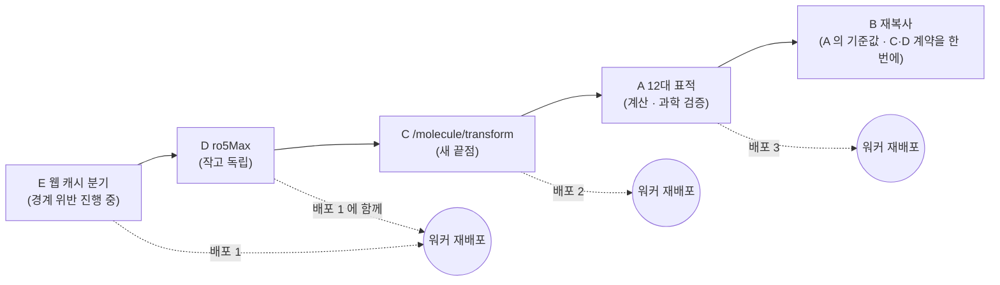

# crista 연동 변경 계획 — bio-worker 12대 표적 · 사본 재복사 · `/molecule/transform` · `ro5Max` · 웹 캐시 분기 (2026-10-24)

> **상태**: 계획(구현 전). **crista 저장소 변경 · 호스팅 워커 재배포 · 호스팅 DB 정리는 모두 사용자 확인 뒤에 한다.** 이 문서는 crista 를 읽기만 하고 썼다(파일 수정 · 커밋 없음).
> **근거 절**: [설계](2026-10-23-crista-web-design.md) §6.1.1(12대 표적 카탈로그) · §7.1(경계 — '워커 작업 · 캐시' 행의 알려진 예외) · §7.2(마이그레이션 실행기) · §10(리드 최적화 — `POST /molecule/transform`) · §12-6(crista 연동 변경) ·
> [`packages/SOURCE.md`](../packages/SOURCE.md) · 12대 표적 교차 의견 [`.review/2026-10-23-db-12targets/`](../.review/2026-10-23-db-12targets/)(특히 `gpt-6-astra-xhigh.md` §1.2~§1.4 · §4) · [`AGENTS.md`](../AGENTS.md)('crista 게임과 겹치지 않게').
> **crista 기준 커밋**(읽은 작업 트리): `d67e132 Merge origin/main into feat/pocket-medical-ui — 배포 설정(#6)과 .gitignore 합치기`(브랜치 `feat/pocket-medical-ui`). crista `main` 은 `135d23e Merge pull request #6 from mulkib0/deploy/railway-vercel`.
> **crista-web 사본 커밋**: `e911572`(2026-10-23, 프로토콜 v11 — `packages/SOURCE.md`). 2026-10-24 `git archive e911572` 와 `diff -rq` 로 사본이 원본과 같음을 다시 확인했다.
> `e911572..main` 에는 `packages/shared-types` · `game-rules` 변경이 없고, `e911572..d67e132` 에는 `shared-types/src/domain.ts` 의 색 토큰(`75008d9` · `8d61310` — `TEAM_TICKER_FG` · `PAPER` · `INK` · `UI`)만 있다(판정 · 표적 값 변경 없음).
> **기준 시험(2026-10-24, d67e132)**: crista 워커 `pytest -q -p no:cacheprovider`(캐시 파일을 쓰지 않게) → **384 통과 · 6 건너뜀 · 75.8초**. 이후 모든 작업의 회귀 기준이다.

---

## 0. 한눈에

| 작업 | 한 줄 | crista-web 에서 기다리는 곳 | 게임 영향 | 순서 |
| --- | --- | --- | --- | :-: |
| **E** 웹 캐시 분기 | `classId` 가 `web:` 면 `public.simulation_cache` 를 읽지도 쓰지도 않고 워커 메모리 캐시(상한)만 | §7.1 경계 원칙 — **지금 호스팅에서 깨지고 있다**(아래 E-1) | 없음(게임 경로 코드 그대로) | **1** |
| **D** `ro5Max` | `/datasets/compounds` 가 `ro5Max`(0~4)를 받고 `ro5Only` 와 호환 · 깔때기 분포 | §5.5 1.2 기준 회의 Ro5 안건 '2개까지' · `SCREEN_RO5_VALUES_NOW` | 없음(기본값 동작 그대로) | 2 |
| **C** `POST /molecule/transform` | 작용기 칩 6종 → RDKit 반응 SMARTS → 정규화 · 검증한 생성물 목록 | §10 리드 최적화 · §6.4 2.1 · [구현 기록](2026-10-23-implementation-status.md) '작용기 변형 칩' | 없음(새 끝점) | 3 |
| **A** 12대 표적 데이터 | 신규 8종 `data/targets/<id>/` · 준비 · 재도킹 검증 확장 · 시드 50 + 공통 30 사전 도킹 | §6.1.1 · 1.1 질환 12종 · 1.2 표적별 220종 → 표적별 풀 · 2.1 실제 Vina | **조심** — 라이브러리 · 질환 목록이 커진다(A-6) | 4 |
| **B** shared-types 재복사 | crista 쪽 12종 카탈로그 · `TRIAL_OPTIONS` 12종 → crista-web `packages/` 재복사 · `SOURCE.md` 갱신 | §1.1 · §6.1.1 · `web-contract` 의 임시 `TRIAL_FALLBACK` | **결정 필요** — `DOCKING_TARGETS` 자체를 12종으로 늘리면 게임 화면에 8종이 열린다(B-2) | 5 |

---

## 1. 작업 목록

### E. `classId` 'web:' 요청의 캐시 분기 (`docking/cache.py`)

**무엇** — 워커 도킹 캐시가 요청의 `classId` 접두를 보고 저장소를 고른다. `web:` 로 시작하면 `public.simulation_cache` 를 **읽지도 쓰지도 않고** 웹 전용 저장소(1단계: 워커 메모리, 2단계 선택: `web.simulation_cache`)만 쓴다. 게임 요청은 지금과 똑같다.

**왜** — §7.1 '워커 작업 · 캐시' 행이 적어 둔 예외가 **호스팅에서 실제로 일어나고 있다**:

- E-1. 호스팅 워커는 `CRISTA_WORKER_DATABASE_URL` 을 게임 서버와 **같은 관리자 연결**로 받는다(crista `docs/2026-10-23-railway-deploy.md` §4). 그래서 `make_cache(settings.database_url)` → `PostgresCache` 가 되고,
  `PostgresCache.put()` 은 `insert into public.simulation_cache (cache_key, class_id, team_id, …)` 로 **`class_id = 'web:<uuid>'` · `team_id = 'web:<uuid>'` 줄을 게임 표에 쓴다**(`class_id` · `team_id` 는 `text not null` 이라 거절되지 않는다 — crista `supabase/migrations/20261021090000_m2_core.sql` `simulation_cache`).
- E-2. crista-web 은 W6 에서 호스팅 compute 워커로 2.1 실제 Vina 를 돌렸다([구현 기록](2026-10-23-implementation-status.md) W6 행) → 호스팅 `public.simulation_cache` 에 `web:%` 줄이 이미 있을 것이다(건수는 확인 못 함 — 관리자 조회가 필요해 하지 않았다). [`db/README.md`](../db/README.md) 끝줄도 '워커 캐시는 W3 부터 생긴다 — `public.simulation_cache` 의 `class_id like 'web:%'`' 라고 적어 두었다.
- E-3. 캐시 키에 `class_id` · `team_id` 가 들어가므로(`cache_key()`) 게임 팀과 웹 모둠의 결과가 섞이지는 않는다 — 문제는 **격리 원칙**(웹 데이터가 `public` 에 남음 · 게임 쪽 `db diff` · 정리 · 백업 범위에 웹 행이 섞임)이다.

**crista 에서 고칠 파일(실재 경로 · 함수)**

| 파일 | 고칠 곳 |
| --- | --- |
| `apps/bio-worker/app/docking/cache.py` | `WEB_SCOPE_PREFIX = "web:"` 와 `is_web_scope(class_id)` 를 더한다. `MemoryCache` 에 **항목 상한(LRU)** 을 받는 생성자 인자를 더한다(지금은 상한 없는 `dict`). `make_cache()` 는 그대로 두고 웹용 `make_web_cache(max_entries)` 를 더한다 |
| `apps/bio-worker/app/docking/pipeline.py` | `DockingService.__init__` 에 `self.web_cache` 를 만들고, `cache_for(class_id) -> ResultCache`(웹이면 `web_cache`, 아니면 기존 `cache`)를 더한다. `validate()` · `cache_key()` 는 바꾸지 않는다(키 모양이 그대로여야 게임 캐시 적중이 유지된다) |
| `apps/bio-worker/app/jobs.py` | `_run_dock()` 의 `service.cache.get(dreq.cache_key)` · `service.cache.put(...)` 두 곳을 `service.cache_for(rec.request.classId)` 로 바꾼다 |
| `apps/bio-worker/app/main.py` | lifespan 종료의 `await docking.cache.close()` 옆에 `web_cache.close()`(메모리라 아무것도 안 함 — 대칭용). 기동 로그에 '캐시 게임 postgres · 웹 memory(상한 N)' |
| `apps/bio-worker/app/config.py` | 새 환경 변수 **`CRISTA_WEB_CACHE_MAX_ENTRIES`**(제안 이름 — 기본 `2000`, `0` 이면 웹 캐시를 끄고 늘 계산). `Settings` 에 `web_cache_max_entries` — `Settings` 는 `@dataclass(frozen=True)` 이고 `scripts/redock_check.py` 가 `Settings(...)` 를 직접 만들므로 **기본값(`= 2000`)을 줘야** 그 스크립트가 깨지지 않는다 |
| `apps/bio-worker/README.md` | 환경 변수 표 · '계산 캐시' 설명에 웹 분기 한 줄 |

- **2단계(선택) — `web.simulation_cache`**: 워커 재시작 뒤에도 웹 캐시를 남겨야 할 때만. crista-web 쪽 마이그레이션이 필요하다(번호 예약: `0010~0018` 은 8b 세션, `0020~` 은 항체 트랙 — **crista-web 쪽 번호는 그때 정한다**).
  - 권한 문제: crista-web 마이그레이션은 `crista_web` 연결로 적용되고 `crista_web` 은 `nocreaterole` 이다(`db/migrations/0000_bootstrap.sql`). 워커가 쓸 역할은 **관리자 연결로 한 번 만드는 별도 파일**(0000 과 같은 방식)이 필요하다 — 예: `crista_worker_web`(login · `web.simulation_cache` 에만 `select, insert, update`, `public` 권한 없음).
  - 워커는 그 역할의 연결 문자열을 **새 환경 변수**(제안: `CRISTA_WORKER_WEB_DATABASE_URL`)로 받는다. 게임 캐시 연결(`CRISTA_WORKER_DATABASE_URL`, 관리자 역할)을 웹에 쓰지 않는다 — 관리자 역할이면 코드 실수 한 줄로 다시 `public` 에 쓸 수 있다.
  - `db/check-boundary.mjs` 에 '워커 역할이 `public.simulation_cache` 를 못 읽음 · `web.simulation_cache` 는 읽고 씀' 탐침을 더한다.
  - crista-web 서버가 이미 `web.jobs` 에 결과 · 정규 SMILES · ΔG 를 저장하고 워커 404 에 같은 jobId 로 다시 낸다(`apps/server/src/jobs.ts` 의 `worker.read() === null` 분기) → 메모리 캐시가 날아가도 잃는 것은 재계산 CPU 뿐이다. **그래서 1단계만으로 시작하기를 권한다.**
- **이미 쌓인 `public` 의 웹 행 정리**(일회성 · 관리자 연결 · 사용자 확인 뒤): `select count(*), min(created_at), max(created_at) from public.simulation_cache where class_id like 'web:%';` 로 먼저 보이고, 확인 뒤 `delete from public.simulation_cache where class_id like 'web:%';`. 게임 행(`class_id` 가 uuid 등)에는 닿지 않는다.

**새 파일** — 없음(테스트는 기존 `tests/test_cache.py` 에 더한다. 따로 두려면 `tests/test_web_cache_scope.py`).

**테스트**

| 시험 | 기대 |
| --- | --- |
| `cache_for('web:…')` 가 `MemoryCache` · `cache_for('<게임 uuid>')` 가 기존 캐시 | 둘이 다른 객체 |
| `PostgresCache` 를 가짜로 바꿔 끼우고 `web:` 작업을 두 번(같은 팀 · 같은 분자) | 가짜 Postgres 의 `get/put` **호출 0회** · 두 번째는 `phase: 'replay'` |
| 같은 설정으로 게임 `classId` 작업 | 가짜 Postgres `get` 1 · `put` 1(지금과 같다) |
| `MemoryCache(max_entries=2)` 에 3개 | 가장 오래 안 쓴 1개가 빠짐 |
| `CRISTA_WEB_CACHE_MAX_ENTRIES=0` | 웹은 늘 계산(캐시 재생 없음) |
| (로컬 DB) `node tools/with-supabase-env.mjs` 로 compute 워커 → `web:` 도킹 1건 | `select count(*) from public.simulation_cache where class_id like 'web:%'` = 0 |

기존 `test_cache.py` 의 `test_postgres_cache_roundtrip_and_hit_count` · `test_postgres_cache_reuses_one_pooled_connection` 은 그대로 통과해야 한다.

**게임에 미치는 영향** — 없어야 한다. 게임 요청은 `classId` 에 `web:` 접두가 없으므로 같은 `PostgresCache` · 같은 키 · 같은 SQL 을 탄다.
**게임 경로 회귀 확인**: `npm run test:worker`(384 · 6 그대로 + 새 시험) · `apps/bio-worker/scripts/smoke.sh`(⑫ '같은 팀 재요청 → replay' 가 게임 접두로 통과) · 로컬 DB 로 게임 `classId` 도킹 뒤 `public.simulation_cache` 에 1행 · 재요청 `hit_count` 1.

---

### D. `/datasets/compounds` 의 `ro5Max`(0~4)

**무엇** — `GET /datasets/compounds` 와 Stage 2 작업 `params` 가 `ro5Max`(0~4 정수)를 받는다. `ro5Only` 는 그대로 받고, 둘의 관계는 아래 표로 정한다. 응답 `stats` 에 **Ro5 위반 수 분포**를 더해 회의 그래프가 한 번 읽기로 그려지게 한다.

**왜** — §5.5 1.2 기준 회의의 '먹는 약 규칙(Ro5 위반 ≤ 0 · 1 · 2개)' 안건과 §12-6 ③. 지금 crista 워커 `filter_compounds()` 는 `ro5_max = 0 if ro5_only else 1` 로 **위반 2개 이상인 분자를 절대 돌려주지 않아**, crista-web 은 `packages/web-contract/src/screen.ts` 의 `SCREEN_RO5_VALUES_NOW`(0 · 1)로 안건 값을 줄였고 `apps/server/src/features/screen.ts` `screenLibrary()` 는 `hidden = total − 받은 수` 로 버틴다.

**crista 에서 고칠 파일**

| 파일 | 고칠 곳 |
| --- | --- |
| `apps/bio-worker/app/datasets.py` | `filter_compounds(..., ro5_max: int \| None = None)` — `ro5_max` 가 있으면 그 값, 없으면 지금처럼 `0 if ro5_only else 1`. `stats.cutoffs` 에 `ro5Max` 를 더하고 `ro5Only` 는 `ro5Max == 0` 으로 계속 싣는다. `stats.distribution = { "ro5Violations": {"0": n, "1": n, …} }`(라이브러리 풀 기준 — 물성 관문 전). `suggestions` 의 'Ro5 위반 0건만…' 문구를 `ro5Max` 값으로. `safe_limit` 상한 500 은 A 뒤 라이브러리가 500 을 넘으면 늘린다(A-5) |
| `apps/bio-worker/app/main.py` | `datasets_compounds()` 에 `ro5Max: int \| None = Query(None, ge=0, le=4)` — 범위 밖은 지금의 검증 처리기대로 **400 `bad_request`**(422 로 내보내지 않는다) |
| `apps/bio-worker/app/fixtures.py` | Stage 2 작업 `params` 의 `ro5Max` 를 읽어 `filter_compounds` 에 넘김. `params` 값은 `str \| int \| float \| bool` 이라(게임 서버 · crista-web 이 문자열로 보낼 수 있다) `int()` 로 읽고, 정수 0~4 가 아니면 다른 Stage 2 수치 칸(`_num_param`)처럼 무시하고 `ro5Only` 규칙으로 — 실제로 쓴 값은 `cutoffs.ro5Max` 로 결과에 싣는다(작업 경로는 동기 400 을 내지 않는다). 지표 이름 `Ro5 통과 (위반 {0 if cut['ro5Only'] else 1}건까지)` 를 `cut['ro5Max']` 로. `extra.dataset.settings` 에 `ro5Max` 추가(옛 `ro5Only` 문자열도 유지) |
| `apps/bio-worker/README.md` | 엔드포인트 설명 한 줄 |

| 요청 | 쓰는 문턱 | 비고 |
| --- | --- | --- |
| 둘 다 없음 | 1 | **지금과 같다**(게임 기본) |
| `ro5Only=true` | 0 | 지금과 같다 |
| `ro5Only=false` | 1 | 지금과 같다 |
| `ro5Max=N` | N | `ro5Only` 는 무시하고 `cutoffs.ro5Only = (N == 0)` |
| `ro5Max` 가 0~4 밖 · 정수 아님 | — | 400 |

- **데이터 확인(2026-10-24)**: 지금 `compound_library.json` 220종의 `ro5Violations` 분포는 **0: 202 · 1: 17 · 3: 1** 이다 — **위반 2개인 분자가 없다**. 그래서 220종 세트에서는 'Ro5 ≤ 2' 가 '≤ 1' 과 같은 수(219)를 남기고, `ro5Max=3`(또는 4)에서야 220 이 된다.
  1.2 회의에서 '2개까지' 를 고른 모둠이 차이를 느끼려면 A 의 표적별 시드(의약화학 변형체 · 대조군)에 위반 2개 분자를 일부러 넣는 것을 A-4 의 데이터 요건으로 둔다.
- **전체 분포 응답**: crista-web 서버는 `maxMw=100000 · maxTpsa=100000 · ro5Max=4 · excludeAlerts=false · limit=500` 한 번으로 표적 라이브러리 전체를 받아 캐시하고, 안건 6개 깔때기를 미리보기와 같은 함수로 직접 센다(§12-6 그대로). `stats.distribution` 은 그 계산의 대조용이다.

**새 파일** — 없음.

**테스트**(`apps/bio-worker/tests/test_datasets.py` 에 더함)

| 시험 | 기대 |
| --- | --- |
| `ro5Max=4` · 큰 MW/TPSA · `limit=500` | `funnel.ro5 == 220` · `len(compounds) == 220` |
| `ro5Max=1` 과 `ro5Only=false` | 같은 `funnel` · 같은 순서 |
| `ro5Max=0` 과 `ro5Only=true` | 같은 `funnel` · 같은 순서 |
| `ro5Max=2` | `funnel.ro5 == 219`(위 데이터 확인) |
| `ro5Max=5` · `ro5Max=-1` · `ro5Max=abc` | 400 |
| Stage 2 작업 `params.ro5Max=3` · `maxMw=100000` · `maxTpsa=100000` | 결과 지표 '위반 3건까지' · `funnel.ro5 == 220`(MW · TPSA 를 안 주면 기본 520 · 140 에서 먼저 걸러져 220 이 안 된다 — 라이브러리 최대 MW 654.6 · TPSA 206.1) |
| Stage 2 작업 `params.ro5Max="2"`(문자열) · `ro5Max="x"` | 2 로 읽음 · 무시하고 기본 문턱 1(`cutoffs.ro5Max == 1`) |
| `stats.distribution.ro5Violations` | `{"0":202,"1":17,"3":1}` |

기존 `test_stage2_filters_funnel_and_candidates` · `test_stage2_strict_filter_returns_zero_without_silent_relaxation` · `test_datasets_compounds_endpoint_and_stage2_job` 는 그대로 통과해야 한다.

**게임에 미치는 영향** — 없어야 한다. 게임은 `ro5Max` 를 보내지 않으므로 문턱 · 순서 · 지표 이름이 그대로다. **회귀 확인**: 위 기존 시험 3건 · `smoke.sh`(fixture) · 게임 Stage 2 결과 JSON 의 `funnel` 이 변경 전후 같은지(같은 `jobId` · 같은 `params` 로 비교).

---

### C. `POST /molecule/transform` — 작용기 칩 6종

**무엇** — SMILES 하나와 칩 id 하나를 받아, RDKit 반응 SMARTS 로 만든 생성물들을 **정규화 · 검증 · 물성 계산까지 해서** 돌려준다. 생성물이 여러 개면(예: 방향족 C–H 가 여러 자리) 중복을 지우고 정해진 순서로 상한까지 돌려준다.

**왜** — §10 '리드 최적화(2.1 안)' · §6.4 2.1 '작용기 변형 칩 6종'. 지금은 [구현 기록](2026-10-23-implementation-status.md)대로 'SMILES 직접 편집 + 무료 물성 미리보기 + 구조 바꿔 다시'로 대신한다. 칩 문구는 crista-web 학습 문항(`apps/server/src/features/learn-bank.ts`)에도 이미 나온다.

**칩 → 반응 SMARTS(초안 — 구현 때 시험으로 확정)**

| 칩 id(제안) | 화면 이름 | 반응 SMARTS | 메모 |
| --- | --- | --- | --- |
| `aromatic_amine_to_acetamide` | 방향족 아민 → 아세트아마이드 | `[c:1][NX3;H2,H1;!$(NC=O);!$(N(c)c):2]>>[c:1][N:2]C(C)=O` | 왼쪽 패턴은 워커 구조 경고 `ALERT_SMARTS['aromatic_amine']`(`app/properties.py`)와 **같은 원자 집합** — 경고를 없애는 칩이 경고가 잡는 곳만 바꾼다 |
| `nitro_to_cyano` | 니트로 → 시아노 | `[c:1][N+](=O)[O-]>>[c:1]C#N` 와 `[c:1]N(=O)=O>>[c:1]C#N` 두 개를 차례로 | `ALERT_SMARTS['nitro_aromatic']` 의 두 표기(전하 분리 · 5가)와 같다 |
| `basic_amine_to_amide` | 염기성 아민 → 아마이드 | `[NX3;H2,H1;!$(N-C=[O,S,N]);!$(N-a);!$(N-S(=O));!$(N#*);!$(N=*):1]>>[N:1]C(C)=O` | `BASIC_AMINE_SMARTS` 에서 3차(`H0`)를 뺀 것 — 3차 아민은 아실화할 수 없어 0개 + 사유 |
| `add_hydroxy` | 하이드록시 도입 | `[cH:1]>>[c:1]O` | 방향족 C–H 자리마다 하나 → 여러 생성물 |
| `add_fluorine` | 플루오린 도입 | `[cH:1]>>[c:1]F` | 위와 같음 |
| `remove_methoxy` | 메톡시 제거 | `[c:1][OX2][CH3]>>[c:1]` | 아릴 메틸 에테르만(지방족 메톡시는 범위 밖). 'O-탈메틸 → 페놀'(`>>[c:1][O]`)로 할지는 학습 의도에 따라 결정 — 기본은 '제거' |

**처리 순서(`app/transform.py` 새 파일)**

1. 본문 크기 ≤ `PROPERTIES_BODY_MAX_BYTES`(4096, `app/main.py`) · `{ smiles: string, transform: <칩 id> }` 형식 · 모르는 칩 → 400 `invalid_input`.
2. 입력은 물성 계산과 **같은 함수** `docking.validate.validate_smiles()` 로 검증 · 정규화(200자 · 원소 · 반대이온 · 중원자 5~60 · MW 700 · 회전 결합 15) → 주 조각 `mol`.
3. 반응은 처음 쓸 때 한 번 `rdChemReactions.ReactionFromSmarts()` 로 만들어 둔다(`app/properties.py` 의 `_rdkit()` 처럼 `functools.cache` · RDKit 없으면 503). **`docking/validate.py` 는 맨 위에서 `from rdkit import Chem` 을 하므로**, `transform.py` 도 `properties.py` 처럼 `validate_smiles` 를 그 캐시 함수 **안에서** 가져와야 RDKit 이 없을 때 모듈 적재 오류가 아니라 503 이 된다.
4. `rxn.RunReactants((mol,), maxProducts=TRANSFORM_MAX_RAW)`(제안 200) — 결과는 '생성물 튜플의 튜플'이다. **생성물은 sanitize 되지 않은 채 나오므로** 각 생성물에 `Chem.SanitizeMol(p, catchErrors=True)` 를 하고, 0 이 아니면(원자가 · 방향족 실패) 버린다.
5. 살아남은 생성물을 다시 `validate_smiles(Chem.MolToSmiles(p))` 에 넣는다 — 도킹 · 물성과 같은 상한을 지키고, `canonicalSmiles`(입체 포함)가 도킹 산출물과 같은 문자열이 된다. 상한을 넘는 생성물(예: 큰 분자에 아세틸)은 `rejected` 로 센다.
6. `canonicalSmiles` 로 중복 제거 → 정렬(문자열 오름차순 — 결정적) → 최대 `TRANSFORM_MAX_PRODUCTS`(제안 12)개, 넘으면 `truncated: true`. 입력과 같은 분자(변화 없음)는 뺀다.
7. 생성물마다 `compute_properties()`(같은 모듈)로 물성을 붙인다 — crista-web 이 생성물마다 `/molecule/properties` 를 다시 부르지 않게(모둠당 분당 20회 상한 절약).
8. 바꿀 자리가 없으면 **200** `{ ok: true, products: [], noSite: '이 분자에는 … 자리가 없어요' }`(학생 입력 실수가 아니라 실험 결과).

**계약(crista `packages/shared-types` — 값 · 칩 타입은 `pipeline.ts` 의 `MoleculeProperties` 옆, 끝점 요청 · 응답은 기존 관례대로 `protocol.ts` 의 `MoleculePropertiesRequest` · `MoleculePropertiesResponse`(1190행 부근) 옆)**

```ts
export type MoleculeTransformId =
  | 'aromatic_amine_to_acetamide' | 'nitro_to_cyano' | 'basic_amine_to_amide'
  | 'add_hydroxy' | 'add_fluorine' | 'remove_methoxy';
// 형태만 적은 것 — 실제 코드는 위 표의 화면 이름으로 6개 값을 채운 객체 리터럴(초기값 없는 `export const` 는 TS 오류)
export const MOLECULE_TRANSFORMS: Readonly<Record<MoleculeTransformId, { label: string }>> = { /* 위 표 */ } as never;
export const TRANSFORM_MAX_PRODUCTS = 12;
export interface MoleculeTransformRequest { smiles: string; transform: MoleculeTransformId }
export interface MoleculeTransformProduct { canonicalSmiles: string; flatSmiles: string; properties: MoleculeProperties }
export interface MoleculeTransformOk {
  ok: true;
  transform: MoleculeTransformId;
  parent: MoleculeProperties;          // 입력의 정규화 · 물성(무료 미리보기와 같은 값)
  products: MoleculeTransformProduct[];
  truncated: boolean;                  // 상한에서 잘렸나
  rejected: number;                    // sanitize · 상한 검증에서 버린 수
  noSite?: string;                     // 바꿀 자리가 없을 때 학생이 읽는 한국어
  engine: string;                      // 'RDKit 2026.09.1'
}
```

- 오류: 형식 · 입력 400 `invalid_input` · RDKit 없음 503 `worker_unavailable`(`/molecule/properties` 와 같은 두 코드). 응답 유니온은 `MoleculePropertiesResponse` 와 같은 꼴 — `MoleculeTransformResponse = MoleculeTransformOk | { ok: false; code: 'invalid_input' | 'worker_unavailable'; message: string }`(`protocol.ts`).
- `test_models.py` 의 `ts_interface_fields()` 는 `protocol.ts` · `llm.ts` · `market.ts` · `world.ts` · `pipeline.ts` 를 이어 붙여 `export interface <이름> {` 를 찾으므로(`conftest.shared_text()`) 어느 파일에 두어도 대조된다. 단 줄 머리 들여쓰기 2칸 · `이름?:` 꼴을 지켜야 정규식이 필드를 읽는다.
- **`PROTOCOL_VERSION`(지금 11)은 올리지 않는다** — 게임 서버 `apps/game-server/src/rooms/WorldRoom.ts` 가 `join.protocolVersion !== PROTOCOL_VERSION` 이면 입장을 거절하므로, 올리면 게임 클라이언트 · 서버를 같이 다시 내야 한다. 워커 판은 `apps/bio-worker/app/__init__.py` 의 `WORKER_VERSION`(지금 `0.2.0`)과 `apps/bio-worker/pyproject.toml` 의 `version` 을 함께 올린다(`__init__.py` 주석: '둘을 같은 값으로 유지'). 계약 타입 추가는 게임 코드가 쓰지 않으므로 판 번호 없이 들어간다.

**crista 에서 고칠 파일 · 새 파일**

| 파일 | 내용 |
| --- | --- |
| `apps/bio-worker/app/transform.py`(새) | 위 1~8 · 반응 표 · `TransformUnavailable` |
| `apps/bio-worker/app/models.py` | `MoleculeTransformRequest` · `MoleculeTransformProduct` · `MoleculeTransformOk` pydantic(옆의 `MoleculePropertiesRequest` · `MoleculePropertiesOk` 와 같은 꼴) |
| `apps/bio-worker/app/main.py` | `@app.post("/molecule/transform")` — `molecule_properties()` 와 같은 본문 크기 검사 · `asyncio.to_thread()` |
| `packages/shared-types/src/pipeline.ts` · `protocol.ts` | 위 계약(칩 id · 표 · 상한은 `pipeline.ts`, 요청 · 응답 타입은 `protocol.ts`) |
| `apps/bio-worker/pyproject.toml` | `version` 을 `WORKER_VERSION` 과 같이 올림 |
| `apps/bio-worker/tests/test_transform.py`(새) | 아래 |
| `apps/bio-worker/tests/test_models.py` | `PAIRS` 에 새 모델 3쌍(필드 이름 · 선택 여부를 `pipeline.ts` 와 대조) |
| `apps/bio-worker/README.md` | 엔드포인트 표 한 줄 |

**테스트**

| 입력 → 칩 | 기대 |
| --- | --- |
| 아닐린 `Nc1ccccc1` → `aromatic_amine_to_acetamide` | `CC(=O)Nc1ccccc1` 1개 · 생성물의 `alerts` 에 `aromatic_amine` 없음 |
| 엘로티닙(디아릴아민) → 같은 칩 | 0개 + `noSite`(경고 SMARTS 와 같은 제외) |
| 니트로벤젠 두 표기 → `nitro_to_cyano` | 둘 다 `N#Cc1ccccc1` |
| 도네페질 → `basic_amine_to_amide` | 0개(3차 아민) + `noSite` |
| 도네페질 → `remove_methoxy` | 두 자리 → 서로 다른 2개 · 정렬 순서 고정 |
| 톨루엔류 → `add_fluorine` | 대칭 자리 중복 제거 · 개수 = 고유 자리 수 |
| 상한 바로 아래 분자(MW 약 670~699 · 2차 지방족 아민 있음) → `basic_amine_to_amide` | 아세틸(+42 g/mol)로 MW 700 을 넘는 생성물은 `rejected` 로 · 400 아님. (중원자 59 같은 입력은 MW 700 상한에 먼저 걸려 입력 단계에서 400 이 되므로 이 시험 입력으로 쓸 수 없다) |
| 생성물 `canonicalSmiles` 를 `/molecule/properties` 에 다시 | 같은 문자열 · 같은 물성(도킹 · 특허 동일성 유지) |
| 잘못된 SMILES · 모르는 칩 · 4096 바이트 초과 | 400 |
| RDKit 못 불러옴(monkeypatch) | 503 |
| 같은 요청 두 번 | 같은 응답(결정성) |

**게임에 미치는 영향** — 없다(새 끝점 · 게임 코드가 부르지 않음 · `PROTOCOL_VERSION` 그대로). **회귀 확인**: `npm run test:worker` 기존 384 + 새 시험 · `npm run typecheck`(shared-types 추가가 게임 서버 · 클라이언트 타입을 깨지 않음) · `smoke.sh` ⑮(물성 계산 값이 그대로).

---

### A. bio-worker 12대 표적 데이터 · 준비 · 재도킹 검증 · 사전 도킹

**무엇** — §6.1.1 표의 신규 8종을 기존 4종과 같은 꼴로 `apps/bio-worker/data/targets/<id>/` 에 더하고, 준비 · 재도킹 검증 스크립트를 다중 사슬 · 보조인자 · 이온 · 물 보존과 '불합격이면 실패 종료'로 넓힌다. 질환 · 화합물 데이터셋을 12종으로 넓히고 **표적별 시드 50 + 공통 30**(최대 약 960쌍)을 사전 도킹한다.

**왜** — §6.1.1 · §6.4 1.1(4인 × 질환군 3개) · 1.2(표적별 미션 · 사전 Vina 값) · 2.1(실제 Vina). crista-web 은 이미 8종을 화면 · 계약에 갖고 있다(`packages/web-contract/src/clinical.ts` · `ind.ts` 의 `TRIAL_FALLBACK`) — 워커가 그 표적으로 도킹할 수 없는 것이 막힌 곳이다.

**A-1. 지금 데이터 꼴(기존 4종 — 그대로 따른다)**

| 위치 | 내용 |
| --- | --- |
| `data/targets/<id>/` | `receptor.pdbqt`(Vina 용, `ATOM`/`HETATM`/`TER` 줄만) · `receptor_h.pdb`(PLIP 용, 수소 포함) · `reference_ligand.sdf`(결합 차수를 템플릿으로 준 결정 리간드) · `target.json`(`id` · `pdbId` · `chain` · `label` · `gene` · `source{url,sha256,license}` · `referenceLigand{resname,name,smiles,chain,seq,heavyAtoms}` · `box{center,size:[22,22,22],basis}` · `protonation` · `files{세 파일 sha256}` · `tools` · `preparedAt` · `referenceKcal` · `referenceRmsd` · `redock{…}`) |
| `data/cache/<PDB>.cif` · `data/cache/vina_prescreen.jsonl` | RCSB 원본 · 사전 도킹 진행 기록 — **git 무시**(`apps/bio-worker/.gitignore` `data/cache/`). 지금 진행 기록 880줄 = 220 × 4 |
| `data/datasets/` | `disease_targets.json`(Open Targets — 질환 4 · 480건) · `compound_library.json`(220종 · `vinaKcalByTarget` · `screenScoreByTarget` · `tanimotoByTarget`) · `manifest.json`(sha256 · 건수 — 워커 기동 때 `verify_datasets()` 가 대조) |
| `Dockerfile` | `COPY apps/bio-worker/data/datasets` · `COPY apps/bio-worker/data/targets` — 새 표적 폴더가 이미지에 자동으로 들어간다 |

**A-2. 고칠 코드(실재 위치)**

| 파일 | 지금 | 고칠 곳 |
| --- | --- | --- |
| `apps/bio-worker/scripts/prepare_target.py` | `TARGETS` 4종 · `build()` 가 **단일 `chain` 만 남김** · 첫 같은 이름 잔기를 결정 리간드로 · `st.remove_ligands_and_waters()` 로 **모든 보조인자 · 이온 · 물 제거** · 템플릿 일치를 **입체 없는** SMILES 로 비교 · `main()` 은 표적 하나(`choices=sorted(TARGETS)`) | 표적 명세에 `receptorChains`(기본 `[chain]`) · `keepCofactors` · `keepIons` · `keepWaters`(잔기 지정) · `ligandChain` · `ligandSeq`(인스턴스 지정) · `validationStatus` 를 더한다. 제거를 '허용 목록 빼고 지움'으로 바꾼다. 템플릿 일치를 `isomericSmiles=True` 로도 본다(에스시탈로프람 · 시타글립틴처럼 입체가 중요한 기준약). `target.json` 에 `receptorChains` · `kept`(보존한 잔기 목록) · `validationStatus` 를 쓴다 |
| `apps/bio-worker/scripts/redock_check.py` | `TARGET_IDS` 4종 고정 · RMSD 2 Å 초과도 **문구만 찍고 종료 코드 0** · 반올림 뒤 값 비교 | `TARGET_IDS` 를 `prepare_target.TARGETS` 에서 읽는다. **반올림 전 1위 포즈 중원자 RMSD ≤ 2.0 Å** 가 아니면 `exit 1` 이고 `validationStatus` 를 `validated` 로 올리지 않는다. 기존 4종의 `target.json` 은 다시 쓰지 않는다(값 · 해시 그대로) |
| `apps/bio-worker/app/docking/targets.py` | `load_targets()` 가 폴더의 **모든** 표적을 읽음 | `target.json` 에 `validationStatus` 가 없으면 `validated`(기존 4종 파일을 고치지 않기 위해). `draft` 는 읽되 `DockingTarget.validated = False` |
| `apps/bio-worker/app/docking/pipeline.py` · `app/config.py` | `validate()` 가 `self.targets` 에 있으면 받음 | `draft` 표적은 400 `invalid_input`('검증 중인 표적') — `Settings.allow_draft_targets`(기본 `False`)가 참일 때만 받는다. 워커는 새 환경 변수 **`CRISTA_ALLOW_DRAFT_TARGETS=1`**(제안 이름 · 기본 끔)로 켠다(로컬 시험용). **`redock_check.py` 는 `load_settings()` 가 아니라 `Settings(...)` 를 직접 만들어 환경 변수를 읽지 않으므로**, 스크립트 안에서 `allow_draft_targets=True` 를 넘긴다(재도킹은 draft 를 검증하는 도구). `/healthz.targets` 에 draft 를 넣을지 · 표시할지도 여기서 정한다 |
| `apps/bio-worker/scripts/prescreen_library.py`(진행 기록) | 기록 키 `"<targetId>\|<canonicalSmiles>"` · `receptorSha256` 이 다르면 다시 계산 · 상자 · 리간드 준비 도구 판은 기록에 없음 | §6.1.1 '캐시 키는 canonicalSmiles + 리간드준비버전 + 수용체해시 + 상자설정 + Vina 판/seed/exhaustiveness 전체' — 기록 줄에 `box`(중심 · 크기) · `tools`(RDKit · Meeko 판)을 더하고, 재계산 판단 · `recompute_derived()` 대조를 그 전체로 한다 |
| `apps/bio-worker/tests/test_targets.py` · `tests/test_datasets.py` | `test_target_matches_protocol_ts` 가 `sorted(load_targets()) == protocol.ts DOCKING_TARGETS id 4개` · `test_datasets_summary_endpoint` 가 질환 이름 **4개 집합 일치** · `test_manifest_matches_files` 가 `disease_targets.json` **480건** · `test_compound_library_is_consistent` 가 모든 화합물의 `tanimotoByTarget` · `screenScoreByTarget` 키 == **4표적** 이고 사전 도킹 빠진 분자 **≤ 3** | **A 에서 고친다**(B 를 기다리면 A-4 ⑥ `npm run test:worker` 가 실패) — 표적 대조는 `target.json` 의 `validationStatus == 'validated'` 집합 ↔ 카탈로그(B-1 의 crista 쪽 shared-types 변경을 A 와 같은 PR 로 넣거나, 그 전까지는 기존 4종 ↔ `DOCKING_TARGETS`). 질환 · 건수 · 4표적 단정은 v11 세트(`scope` 기본)와 확장 세트로 나눠 새 기대값으로. 새 분자의 `not_scheduled` 쌍은 '빠진 분자' 셈에서 뺀다 |
| `apps/bio-worker/scripts/prepare_datasets.py` | `DISEASE_SPECS` 4 · `DOCKING_TARGET_BY_GENE` · `REFERENCE_SMILES_BY_TARGET` 4 · Open Targets 에 도킹 유전자가 없으면 **고정 점수 · 하드코딩 Ensembl id 로 채우는 보강 경로**(`fetch_open_targets()` 안) · `recompute_derived()` 가 진행 기록의 `receptorSha256` 을 대조하지 않음 | 12 질환(천식 `MONDO_0004979` · COPD `MONDO_0005002` 는 따로 — 둘 다 `pde4b-1xmu`) · 보강 경로 대신 `curatedForLesson: true` · 진행 기록의 `receptorSha256` · 설정이 지금 표적과 다르면 쓰지 않음 · 미계산은 `dockingStatus: 'not_scheduled'`(0점으로 깎지 않음 — §6.1.1) |
| `apps/bio-worker/scripts/prescreen_library.py` | `--jobs` · `--cpu` · `--limit` · 모든 분자 × 모든 표적 | `--targets` · 쌍 목록(시드 50 + 공통 30) 입력 · `jobs × cpu` 가 CPU 수를 넘지 않게 · 실패 재시도 |
| `apps/bio-worker/app/docking/analysis.py` | PLIP 상호작용에 금속 배위 · 물 매개 없음(잔기에 `chain` 은 있음) | 보존한 이온 · 물이 있는 표적은 결과지에 '금속 배위 · 물 매개 결합은 이 분석에서 빠짐'을 적는다(추가 분석은 범위 밖) |

**A-3. 신규 8종 수용체 준비 규격(§6.1.1 표 → 명세)**

| id | PDB · 기준 CCD | `receptorChains` | 보존 | 확인한 사실(외부) | 위험 |
| --- | --- | --- | --- | --- | --- |
| `maob-2v5z` | `2V5Z` · `SAG`(사피나미드) | `A`(포켓 접촉 확인 뒤 단일) | `keepCofactors: [FAD(A)]` | 사람 MAO-B + 사피나미드 · FAD 포함 · 고분자 사슬 2개([RCSB 2V5Z](https://www.rcsb.org/structure/2V5Z) · [PDBj](https://pdbj.org/mine/summary/2v5z)) | FAD–Cys 공유 연결을 Open Babel 이 어떻게 쓰는지 · FAD 원자형 |
| `sert-5i71` | `5I71` · `68P`(S-시탈로프람) | `A`(SERT) — `B` · `C` 는 8B6 항체(제외 후보) | `keepIons: [Na+(중앙 부위 근처)]` · Cl⁻ 은 구조에 있는 것만 | ts3 열안정 변이 사람 SERT · 중앙 부위 S-시탈로프람 · 3.15 Å · 사슬 A=SERT · B/C=8B6 항체([RCSB 5I71](https://www.rcsb.org/structure/5i71) · [PDBj 구조](https://pdbj.org/mine/structural_details/5i71)) | 열안정 변이 표기 · 막단백질 · 해상도 3.15 Å · 입체 템플릿 |
| `abl1-2hyy` | `2HYY` · `STI`(이마티닙) | `A` | 없음 | 사람 Abl 키나아제 도메인 + 이마티닙 · 단량체 · 리간드 `STI`([RCSB 2HYY](https://www.rcsb.org/structure/2HYY) · [NCBI](https://www.ncbi.nlm.nih.gov/Structure/pdb/2HYY)). Vina 공식 기본 예제도 Abl–이마티닙(1IEP)이다([docking_basic](https://github.com/ccsb-scripps/autodock-vina/blob/develop/docs/source/docking_basic.rst)) | 회전 결합이 많은 리간드 — exhaustiveness 8 에서 RMSD 통과 미확인 |
| `braf-3og7` | `3OG7` · `032`(베무라페닙) | `A`(변이 V600E 기록) | 없음 | BRAF V600E + PLX4032 · 사슬 A · B(AKAP9-BRAF 융합 단백질 표기) · 리간드 `032`([RCSB 3OG7](https://www.rcsb.org/structure/3OG7)) | 사슬 A 에 `032` 가 있는지 인스턴스 확인 |
| `hmgcr-1hwk` | `1HWK` · `117`(아토르바스타틴) | `A`+`B`(포켓이 이량체 계면) — 처음엔 A~D 로 검증 뒤 줄임 | 없음 | 사람 HMGR 촉매 부분 + 아토르바스타틴 · 생물학적 단위 사량체(A B C D) · 리간드 `117`([RCSB 1HWK](https://www.rcsb.org/structure/1HWK) · [NCBI](https://www.ncbi.nlm.nih.gov/Structure/pdb/1HWK)) | 사슬 쌍 선택 · 수용체 원자 수 증가(계산 시간) |
| `fxa-2p16` | `2P16` · `GG2`(아픽사반) | 촉매 사슬 `A`(+ 경쇄 — §6.1.1 '필요 시') | `keepIons: [Ca2+]`(구조에 있으면) | FXa + 아픽사반(BMS-562247)([RCSB 2P16](https://www.rcsb.org/versions/2P16)) | A 단독 vs A+경쇄 재도킹 비교 |
| `jak1-6bbu` | `6BBU` · `D7D`(아브로시티닙 · PF-04965842) | `A` | 없음 · 인산화 `PTR` 잔기 유지 확인 | 사람 JAK1(사슬 A) + PF-04965842(화합물 25)([RCSB 6BBU](https://www.rcsb.org/structure/6BBU) · [PDBj](https://pdbj.org/mine/summary/6bbu)) | `PTR` 를 Open Babel 이 수소 · 전하를 바르게 주는지 |
| `pde4b-1xmu` | `1XMU` · `ROF`(로플루밀라스트) | `A` | `keepIons: [Zn2+, Mg2+]` · `keepWaters: [금속 배위 물]` | 사람 PDE4B 촉매 도메인 + 로플루밀라스트([RCSB 1XMU](https://www.rcsb.org/structure/1XMU)) | 아래 '금속' 참고 |

- **금속 · 이온**: Vina 공식 문서는 아연 배위를 정확히 다루려면 따로 **AutoDock4Zn** 절차(사면체 아연 의사 원자 `TZ` · `zinc_pseudo.py` · `AD4Zn.dat`)를 쓴다([Docking with Zinc Metalloproteins](https://autodock-vina.readthedocs.io/en/latest/docking_zinc.html)). 이 계획은 **같은 Vina 점수 함수에 이온만 남기는 것**까지만 하고, AD4Zn 으로 바꾸면 엔진 · 기준값 · 캐시 키가 달라지는 별도 작업으로 본다(12d 리뷰 §1.3 과 같은 판단).
  crista 는 수용체를 Open Babel(`AddHydrogens` → PDBQT `-xr`)로 준비하므로 Meeko 수용체 준비의 금속 제약(원소 · 템플릿 — [Meeko #252](https://github.com/forlilab/Meeko/issues/252) · [수용체 준비 개요](https://meeko.readthedocs.io/en/develop/rec_overview.html))은 지금 경로에 해당하지 않는다. 대신 **Open Babel 이 쓴 `receptor.pdbqt` 의 이온 원자형을 Vina 1.2.7 이 받는지**를 A-4 ② 에서 실제로 돌려 확인한다(확인 못 함 — 아직 돌리지 않았다).
- **CCD 확인 범위**: 위 외부 확인에서 `STI`(2HYY) · `032`(3OG7) · `117`(1HWK) · FAD(2V5Z)는 RCSB 페이지에서 직접 봤다. `SAG` · `68P` · `GG2` · `D7D` · `ROF` 는 리간드 이름(사피나미드 · S-시탈로프람 · 아픽사반 · PF-04965842 · 로플루밀라스트)까지만 봤고 CCD 코드는 §6.1.1 표 그대로다 — `prepare_target.py` 가 `<resname> 이 없습니다` 로 멈추므로 첫 실행에서 바로 드러난다.

**A-4. 진행 순서와 완료 기준**

| # | 일 | 명령(crista `apps/bio-worker` 안) | 완료 기준 |
| :-: | --- | --- | --- |
| ① | 스크립트 확장(A-2) + 기존 4종 재현 | `.venv/bin/python scripts/prepare_target.py <기존 id> --check`(4번) · `.venv/bin/python scripts/redock_check.py --check ache-4ey7 egfr-1m17 dpp4-1x70 cox2-3ln1`(`TARGET_IDS` 를 `TARGETS` 에서 읽게 바꾼 뒤에는 인자 없이 돌리면 draft 신규 표적까지 재도킹하므로 4종을 적는다) | 기존 4종 **파일 sha256 · `referenceKcal` · `referenceRmsd` 그대로**(값: −11.84/0.82 · −7.24/1.33 · −9.02/0.80 · −12.26/0.51) |
| ② | 신규 8종 준비 | `.venv/bin/python scripts/prepare_target.py maob-2v5z` … | 8개 폴더 · `validationStatus: 'draft'` · Vina 가 `receptor.pdbqt` 를 읽음(이온 원자형 오류 없음) |
| ③ | 재도킹 | `.venv/bin/python scripts/redock_check.py <신규 id>`(스크립트가 `allow_draft_targets=True` 로 직접 설정 — A-2. 환경 변수는 이 스크립트에 닿지 않는다) | 반올림 전 RMSD ≤ 2.0 Å → `validated` · `referenceKcal` 기록. **실패한 표적은 문턱을 풀지 않고** 명세(사슬 · 보존 · 상자)나 대체 구조를 다시 본다 — 그동안 그 표적은 `draft`(수업 목록 밖) |
| ④ | 데이터셋 | `.venv/bin/python scripts/prepare_datasets.py`(온라인 수집) | 질환 12(+COPD 따로) · 가짜 점수 0 · 표적별 시드 50(결정 리간드 · 승인 비교약 · 활성 화합물 · 의약화학 변형체 · 대조군 — **Ro5 위반 2개 분자 몇 개 포함**, D 참고) + 공통 다양성 30 |
| ⑤ | 부분 사전 도킹 | `.venv/bin/python scripts/prescreen_library.py --targets <id…> --jobs 4 --cpu 2` → `scripts/prepare_datasets.py --offline` | 약 960쌍 · `completed` / `failed` / `not_scheduled` 구분 · `manifest.json` 재작성 · 워커 기동 대조 통과 |
| ⑥ | 워커 반영 | `npm run test:worker` · compute 워커로 신규 표적 도킹 1건씩 | 12 표적 `/healthz.targets` · 모르는 · draft 표적 400 |

- 계산량(로컬 1회 · 비용 없음): 기존 기록의 1건당 `computeMs` 가 약 2.8~4.9초(`vina_prescreen.jsonl` 첫 줄들 · `--cpu` 2)였다. 960쌍을 `--jobs 4` 로 돌리면 대략 수십 분 — 표적이 커지면(HMGCR 다중 사슬) 더 걸린다.

**A-5. 라이브러리 크기와 상한** — 220 → 약 220 + 8 × 50 + 30 ≈ 650종이 되면 `filter_compounds()` 의 `safe_limit` 상한 500 과 crista-web `screenLibrary()` 의 `LIBRARY_LIMIT` 이 표적 전체를 못 받는다. 표적별 풀(A-6 의 `scope=target`)이 그 표적의 시드 50 + 공통 30 + 기존 세트를 넘지 않게 하고, 필요하면 D 에서 상한을 1,000 으로 올린다.

**A-6. 게임에 미치는 영향 — 있다(막는 방법까지가 A 의 범위)**

| 바뀌는 것 | 게임에 닿는 길 | 막는 방법 |
| --- | --- | --- |
| `data/targets/` 에 폴더 8개 | 워커 `load_targets()` 가 읽음 → 워커는 새 표적 도킹도 받음 | 게임 서버가 먼저 `DOCKING_TARGETS` 로 표적을 확인한다(`apps/game-server/src/jobs/service.ts` — `DOCKING_TARGETS.find(...)`). `DOCKING_TARGETS` 를 4종으로 두면(B-2 권장) 게임은 새 표적을 보내지 않는다 |
| `compound_library.json` 이 커짐 | 게임 Stage 2 작업(`fixtures.py` → `filter_compounds()`)의 전체 수 · 깔때기 · 상위 N 이 바뀜 | 화합물에 **세트 표시**(예: `sets: ['v11']` · 새 분자는 `['lesson12']`)를 두고 `/datasets/compounds` · Stage 2 작업에 `scope` 를 더한다 — 기본(`scope` 없음) = **지금의 v11 220종** → 게임 결과 그대로. crista-web 은 `scope=target`(그 표적이 사전 도킹된 분자). `filter_compounds()` 의 `stats.total`(= 결과 `funnel.total`)도 지금은 `len(all_compounds)` 라 **scope 로 자른 뒤의 수**로 세야 게임 결과가 같다. `library_names()`(기동 로그 · 400 사유)와 `/datasets/summary` 의 `totalCount` 는 scope 와 상관없이 늘어난다(게임은 부르지 않음) |
| `disease_targets.json` 질환 4 → 13 | 게임 Stage 1 작업은 게임이 보낸 질환만 찾음(`get_disease_record`) · 게임 서버는 `/datasets/*` 를 직접 부르지 않음(grep 0건) | 영향 없음 — 단, `/datasets/summary` · `/datasets/targets`(질환 목록)는 13개가 보인다 |
| 기존 4종 `screenScoreByTarget` | `recompute_derived()` 를 다시 돌리면 표적 수가 늘며 값이 다시 계산됨 | 기존 220종 · 기존 4표적의 값은 **같은 진행 기록 · 같은 수용체**라 같은 값이어야 한다 — 다시 만든 뒤 v11 220종의 4표적 값이 한 자리도 안 바뀌었는지 비교(아래 3장) |

**게임 경로 회귀 확인**: `scripts/prepare_target.py <기존 4종> --check` · `scripts/redock_check.py --check`(기존 4종) · 변경 전후 게임 Stage 1 · 2 · 3 작업 결과 JSON 비교(같은 `jobId` · 같은 `params`) · `npm test`(game-rules · game-server) · `smoke.sh` ⑪(도네페질 재도킹 RMSD ≤ 2 Å · ΔG < −9).

---

### B. shared-types 재복사(12종) · `packages/SOURCE.md` 갱신

**무엇** — crista `packages/shared-types` 에 12종 표적 · 질환 · 임상 선택지를 넣고(A 의 `referenceKcal` · `referenceRmsd` 확정 뒤), crista-web `packages/shared-types` · `packages/game-rules` 를 그 커밋으로 다시 복사한다. C · D 의 계약 타입도 같은 복사에 실린다.

**왜** — §1.1('`DOCKING_TARGETS`(기존 4종 → 12종 · `referenceKcal`)') · `SOURCE.md` 규칙('표적 값은 crista 에서 고치고 다시 복사'). 지금 crista-web 은 8종을 `web-contract` 에 임시로 들고 있다 — `packages/web-contract/src/ind.ts` `TRIAL_FALLBACK`(주석: 'crista 가 TRIAL_OPTIONS 12종을 다시 복사해 주면 그쪽이 먼저다') · `clinical.ts` 의 표적별 표. 서버 `apps/server/src/pipeline.ts` 의 `DISEASES` 는 `DISEASE_TO_TARGET`(4종)에서 만든다.

**B-1. crista 쪽 고칠 곳**

| 파일 | 지금 | 고칠 곳 |
| --- | --- | --- |
| `packages/shared-types/src/protocol.ts` | `DOCKING_TARGETS`(4) · `DockingTarget` | B-2 결정에 따라 12종 카탈로그. 기존 4종 객체는 한 글자도 바꾸지 않는다 |
| `packages/shared-types/src/pipeline.ts` | `DISEASE_TO_TARGET`(4 · MONDO → 표적) · `TARGET_TO_DISEASE`(**1:1 가정** — `Object.fromEntries`) · `DISEASE_LABEL` · `TRIAL_OPTIONS`(4) | 13 MONDO(천식 · COPD 둘 → `pde4b-1xmu`)라 1:1 이 깨진다 → `TARGET_TO_DISEASES`(배열)를 더하고 기존 `TARGET_TO_DISEASE` 는 게임 4종 범위로 남긴다. `TRIAL_OPTIONS` 에 8종 키를 더한다(`braf-3og7` 은 `brainPopulations` 뇌전이 환자군) |
| `apps/bio-worker/tests/test_targets.py` · `test_datasets.py` | `DOCKING_TARGETS` 블록의 id 목록 == `load_targets()` | **A 에서 이미 고친다(A-2 마지막 행)** — B 에서는 카탈로그 블록 대조로 마무리(+ `draft` 는 카탈로그에 넣지 않는다). `test_target_json_reference_matches_protocol_ts` 의 `len(ids) == 4` 는 (나)안이면 그대로 |

**B-2. 결정 필요 — 12종을 어디에 넣나**

| 안 | 내용 | 게임 영향 |
| --- | --- | --- |
| (가) `DOCKING_TARGETS` · `DISEASE_TO_TARGET` 자체를 12종으로 | 설계 §1.1 문구 그대로 | **있다** — 게임 클라이언트 `apps/desktop-client/src/ui/InteractModal.tsx` 가 `DISEASE_IDS` 로 질환 선택지를 그리고, 게임 서버 `apps/game-server/src/pipeline/service.ts` 가 `DOCKING_TARGETS` · `DISEASE_TO_TARGET` 으로 질환 · 표적을 받는다 → 게임 1.1 에 8종이 열린다. 게임 균형(§10 판정 · 애널리스트 · NPC 문구 `npc/service.ts` 의 `DOCKING_TARGETS[0]` 기본)까지 crista 결정이 필요 |
| **(나) 권장 — 카탈로그를 따로** | `DOCKING_TARGETS`(4) · `DISEASE_TO_TARGET`(4)는 그대로, **`DOCKING_TARGET_CATALOG`**(12 — 앞 4개는 `...DOCKING_TARGETS`) · **`DISEASE_TO_TARGET_CATALOG`**(13) · `DISEASE_LABEL_CATALOG` · `TARGET_TO_DISEASES` 를 더함. `TRIAL_OPTIONS` 는 키만 8개 더함 | **없다** — 게임 코드는 새 이름을 쓰지 않고, `TRIAL_OPTIONS` 는 게임에서 `TRIAL_OPTIONS[targetId]` 조회로만 쓰인다(`desktop-client` `DeskWindow.tsx` · `game-rules` `pipeline/score.ts` · `pipeline/flow.ts`) |

- 이름(`…_CATALOG`)은 제안이다. (나)를 고르면 설계 §1.1 · §6.1.1 의 '`DOCKING_TARGETS` 12종' 문구를 카탈로그 이름으로 고친다(이 문서는 설계를 고치지 않는다).
- `DockingTarget` 에 선택 필드(`receptorChains?` · `validationStatus?`)를 더해도 게임 타입은 깨지지 않는다.

**B-3. crista-web 쪽(재복사)**

1. crista 변경이 crista `main` 에 합쳐진 커밋에서 `rsync -a --exclude node_modules --exclude dist --exclude '*.tsbuildinfo'` 로 `packages/shared-types` · `packages/game-rules` 를 덮어쓴다(`SOURCE.md` 의 복사 방법 그대로 — 원본에서 지워진 파일이 있으면 `--delete` 도) → `diff -rq` 로 원본과 같음 확인.
2. `packages/SOURCE.md` 표의 '원본 커밋'을 새 커밋으로 · 확인 기록 표에 날짜 · `npm run typecheck`(두 패키지) · `npm run test:rules` 결과를 더한다. 커밋 메시지에 차이(카탈로그 · `TRIAL_OPTIONS` 8키 · 변형 · Ro5 계약)를 적는다. **`domain.ts` 색 토큰(`75008d9` · `8d61310`)은 `feat/pocket-medical-ui` 에만 있고 `main` 에는 없다**(`git merge-base --is-ancestor 75008d9 main` 거짓) — 이 변경을 `main` 기반 새 브랜치로 하면 그 토큰은 사본에 실리지 않는다. UI 브랜치가 먼저 `main` 에 합쳐졌을 때만 차이에 적는다.
3. crista-web 후속(다른 세션 — `apps/` · `packages/web-contract` 소유자 몫, 이 계획은 목록만): `apps/server/src/pipeline.ts` 의 `DISEASES` 를 카탈로그로 · `web-contract/src/ind.ts` 의 `TRIAL_FALLBACK` 제거 · `apps/server/src/worker.ts` 에 `transform()` · `CompoundQuery.ro5Max` · `web-contract/src/screen.ts` 의 `SCREEN_RO5_VALUES_NOW` 에 2 · `features/screen.ts` 의 `hidden` 계산 정리 · **같은 파일 Stage 2 작업 `params`(지금 `ro5Only: full.ro5 === 0`, 625행 부근)에 `ro5Max: full.ro5`** — 이것을 빼면 회의 값 2 가 워커 실행에서 1 로 줄어 서버 깔때기와 워커 `funnel` 이 어긋난다.

**`db/check-boundary` 영향** — **없다**. 경계 점검(`db/check-boundary.mjs`)은 `crista_web` 역할의 권한만 시험하고 shared-types 를 읽지 않는다. 표적 id 를 담는 칸의 검사식(`0002_pipeline.sql` · `0003_parallel_lab.sql` 의 `target_id ~ '^[a-z0-9]+-[a-z0-9]{4}$'` · `disease_id ~ '^MONDO_[0-9]{7}$'`)은 12종 id 와 13 MONDO id 를 모두 받는다 — 마이그레이션이 필요 없다(E 2단계를 고르면 E 에서 탐침을 더한다).

**게임 영향 · 회귀 확인** — (나)면 없음. crista 에서 `npm run typecheck`(shared-types · game-rules · game-server · desktop-client) · `npm test`(game-rules · game-server) · `npm run test:worker`. crista-web 에서 `npm run test:rules`(W1 기록: 290 중 287 통과 · 3 은 사본 밖 자산 경로 ENOENT — 같은 3건만 실패해야 함) · `npm test`.

---

## 2. 순서 · 의존



| 순서 | 작업 | 근거 |
| :-: | --- | --- |
| 1 | **E** | §7.1 경계 원칙이 **지금 호스팅에서 깨지고 있다**(E-1 · E-2). 고칠 곳이 3~4 파일 · DB 변경 없이(1단계) 끝난다. 늦출수록 `public` 의 `web:%` 행이 쌓인다 |
| 2 | **D** | 가장 작고 독립(`datasets.py` 한 함수 · 기본값 동작 그대로). crista-web 1.2 회의가 이미 값 2 를 받을 준비(DB 는 2 까지 · `SCREEN_RO5_VALUES_NOW`)가 돼 있다. E 와 한 번에 재배포할 수 있다 |
| 3 | **C** | 새 끝점이라 게임 위험이 없고 RDKit 만 쓴다(Vina · 표적 무관). 2.1 칩이 기다린다. 계약 타입이 B 의 재복사에 실려야 하므로 B 앞 |
| 4 | **A** | 가장 크다 — 과학 검증(재도킹 RMSD)에서 일부 표적이 떨어질 수 있고, 데이터셋 재생성 · 사전 도킹 · 게임 Stage 2 고정(A-6)이 함께 가야 한다. E · D · C 와 독립이라 병렬로 시작할 수 있지만 **배포는 마지막**(가장 위험) |
| 5 | **B** | `DOCKING_TARGETS` 계열의 `referenceKcal` · `referenceRmsd` 가 A 의 재도킹 결과라 A 뒤. 단 crista 쪽 B-1(shared-types 카탈로그)은 A 의 워커 시험(`test_targets.py` 가 `protocol.ts` 와 표적 폴더를 대조)과 맞물리므로 **A 와 같은 PR** 로 넣고, B 로 따로 남는 것은 crista-web 재복사(B-3)다. C · D 계약도 한 번에 실어 재복사를 한 번으로 줄인다(C · D 만 먼저 필요하면 crista-web 은 `apps/server/src/worker.ts` 의 자기 타입으로 버틴다 — 사본을 고치지 않는다) |

- **crista 브랜치**: crista 작업 트리는 지금 `feat/pocket-medical-ui`(UI 작업 · 추적 안 된 `.review/` 다수)다. 이 변경은 crista `main`(`135d23e`)에서 새 브랜치로 — 가능하면 `git worktree` 로 따로 — 작업해 UI 브랜치와 섞지 않는다(사용자 확인).
- **배포 묶음**: 배포 1(E + D) · 배포 2(C) · 배포 3(A + B 의 crista 쪽). 워커 재배포마다 게임 · 웹이 같이 끊긴다(5장).

---

## 3. 확인할 것(작업별 검수 조건 · 명령)

**공통 — 로컬 워커 8790(crista-web 용 포트 · `AGENTS.md`)**

```sh
# fixture
cd ~/Desktop/repo/crista/apps/bio-worker && CRISTA_WORKER_MODE=fixture ./.venv/bin/python -m uvicorn app.main:app --port 8790
# compute(메모리 캐시)
cd ~/Desktop/repo/crista/apps/bio-worker && CRISTA_WORKER_MODE=compute ./.venv/bin/python -m uvicorn app.main:app --port 8790
# compute + 로컬 Supabase 캐시(E 시험용 — 저장소 루트에서; 키 값은 출력되지 않는다)
cd ~/Desktop/repo/crista && node tools/with-supabase-env.mjs sh -c 'cd apps/bio-worker && CRISTA_WORKER_MODE=compute ./.venv/bin/python -m uvicorn app.main:app --port 8790'
```

crista 공통 회귀: `npm run test:worker`(기준 384 통과 · 6 건너뜀) · `npm test` · `npm run typecheck` · `apps/bio-worker/scripts/smoke.sh`(직접 띄우는 포트는 `SMOKE_PORT=8798` — 8787 · 8790 과 겹치지 않게).

| 작업 | 검수 조건 | 명령 · 방법 |
| --- | --- | --- |
| **E** | `web:` 도킹은 `public.simulation_cache` 행 0 · 같은 모둠 재요청은 `phase: 'replay'` · 게임 `classId` 는 지금처럼 1행 + `hit_count` 증가 | 위 'compute + 로컬 Supabase' 워커 → `POST /jobs`(stage 3 · `classId: 'web:e2e'` · 도네페질) 2번 → 로컬 DB `select class_id, hit_count from public.simulation_cache order by created_at desc limit 5` · 게임 접두로 한 번 더 |
| **E**(호스팅 · 확인 뒤) | 재배포 뒤 crista-web 호스팅에서 2.1 도킹 1건 → `public` 의 `web:%` 행 수가 늘지 않음 | 관리자 연결 `select count(*) from public.simulation_cache where class_id like 'web:%'`(배포 전 · 후) |
| **D** | 1장 D 표 | `curl -s 'http://127.0.0.1:8790/datasets/compounds?targetId=ache-4ey7&maxMw=100000&maxTpsa=100000&ro5Max=4&limit=500' \| jq '.stats.funnel, .stats.distribution'` → `ro5: 220` · `{"ro5Violations":{"0":202,"1":17,"3":1}}`. `ro5Only=false` 와 `ro5Max=1` 결과 같음 |
| **D** ↔ crista-web | 1.2 회의에서 Ro5 '2개까지' 합의 → 실행 → 서버 깔때기 = 워커 `funnel` | crista-web `npm run e2e:screen`(워커 8790) — `SCREEN_RO5_VALUES_NOW` 에 2 를 더한 뒤(다른 세션) |
| **C** | 1장 C 표 · 생성물 `canonicalSmiles` 가 `/molecule/properties` 정규형과 같음 | `curl -s -X POST http://127.0.0.1:8790/molecule/transform -H 'content-type: application/json' -d '{"smiles":"Nc1ccccc1","transform":"aromatic_amine_to_acetamide"}' \| jq '.products[].canonicalSmiles'` → `"CC(=O)Nc1ccccc1"` |
| **C** ↔ crista-web | 칩 → 생성물 → 무료 미리보기 → 도킹(부모 작업 기록) · 비교표에 부모 분자 | crista-web e2e(새 스크립트 — 다른 세션) · `npm run e2e:parallel` 회귀 |
| **A** | 기존 4종 파일 · 기준값 그대로 · 신규 8종 RMSD ≤ 2.0 Å(반올림 전) · draft 400 · 게임 Stage 2(v11 세트) 결과 그대로 · v11 220종의 4표적 `vinaKcalByTarget` · `screenScoreByTarget` 변화 0 | A-4 표 ①~⑥ · `jq` 로 변경 전후 `compound_library.json` 의 v11 220종 4표적 값 비교 · 신규 표적마다 compute 워커 도킹 1건(기준 리간드 → `provenance.redockRmsdA`) |
| **A** ↔ crista-web | 1.1 질환 12 → 표적 → 1.2 그 표적 풀 → 2.1 실제 Vina | 호스팅 전 로컬 compute 워커 8790 으로 `npm run e2e:selection` · `e2e:parallel` |
| **B** | 사본 = 원본(`diff -rq`) · 두 저장소 타입 검사 · 게임 화면 질환 4개 그대로((나)안) | crista-web `npm run test:rules` · `npm test` · crista `npm run typecheck` · 게임 클라이언트 1.1 질환 선택지 수 |

**crista-web e2e 와의 계약(지켜야 하는 것)**

- 워커 응답에 필드를 **더하기만** 한다(`stats.distribution` · `cutoffs.ro5Max` · 새 끝점). 기존 필드 이름 · 뜻 · 기본 동작(`ro5Only` 없으면 1)은 바꾸지 않는다 — `apps/server/src/worker.ts` 의 `CompoundsResult` 와 지금 e2e(`e2e:screen` · `e2e:selection` · `e2e:patents`)가 그대로 돈다.
- crista-web 은 워커 404 에 같은 jobId 로 다시 내므로(`jobs.ts`) 재배포 중 진행 작업은 재계산된다 — e2e 는 재배포 도중이 아니라 앞뒤로 돌린다.

---

## 4. 되돌리는 법

| 작업 | 코드 | 데이터 · 설정 | 정리 |
| --- | --- | --- | --- |
| **E** | crista 해당 커밋 `git revert` → 워커 재배포 | `CRISTA_WEB_CACHE_MAX_ENTRIES=0` 이면 되돌리지 않고 웹 캐시만 끔(늘 계산) | 메모리 캐시라 정리할 것 없음. 2단계를 했다면 crista-web 쪽 되돌리기 파일로 `drop table web.simulation_cache` · 역할 `crista_worker_web` 회수 · 삭제(관리자) · Railway 변수 `CRISTA_WORKER_WEB_DATABASE_URL` 제거. **일회성으로 지운 `public` 의 `web:%` 행은 되살리지 않는다**(캐시 — 다시 계산하면 생김) |
| **D** | `git revert` → 재배포 | — | crista-web 은 `SCREEN_RO5_VALUES_NOW` 를 0 · 1 로 되돌림(다른 세션). **주의**: 새 회의는 서버가 막지만, 이미 `ro5 = 2` 로 합의돼 DB 에 남은 회의를 실행하면 되돌린 워커는 모르는 `ro5Max` 를 **조용히 무시**한다(FastAPI 는 모르는 쿼리 인자 · 작업 `params` 키를 400 으로 내지 않는다) → 워커는 문턱 1 로 세고 서버 깔때기와 어긋난다. crista-web 서버는 워커 응답에 `cutoffs.ro5Max` 가 없거나 보낸 값과 다르면 그 실행을 거절해야 되돌림이 안전하다(다른 세션 몫 · 지금 코드에 없음) |
| **C** | `git revert` → 재배포 | — | crista-web 칩은 'SMILES 편집 + 미리보기'로 돌아간다(지금 방식). 이미 도킹한 변형체 결과는 `web.jobs` 에 그대로 |
| **A** | `git revert`(스크립트 · 로더) | 신규 표적만 빼려면 `data/targets/<id>/` 폴더 삭제 + `prepare_target.TARGETS` 항목 제거 — **`compound_library.json` · `disease_targets.json` · `manifest.json` 은 세 파일을 한 커밋으로 함께 되돌린다**(워커 기동 때 `verify_datasets()` 가 sha256 · 건수를 대조해 하나만 되돌리면 경고) | `data/cache/vina_prescreen.jsonl` 은 git 밖 진행 기록 — 지우지 않아도 된다(기록 키는 `"<targetId>\|<canonicalSmiles>"` 이고 `recompute_derived()` 는 `REFERENCE_SMILES_BY_TARGET` 의 표적만 읽으므로 뺀 표적의 줄은 쓰이지 않는다. `receptorSha256` 은 키가 아니라 기록 칸 — 지금은 `prescreen_library.py` 만 대조하고 `recompute_derived()` 는 대조하지 않는다, A-2). draft 표적은 `CRISTA_ALLOW_DRAFT_TARGETS` 를 끄면(기본) 수업에 안 보인다 |
| **B** | crista `git revert` · crista-web 은 앞 사본 커밋으로 다시 복사 — `git -C ~/Desktop/repo/crista archive e911572 packages/shared-types packages/game-rules \| tar -x -C <임시 폴더>` 뒤 `rsync -a --delete --exclude node_modules --exclude dist --exclude '*.tsbuildinfo' <임시 폴더>/packages/<이름>/ packages/<이름>/` → `diff -rq`(tar 를 저장소에 바로 풀면 새 판에서 더해진 파일이 남는다). `e911572` 는 crista `main` 이 아니라 `feat/first-screen-skyline` · `feat/pocket-medical-ui` 에 있는 커밋이다(두 패키지 내용은 `main` 과 같음 — `git diff e911572 main -- packages/…` 빈 결과) | `packages/SOURCE.md` 원본 커밋 줄을 `e911572` 로 | crista-web 의 `TRIAL_FALLBACK` 등 임시 표는 지우기 전까지 남아 있어야 되돌림이 안전하다 → **B 뒤 crista-web 정리는 한 판 늦게** |

---

## 5. 위험 · 사용자 확인 필요

| # | 무엇 | 왜 확인이 필요한가 | 제안 |
| :-: | --- | --- | --- |
| 1 | **crista 저장소 변경 자체** | `AGENTS.md` · 설계 §10 · §12-6 — 다른 저장소 변경은 사용자 확인 뒤. crista 는 지금 UI 브랜치에 미커밋 파일이 많다 | `main` 에서 새 브랜치(worktree) · PR 로 |
| 2 | **호스팅 워커 재배포**(Railway `bio-worker` · `railway up --service bio-worker --ci`) | 게임 · 웹이 **같은 워커**를 쓴다. 재시작하면 메모리의 진행 작업이 사라지고(게임 서버 · crista-web 모두 404 → 같은 jobId 로 재접수) 진행 중 도킹이 다시 돈다. 의존성 층이 바뀌면 빌드에 몇 분 | 배포 3번(2장)으로 묶기 · 각 배포 전후 `/healthz`(내부망) · 게임 도킹 1건 · 웹 도킹 1건 |
| 3 | **수업 중 배포 금지** | crista 배포 기록 §5: '배포하면 접속이 끊기므로 수업 시간에는 배포하지 않는다'. 게임 · crista-web 수업 시간표는 이 문서가 모른다 | 사용자가 배포 가능 시간을 정한다. 게임 서버를 함께 내는 일이 아니므로 '학급 일시정지'는 필수는 아니지만, 도킹이 몰리는 시간은 피한다 |
| 4 | **비용** | 워커 대기 약 $10/월(배포 기록 §8). 표적 8종 추가는 이미지 수 MB · 메모리 영향 작음. 사전 도킹(약 960쌍)은 **로컬에서** 돌려 Railway CPU 를 쓰지 않는다. HMGCR 다중 사슬 등 큰 수용체는 도킹 1건이 길어져 수업 중 CPU 가 는다 | 신규 표적별 도킹 1건 소요를 A-4 ⑥ 에서 재고 기록 |
| 5 | **호스팅 DB 정리**(`public.simulation_cache` 의 `web:%` 삭제) | 게임 스키마에 쓰는 일 · 관리자 연결 | `select count(*)` 먼저 보이고 확인 뒤 `delete` |
| 6 | **B-2 결정** | (가)는 게임 기능 변경(1.1 에 8 질환) · (나)는 설계 문구를 카탈로그 이름으로 고침 | 권장 (나) |
| 7 | **과학 검증 실패 가능성** | 재도킹 RMSD 미확인 표적이 많다(12d 리뷰: 2HYY · 3OG7 'RMSD 통과는 미확인', MAO-B · HMGCR · PDE4B 는 보존 처리가 필요). 이온 원자형을 Vina 가 받는지도 미확인 | 실패 표적은 `draft` 로 수업 목록 밖 · 문턱 완화 금지 · 대체 구조는 사용자 결정 |
| 8 | **`PROTOCOL_VERSION`** | 올리면 게임 클라이언트(Tauri · Vercel) · 서버를 같이 내야 한다(`WorldRoom.ts` 입장 검사) | 이번 변경은 올리지 않는다 — 워커 `WORKER_VERSION` 만 |
| 9 | **E 2단계(`web.simulation_cache`)** | crista-web 관리자 마이그레이션 · 새 역할 · Railway 비밀 변수 추가 — 번호는 그때 정한다(0010~0018 8b · 0020~ 항체) | 1단계(메모리)로 시작하고 필요가 보이면 |
| 10 | **데이터 출처 · 라이선스** | Open Targets · ChEMBL · RCSB(CC0) 재수집 — 표기는 지금 `manifest.json` 꼴 그대로 | 변경 없음 · 기록만 |

---

## 참고(이번에 확인한 외부 근거)

- RDKit `rdChemReactions` — `ReactionFromSmarts` · `RunReactants`(생성물은 '튜플의 튜플', `maxProducts` 기본 1000): https://github.com/rdkit/rdkit/blob/master/Docs/Book/source/rdkit.Chem.rdChemReactions.rst
- RDKit — 반응 생성물은 sanitize 해야 한다(Getting Started 'Sanitize Molecule After Reaction'): https://www.rdkit.org/docs/GettingStartedInPython.html · `SanitizeMol(…, catchErrors=True)` 는 실패한 첫 단계를 돌려준다: https://www.rdkit.org/docs/source/rdkit.Chem.rdmolops.html
- AutoDock Vina 1.2 — 기본 도킹(Meeko `mk_prepare_ligand.py` · Abl–이마티닙 1IEP 예제): https://github.com/ccsb-scripps/autodock-vina/blob/develop/docs/source/docking_basic.rst · CLI 옵션(`--seed` · `--exhaustiveness` 기본 8 · `--num_modes` 9 · `--cpu`): https://github.com/ccsb-scripps/autodock-vina/blob/develop/src/main/main.cpp
- Vina 아연 금속단백질 도킹(AutoDock4Zn · `zinc_pseudo.py` · `mk_prepare_receptor.py`): https://autodock-vina.readthedocs.io/en/latest/docking_zinc.html
- Meeko 수용체 준비(템플릿 일치 · 잔기 선택 언어 · 금속 지원 제약): https://meeko.readthedocs.io/en/develop/rec_overview.html · https://meeko.readthedocs.io/en/develop/cli_rec_prep.html · https://github.com/forlilab/Meeko/issues/252
- RCSB / PDBj / NCBI 구조 항목: [2V5Z](https://www.rcsb.org/structure/2V5Z) · [5I71](https://www.rcsb.org/structure/5i71)([PDBj 사슬](https://pdbj.org/mine/structural_details/5i71)) · [1HWK](https://www.rcsb.org/structure/1HWK)([NCBI 사량체](https://www.ncbi.nlm.nih.gov/Structure/pdb/1HWK)) · [1XMU](https://www.rcsb.org/structure/1XMU) · [2HYY](https://www.rcsb.org/structure/2HYY) · [3OG7](https://www.rcsb.org/structure/3OG7) · [6BBU](https://www.rcsb.org/structure/6BBU) · [2P16](https://www.rcsb.org/versions/2P16)
- crista 내부: `apps/bio-worker/README.md` · `docs/2026-10-23-railway-deploy.md` · `supabase/migrations/20261021090000_m2_core.sql`(`simulation_cache`)

---

## 검증 메모(2026-10-24)

독립 검증자가 crista(`d67e132`, 읽기만)와 crista-web 코드에 대조했다. 경로 · 함수 · 환경 변수 · 끝점 · 명령은 `ls` · `grep` 로 하나씩 확인했고, 아래에 적지 않은 것은 문서대로 실재한다.

**다시 확인한 것**
- 기준 시험: `PYTHONDONTWRITEBYTECODE=1 .venv/bin/python -m pytest -q -p no:cacheprovider` → **384 통과 · 6 건너뜀**(50.3초). 실행 뒤 crista `git status` 줄 수는 그대로.
- `compound_library.json` Ro5 위반 분포 `0: 202 · 1: 17 · 3: 1`, 진행 기록 880줄, 기존 4종 `referenceKcal/Rmsd` 값, `e911572` 이후 두 패키지 차이(`domain.ts` 만)가 문서와 같다.
- C 의 반응 SMARTS 6종을 crista 워커의 RDKit 2026.09.1 로 실제로 돌렸다. 아닐린 → `CC(=O)Nc1ccccc1` · 엘로티닙 0개 · 니트로벤젠 두 표기 → 둘 다 `N#Cc1ccccc1`(5가 표기는 RDKit 정리 단계에서 전하 분리형으로 바뀌어 첫 반응이 잡는다) · 도네페질 → 아마이드 0개 · 메톡시 제거 2개 · 톨루엔 플루오린 3개(고유 자리 수), sanitize 실패 0이었다. `>>[c:1][O]`(O-탈메틸)도 페놀이 된다. Context7(`/rdkit/rdkit`)로 `RunReactants` 가 '튜플의 튜플'을 돌려주고 `maxProducts` 기본값이 1000이며 생성물이 sanitize 되지 않는다는 것도 확인했다.

**고친 곳**
1. C 시험 '큰 분자(중원자 59)'를 'MW 670~699 · 2차 아민'으로 바꿨다. 중원자 59 분자는 MW 700 상한에 먼저 걸려 입력 단계에서 400 이 난다.
2. C: `validate.py` 가 맨 위에서 RDKit 을 가져오므로, 503 을 내려면 `validate_smiles` 를 캐시 함수 안에서 가져와야 한다는 점을 적었다. `WORKER_VERSION` 과 함께 `pyproject.toml` 의 `version` 도 올리도록 했다. 끝점 요청 · 응답 타입을 기존 관례대로 `protocol.ts` 에 두고 `…Response` 유니온을 더했으며, 초기값 없는 `export const`(TS 오류) 예시도 바로잡았다.
3. D: Stage 2 시험 `ro5Max=3 → funnel.ro5 == 220` 에 `maxMw` · `maxTpsa` 를 크게 주는 조건을 더했다(기본 520 · 140 이면 220 이 안 된다). 작업 `params` 의 문자열 · 잘못된 값 처리를 정하고, crista-web Stage 2 작업 `params` 에 `ro5Max` 를 넣는 일을 후속 목록에 더했다. 되돌릴 때 이미 2 로 합의된 회의를 워커가 조용히 무시하는 위험도 적었다.
4. E · A: `Settings` 는 frozen dataclass 이고 `redock_check.py` 가 직접 만들므로 새 필드에는 기본값이 필요하다. `CRISTA_ALLOW_DRAFT_TARGETS` 는 `redock_check.py` 에 닿지 않는다. 그래서 A-4 ③ 명령을 고쳐 스크립트가 직접 `allow_draft_targets=True` 를 넘기게 했다. A-4 ① `--check` 에는 기존 4종 id 를 적었다.
5. A: **빠져 있던 게임 쪽 회귀 시험 4건**(`test_target_matches_protocol_ts` · `test_datasets_summary_endpoint` · `test_manifest_matches_files` 480 · `test_compound_library_is_consistent` 4표적 · 빠진 분자 ≤ 3)을 A-2 에 더했다. 이 시험들은 표적 폴더 · 데이터셋이 늘면 바로 깨진다. 그래서 crista 쪽 B-1 을 A 와 같은 PR 로 묶도록 순서 근거를 고쳤다.
6. A: §6.1.1 캐시 키 요건(상자 · 리간드 준비 판)을 사전 도킹 진행 기록에 반영하는 행을 더했다. 되돌리는 법에 적힌 '키에 `receptorSha256`'은 틀렸다(키는 `targetId|canonicalSmiles`). `scope` 를 쓸 때 `stats.total` 도 잘라야 게임 결과가 그대로라는 점도 적었다.
7. B: 색 토큰 커밋은 `main` 에 없다. 그래서 `main` 기반 브랜치로 복사하면 실리지 않는다고 적었다. 되돌리는 명령은 `git archive … | tar` + `rsync --delete` 로 바꿨다(tar 를 바로 풀면 새 파일이 남는다). `e911572` 가 `main` 밖 커밋이라는 점도 적었다.

**남은 문제(이 문서로 풀지 않음)**
- 설계 §7.1 '워커 작업 · 캐시' 행의 '(팀 · 작업 식별자는 빼고 저장)'은 코드와 다르다. `PostgresCache.put()` 은 `class_id` · `team_id` 칸에 `web:<uuid>` 를 쓴다(E-1). 같은 행의 '`web.simulation_cache` 마이그레이션과 함께 들어가야 풀린다'도, 1단계(메모리)만 고르면 맞지 않는다. 설계 문구 수정이 필요하다.
- 호스팅 `public.simulation_cache` 의 `web:%` 행 수는 관리자 조회가 필요해 아직 확인하지 못했다.
- 신규 8종의 CCD 코드 5개 · 이온 원자형 · 재도킹 RMSD 는 그대로 미확인이다(A-3 · A-4 ②③에서 실제로 돌려야 안다).
- D 되돌림 때 crista-web 서버가 `cutoffs.ro5Max` 를 대조하는 코드는 아직 없다(다른 세션 몫).
