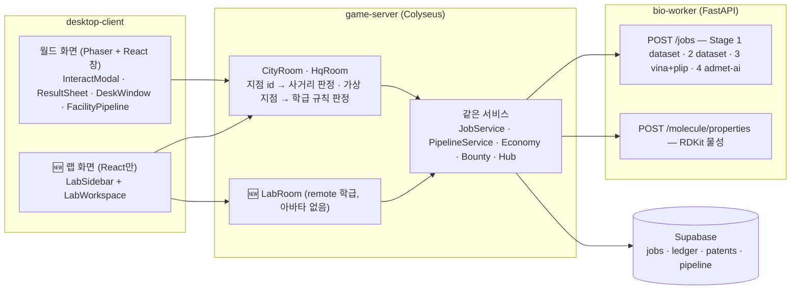

# Crista 신약 개발 파이프라인 랩(Pipeline Lab) 설계 — 2026-10-23

> **대체됨(2026-10-23)**: 사용자가 crista 안의 화면이 아니라 **새 저장소 crista-web** 를 뜻했다고 밝혔다. 이 초안은 crista 에서 옮겨 온 기록이고, 기준 문서는 [`../2026-10-23-crista-web-design.md`](../2026-10-23-crista-web-design.md) 다. 아래의 상대 경로 링크는 crista 저장소 기준이다.

> **상태**: 설계안(구현 전). 사용자 요청 — "지금 신약 개발 파이프라인 그대로 **왼쪽 사이드바 / 오른쪽에 진짜 뜨게**, 게이미피케이션 요소(제약회사 이름 정하기 · 연구비 받아서 돌리기)는 살리되
> **아예 신약 개발 파이프라인을 해 보는 플랫폼**을 여기에, **지금 연결된 것을 살려서**. 왼쪽 사이드바에 **단계별로 1. 2. 3. 4.** 가 순서대로 확연히 보일 것."
> **화면 디자인(UI/UX)은 다른 세션이 프리뷰로 만든다** — 이 문서는 단계 정의 · 상태 · 서버 계약 · 재사용 · 위험 · 구현 순서를 정하고, 프리뷰가 맞춰야 할 **화면 계약(§6)** 을 준다.
> **교차 설계**: `Gemini 4 Argon (High)` · `GPT-6-Astra (xhigh)` 의견서를 받아 코드와 대조한 뒤 합쳤다 — 대조 결과 §10, 원문 [`.review/2026-10-23-pipeline-lab/`](../.review/2026-10-23-pipeline-lab/).
> **연관 문서**: [`PRD.md`](../PRD.md) · [`ARCHITECTURE.md`](../ARCHITECTURE.md) · [균형안 v0 §3 · §10](2026-10-19-game-balance-v0.md) · [M5 브리프](2026-10-21-m5-implementation-brief.md) ·
> [실데이터 멀티 표적(v11)](2026-10-23-real-db-multi-target-upgrade-design.md) · [동기부여 3대 축](2026-10-22-gamification-motivation-design.md) · [첫 이용 페르소나 모의 테스트](../.review/persona-2026-10-23/report.md)

---

## 0. 한눈에

| 항목 | 결정 |
| --- | --- |
| 무엇 | 같은 데스크톱 클라이언트 안의 **두 번째 화면 '파이프라인 랩'**. 걷는 월드 없이 **왼쪽 = 번호 단계 사이드바, 오른쪽 = 그 단계의 실제 작업 영역**. 월드와 오갈 수 있다. |
| 무엇을 살리나 | 같은 회사 · 같은 연구비 원장 · 같은 작업(`jobs`) · 같은 바이오 워커(Open Targets · ChEMBL · Vina · PLIP · ADMET-AI · RDKit) · 같은 판정(game-rules) · 같은 Supabase. **새 계산 · 새 판정 규칙을 만들지 않는다.** |
| 단계 | **10단계 1.~10.** = 산업의 표준 10단계(표적 발굴 · 검증 → 히트 → 히트-리드 → 리드 최적화 → 전임상 → IND → 1 · 2 · 3상 → 허가). 4묶음. §2 |
| 게이미피케이션 | 사이드바 맨 위 **회사 카드**(사명 · 티커 · 연구비 · 날짜 · 주가) + 단계 사이 **투자 심사 줄**(Series A · B, 번호 없음). 번호는 파이프라인에만. §5 |
| 학급 규칙 | 교사가 `labMode` 를 고른다 — `off`(지금 그대로) · `hybrid`(사옥 설비는 랩에서, 기관 창구는 걸어서 — 자동 걷기 제공) · `remote`(전부 랩에서). 학생 토글은 **화면만** 바꾼다. §3 |
| 서버 | 메시지가 **가상 지점**(`lab:facility:docking` 등)을 실으면 서버가 학급 규칙을 보고 **사거리 판정만** 건너뛴다. 설비 · 팀 격리 · 멱등 · 세대 · 유료 차단은 기존 함수 그대로. 랩만 쓰는 학생은 아바타 없는 `LabRoom`. §4 |
| 빈 곳 | 리드 최적화 고리(작용기 바꾸기 칩 → 무료 물성 미리보기 → 재도킹 → 비교표)와 **연구 노트**(왜 골랐나 · 무엇을 모르나 · 다음에 바꿀 것). 3D 포즈 뷰어 · 2D 스케처는 새 패키지라 **승인 뒤**. §7 |
| 함께 고칠 기존 결함 | Stage 4 가 특허 분자인지 서버가 안 봄 · 팀원 상태 수신을 내 신청 완료로 표시 · 제형 결정이 표적을 조용히 바꿈 · Stage 1 PDB 기본값 `1M17` 고정. §4.5 |
| 프로토콜 | v11 → **v12**. 바뀌는 것만 §8. DB 는 `classes.lab_mode` 와 `lab_notes` 표. |

---

## 1. 지금 연결된 것 — 무엇이 실제로 돌고 어디서 막히나

### 1.1 그대로 살리는 경로



| 계산 · 절차 | 지금 장소 · 메시지 | 실제 계산 | 비용(균형안 §3.3 · §10.1) |
| --- | --- | --- | --- |
| Stage 1 표적 탐색 | 내 사옥 표적 탐색실 · `experiment:request` | Open Targets v4 4대 질환 × 120 유전자(`source: 'dataset'`) | 무료 |
| ① 코드명 · 기전 선언 | 표적 탐색실 · `pipeline:declare` | — (이번 세대 Stage 1 성공 필요) | 무료 |
| Stage 2 HTVS | HTVS · 합성실 · `experiment:request` | ChEMBL/RDKit 220종 깔때기 + 사전 Vina, `candidates` · `funnel` | 무료 |
| Stage 3 도킹 | 도킹 서버실 · `experiment:request` | RDKit ETKDGv3 → Meeko → Vina 1.2.7 → PLIP, 표적 4종 | $0.050M |
| 물질특허 | 시청 · 특허청 창구 · `pipeline:patent` | 워커 RDKit 물성(출원 때) | $0.050M |
| Stage 4 ADMET | ADMET실 · `experiment:request` | ADMET-AI v2 레이더 6축 | $0.050M |
| ② 후보 · 제형 | ADMET실 · `pipeline:formulate` | — | 무료 |
| IND · 임상 1 · 2 · 3 · ③ 허가 | FDA · 대학병원 창구 · `pipeline:ind|trial|amend|final` | game-rules 효능 E · 안전 S 판정, 학급 게임 시계 | $0.100M / $0.300M / $0.600M / $1.200M / $0.100M |

Stage 1 데이터에서 **도킹까지 이어지는 표적은 질환마다 1개**다 — 480 유전자 중 `dockingTargetId` 가 있는 4개(AChE · EGFR · DPP4 · COX-2)만 결정구조 · 포켓이 준비돼 있다(`disease_targets.json` 의 `dockingTargetId` · `smPocket`). 랩은 이 사실을 숨기지 않고 **'구조 준비됨' 표시와 '약이 될 만한 표적(druggability)' 설명**으로 가르친다.

### 1.2 랩을 막는 단 한 가지 — 사거리 판정

- 실험: [`rooms/handlers.ts` `handleExperimentRequest`](../apps/game-server/src/rooms/handlers.ts) → [`world/interact.ts` `checkExperimentPermission`](../apps/game-server/src/world/interact.ts)(L307~)가 서버 권위 위치 · `interactableId` 로 사거리를 본다.
- 파이프라인 10종: [`pipeline/service.ts`](../apps/game-server/src/pipeline/service.ts) L480~501 의 장소 판정(기관 종류 · 내 사옥 설비 종류 · `withinRange`).
- 설비 건설 · 업그레이드: `FacilityBuildMessage.interactableId`(사옥 맵의 설비 지점).
- 문맥: [`ports.ts` `ClientCtx`](../apps/game-server/src/ports.ts)(L51~)가 `x · y · map` 을 싣는다.

**나머지는 장소와 무관하다.** 결과 · 상태는 룸이 아니라 [`Hub`](../apps/game-server/src/hub.ts) 의 사용자 · 팀 통로로 가므로(룸을 옮겨도 팀 결과가 온다) 랩 화면이 같은 통로에 붙으면 된다.

### 1.3 랩이 함께 풀어야 할 기존 학습 문제(페르소나 모의 테스트 2026-10-23)

| 관찰 | 랩에서의 처리 |
| --- | --- |
| 다음 목적지 안내가 선행 조건보다 앞섬(도킹 없이 '특허청으로') | 사이드바 상태를 **서버 상태의 근거로 계산**(§2.3) — 근거가 없으면 `잠김` + 무엇이 필요한지 |
| 표적 탐색 창 안에서 선언 칸이 실험보다 위 | 1번 안의 순서를 **① 근거 조회 → ② 표적 확정 · 선언**으로 고정 |
| 결과에서 다음 실험으로 후보를 넘기는 버튼 없음 | 모든 결과에 **'다음 단계로 넘기기'**(§6.4) — 초안만 채우고 실행 · 과금은 학생이 누른다 |
| 질환 · PDB 기본값 불일치(알츠하이머 + 1M17) | 랩에는 PDB 입력칸이 없다 — 질환이 표적 · 구조를 정한다. 월드 서식의 `fallback: '1M17'`(`InteractModal.tsx` Stage 1 칸)도 질환 연동으로 고친다 |
| 이동 방법을 몰라 첫 행동을 못 찾음 | 랩 첫 화면이 곧 1번 |
| 일시정지 중 무엇이 되는지 모름 | `blocked`(학급 상태)와 `locked`(선행 근거 없음)를 다른 표시로 |

---

## 2. 사이드바 단계 — 10단계 · 4묶음

### 2.1 번호 원칙

1. **번호 = 산업의 표준 단계.** 학생이 배운 번호가 교과서 · 산업의 순서와 같아야 옮겨 간다 — 표적 발굴 · 검증 → 히트 발굴 → 히트-리드 → 리드 최적화 → 전임상 · 후보 확정 → IND → 임상 1 · 2 · 3상 → 허가
   (NIH NCATS *Early Drug Discovery and Development Guidelines* 의 결정 지점 · FDA *The Drug Development Process* 5단계 · Hughes 외 2011).
2. **1~10 연속 번호 하나만.** 묶음 제목에는 번호를 달지 않는다(두 겹 번호는 헷갈린다). 번호 안의 절차(예: 1번 안의 '근거 조회 → 선언')는 오른쪽 작업 영역의 순서로만 보인다.
3. **한 번호 = 서버 상태로 확인되는 완료 조건 하나.** 학생이 '다 했다'고 누르는 체크리스트를 진실로 삼지 않는다.
4. 임상 1 · 2 · 3상은 **각각 번호** — 비용 · 기간 · 판정 축 · 재도전 경로가 다르고, 가장 오래 기다리는 구간이라 진행이 보여야 한다.
5. 회사 설립 · 연구비 · 주가 · CRO · 학회는 **번호 밖**(§5). 번호를 세면 곧 신약 개발 단계 수가 되게 한다.
6. 2~4번을 여러 번 돌아도 번호가 바뀌거나 이전 결과가 사라지지 않는다(기록은 단계 안에 쌓인다).

### 2.2 단계 표

| # | 묶음 | 사이드바 제목 | 오른쪽에서 하는 일(순서대로) | 지금 연결 | **완료 조건**(서버 상태) | 비용 · 기간 |
| ---: | --- | --- | --- | --- | --- | --- |
| **1** | 발견 | 표적 발굴 · 검증 | ① 질환 고르고 Open Targets 근거(유전 · 문헌 · 약물 · 발현 점수, 구조 준비 여부) 조회 → ② 표적 확정 · 코드명(`CRX-101`) · 기전 한 줄 선언 | Stage 1 + `pipeline:declare` | `program` 에 코드명 · `targetId` 있음 | 무료 |
| **2** | 발견 | 히트 발굴 | 220종 깔때기 컷오프(MW · TPSA · Ro5 · 구조 경고)를 직접 정해 실행 → 남은 후보 · 탈락 수 → 후보 고르기 | Stage 2 | 이번 세대 · 프로그램 표적의 Stage 2 `succeeded` 1건 이상 | 무료 |
| **3** | 발견 | 히트 → 리드 | 고른 후보 + 대조군(결정 리간드) 도킹 → ΔG · 기준 대비 결합력 · PLIP 상호작용 비교 → 리드 고르기 | Stage 3 | 프로그램 표적의 실제 `vina` 근거(`targetEvidenceKey`) 1건 이상 | 도킹마다 $0.050M |
| **4** | 발견 | 리드 최적화 · 물질특허 | 작용기 바꾸기 → **무료 물성 미리보기** → 재도킹 → 원본 · 변형체 비교표 → 최종 분자 물질특허 출원 | 🆕 `molecule:preview` + Stage 3 + `pipeline:patent` | 프로그램 표적의 **유효 특허** 1건 이상 | 도킹 $0.050M · 출원 $0.050M |
| **5** | 전임상 | 전임상 · 후보 확정 | 특허 분자 ADMET-AI 레이더 + RDKit 위험 신호 → 부족한 근거 표시 → 후보 1개 · 제형(경구 · 정맥 · 경피) 결정 | Stage 4 + `pipeline:formulate` | `program.status` 가 `formulated` 이상 | ADMET $0.050M · 결정 무료 |
| **6** | 임상 | IND 신청 | 용량 10/50/100 mg · 환자군 · 1차 평가지표 → FDA 심사 진행 | `pipeline:ind` | IND 통과 | $0.100M · 30게임 일 |
| **7** | 임상 | 임상 1상 | 안전성 · 용량(통과 용량이 기록된다) | `pipeline:trial` | 1상 통과 | $0.300M · 90게임 일 |
| **8** | 임상 | 임상 2상 | 효능 · 안전성 | `pipeline:trial` · `amend` | 2상 통과 | $0.600M · 180게임 일 |
| **9** | 임상 | 임상 3상 | 대규모 확증 | `pipeline:trial` · `amend` | 3상 통과 | $1.200M · 360게임 일 |
| **10** | 허가 | 신약 허가 | 브랜드 이름 · 포장 · 최종 허가 심사 | `pipeline:final` | 허가 | $0.100M · 60게임 일 |

- 대학병원 지구 임상 기간 × 0.85, `regulation` · `trial-recruit` 이벤트 배율은 지금 규칙 그대로(균형안 §10.1). 랩은 비용 · 기간을 **서버가 준 값**으로만 보인다.
- **물질특허를 따로 번호로 세지 않은 까닭**: 특허는 과학 단계가 아니라 리드 최적화의 끝에서 하는 권리 절차이고(산업에서도 리드 · 후보 선정 즈음 출원), 지금 서버에서 5번(ADMET · 제형)의 필수 선행 조건이다. 그래서 **4번의 완료 조건**으로 둔다 — 번호 없는 필수 관문을 만들지 않는다.
- **선언을 1번에 묶은 까닭**: 표적 검증의 산출물이 곧 '이 표적으로 개발하겠다'는 선언이다. 페르소나 테스트의 '창 안 순서 뒤집힘'은 1번 안의 순서(① 조회 → ② 선언)로 푼다.

### 2.3 단계 상태 — 하나의 순수 함수

사이드바 상태는 화면이 추측하지 않고 `@crista/game-rules` 의 순수 함수 하나가 정한다. **UI 프리뷰도 이 함수의 출력 모양만 받는다.**

```ts
// packages/game-rules/src/lab/steps.ts (신규)
export type LabStepId = 'target' | 'hit' | 'hit2lead' | 'leadopt' | 'preclinical' | 'ind' | 'phase1' | 'phase2' | 'phase3' | 'approval';
export type LabStepState =
  | 'locked'      // 선행 단계 근거 없음 — reason + unlockBy(번호)
  | 'needs-lab'   // 설비 미건설 · 가동 중지 — 이 자리에서 설치 · 재가동(§5.3)
  | 'ready'       // 할 수 있음
  | 'running'     // 작업 · 심사 · 임상 진행 중 — progressPct · byName
  | 'done'        // 완료 조건 충족
  | 'held'        // 보류(CRL) · 기준 미달 — 재도전 경로 + 바운티
  | 'blocked';    // 학급 · 회사 상태(일시정지 · 구조조정 · 파산 · 연구비 부족) — 유료 행동만 막힘, 무료는 열림
export type LabEvidenceKind = 'dataset' | 'compute' | 'prediction' | 'simulation'; // 자료 조회 · 실제 계산 · AI 예측 · 교육용 모의 판정
export interface LabStepView {
  id: LabStepId; no: number; group: 'discovery' | 'preclinical' | 'clinical' | 'approval';
  state: LabStepState; reason?: string; unlockBy?: number;
  progressPct?: number; byName?: string;      // 진행 중이면 누가 시작했나(같은 팀 중복 실행 예방)
  attempt?: number;                            // 재도전 회차(임상)
  evidence: LabEvidenceKind[];                 // 이 단계 결과의 성격 — 화면에 그대로 표시
  costCents?: number; durationGameDays?: number;
  otherTargetResults?: number;                 // 프로그램 표적이 아닌 결과 수(흐리게 따로)
}
export function labStepsOf(input: {
  pipeline: PipelineStateMessage | null; jobs: readonly JobView[]; team: TeamStateMessage | null;
  clock: ClockView | null; labMode: LabMode; generation: number;
}): LabStepView[];
export function currentLabStep(steps: readonly LabStepView[]): LabStepId; // 처음으로 done 이 아닌 단계
```

- **완료 조건은 서버 상태에서만** 계산한다(§2.2 열). 월드에서 한 일도 그대로 반영된다 — 같은 팀원이 월드에서 도킹하면 랩의 3번이 `done` 이 된다.
  입력은 클라이언트가 이미 받는 `PIPELINE_STATE`(프로그램 · 특허 · 도킹 근거 `candidates` · 단계) · `JOB_LIST`(작업) · `TEAM_STATE`(설비 등급 · 가동 · 잔액) · `CLOCK` 이고,
  `JobView` 에 표적 · 분자 칸만 더한다(§8).
- **프로그램 표적만 센다.** 1번에서 표적을 바꾸면(IND 전에는 서버가 허용) 2~4번의 완료 근거는 새 표적 기준으로 다시 계산되고, 옛 표적 결과는 `otherTargetResults` 로 흐리게 따로 보인다.
- **잠김 규칙 = 서버 조건 + 랩 순서**: 서버가 이미 막는 조건(선언 ← Stage 1, 특허 ← 실제 도킹, 제형 ← 선언 + 특허, IND ← 제형, 임상 ← 직전 통과, 허가 ← 3상)은 같은 조건을 쓴다.
  서버가 막지 않는 순서(2 히트 → 3 도킹, 5번 안의 ADMET → 제형)는 **랩 화면만** 지킨다. 이미 근거가 있으면(월드에서 먼저 했으면) 막지 않고 `done` 으로 보인다.
- `blocked` 는 `locked` 와 다르다 — 학생 잘못이 아니라 학급 · 회사 상태라는 것을 구분해 알린다.
- **점수(효능 E · 안전 S)는 판정 뒤에만** 보인다(`pipelineFormat.tsx` 머리말의 원칙 유지). 미리보기 · ADMET · 제형 화면은 물성과 위험 신호만.
- 단위 테스트는 M5 판정 픽스처를 재사용해 **서버 조건과 어긋나지 않음**을 지킨다.

---

## 3. 진입과 모드 — 걷는 월드와 공존

### 3.1 학급 설정 `labMode` (교사가 정하고, 학급 전체에 같다)

| 값 | 내 사옥 설비(1 · 2 · 3 · 4 · 5번의 실험 · 선언 · 제형 · 설비 건설) | 기관 창구(4번 특허 · 6~10번) | 쓰임 |
| --- | --- | --- | --- |
| `off` | 걸어서 | 걸어서 | **기존 학급의 기본값** — 아무것도 바뀌지 않는다. 랩 화면은 읽기 전용 진행 노트로만 열린다 |
| `hybrid` | **랩에서 실행** | 랩의 **[가기]** → 월드로 바뀌며 자동 걷기(기존 클릭 이동 길찾기) → 도착하면 그 창구 창 | 타이쿤 수업 + 실습. 도시의 경쟁(특허 선점 · 지구 거리)은 살리고 사옥 안 왕복만 줄인다 |
| `remote` | 랩에서 실행 | **랩에서 실행** | 파이프라인 실습 수업. 월드는 도시 구경 · 거래소용으로 열 수 있다 |

- **공정성**: 원격 권한은 학생 설정이 아니라 **학급 설정**으로만 켜진다. 같은 학급 학생은 모두 같은 규칙을 쓰고, 걷는 학생은 '느린 길'을 고른 것이다. 학생의 [랩 | 월드] 토글은 화면만 바꾼다(GPT · Gemini 공통 지적).
- `hybrid` 가 기관 창구를 걷게 두는 까닭: 특허는 같은 학급 선착순이고(같은 물질 판정), 지구마다 기관까지 거리가 달라 지구 선택의 의미가 있다(Gemini 지적). 사옥 안 설비는 팀끼리 거리 경쟁이 없다.
- **현장 전용으로 남기는 것**(모든 모드): 거래소 매매 · 유상증자 청약(PRD §3.1), 타 팀 사옥 정찰, 설비 임대(`rent`), NPC 대화. 랩은 주가 · 공시를 **읽기만** 한다.
- **변경**: 교사가 GM 패널에서 학급을 **일시정지한 상태에서** 바꾸고, 바뀐 시각 · 교사 · 전후 값을 기록하며 학급 공시 1줄을 낸다. 진행 중 작업 · 연구비 · 시계는 그대로, 다음 요청부터 적용(GPT 제안).

### 3.2 화면 진입

- 로그인(첫 화면 스카이라인 → 로그인 창) 뒤 학생은 `remote` = 랩, `hybrid` · `off` = 월드로 들어간다. 상단 바에 **[랩 | 월드]** 전환 하나.
- 전환은 클라이언트 화면만 바꾸고 접속 룸은 그대로다(§4.1). 회사 · 작업 상태는 같은 팀 통로로 둘 다에 온다.
- 교사는 랩을 **학급 현황판**(팀별 현재 단계 번호 · 상태 · 막힌 이유 · 연구 노트)으로 본다 — 기존 `PipelineInspect` 재사용(§9 L4).

---

## 4. 서버 계약 — 가상 지점과 학급 규칙

### 4.1 콘솔 판정은 '메시지 단위', 랩 룸은 '아바타 없는 접속'

- **콘솔 여부는 룸이 아니라 메시지가 정한다** — `interactableId` 가 가상 지점(`lab:*`, §4.2)이면 `reach = 'console'`, 아니면 지금처럼 `'walk'`.
  그래서 월드와 랩을 **오가는 학생은 지금 붙은 도시 · 사옥 룸을 그대로 쓴다**(전환할 때 다시 입장하지 않는다 — 룸을 바꾸면 소켓 재입장 · 룸별 `sentResultJobIds` 가 갈린다는 Gemini 지적).
- **랩만 쓰는 학생**(`remote` 학급에서 월드를 열지 않음)은 도시에 서 있는 아바타를 만들지 않도록 **`LabRoom`** 에 붙는다:
  `ROOM_LAB = 'lab'`, `gameServer.define(ROOM_LAB, LabRoom).filterBy(['classId'])` — 도시 룸과 같은 학급마다 하나([`index.ts`](../apps/game-server/src/index.ts) L37 패턴).
  맵 · 이동 · 플레이어 동기 상태가 없다(Colyseus 는 스키마 없는 룸을 허용한다 — 내장 `RelayRoom` 처럼). **L2 에서 넣고, L1 은 기존 룸만으로 검증한다**(GPT 권고: 첫 구현은 새 룸 없이).
- 인증 · 입장은 `rooms/admission.ts` 그대로, 입장하면 `Hub` 구독. 입장 동기화는 월드 룸 `resync`([`WorldRoom.ts`](../apps/game-server/src/rooms/WorldRoom.ts) — `sendTeamState` · `handleJobSync` · `syncPipelineOnJoin`)와 **같은 함수**. 재접속(`allowReconnection` 30초)도 같다.
- 버전 검사는 입장 때 기존 `PROTOCOL_VERSION` 비교 그대로 — v11 클라이언트는 v12 서버에 들어오지 못하므로 구버전이 가상 지점을 보내는 일은 없다.

### 4.2 가상 지점 id와 해석기

```ts
// packages/shared-types/src/lab.ts (신규)
export type LabMode = 'off' | 'hybrid' | 'remote';
export const LAB_FACILITY_ID = (kind: FacilityKind) => `lab:facility:${kind}` as const;              // 내 사옥 설비
export const LAB_DESK_ID = (inst: 'city-hall' | 'fda' | 'hospital') => `lab:desk:${inst}` as const;  // 기관 창구
export const isLabInteractableId = (id: string) => id.startsWith('lab:');
```

```ts
// apps/game-server/src/world/console.ts (신규)
/** 가상 지점 → 실제 지점. 설비는 그 팀 사옥 맵에서 '종류'로, 창구는 학급 도시 맵에서 '기관'으로 찾는다. */
export function resolveConsoleItem(dir: WorldDirectory, teamId: TeamId, id: string): Interactable | null;
/** 학급 규칙 · 역할 · 지점 종류로 콘솔 실행을 허락하는가. 위치 외의 판정은 하지 않는다(기존 함수가 이어서 한다). */
export function consoleAllowed(args: { labMode: LabMode; role: UserRole; teamId: TeamId | null; item: Interactable }): Denial | null;
```

- **식별자를 안다는 것은 권한이 아니다**(GPT). 서버가 세션의 팀 · 학급 규칙 · 지점 종류를 대조한다 — `remote` 는 내 회사 설비 + 파이프라인 창구, `hybrid` 는 내 회사 설비만, `off` 는 없음. 아니면 새 오류 `console_disabled`.
- 설비는 **종류로** 찾는다. 지금 사옥 맵의 설비 지점 id 는 등급과 무관하게 `facility-${kind}` 로 고정이지만([`hq.ts`](../packages/game-rules/src/world/hq.ts) L216~), 해석기는 `item.facility === kind` 로 찾아 맵 생성 방식이 바뀌어도 깨지지 않게 한다. `directory.hqMap(teamId)` · `directory.cityMap()` 을 쓴다.
- 가상 지점이면 **어느 공간에 있든**(도시 · 내 사옥 · 다른 회사 사옥 · 랩 룸) 같은 결과다 — 기준은 '세션의 팀'이지 '서 있는 공간'이 아니다. 가짜 좌표 · 순간이동으로 권한을 얻는 방식은 쓰지 않는다.
- GPT 는 `interactableId` 를 `ActionOrigin = { kind: 'world'; interactableId } | { kind: 'lab'; station }` 으로 일반화하자고 했다. 가상 지점 문자열은 **같은 뜻을 기존 칸에 담는 최소 변경**이라 메시지 10여 종의 모양을 바꾸지 않는다. 판정 계층(`consoleAllowed`)이 하나라는 점은 같다.

### 4.3 `ClientCtx.reach` — 바뀌는 곳

```ts
// apps/game-server/src/ports.ts
export interface ClientCtx { /* … 기존 … */ labMode: LabMode; }
// reach 는 메시지마다: isLabInteractableId(msg.interactableId) ? 'console' : 'walk'
```

| 위치 | 지금 | 바꾼 뒤 |
| --- | --- | --- |
| `checkExperimentPermission` · `checkFacilityPermission`(`world/interact.ts`) | 사거리 실패 → `out_of_range` | 가상 지점이면 해석 → `consoleAllowed` → **사거리만** 건너뜀. 건설 · 등급 · 가동 · 방문자 판정은 그대로 |
| `PipelineService` 장소 판정(L480~501) | 지점 · 기관 · 내 사옥 · `withinRange` | 같음. 내 사옥 판정(`ctx.hqTeamId === ctx.teamId`)은 '해석된 설비가 세션 팀의 것'으로 대신 |
| `handleExperimentRequest` 의 `rent` | 다른 팀 사옥 방문 | 가상 지점이면 `rent` 거절(`not_eligible`) — 임대를 자기 설비 실행으로 바꾸지 않는다 |
| `INTERACT`(창 열기) | 사거리 안에서 `INTERACT_OPEN` | 가상 지점이면 같은 `INTERACT_OPEN`(행동 목록 포함)을 돌려준다 — 랩 오른쪽 영역이 서버의 행동 가능 목록을 그대로 쓴다 |

- `off` 학급의 랩 화면은 읽기 메시지(`pipeline:sync` · `pipeline:desk` · `job:sync` · `pipeline:seen` · `experiment:seen` · `bounty:*`)만 쓴다 — 지금도 장소와 무관한 메시지들이다.

### 4.4 지켜야 할 불변식(검증 항목)

| 불변식 | 지키는 방법 |
| --- | --- |
| 팀 · 학급 격리 | 해석기는 **세션의 팀** 사옥만 본다(클라이언트가 보낸 팀 id 를 믿지 않는다). 결과는 `Hub.sendToTeam` 그대로 |
| 설비 조건 | 원격에서도 건설 · 등급 · 가동 · 회사 상태 검사 |
| 멱등 · 과금 | 같은 서비스 · 같은 `(팀, requestId, 세대)`. 화면 전환 · 재전송은 새 요청이 아니다 |
| 세대 · 복원 | 랩도 `WORLD_CHANGED` · 복원 공시를 받아 상태를 다시 받고 **초안의 참조(작업 · 특허 id)를 다시 검증**한다. 옛 세대의 늦은 결과는 기존 세대 판정이 버린다 |
| 유료 차단 | 일시정지 `class_paused` · 구조조정 `restructure_blocked` · 파산 — 같은 함수 |
| 정정 | 교사 정정 · 개입 표시는 `JOB_UPDATE` · `PIPELINE_STATE` 로 오므로 랩도 같은 표시 |
| 현장 전용 | 매매 · 청약 · 임대 · 정찰 · NPC 메시지는 `LabRoom` 에 등록하지 않고, 가상 지점으로도 받지 않는다 |
| 출처 정직성 | `fixture` 결과는 연구 근거로 세지 않는다(완료 조건 · 특허 · 비교표에서 제외) |

### 4.5 랩과 함께 고칠 기존 결함(코드 대조로 확인)

| 결함 | 확인한 곳 | 고침 |
| --- | --- | --- |
| **Stage 4 가 '그 팀의 유효 특허 분자'인지 서버가 보지 않는다** — 화면만 특허 목록에서 고르게 하고, 서버는 SMILES 길이만 본다 | [`jobs/service.ts` `prepareInput`](../apps/game-server/src/jobs/service.ts) L966~ ("Stage 4 … 길이만 확인") | Stage 4 + `smiles` 는 그 팀(또는 라이선스)의 유효 특허 정규 SMILES 와 같아야 접수. 아니면 `not_eligible` (GPT P0) |
| **팀원의 상태 수신을 내 신청 완료로 표시** — `PIPELINE_STATE` 가 오면 대기 중 서식을 모두 '반영됐다'로 바꾼다 | [`store/pipeline.ts` `applyState`](../apps/desktop-client/src/store/pipeline.ts) L138~ | 서버가 `PIPELINE_STATE` 에 마지막 처리 `requestId` 를 싣고, 그 id 와 맞는 서식만 완료로(GPT P0). 랩은 팀원이 동시에 쓰는 화면이라 필수 |
| **제형 결정이 프로그램 표적을 특허 표적으로 조용히 바꾼다** | [`pipeline/service.ts`](../apps/game-server/src/pipeline/service.ts) L821~(`targetId: patent!.targetId`) | 특허 표적 ≠ 프로그램 표적이면 거절하고 '1번에서 표적을 바꾸세요'(IND 전에만 가능). v11 이 선언 때 표적을 정하므로 이제 덮어쓸 까닭이 없다(GPT P1) |
| Stage 1 PDB 기본값 `1M17` 고정 | `InteractModal.tsx` Stage 1 `pdbId` `fallback: '1M17'` | 질환 → `DISEASE_TO_TARGET` 의 PDB 로 자동(Gemini) |

---

## 5. 게이미피케이션 — 번호 밖에서 살린다

### 5.1 회사 카드(사이드바 맨 위, 항상 보임)

사명 · 티커 · 잉크 색 · 사옥 Tier 배지 · **연구비 잔액**(+ 월 유지비 · 운영 가능 개월 · 자금 경고 단계) · 게임 날짜(일시정지 표시) · 주가(읽기 전용, 객장 시세 공개분). 누르면 기존 연구비 장부(`LedgerPanel`).

### 5.2 연구비 — '받아서 돌리기'

- 모든 유료 실행 버튼에 **비용 칩**과 지출 확인(기존 `SubmitWithConfirm` · `SpendConfirm`). 잔액이 모자라면 `blocked` + 부족액.
- **투자 심사 줄**(번호 없음, 단계와 다른 모양) — PRD 흐름(표적 발굴 → VC Series A, 전임상 → Series B)과 균형안 §3.1 에 맞춰 **1번 뒤 `Series A`, 5번 뒤 `Series B`**.
  지금 투자 지급은 교사 승인(`investment` 원장 · GM)이므로, 랩은 이 줄에서 **'심사 요청'** 을 기존 `SUPPORT_REQUEST { kind: 'grant' }` 로 보낸다. 본문은 연구 노트(§7.2)의 가설 · 근거 · 실패 시 대안을 200자로 요약해 미리 채운다.
  교사 승인 → 기존 원장 → 회사 카드 갱신. 학생은 승인 API 를 부르지 않는다. 줄의 '받음' 표시는 `TEAM_STATE` 의 `investments`(이미 받은 마일스톤)로 정한다. PRD 의 'VC 고찰 카드' 피칭(M6 후보)이 생기면 이 줄이 그 서식을 연다.
- 실패 데이터 바운티(v8)는 `held` 단계 · 기준 미달 결과 안에 그대로(결과지 탭).
- CRO 의뢰 · 학회 · 라이선스(v9 · v10)는 사이드바 아래 **'회사 운영'** 묶음(번호 없음)에서 연다(L4, `remote` 학급은 가상 창구로).

### 5.3 설비 건설도 그 자리에서 — 그리고 첫 수업의 함정

- 랩에도 '연구소를 짓는 돈'의 결정이 남는다. 설비가 없으면 그 단계가 `needs-lab` 이 되고 오른쪽 맨 위에 **설치 카드**(이름 · 설치비 · 월 유지비 · 지구 할인)를 보인다. 실행은 기존 `facility:build` + `LAB_FACILITY_ID(kind)`.
- **함정**(Gemini P0): 새 학급은 설비가 전부 등급 0 이고 시계가 **일시정지로** 시작한다. 일시정지 중에는 설비 건설도 `class_paused` 다. 그러면 1번(무료)조차 시작할 수 없다.
  → 랩 첫 화면에 '교사가 수업을 시작하면 표적 탐색실을 지을 수 있어요' 띠를 두고, 학급 만들기에 **'기본 연구소를 갖추고 시작'**(`labStart: 'empty' | 'equipped'`) 선택을 더한다 — `equipped` 는 표적 탐색실 · HTVS실을 1등급으로 짓고 **설치비를 초기 연구비에서 원장 한 줄씩 차감**해 균형안 산술(§7.1)을 바꾸지 않는다.

### 5.4 회사 이름 정하기

지금은 교사가 학급을 만들 때 사명 · 티커를 적는다(`CreateClassForm`). 학생이 정하는 것은 파산 뒤 재창업(`COMPANY_REFOUND`)뿐이다 — '기존 기능'으로 표시하지 않는다.
학생 작명은 두 길이 있다: (가) **팀 제안 → 교사 반영**(GPT 권고, 새 서버 상태 없음 — `SUPPORT_REQUEST { kind: 'other' }` + 교사 화면에서 이름 바꾸기) · (나) 새 메시지 `company:charter`(첫 거래 · 첫 유료 행동 전 1회).
티커가 증시 상장 키라 **거래가 생긴 뒤에는 바꾸지 않는다**. (가)를 L4 에 넣고 (나)는 사용자 결정으로 남긴다. (증시가 티커를 어디에 키로 쓰는지는 구현 전에 확인 — 추정 단계)

---

## 6. 화면 계약 — 다른 세션의 UI 프리뷰가 맞출 것

시각(06 픽셀 타이쿤 토큰 · 서체 · 창 문법)은 프리뷰 세션이 정한다. 아래는 **구조와 상태 어휘**만 고정한다. 프리뷰의 가짜 데이터도 `LabStepView[]`(§2.3) 모양으로 만든다 — 화면이 스스로 완료를 판정하거나 성공으로 넘어가는 연출을 만들지 않는다(GPT P1).

### 6.1 배치

```text
┌─ 사이드바 (고정 폭) ──────────────────┬─ 작업 영역 ─────────────────────────────────────────┐
│ [회사 카드] 사명 · 티커 · 연구비 · 날짜    │  3. 히트 → 리드                    도킹 $0.050M / 회 │
│ ─ 발견 ─                              │  실제 산업에서는: 히트 몇 개를 비교해 리드를 고른다…    │
│  ✓ 1. 표적 발굴 · 검증                  │  결과의 성격: 실제 계산(Vina) · 결합력은 추정치        │
│  ◆ Series A 심사 요청                  │  ┌ 준비물(이전 단계에서 넘어온 것) ─────────────────┐ │
│  ✓ 2. 히트 발굴                        │  │ 표적 AChE · 4EY7 · 후보 3개 · 대조군 도네페질     │ │
│  ▸ 3. 히트 → 리드        ◀ 지금         │  └────────────────────────────────────────────────┘ │
│  🔒 4. 리드 최적화 · 물질특허            │  … 입력 · 실행 · 결과 기록 …                         │
│ ─ 전임상 ─                             │  연구 노트: 왜 골랐나 · 무엇을 모르나                 │
│  🔒 5. 전임상 · 후보 확정                │  [다음 단계로: 4. 리드 최적화 · 물질특허 →]          │
│  ◆ Series B 심사 요청                  │                                                     │
│ ─ 임상 ─  6 IND · 7 1상 · 8 2상 · 9 3상  │                                                     │
│ ─ 허가 ─  10 신약 허가                  │                                                     │
│ ─ 회사 운영 ─ 장부 · CRO · 학회 · 설정    │                                                     │
└──────────────────────────────────────┴─────────────────────────────────────────────────────┘
```

### 6.2 사이드바 항목 계약

| 칸 | 내용 |
| --- | --- |
| 번호 | `1.` ~ `10.` — **목록이 번호를 매긴다**(`<ol>`), 제목 문자열에 번호를 손으로 넣지 않는다 |
| 제목 | §2.2 '사이드바 제목' 그대로 |
| 보조 줄 | 상태 요약 — 예: `도킹 서버실 · 3회 실행`, `2상 · 42% · 김OO 시작`, `보류 · 재도전 가능`, `설비 필요 · $0.700M` |
| 상태 | §2.3 의 7개 — **색만으로 구분하지 않는다**(기호 · 글자 함께: ✓ 완료 · ▸ 진행 · 🔒 잠김 · ✕ 보류 · ⏸ 막힘 · 🏗 설비 필요 · ○ 할 수 있음) |
| 지금 단계 | `aria-current="step"` 1개(= `currentLabStep`) |
| 잠긴 단계 | 누를 수 있다 — 오른쪽에 '무엇을 배우나 + 무엇이 필요한가(→ N번)' 미리 보기. 실행 칸은 없다(`aria-disabled`) |
| 완료 단계 | 누르면 기록(결과 목록 · 연구 노트)을 다시 본다 |
| 투자 심사 줄 | 번호 없는 줄(Series A · B) — 단계와 모양이 달라야 한다 |

### 6.3 작업 영역 공통 틀(단계마다 같은 순서)

1. **머리** — `N. 제목` · 완료 조건 한 줄 · 비용 · 기간.
2. **실제 산업에서는** — 2~3문장(교사용 설명과 같은 사실).
3. **결과의 성격** — `자료 조회`(Open Targets · ChEMBL) · `실제 계산`(Vina · PLIP · RDKit) · `AI 예측`(ADMET-AI) · `교육용 모의 판정`(IND · 임상 · 허가 — game-rules 규칙 점수). '도킹 점수는 실제 활성 측정이 아니다' · 'ADMET 예측은 전임상 시험 전체를 대신하지 않는다' · '임상 판정은 ADMET-AI 값을 쓰지 않는다(특허의 도킹값 · RDKit 물성 · 용량 · 제형)'를 그 단계에 적는다(GPT P0).
4. **준비물** — 이전 단계에서 넘어온 값(읽기 전용 카드, 바꾸려면 그 번호로 가는 링크).
5. **입력 · 실행** — 서버가 보낸 행동 목록(`INTERACT_OPEN.actions`)으로 서식을 연다(§6.5).
6. **결과 기록** — 이 단계의 실행 기록(최신이 위). 결과 자동 열기(PRD §6)는 '이 단계 결과 칸으로 이동 + 사이드바 표시', 알림 전용이면 사이드바 표시만.
7. **연구 노트** — 왜 골랐나 · 무엇을 아직 모르나 · 실패하면 무엇을 바꾸나(§7.2).
8. **다음 단계로** — 넘길 값을 **초안으로** 채운 채 다음 번호를 연다. 자동 실행 · 자동 과금은 없다.

### 6.4 넘기기 지도

| 보내는 곳 | 넘기는 값 | 받는 곳 |
| --- | --- | --- |
| 1 ① 조회 결과의 유전자 줄 | 질환 id → `DISEASE_TO_TARGET`(구조 준비된 표적만 선택 가능) | 1 ② 선언 서식(질환 · 표적 미리 채움, 근거 요약 카드) |
| 1 ② 선언 | `program.targetId` | 2 · 3 · 4 의 표적(고정, 바꾸려면 1번) |
| 2 결과 `candidates[]` | `ScreeningCandidate` + 원본 작업 id(표 문자열 복사가 아니다) | 3 도킹 대기열(여러 개) + 대조군 자동 추가 |
| 3 결과 | 리드 분자 · ΔG · PLIP 잔기 · Vina 작업 id | 4 편집 시작점 · 비교표의 '원본' 줄 |
| 4 특허 | 특허 id · 정규 SMILES | 5 ADMET 입력(서버가 특허와 대조 — §4.5) |
| 5 ADMET · 제형 | 레이더 · 위험 신호 · 제형 | 6 IND 서식 |
| 7~9 보류 | 실패 종류 · 재도전 3경로 | 같은 번호(다시) · 6번 화면의 용량 변경 · 5번(제형 · 후보 교체 → 새 IND) |

분자나 표적을 바꾸면 기존 도킹 · 특허 근거가 그대로 유효하다고 표시하지 않는다(새 분자는 비교표에서 '근거 없음'으로 시작).

### 6.5 재사용 · 다시 짜기

| 지금 컴포넌트 | 랩에서 |
| --- | --- |
| `InteractModal.tsx`(1089줄) — `FacilityBuildSection` · Stage 1~4 서식 · `DockingFields` · `AdmetFields` | **창 외곽과 본문 분리** → `ui/forms/*` 로 export, 월드 창과 랩이 함께 쓴다 |
| `ResultSheet.tsx` · `StepResultSheet.tsx` · `BountyTab.tsx` | `variant: 'modal' | 'inline'` 추가. '다음 단계로'는 **새 콜백**(`onHandoff`) — 지금 `onNext` 는 '다음 미확인 결과'라는 뜻이라 바꾸지 않는다(GPT) |
| `FacilityPipeline.tsx`(`DeclareSection` · `FormulateSection`) | 그대로 1번 ② · 5번에 넣는다(이미 섹션 단위) |
| `DeskWindow.tsx`(`PatentDesk` · `FdaDesk` · `HospitalDesk`) | export 분리 + `FdaDesk` 를 `IndFormSection` · `AmendDoseSection` · `FinalSection` 으로 쪼갠다(Gemini) |
| `PipelinePanel.tsx` 의 8칸 `cellStates` · `nextPlace` | `labStepsOf` 로 대체 — 월드 HUD 패널도 같은 함수를 쓰게 해 두 화면의 '다음 할 일'이 같아진다 |
| `App.tsx`(2337줄)의 S2C 분배 | `net/dispatch.ts` 로 빼서 월드 · 랩이 같은 분배를 쓴다(가장 큰 회귀 위험 — §11) |
| `JobList` · `HudCashCard` · `HudCalendar` · `NotificationTray` | 그대로(회사 카드 · 상단 바) |

---

## 7. 빈 곳 — '진짜 해 보는' 데 모자란 것

### 7.1 리드 최적화 고리(4번)

산업의 설계 → 만들기 → 시험 → 분석(DMTA) 고리를 교실 크기로 줄인다(Bath 대학 '화학 사이클 5회 반복' 수업, J. Chem. Educ. 2024 *MedChem Game*, TeachOpenCADD T002 · T015 · T016).

| 조각 | 설계 |
| --- | --- |
| **작용기 바꾸기 칩**(L3 핵심) | 고등학생이 SMILES 를 손으로 고치기는 어렵다(Gemini). 바운티 처방(`BOUNTY_REMEDY_LABEL` — `redesign_amine` · `redesign_alert` · `lower_clogp` · `improve_affinity`)과 짝지은 칩 6종: 방향족 아민 → 아세트아마이드 · 니트로 → 시아노 · 염기성 아민 → 아마이드 · 하이드록시 도입 · 플루오린 도입 · 메톡시 제거. 워커가 RDKit 반응 SMARTS 로 변형체를 만든다(`POST /molecule/transform`, 새 의존 없음). 적용할 자리가 없으면 '이 분자에는 해당 작용기가 없다'를 돌려준다 |
| **SMILES 직접 편집** | 칩과 함께 둔다(상급 학생) |
| **무료 물성 미리보기** | `molecule:preview` → 게임 서버가 워커 `POST /molecule/properties` 를 대신 부르고 game-rules `propertySignals` 로 위험 신호를 붙인다. 특허 물성과 **같은 RDKit 판 · 같은 정규화**라 숫자가 어긋나지 않는다. 학생에게 워커 주소를 열지 않는다 |
| **2D 구조 그림** | 워커가 RDKit `rdMolDraw2D` SVG 를 함께 돌려준다(새 의존 없음) — 결과 표 · 비교표 · 특허 카드 |
| **비교표** | 이 표적에 도킹한 모든 분자: ΔG · 기준 대비 결합력(`referenceKcal`) · MW · cLogP · TPSA · 위험 신호 · 출처 작업. 원본 → 변형체 계보(부모 SMILES) |
| **대조군 습관** | 3번 첫 실행에 결정 리간드 재도킹을 대조군으로 권한다(유료 1회, 끌 수 있음) |

`molecule:preview` · `transform` 보호: 무료지만 **서버 비용은 있다** — 팀당 분당 20회 · 학급 동시 처리 상한 · SMILES 길이(`SMILES_MAX_LENGTH`) · 엔진 판을 키에 넣은 팀 범위 캐시. 입력 칸 타자마다가 아니라 단추 · 칩을 누를 때만 보낸다. 미리보기 실패가 도킹으로 넘어가지 않는다.

**무료 미리보기를 클라이언트 RDKit.js 로 하지 않는 까닭**: Python 워커와 판이 달라 특허 · 판정 값과 어긋날 수 있고, 새 패키지(wasm 수 MB)라 사전 승인 대상이다. 오프라인 즉시 미리보기가 필요하다고 확인되면 그때 넣고, 공식 값은 서버가 다시 계산한다(세 모델 같은 결론).

### 7.2 연구 노트(모든 단계)

'최저 도킹값 찾기 · 성공 단추 누르기'만 반복하는 위험을 막는다(GPT). 단계마다 세 칸 — **왜 이것을 골랐나 · 무엇을 아직 모르나 · 실패하면 무엇을 바꾸나**.

- 저장: 새 표 `lab_notes(class_id, team_id, generation, step_id, body jsonb, refs jsonb, author_id, updated_at)` — `refs` 는 근거 작업 id · 특허 id · 부모 SMILES. 팀원 · 교사가 본다. 다른 팀은 보지 못한다.
- 완료 조건이 **아니다**(막지 않는다). 대신 투자 심사 요청 · 교사 현황판 · 바운티 리포트가 이 노트를 미리 채운다.
- 복원: 노트는 게임 상태가 아니라 학습 기록이라 지우지 않고 세대 표시만 남긴다. 복원 뒤 `refs` 가 없는 작업을 가리키면 '복원 전 근거'로 표시.

### 7.3 그 밖의 빈 곳

| 빈 곳 | 이번 설계 |
| --- | --- |
| 표적 검증 근거 읽기 | 1번 ①의 Open Targets 점수(유전 · 문헌 · 약물 · 발현)와 `smPocket` · 구조 준비 여부로 '근거 요약 카드'를 ② 선언 옆에 고정. 반대 근거 · 추가로 필요한 검증 실험은 연구 노트 칸으로 |
| 전임상 근거 묶음 | 5번에 '아직 없는 자료' 체크(독성 시험 · 노출 · 제조 · 품질)를 보이되 **완료로 세지 않는다** |
| 3D 결합 포즈 | **L5(승인 뒤)** — 워커가 이미 `artifacts.poseSdf` 를 만든다. 3Dmol.js 또는 Mol* 로 PLIP 잔기를 3D 로 |
| 2D 스케처(PRD 의 Ketcher) | L5(승인 뒤) |

---

## 8. 프로토콜 v12 — 바뀌는 것만

| 종류 | 이름 | 내용 |
| --- | --- | --- |
| 상수 · 타입 | `LabMode` · `LAB_FACILITY_ID` · `LAB_DESK_ID` · `isLabInteractableId` | §4.2 |
| 학급 | `labMode` · `labStart` | `CreateClassRequest` · `ClassSummary` · `WelcomeMessage` · GM 변경 API(일시정지 중만) · 마이그레이션 `classes.lab_mode text not null default 'off'` |
| 룸(L2) | `ROOM_LAB` · `LAB_WELCOME`(S2C) | `filterBy(['classId'])`, 맵 없음. 입장 뒤 기존 동기화 메시지 |
| C2S · S2C | `molecule:preview` | `{ requestId, smiles }` → `{ requestId, ok, properties?, signals?, svg?, code? }` — 무료 |
| C2S · S2C | `molecule:transform` | `{ requestId, smiles, transform: TransformId }` → `{ requestId, ok, smiles?, properties?, signals?, svg?, code: 'no_site' | … }` — 무료 |
| C2S · S2C | `lab:note:save` · `lab:notes` | 연구 노트 저장 · 팀 노트 목록 |
| 상태 | `PipelineStateMessage.lastRequestId?` | 서식 완료 판정을 내 요청과 맞추기(§4.5) |
| 상태 | `JobView.targetId?` · `JobView.canonicalSmiles?` | 지금 `JobView` 에는 표적 · 분자가 없고 `inputSummary` 문자열뿐이라 2번 완료 조건(프로그램 표적의 Stage 2)과 5번 안의 'ADMET 한 특허'를 계산할 수 없다. Stage 2 · 3 · 4 작업에 싣는다(그 팀에게만 가는 메시지라 격리는 그대로). 3 · 4번의 도킹 · 특허 근거는 이미 `PipelineStateMessage.candidates[].targetId` · `patents[].targetId` 로 온다 |
| 오류 | `console_disabled` | 학급 규칙 · 대상 지점이 콘솔 실행을 허락하지 않음 |
| 문맥 | `ClientCtx.labMode` | 메시지마다 `reach` 계산 |
| 판정 강화 | Stage 4 특허 대조 · 제형 표적 일치 | §4.5 — 메시지 모양은 그대로, 거절 사유만 늘어남 |

DB: `classes.lab_mode` · `classes.lab_start` · `lab_notes`. **단계 상태는 저장하지 않는다** — 서버 상태에서 매번 계산하므로 복원 · 정정과 어긋날 수 없다. 랩의 작성 중 입력 · 고른 탭은 클라이언트 `localStorage`(프로필별)에만.

---

## 9. 구현 순서

| 단계 | 범위 | 완료 기준 |
| --- | --- | --- |
| **L0 계약** | `shared-types` v12(§8) · `game-rules/lab/steps.ts` `labStepsOf` + 테스트 · 마이그레이션 · `CreateClassForm` 의 `labMode` · `labStart` 칸 | 타입체크 · `labStepsOf` 가 M5 판정 픽스처로 10단계 × 7상태 경우를 맞춤 · 로컬 `migration up` |
| **L1 서버(새 룸 없이)** | `world/console.ts` 해석기 · `consoleAllowed` · 세 군데 사거리 분기 · `INTERACT` 가상 지점 · `console_disabled` · §4.5 결함 3건(Stage 4 특허 대조 · `lastRequestId` · 제형 표적 일치) | 서버 테스트: `remote` 학급에서 도시에 선 채 1~10단계 전부 성공 · `hybrid` 에서 창구만 거절 · `off` 에서 전부 거절 · 다른 팀 설비 · 임대 · 매매 거절 · 같은 requestId 재전송 무과금 · 복원 뒤 늦은 결과 버림 · 기존 `verify-m1~m5` · `verify-npc` 통과 |
| **L2 화면** | `net/dispatch.ts` 분리(동작 변경 없는 첫 커밋) · `LabScreen`(사이드바 + 작업 영역) · 서식 · 결과 재사용(§6.5) · 넘기기(§6.4) · `LabRoom` · [랩 | 월드] 전환 · `hybrid` 자동 걷기 | 회귀 통과 + 새 `verify-lab`(fixture 워커, 두 팀 · 같은 팀 두 학생, 1→10 완주 · 시간 건너뛰기 · 동시 실행 표시) |
| **L3 리드 최적화 · 노트** | `molecule:preview` · `molecule:transform` · 워커 SVG · 4번 비교표 · 대조군 권장 · `lab_notes` | compute 워커로 도네페질 → 변형체 2개 미리보기 · 도킹 · 비교표 수치가 특허 물성과 일치 · 재접속 뒤 노트 · 비교 유지 · 요청 제한 작동 |
| **L4 게이미피케이션 연결** | 회사 카드 · Series A/B 심사 줄(`SUPPORT_REQUEST`) · '회사 운영' 묶음(CRO · 학회 · 라이선스 가상 창구) · 교사 학급 현황판 · 학생 사명 제안 → 교사 반영 · `labStart: 'equipped'` | 교사 승인 → 원장 → 회사 카드 갱신, 현황판이 팀별 현재 번호 · 노트를 보임 |
| **L5 (승인 필요)** | 3D 포즈 뷰어(3Dmol.js / Mol*) · 2D 스케처(Ketcher) | 사용자 승인 뒤 별도 설계 |

L1~L2 가 끝나면 지금 계산을 연결한 랩으로 수업에 써 볼 수 있다. '신약 개발을 직접 해 보는 플랫폼'의 완료 기준은 **L3 까지**(GPT) — 학생이 화면을 오가도 같은 회사의 돈 · 분자 · 근거 · 기록을 이어 쓰고, 자신의 선택과 결과를 설명할 수 있어야 한다.
효과 검증은 실제 학생이 **도움 없이 첫 후보를 도킹 입력으로 넘기는지**부터 잰다(페르소나 보고서의 후속 제안 — 모의 테스트만으로 성공률을 말하지 않는다).

다른 세션의 UI 프리뷰가 확정되면 L2 화면을 그 프리뷰에 맞춘다(구조 · 상태는 §6, 시각은 프리뷰).

---

## 10. 교차 설계 대조 (Gemini 4 Argon High · GPT-6-Astra xhigh)

조정자가 두 의견서의 근거를 코드와 대조했다. 원문: [`gemini-4-argon-high.md`](../.review/2026-10-23-pipeline-lab/gemini-4-argon-high.md) · [`gpt-6-astra-xhigh.md`](../.review/2026-10-23-pipeline-lab/gpt-6-astra-xhigh.md) · 의뢰서 [`brief.md`](../.review/2026-10-23-pipeline-lab/brief.md).

| 쟁점 | Gemini | GPT | 조정자 초안 | **채택** · 까닭 |
| --- | --- | --- | --- | --- |
| 번호 수 | 10(1번 = 조회 + 선언, 4번 = 특허, 5번 = ADMET + 제형) | 10(3 히트→리드 · 4 리드 최적화 분리, 특허는 번호 밖) | 12(선언 · 특허 · 제형 각각 번호) | **10** — 산업 표준 10단계와 1:1. GPT 의 히트→리드 / 리드 최적화 분리 + 특허는 **4번 완료 조건**으로(번호 없는 필수 관문을 만들지 않는다) |
| 모드 | `world` · `hybrid`(사옥 원격 + 기관 자동 걷기) · `lab` | `walk_required` · `remote_allowed`, 학생 토글은 화면만 | `off` · `guide` · `console` | **`off` · `hybrid` · `remote`** — Gemini 의 혼합안(도시 경쟁 보존)과 GPT 의 '학급 규칙 · 학생은 화면만' 원칙을 합침 |
| 새 룸 | 만들지 말 것(재입장 · 룸별 상태) | 첫 구현은 만들지 말 것 | `LabRoom` | **메시지 단위 판정 + 아바타 없는 `LabRoom` 은 L2** — 오가는 학생은 기존 룸, 랩만 쓰는 학생만 새 룸 |
| 권한 표현 | `locationPolicy` 를 `ClientCtx` 에 | `ActionOrigin` 일반화 · 클라이언트가 정하는 `ignoreRange` 금지 | 가상 지점 id | **가상 지점 id + 서버 `consoleAllowed`** — 같은 뜻을 기존 칸에 담는 최소 변경(§4.2) |
| 무료 미리보기 | 워커 중계(캐시 · 제한) | 워커 중계, RDKit.js 는 나중 | 워커 중계 | **세 모델 일치** |
| 작용기 칩 | 6종 + 바운티 처방 연결 | 제한된 예제 + SMILES 편집 | L5(승인 뒤) | **L3 핵심으로 올림**(Gemini) — 워커 반응 SMARTS 라 새 패키지 없음 |
| 연구 노트 | — | 단계마다 이유 · 모르는 것 · 대안, 서버 저장 | 클라이언트 초안만 | **`lab_notes` 채택**(GPT) |
| 기존 결함 | PDB `1M17` · 설비 0 + 일시정지 함정 · 표적 변경 엇갈림 | Stage 4 특허 미검증 · `applyState` · 제형 표적 덮어쓰기 · 출처 구분 | — | **전부 코드로 확인 후 채택**(§4.5 · §5.3 · §2.3 · §6.3) |
| 학생 사명 | 번호 밖, 교사 생성 | '팀 제안 → 교사 반영', 기존 기능이라 표시 말 것 | `company:charter` | **(가) 제안 → 교사 반영을 L4**, (나) charter 는 사용자 결정 |

두 의견서에서 확인하지 못했거나 고친 것: Gemini 의 임상 '대학병원 지구 +3점' · 워커 RDKit 판 `2026.09.1` 표기는 이 문서 범위에서 대조하지 않았다. GPT 의 `snapshot/restore.ts` 줄 번호는 열어 보지 않았다.

---

## 11. 위험 · 미결정

| 위험 | 대응 |
| --- | --- |
| `App.tsx` S2C 분배를 빼다 월드가 깨짐 | L2 첫 커밋은 **동작 변경 없는 추출**만, `verify-m1~m5` · `verify-npc` 통과 뒤 랩을 붙인다 |
| 랩이 걷는 시간(자연스러운 쿨다운)을 없애 진행이 빨라짐 → 같은 진척에 유지비가 덜 나가 경제가 쉬워짐 | 균형안은 그대로 두고 **플레이 테스트로 확인**(같은 과제를 월드 · 랩으로). 필요하면 학급 배율로 — 랩 전용 규칙을 따로 두지 않는다 |
| `remote` 에서 지구 입지의 거리 의미가 사라짐 | 지구 버프(할인 · 보너스)는 그대로 남는다. 거리 경쟁을 원하는 수업은 `hybrid` |
| 서버가 막지 않는 순서(2→3, ADMET→제형)를 랩만 막음 → 월드 · 랩 표시 차이 | 근거가 있으면 `done` 으로 보이게(막지 않음). 서버도 강제할지는 **사용자 결정** |
| 무료 미리보기 · 반복 도킹으로 실제 서버 비용 증가 | 요청 제한 · 동시 처리 상한 · 캐시. 게임 연구비와 인프라 비용을 따로 본다 |
| 같은 팀원 둘이 같은 단계를 동시에 | 서버 멱등 · 단계 조건이 정리, 사이드바에 '○○ 님이 실행 중'(`byName`), `lastRequestId` 로 내 서식만 완료 표시 |
| 거래소를 안 가는 랩 학생은 증시 정보에서 멀어짐 | 회사 카드에 공시 · 주가 읽기 전용, 매매는 월드 |
| 프로토콜 판 올림과 다른 세션의 `verify-m5` 동시 실행 | 검증 실행 중에는 shared-types · game-server 소스를 고치지 않는다(메모리 규칙) |
| UI 프리뷰와 상태 어휘 어긋남 | §6 이 단일 기준. 프리뷰 세션에 이 문서 링크를 넘긴다 |

**사용자 결정으로 남긴 것**

1. 새 학급 만들기의 `labMode` 기본값 — 조정자 권고: 수업 유형에 따라 `hybrid`(타이쿤 + 실습) · `remote`(파이프라인 실습)를 학급 만들기 첫 질문으로.
2. 서버도 랩 순서(2→3 · ADMET→제형)를 강제할지.
3. 학생 회사 설립을 `company:charter`(직접)로 할지, '제안 → 교사 반영'으로 충분한지.
4. `labStart: 'equipped'` 선택지를 넣을지(설치비는 초기 연구비에서 차감).
5. L5 패키지 설치(3D 뷰어 · 스케처).

---

## 참고

- NIH NCATS, *Early Drug Discovery and Development Guidelines* (Assay Guidance Manual) — 결정 지점: https://www.ncbi.nlm.nih.gov/books/NBK92015
- FDA, *The Drug Development Process* — Step 1 Discovery and Development · Step 2 Preclinical · Step 3 Clinical Research: https://www.fda.gov/patients/drug-development-process/step-1-discovery-and-development
- Hughes 외, *Principles of early drug discovery*, Br J Pharmacol 2011: https://pmc.ncbi.nlm.nih.gov/articles/PMC3058157
- NIH Blueprint Neurotherapeutics 마일스톤(Exploratory → Hit-to-Lead → Lead Optimization → IND-enabling): https://ninds.nih.gov/sites/default/files/2025-05/BPN%20Milestones%20orientation.pdf
- TeachOpenCADD talktorials(ChEMBL → Ro5 → 유사도 스크리닝 → 도킹 → PLIP): https://projects.volkamerlab.org/teachopencadd/all_talktorials.html
- *MedChem Game: Gamification of Drug Design*, J. Chem. Educ. 2024: https://pubs.acs.org/doi/10.1021/acs.jchemed.4c00253
- University of Bath, *A multi-disciplinary team-based classroom exercise for small molecule drug discovery*: https://researchdata.bath.ac.uk/1306/
- 단계 표시 접근성 — 번호는 목록이, 지금 단계는 `aria-current="step"`, 상태는 색 외 표시, 잠긴 단계는 `aria-disabled`: Tabler *Step* · Red Hat *Progress stepper* · USWDS *Step indicator*
- Colyseus `filterBy` · 스키마 없는 룸(`RelayRoom`) — Context7 `/colyseus/docs`
- RDKit.js `get_descriptors` · Vite wasm — Context7 `/rdkit/rdkit-js`(이번 설계는 쓰지 않음 — §7.1)
